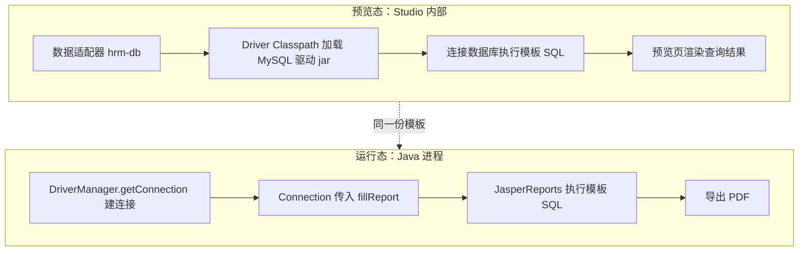
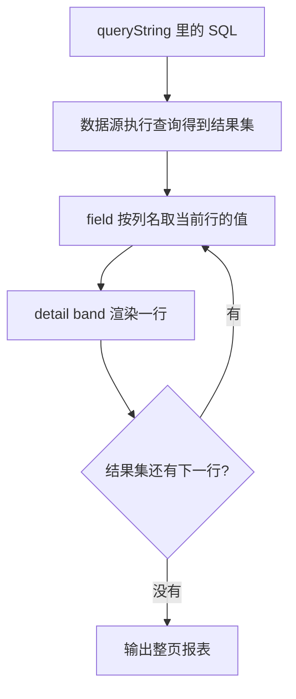
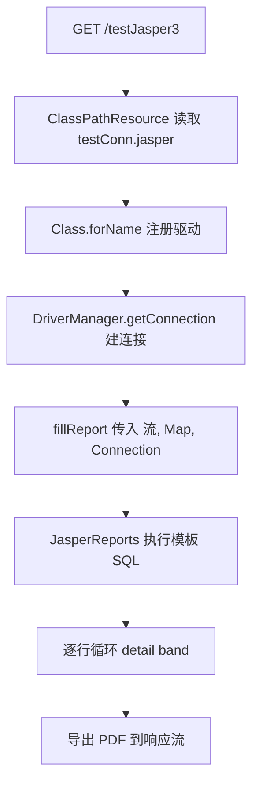
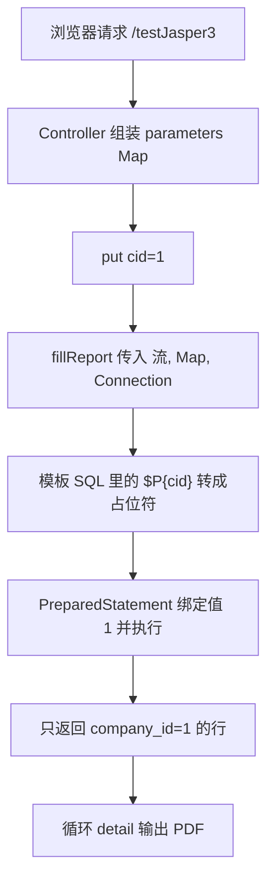

# Jdbc 数据源数据填充四步走：构造连接、fields、填充出 PDF 与条件传参

## 先给结论

- 四篇内容完成 JasperReports 列表报表的 JDBC 数据源填充：构造数据库模拟连接、构造 fields、传递 Connection 填充输出 PDF、用 parameter 给 SQL 传条件。
- 列表数据不适合 Parameter 逐个塞值，走 DataSource 填充，入口仍是 `fillReport`，变化在第三个参数换成真实数据源。
- Studio 里的 JDBC 连接只是预览用的模拟连接，运行期连接由 Java 代码传入；Studio 不带数据库驱动，要在 Data Adapter 里手动挂 MySQL 驱动 jar。
- detail band 有循环特性：编辑时画一行，填充时按结果集行数自动复制；field 的 name 必须与结果集列名一致，Read Fields 可按查询结果自动生成。
- Java 侧用 `Class.forName` 加 `DriverManager.getConnection` 构造连接，`fillReport` 直接接收 `Connection`，模板里的 SQL 由引擎自行执行。
- 条件过滤用 `$P{cid}` 占位，引擎转成 PreparedStatement 问号传参；`$P!{cid}` 直接织进 SQL 文本能做动态排序，接用户输入就是注入漏洞。
- 模板参数名要与 Java 侧 Map 的 key 完全一致；模板改完必须重新编译并覆盖 `.jasper`，Java 代码加载的永远是编译产物。
- 一次真实的 Unknown Host 翻车提醒连接三要素的重要性：URL、用户名、密码与普通 JDBC 完全一致。
- 主线是「连接、字段、填充、传参」四步，每一步都有可以直接复用的成例代码。

## 第1部分：列表报表登场：为模板准备 JDBC 数据源

Parameter 填充把单值传进模板已经没问题了，但需求一变就露出短板：用户表里有一百条记录，要把每一条都作为一行罗列在 PDF 里，难道手动 put 一百次？Parameter 比较适用于单个属性值的传递，批量列表需要另一种填充方式：数据源。这一节先解决前置问题，让模板开发环境连上数据库。

### Parameter 玩不转的列表场景

把需求摆出来：用户表有十条数据，报表就要渲染十行，每行是 id、用户名、手机号这类字段。对 Parameter 来说，它是按名字取值的单槽位，十条数据意味着十个名字各不相同，数量还不定，模板根本没法提前画。这正是数据源填充的适用场景：模板只画一行，值由数据源逐行喂进去。

`fillReport(InputStream, Map, JRDataSource)` 的第三个参数就是干这个的。它是一系列数据源形态的统称：可以是一个 JDBC 连接，让 JasperReports 自己执行模板里的 SQL；也可以是 JavaBean 的数组或者集合，由代码查好数据再交给模板。从这里开始走 JDBC 连接这条路，它最省代码，模板里直接写 SQL。这条路的分工也最清楚：SQL 写在模板里，字段名与查询结果列名对齐，Java 侧只负责递连接，查询、遍历、装填全部由报表引擎完成；换 JavaBean 数据源时，取数才回到代码手里，两种路线各有所长，本课先用最省代码的那种。

### 在 Studio 里造一个 JDBC 数据适配器

做模板时有个现实问题：detail band 里摆了字段，不连库就预览不出效果，版式无从调起。Studio 因此允许在工程里创建「数据适配器」，用一条真实连接把数据取回来辅助预览。

操作入口在 Repository 面板：在 Data Adapters 上右键，Create Data Adapter，类型列表里能模拟的数据源有很多，Database JDBC Connection 是这里要选的，此外还支持 MongoDB 连接、Hive 连接、JSON 文件、JavaBean 集合等一大堆类型。要用哪种数据源做模拟，就创建哪种适配器。

选中 Database JDBC Connection 后逐项填写，向导里的关键输入整理成配置如下：

```properties
# Data Adapter: Database JDBC Connection
Name=hrm-db
JDBC Driver=com.mysql.jdbc.Driver
JDBC URL=jdbc:mysql://localhost:3306/ihrm
Username=root
Password=******
```

名称只用于在 Studio 内部识别，随意取；驱动下拉定位到 MySQL Connector/J；URL 指向人事管理系统库 `ihrm`；账号密码按本机数据库填写。URL 里建议像工程配置一样带上字符集参数 `useUnicode=true&characterEncoding=utf8`，否则预览结果里的中文可能变成问号，让人误判成模板字体问题。

配置面板底部有三个标签页，其中 Driver Classpath 决定 Studio 用哪个驱动 jar 去建连接。Studio 发行包不带 MySQL 驱动，这里要手动 Add，把课程资料第十天资源里的 `mysql-connector-java-5.1.42.jar` 加进来。配置完成后点 Test，返回 Succeeded 说明模拟连接可用，保存收工。

### 预览连接与运行连接是两回事

这是本节最容易被带偏的认知点。Studio 里配的适配器，服务对象是「设计模板的人」，让你在 Preview 标签页里看到真实查询结果，从而调整版式。等到 Java 侧真正填充时，这份配置不会参与运行，连接由代码里 `DriverManager.getConnection()` 造出来，直接作为 `fillReport` 的第三个参数传进去。



两条路径用的是同一份模板，连接来源却完全不同。理解了这一点，后面在代码里看到 `getConnection()` 就不会觉得与 Studio 的配置重复。

## 第2部分：模板里接住查询结果：构造 Fields 与 detail band 的循环特性

数据适配器连上了，模板的 detail band 还是一块空板子：查询结果的一行行数据，得有人去「接」。JasperReports 用 field 承担这个角色，这一节在模板里把 SQL、field 和 detail band 三者串起来，为代码侧传 Connection 做好全部准备。

### detail band：画一行，出 N 行

先删 band。新模板自带 Title、Page Header、Column Header、Detail、Column Footer、Page Footer 一整排区域，本例只保留 Title 与 Detail，其余逐个删除，报表结构越简单越好维护。

detail band 的特性值得单独强调：它的内容会根据查询出来的列表自动循环填充。编辑时只需要构造一行格子，如果查到 10 条数据，填充器就按这一行的版式复制出 10 条。这个特性只在 detail 区域有效，title 这些 band 从头到尾只渲染一次。模板开发者因此可以把注意力集中在「一行长什么样」上，行数交给数据。与 band 配套的还有 Fields 面板：模板里声明了哪些 field，这里就列出哪些，把 field 拖进 detail 的文本框时，Studio 自动生成 `$F{字段名}` 表达式，$F 前缀就是 field 取值的标记，与 $P 代表 parameter、$V 代表 variable 一起构成模板表达式的三大前缀。

### Dataset and Query：把 SQL 写进模板

JDBC 数据源模式下，查询语句由模板自己携带。在模板根节点上右键，打开 Dataset and Query 对话框，要做三件事。

**第一，选语言与数据源。** 查询语言选 sql；数据源下拉选上一节建好的 `hrm-db` 适配器，告诉 Studio 这条查询去哪执行。

**第二，写查询语句。** 没写 SQL 时对话框右侧是一个红叉状态，输入 `select * from bs_user`，即人事系统用户表的全量查询。

**第三，Read Fields。** 点下 Read Fields，Studio 会真的执行这条语句，拿到结果集的元数据，把所有列自动导入为 field：id、mobile、username、password、enable_state、create_time、department_id、time_of_entry、form_of_employment，类型默认 `java.lang.String`。导入完成后左侧 Outline 的 Fields 节点下就能看到它们，不需要手动逐个创建。导入完成后顺手核对类型：日期列若被推断成 String，排序与格式化都会受限，必要时手动把 class 改成 java.util.Date 或 BigDecimal。

全字段导入后做删减：报表只展示编号、用户名、手机号、所属企业、所属部门这几列，把头像、密码等无关 field 批量勾选删除。`select *` 一次查回所有列再丢掉大半，正式系统里应把 SQL 收窄成明确的列清单，这里为演示流程从简。

Read Fields 推断出的类型并不总是合理：enable_state 这类状态列被导成 String 后，表达式里做数值比较要显式转换；create_time 被导成 String 后，无法直接套日期 pattern 做格式化。遇到这类列，在 Outline 里选中对应 field，把 class 改成 java.lang.Integer 或 java.util.Date 即可，模板版式与 SQL 都不用动，预览时按新类型取值，格式化能力随之恢复。

### 模板里的 SQL 与 field 长什么样

上述操作最终落在 `jrxml` 的两个节点上（模板源文件未随资料包提供，以下片段为按本课写法补全的示例）：

```xml
<queryString language="SQL">
    <![CDATA[select * from bs_user]]>
</queryString>
<field name="id" class="java.lang.String"/>
<field name="username" class="java.lang.String"/>
<field name="mobile" class="java.lang.String"/>
<field name="company_name" class="java.lang.String"/>
<field name="department_name" class="java.lang.String"/>
```

`queryString` 是模板携带的查询，`field` 是结果集的映射声明。后续在 detail band 里从 Fields 面板把 field 拖进设计区，数据就接上了。三者的关系如下图：



循环发生在 field 取值与 band 渲染这一层，一行格子配合 N 行数据，就是列表报表的全部秘密。detail band 的高度也要留意：编辑时画的那行格子有多高，填充出的每条记录就占多高，行间想留空隙直接加高 band 或画分隔线，不要靠多打空行，那会让每条数据都重复渲染一遍空行。

## 第3部分：把 Connection 交给 fillReport：JDBC 数据源填充输出 PDF

模板里 SQL 有了、field 有了，就差最后一步：Java 侧把数据库连接递给填充器，让浏览器里出现一份带真实用户列表的 PDF。这一步代码量不大，但连接串写错一个字符就会当场报错，演示过程正好完整踩了一次。

### 把一行数据排进 detail

从 Fields 面板把 `id`、`username`、`mobile`、`company_name`、`department_name` 逐个拖进 detail band。注意每个 field 拖进去会生成两个元素：一个 Static Text 显示字段名，作用相当于 Label，说明这一列是什么；一个 Text Field 绑定 `$F{字段名}`，这才是取数据的地方。列表报表通常不需要每行重复字段名，把 Static Text 全部删掉，只留 Text Field，再做水平对齐。

中文内容照例设置字体（华文宋体）、字号与水平垂直居中；需要表格线时选中整行元素统一加边框，粗细调到 1.5 左右。保存后用 Preview 预览，数据已经查出来，但版式可能很怪：detail band 高度默认一百多像素，一行数据占了半页，看起来像每个用户独占一大块。处理办法是把 band 的 height 改成与字段元素一致的高度，比如字段高 30 像素，band 就改 30 像素，再把所有元素上移贴齐 band 顶。重新预览，紧凑的单行列表就出来了。

**这里藏着 detail band 的一个核心认知：band 高度就是一行数据的高度。** 预览时看到的长长一串，是同一行版式被循环了 N 次的结果，版式怪先查 band 高度。

### Controller：构造连接并填充

编译模板得到 `testConn.jasper`，拷入工程 `resources/templates`。代码可以从上一个 Controller 复制改造，资料包工程的 `JasperController03` 是最终形态（包名已改为 `com.example`）：

```java
@RestController
public class JasperController03 {

    /** 基于JDBC数据源的形式填充数据 */
    @GetMapping("/testJasper3")
    public void createPdf(HttpServletRequest request, HttpServletResponse response) throws Exception {
        //1.引入jasper文件
        Resource resource = new ClassPathResource("templates/testConn.jasper");
        FileInputStream fis = new FileInputStream(resource.getFile());

        //2.创建JasperPrint,向jasper文件中填充数据
        ServletOutputStream os = response.getOutputStream();
        try {
            Map parameters = new HashMap<>();
            //查询企业id为1的所有用户
            parameters.put("cid", "1");

            //获取数据库连接
            Connection conn = getConnection();
            JasperPrint print = JasperFillManager.fillReport(fis, parameters, conn);
            JasperExportManager.exportReportToPdfStream(print, os);
        } catch (JRException e) {
            e.printStackTrace();
        } finally {
            os.flush();
        }
    }

    public Connection getConnection() throws Exception {
        Class.forName("com.mysql.jdbc.Driver");
        Connection conn = DriverManager.getConnection("jdbc:mysql://localhost/ihrm", "root", "111111");
        return conn;
    }
}
```

与 Map 填充版相比只有两处变化：第三参从 `JREmptyDataSource` 换成 `Connection`；模板不再依赖外部传入的单值，parameters 可以为空 Map。本例的 parameters 里放了一个 `cid`，配合模板 SQL 里的 `$P{cid}` 做条件过滤（只查企业 id 为 1 的用户），这是 Parameter 与数据源配合的典型姿势：数据源管行，参数管条件。

`getConnection()` 就是教科书式 JDBC：`Class.forName` 注册驱动，`DriverManager.getConnection` 按 URL、用户名、密码建连接，最后把连接返回。`com.mysql.jdbc.Driver` 是 MySQL 5.x 的驱动类名，换 8.x 驱动时要改成 `com.mysql.cj.jdbc.Driver`，并在 URL 上补时区参数。演示代码为求快用了最原始的写法，正式工程应交给连接池管理。

### 一次真实的翻车：Unknown Host

演示过程连出过一次事故：启动后访问 `/testJasper3`，浏览器迟迟不渲染，控制台报 `UnknownHostException`，提示主机名有问题。回到代码检查连接部分，原因是 URL 手打时把主机名写错了，`DriverManager` 拿着一个坏的 `localhost` 字符串去做解析，直接失败。这类问题报错位置很低层（DNS 解析），但根因就是连接串拼写，逐字符比对即可修复。修正后重启，浏览器里用户列表按行铺开，与 Studio 预览的效果完全一致。



关键差异在 E 到 F 这两步：填充器拿到连接后不再需要外部喂数据，取数动作内化到报表引擎里，Java 代码只负责把连接递进去。

## 第4部分：用 Parameter 给模板 SQL 传条件：JDBC 数据源的条件过滤写法

JDBC 数据源版模板跑通之后，浏览器里的用户列表是全量的：`bs_user` 表里躺着所有入驻企业的用户，一股脑全打出来了。SaaS 场景下这不成立，任何一家企业触发打印，期望的都是「只打本企业的员工」。模板里的 SQL 是编译时固化的，条件显然要靠运行时传进去，这正是 Parameter 与 Connection 配合要解决的事。

### 需求与整体链路

多租户过滤的诉求一句话就能说清：查询条件由调用方决定，模板只负责版式。整条链路上，条件值从浏览器一路走到 SQL，经过四个环节：



关键在 E 到 F 这两步：`$P{}` 不是把值抄进 SQL 文本，而是登记成一个 JDBC 参数，真正执行时由 PreparedStatement 绑定。这也决定了它能防注入，后面展开。

### 模板侧：建 Parameter，改 SQL

在 Jaspersoft Studio 里做两件事。

**第一，声明参数。** 在 Outline 面板找到 Parameters 节点，右键 Create Parameter，名字填 `cid`（取 company id 的缩写），Class 选 `java.lang.String`，Default Value Expression 留空。Parameters 这个集合在模板里有两类用途：承接外部传入的展示值（比如前几节用 Map 填的 `username`），以及给 SQL 语句传递查询条件，这里用的是第二种。

**第二，改查询语句。** 右键模板根节点打开 Dataset and Query 对话框，在原有语句上追加 WHERE 条件：

```sql
select * from bs_user
where company_id = $P{cid}
```

`$P{cid}` 就是刚才声明的那个参数。改完直接点 Preview，Studio 会弹出一个参数输入框要求填 `cid` 的值，输入 `1` 之后，预览结果里全部是 `company_id` 为 1 的用户，与浏览器里看到的全量列表对比，明显少了其他企业的记录。模板侧到此完成，编译并把新的 `testConn.jasper` 拷到工程的 `resources/templates` 覆盖旧文件。

### Java 侧：key 对上名字就通了

资料包工程里的 `JasperController03` 就是这一版的最终形态（包名已改为 `com.example`）：

```java
@RestController
public class JasperController03 {

    /** 基于JDBC数据源的形式填充数据 */
    @GetMapping("/testJasper3")
    public void createPdf(HttpServletRequest request, HttpServletResponse response) throws Exception {
        //1.引入jasper文件
        Resource resource = new ClassPathResource("templates/testConn.jasper");
        FileInputStream fis = new FileInputStream(resource.getFile());

        //2.创建JasperPrint,向jasper文件中填充数据
        ServletOutputStream os = response.getOutputStream();
        try {
            Map parameters = new HashMap<>();
            //查询企业id为1的所有用户
            parameters.put("cid", "1");

            //获取数据库连接
            Connection conn = getConnection();
            JasperPrint print = JasperFillManager.fillReport(fis, parameters, conn);
            JasperExportManager.exportReportToPdfStream(print, os);
        } catch (JRException e) {
            e.printStackTrace();
        } finally {
            os.flush();
        }
    }

    public Connection getConnection() throws Exception {
        Class.forName("com.mysql.jdbc.Driver");
        Connection conn = DriverManager.getConnection("jdbc:mysql://localhost/ihrm", "root", "111111");
        return conn;
    }
}
```

与上一版相比只多了一行 `parameters.put("cid", "1")`。这里的对应关系是硬性的：Map 的 key 必须等于模板里 Parameter 的 name，`cid` 对 `cid`，写错一个字母引擎就取不到值，SQL 里的占位符拿不到绑定参数。实际项目里 `1` 当然不会写死，而是取自当前登录用户所属企业的 id， Map 里放什么，SQL 里就过滤什么。

### $P 与 $P!：两种语法，两种命运

同一个参数在 SQL 里有两种写法，行为完全不同。

**`$P{cid}` 是参数化占位。** 引擎执行时把 SQL 改写成 `where company_id = ?`，值通过 `setString` 绑定。值永远是值，不会参与 SQL 语法结构的解析，类型也由模板里声明的 Class 约束。条件过滤一律用它。

**`$P!{cid}` 是文本拼接。** 感叹号版本会在拼装 SQL 阶段把值原样织入语句文本，适合那些无法参数化的片段，比如动态排序字段：

```sql
select * from bs_user order by $P!{orderBy}
```

代价是注入风险原样暴露。假如 `orderBy` 来自前端且未做白名单校验，攻击者传入 `company_id; drop table bs_user` 之类的片段，语句就被改写了。所以约定很明确：值走 `$P{}`，只有排序字段、表名这类结构片段才允许走 `$P!{}`，且必须配白名单校验。演示里如果图省事写成 `where company_id = $P!{cid}`，功能上碰巧能跑，性质上已经埋雷。

顺带一提类型问题：示例里 `cid` 声明为 String，而 `company_id` 是数值列，MySQL 会做隐式转换所以结果正确，但隐式转换可能让索引失效。正式项目里参数 Class 与列类型保持一致更稳。

## 常见误区

- **以为 Studio 的连接就是程序用的连接**：Studio 适配器只服务于预览，运行期不读这份配置。程序里要单独建连接，两边密码改了要各自改。
- **Test 直接报驱动类找不到**：没在 Driver Classpath 里加入 MySQL 驱动 jar 就点 Test。先把 `mysql-connector-java` 的 jar 添加进去再测。
- **连接 URL 漏写库名或端口**：`jdbc:mysql://localhost:3306/` 后面不带库名，预览时列表为空还以为模板画错了，实际是查错了库。
- **field 名与列名对不上**：数据库列叫 `company_name`，field 写成 `companyName`，取值为空白。JDBC 模式下 field name 必须与结果集列名一致，用 Read Fields 自动导入就是为了避免手写错。
- **把 field 拖进 title band 期望循环**：title 只渲染一次，只会显示第一行的值。按行循环只有 detail band 支持。
- **`select *` 原样上线**：全列查询再删 field，带宽和内存都浪费在用不到的列上。正式报表应写明确的列清单，只查展示列。
- **连接 URL 手打出错**：主机名拼错、少冒号少斜杠，报 `UnknownHostException` 或连接超时。URL 是最高频的出错点，建议从配置文件复制而不是手敲。
- **驱动类名与驱动版本不匹配**：5.x 用 `com.mysql.jdbc.Driver`，8.x 用 `com.mysql.cj.jdbc.Driver` 且 URL 需要加 `serverTimezone`，混用会报驱动类找不到或时区异常。
- **Connection 用完不还**：演示代码没处理连接关闭，生产环境必须归还连接池或用 try-with-resources 关闭，否则频繁导出报表会耗尽连接。
- **band 高度与字段不匹配**：字段只有 30 像素，band 却有一百多像素，每行之间出现大片空白。band 高度按一行内容的最小高度设置。
- **Map 的 key 与参数名对不上**：模板里叫 `cid`，代码里 `put("cId", ...)`，引擎取不到值，预览正常而程序输出异常。两边逐字符核对即可解决。
- **改了 jrxml 忘记重新编译覆盖**：Java 加载的是 `.jasper` 编译产物，Studio 里的修改不导出就不生效，表现为「模板明明改了，输出还是老样子」。
- **条件值走 `$P!{}` 拼接**：用户可控输入直接织进 SQL 文本等于放弃防护，注入一打一个准。结构片段才允许 `$P!{}`，且要白名单。
- **参数类型与列类型不一致**：String 对数值列多数数据库能隐式转换，但存在索引失效与精度问题，声明参数时按列类型选 Class。

## 面试可能被问到的问题

1. 面试官追问：「Parameter 和 DataSource 两种填充方式怎么选？」
   答：个数固定、单值的数据（标题、查询条件、图片路径）走 Parameter；按行展开的列表数据走 DataSource。实际报表往往两者混用，数据源出明细，参数出表头与条件。

2. 面试官追问：「`fillReport` 的数据源参数可以传哪些东西？」
   答：凡是 `JRDataSource` 的实现都可以，比如空数据源、JavaBean 集合数据源、表格模型数据源；另外它还接受直接传 `Connection` 的重载形式，由 JasperReports 按模板内的 SQL 自行查询。

3. 面试官追问：「为什么要在 Studio 里配置一个模拟数据源？」
   答：为了让模板在设计期就能预览到真实查询结果，方便调整 detail band 的版式。它只存在于设计期，运行期连接由 Java 代码传入，两者互不影响。

4. 面试官追问：「Studio 点 Test 报 ClassNotFound，怎么处理？」
   答：Studio 不会自动使用项目里的驱动，需要在数据适配器的 Driver Classpath 标签页手动添加 MySQL 驱动 jar，添加成功后重新 Test 验证连通。

5. 面试官追问：「SQL 写在模板里有什么隐患？」
   答：查询逻辑分散在模板和代码两处，改表结构要重新编译模板；参数拼进 SQL 还要区分预编译占位与字符串拼接两种写法，拼接写法存在注入风险。优点是简单报表开发效率高，取数动作完全交给报表引擎。

6. 面试官追问：「field 和 parameter 有什么区别？」
   答：parameter 是从程序外部传入的单值，按名字传递，与查询结果无关；field 对应查询结果集的一列，值随行变化。parameter 相当于方法入参，field 相当于每行记录里的字段。

7. 面试官追问：「detail band 为什么只画一行就能输出多行？」
   答：填充引擎对结果集逐行迭代，每迭代一次就按 detail band 的版式实例化一个 band 副本，填入当前行的 field 值。模板里的一行是版式模板，不是固定内容。

8. 面试官追问：「Read Fields 做了什么？」
   答：它执行 query text 里的 SQL，读取结果集元数据（列名与类型），把每一列生成一个 field 声明写回模板，省去手工创建并避免拼写错误，属于设计期的提效功能。

9. 面试官追问：「查询语句为什么可以写在模板里？」
   答：JDBC 数据源模式下，模板拿到连接后自行执行 query text 完成取数，Java 侧只需传 Connection。这简化了代码，但查询逻辑分散到模板中；复杂查询与动态条件更适合在代码里查好数据再走 Bean 数据源。

10. 面试官追问：「field 的类型声明有什么讲究？」
   答：field 的 class 决定取值后的 Java 类型，应与列的实际类型匹配；日期、数值列声明成 String 会失去格式化能力。Read Fields 会按元数据推断类型，手动建 field 时要自己保证一致。

11. 面试官追问：「传 Connection 给 fillReport 后，内部发生了什么？」
   答：填充器读取模板的 query text，用传入的连接创建 Statement 执行 SQL，得到 ResultSet 后按 field 名逐列取值，对结果集逐行循环填充 detail band，最后返回填充完成的 JasperPrint。

12. 面试官追问：「JDBC 数据源方式和 Bean 集合数据源方式怎么选？」
   答：简单固定报表直接传 Connection，模板自带 SQL，代码最少；数据需要多表聚合、权限过滤或来自多个服务时，在代码里组装好 List 再用 Bean 数据源，查询逻辑留在应用层，模板只管版式。

13. 面试官追问：「parameters 传了 cid，模板里怎么接？」
   答：模板 SQL 里用 `$P{cid}` 占位，填充时被替换为预编译参数，等价于 PreparedStatement 的问号占位；若写成 `$P!{cid}` 则是字符串拼接，直接把值织进 SQL 文本，灵活但有注入风险，只适合排序字段这类无法参数化的片段。

14. 面试官追问：「报表导出接口抛 UnknownHostException，怎么排查？」
   答：该异常说明主机名解析失败，优先检查 JDBC URL 的主机部分是否拼写正确，再查网络与 hosts 配置。演示中就是 URL 手打错误，逐字符比对连接串即可定位。

15. 面试官追问：「这段代码放到生产环境要补哪些东西？」
   答：至少三处：连接改走连接池，避免每次请求建连；异常不要只 printStackTrace，要转成统一错误响应并记录日志；finally 里关连接与输出流。另外模板文件建议加缓存，避免每次请求重复读磁盘反序列化。

16. 面试官追问：「`$P{}` 和 `$P!{}` 有什么区别？」
   答：`$P{}` 是参数化占位，引擎把它改写成 JDBC 的问号占位符，值通过 PreparedStatement 绑定，安全且类型受控；`$P!{}` 是文本拼接，值原样织入 SQL 字符串，只适合排序字段、表名等无法参数化的结构片段，且必须做白名单校验，否则有注入风险。

17. 面试官追问：「Parameter 和 Field 在模板里各扮演什么角色？」
   答：Parameter 是单值输入，一次填充一个值，常用于标题、条件、排序控制；Field 对应数据源的每一行，SQL 数据源下是结果集的列，Bean 数据源下是对象属性，在 detail 循环里逐行取值。一个管「传进来什么」，一个管「每一行长什么样」。

18. 面试官追问：「为什么用 `$P{}` 就能防 SQL 注入？」
   答：因为它最终走 PreparedStatement 通道，SQL 结构与数据在两条通道上传递，数据库先解析带占位符的语句结构，再绑定参数值，值里的任何字符都不会被当成 SQL 语法执行。而字符串拼接把两者混在一条通道里，值就有了改变语句结构的机会。

19. 面试官追问：「模板改了但接口输出没变化，可能是什么原因？」
   答：最常见的是没有重新编译 jrxml，或者编译后没有把新的 .jasper 覆盖到工程的 resources 目录；也可能是接口读取的路径与实际覆盖的路径不一致，或有旧的编译产物缓存。按「改模板、编译、覆盖、重启」的顺序核对一遍。

20. 面试官追问：「多租户报表除了在 SQL 里拼条件，还有什么实现思路？」
   答：可以在应用层把当前租户的数据先查出来，组装成对象列表再用 Bean 数据源填充，模板完全不带 SQL；也可以在数据源层做租户隔离，让连接默认带上租户过滤条件。核心原则是租户过滤不能依赖前端传值，要从登录态推导。

## 配套资料

- 工程依赖与数据库配置（MySQL 驱动坐标、`ihrm` 库连接信息）：`materials/code/02/day10-用户档案PDF报表/day10-用户档案PDF报表/代码/jasper-springboot/pom.xml`、同工程 `src/main/resources/application.yml`
- 数据适配器与模板 `testConn.jrxml` 的制作过程未随资料包提供源文件，配置项与操作路径按课程视频画面还原，示例为按本课写法补全
- 本课对应的 Spring Boot 工程与依赖：`materials/code/02/day10-用户档案PDF报表/day10-用户档案PDF报表/代码/jasper-springboot/pom.xml`（数据源填充控制器在同工程 controller 包内）
- `testConn.jrxml` 模板与 query text、field 定义未随资料包提供，文中 XML 片段为按本课写法补全的示例
- JDBC 数据源填充的完整 Controller 与 `getConnection` 方法（包名已改为 `com.example`）：`materials/code/02/day10-用户档案PDF报表/day10-用户档案PDF报表/代码/jasper-springboot/src/main/java/` 下 controller 包内 `JasperController03.java`
- 工程配置（端口 8181、`ihrm` 库连接信息）：同工程 `src/main/resources/application.yml`，依赖见 `pom.xml`
- `testConn.jrxml` 模板源文件未随资料包提供，版式与 band 高度调整过程按课程视频画面还原，示例为按本课写法补全
- 代码：`materials/code/02/day10-用户档案PDF报表/day10-用户档案PDF报表/代码/jasper-springboot/src/main/java/` 下 controller 包内 `JasperController03.java`（包名已改为 `com.example`）
- 工程 `pom.xml`（jasperreports 6.5.0 依赖）与 `src/main/resources/application.yml`（8181 端口、ihrm 库连接）
- 模板 `testConn.jrxml` 未随资料包提供，Parameter 声明与 SQL 改动步骤按课程操作还原，示例为按本课写法补全
