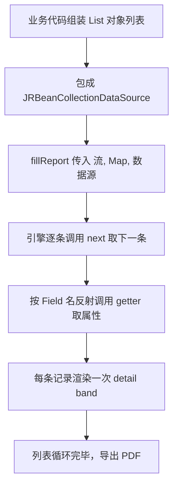

# JavaBean 数据源填充：把 List 交给报表引擎

Connection 版模板有个让人不踏实的地方：数据库连接整个交给了报表引擎，什么时候用、用完谁关，主动权都不在自己手里，连接泄漏的隐患始终悬着。更何况真实业务里，报表数据往往不是一条 SQL 能查出来的，可能要聚合多个服务的结果。更贴合工程实践的做法是：Java 侧把数据组装成对象列表，包成一个数据源对象递给模板。这就是 JavaBean 数据源，也是业务系统里最常用的填充方式。

## 先给结论

- 模板里 Field 的 name 必须与实体类属性名一字不差，引擎靠反射调用 getter 取值。
- JDBC 版的字段可以用查询语句一键生成，Bean 版只能手动 Create Field，一个属性一个。
- Java 侧两步走：组装 `List<User>`，再 `new JRBeanCollectionDataSource(list)`，替换 `fillReport` 的第三个参数。
- `JRBeanCollectionDataSource` 实现的是 `JRDataSource` 接口，与 Connection 版本同属一个体系，只是取数动作从引擎内挪到了引擎外。
- parameters 传空 Map 即可，列表数据走的是另一个通道。

## 为什么换成 Bean 数据源

**第一，连接管理回归应用侧。** 传 Connection 给 `fillReport`，取数在引擎内部发生，连接的关闭时机由模板填充流程决定；改成 Bean 数据源后，查询、组装、关闭连接全部发生在业务代码里，报表引擎只接收现成的内存数据，资源边界清晰。

**第二，数据来源不再受限。** 一条 SQL 能查出来的数据当然可以直接给连接；但跨服务聚合、带权限过滤、需要二次加工的数据，在 Java 代码里组好列表再喂给模板，模板不用感知数据从哪来。

整条链路可以这样理解：



与 JDBC 版相比，D 到 E 这两步换了主角：从「引擎执行 SQL 逐列取值」变成「引擎反射读对象属性」。

## 模板侧：手动造 Field

新建一个 A4 模板 `testBean`，把用不到的 band 删到只剩 Title 和 Detail：Title 拖一个静态文本写标题，Detail 用来承载循环的明细行。

由于数据不再来自 SQL，Field 没法自动生成，要在 Outline 的 Fields 节点下逐个 Create Field。示例要传一个用户对象列表，属性有 `id`、`username`、`mobile`、`company`、`dept` 五个，全部建为 `java.lang.String`。这里有一条铁律：

**Field 的 name 必须与实体属性名一模一样。** 引擎填充时是按名字反射调用 `getId()`、`getUsername()` 这些 getter 的，名字差一个字母都取不到值。建好之后把五个 Field 拖进 Detail band，生成的表达式自然是 `$F{id}`、`$F{username}` 这样的形式；字体、居中、边框照常设置。

预览时会发现画面里全是 `null`，这是正常的：Studio 里没有默认数据源，Bean 版模板不弹参数输入框，数据要等 Java 侧传入。还有一处老规矩别忘：Detail band 的高度就是一行数据的高度，把默认的一百多像素改成与字段元素一致的 30 像素，否则列表行距会大到离谱。编译生成 `testBean.jasper`，拷入工程。

## 实体类与模拟数据

实体类就是普通的 JavaBean（包名已改为 `com.example`）：

```java
package com.example.domain;

public class User {
    private String id;
    private String username;
    private String company;
    private String dept;
    private String mobile;

    public User(String id, String username, String company, String dept, String mobile) {
        this.id = id;
        this.username = username;
        this.company = company;
        this.dept = dept;
        this.mobile = mobile;
    }

    // 五个属性的 getter 与 setter 省略，一个都不能少
}
```

getter 必须生成齐全，反射取值全靠它们。测试数据为了不依赖数据库，直接在代码里模拟一个列表：

```java
public List<User> getUserList() {
    List<User> list = new ArrayList<>();
    for (int i = 0; i < 10; i++) {
        User user = new User(i + "", "用户" + i, "云图科技", "讲师", "1380000000" + i);
        list.add(user);
    }
    return list;
}
```

真实项目里这个方法的位置就是一次业务查询：调 Service、查数据库、组装对象，返回的依然是这样一份列表。

## Controller：把数据源换进 fillReport

资料包工程的 `JasperController04` 是完整实现（包名已改为 `com.example`）：

```java
@RestController
public class JasperController04 {

    /** 基于javaBean数据源的形式填充数据 */
    @GetMapping("/testJasper4")
    public void createPdf(HttpServletRequest request, HttpServletResponse response) throws Exception {
        //1.引入jasper文件
        Resource resource = new ClassPathResource("templates/testBean.jasper");
        FileInputStream fis = new FileInputStream(resource.getFile());

        //2.创建JasperPrint,向jasper文件中填充数据
        ServletOutputStream os = response.getOutputStream();
        try {
            Map parameters = new HashMap<>();
            //1.获取到对象的list集合
            List<User> userList = getUserList();
            //2.通过list集合创建javaBean的数据源对象
            JRBeanCollectionDataSource ds = new JRBeanCollectionDataSource(userList);
            JasperPrint print = JasperFillManager.fillReport(fis, parameters, ds);
            JasperExportManager.exportReportToPdfStream(print, os);
        } catch (JRException e) {
            e.printStackTrace();
        } finally {
            os.flush();
        }
    }
}
```

与 Connection 版对比，骨架完全没动，变的只有两点：加载的模板换成 `testBean.jasper`；`fillReport` 第三参从 `Connection` 换成 `JRBeanCollectionDataSource`。`parameters` 保持空 Map，因为这张模板没有用任何单值参数。重启访问 `/testJasper4`，浏览器里出现 10 行用户数据，每行一条记录，列表效果与 SQL 版完全一致。

## 原理：都汇入 JRDataSource 这一个口子

`fillReport` 的第三个参数，本质类型是 `JRDataSource` 接口，它只约定了两个方法：`next()` 判断还有没有下一条记录，`getFieldValue(JRField)` 返回当前记录指定字段名的值。引擎的填充循环只认这个接口：

- 传 `Connection` 时，引擎内部把它包成 JDBC 数据源，执行模板 SQL，从 `ResultSet` 取列值；
- 传 `JRBeanCollectionDataSource` 时，引擎在列表上迭代，用反射调用属性同名 getter 取值；
- 什么都不传时给 `JREmptyDataSource`，循环零次，模板里只剩静态内容。

三种方式殊途同归，只是取数的位置不同。理解了这一点，「为什么 Field 名必须等于属性名」就有了答案：`getFieldValue` 拿着 Field 名 `company` 去反射找 `getCompany()`，对不上就是 `null` 或异常。

## 常见误区

- **Field 名与属性名不一致**：模板里建了 `userName`，实体属性是 `username`，反射找不到 getter，整列输出空白。两边命名严格对齐，建议直接复制属性名。
- **实体类漏生成 getter**：字段声明了但没生成 getter，同样取不到值。Bean 数据源对实体类的最低要求就是 getter 齐全。
- **复用带 SQL 的模板跑 Bean 数据源**：JDBC 版模板里留着 `queryText`，字段也是按结果集建的，换成 Bean 数据源后字段对不上。每种数据源配各自的模板。
- **Detail band 高度不改**：默认一百多像素的 band 配 30 像素的行元素，每条记录之间空出大片空白，看起来像报表坏了。band 高度对齐一行内容的最小高度。

## 面试可能被问到的问题

1. 面试官追问：「JRBeanCollectionDataSource 是怎么把对象属性填进模板的？」
   答：它实现 JRDataSource 接口，内部在传入的集合上迭代；引擎每调一次 next 前移一条记录，再按 Field 名反射调用实体类的 getter 拿属性值。所以 Field 名必须与属性名完全一致，且实体类要有对应 getter。

2. 面试官追问：「JDBC 数据源和 Bean 数据源怎么选？」
   答：数据能用一条 SQL 表达、报表自己管取数时，传 Connection 代码最少；数据需要聚合加工、跨服务获取或带复杂权限过滤时，在应用层组装 List 再用 Bean 数据源，查询逻辑留在业务代码里，模板只管版式。生产系统多数场景偏向后者。

3. 面试官追问：「fillReport 为什么有多个重载？」
   答：它是填充入口，第三参支持 Connection、JRDataSource 等不同形态，本质都是适配成统一的 JRDataSource 接口来循环取数。传 Connection 是引擎内建 JDBC 数据源的便捷方式，传 Bean 集合则是应用侧准备好数据后交由引擎迭代。

4. 面试官追问：「Bean 数据源方式下，连接什么时候释放？」
   答：连接不再进入报表引擎，生命周期完全由业务代码掌控。查询完组装好列表就该把连接归还连接池或关闭，填充阶段引擎只碰内存数据，不存在报表流程拖住连接的问题。

5. 面试官追问：「列表数据量很大时要注意什么？」
   答：JRBeanCollectionDataSource 要求整份列表先驻留内存，数据量大要考虑分页查询分批导出，或改用支持流式读取的 JRDataSource 实现，逐条从数据库或文件读取，避免一次性加载把堆撑爆。

## 配套资料

- 代码：`materials/code/02/day10-用户档案PDF报表/day10-用户档案PDF报表/代码/jasper-springboot/src/main/java/` 下 controller 包内 `JasperController04.java`、domain 包内 `User.java`（包名已改为 `com.example`）
- 工程配置：`materials/code/02/day10-用户档案PDF报表/day10-用户档案PDF报表/代码/jasper-springboot/src/main/resources/application.yml`
- 模板 `testBean.jrxml` 未随资料包提供，Field 创建与 band 调整过程按课程操作还原，示例为按本课写法补全
