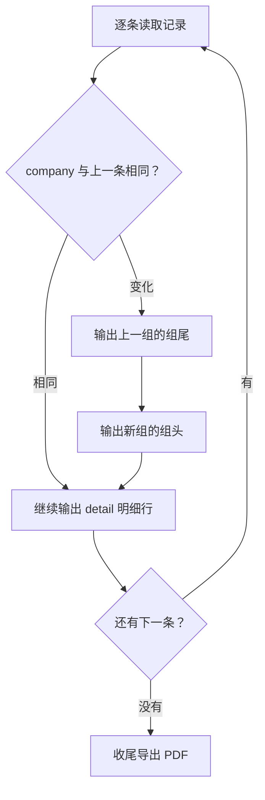

# 分组报表输出 PDF：切组靠顺序，排序是隐形前提

分组模板做好了，剩最后一段路：中文样式收尾、编译、接入 Controller、造出两家企业的演示数据、浏览器里看效果。这条路不难走，但终点处藏着一个最容易忽视的隐形前提：数据顺序。分组成败一半在模板，另一半就在送进来的数据有没有按分组字段排好。

## 先给结论

- 分组报表的填充代码与普通 Bean 列表报表完全一致，换模板即可，没有任何分组 API。
- 引擎切组的方式是逐条比较相邻记录的分组字段值，值变了才切段，它自己不排序。
- 演示数据先 10 条云图科技、再 5 条星河软件，顺序天然满足分组要求，输出两段。
- 数据乱序时同一企业的员工会穿插成多个小段，修复靠排序：SQL 数据源用 `ORDER BY`，列表数据源先 `sort` 再包数据源。
- 模板内的 `sortField` 可以兜底排序，但大数据量优先在查询层完成。

## 收尾与编译

模板细节上还差三件事：全部文本元素统一设为华文宋体 12 号，保证中文不出乱码；明细行与组名加边框，方便观察分段；文字水平垂直居中。中文字体之所以能生效，是因为工程里带了字体扩展注册，`resources` 下的 `jasperreports_extension.properties` 指向了 `stsong/fonts.xml`，为 PDF 导出注册了宋体字体。这些都做完，编译模板得到 `testGroup.jasper`，拷入工程的 `resources/templates`。

Controller 从上一个复制改造，只改模板路径与访问路径，数据仍走 Bean 数据源。

## Controller 与两组演示数据

资料包工程的 `JasperController05` 是完整实现（包名已改为 `com.example`），重点在两组演示数据的构造：

```java
@RestController
public class JasperController05 {

    /** 分组报表 */
    @GetMapping("/testJasper5")
    public void createPdf(HttpServletRequest request, HttpServletResponse response) throws Exception {
        //1.引入jasper文件
        Resource resource = new ClassPathResource("templates/testGroup.jasper");
        FileInputStream fis = new FileInputStream(resource.getFile());

        //2.创建JasperPrint,向jasper文件中填充数据
        ServletOutputStream os = response.getOutputStream();
        try {
            Map parameters = new HashMap<>();
            //1.获取到对象的list集合
            List<User> userList = getUserList();
            //2.通过list集合创建javaBean的数据源对象
            JRBeanCollectionDataSource ds = new JRBeanCollectionDataSource(userList);
            JasperPrint print = JasperFillManager.fillReport(fis, parameters, ds);
            JasperExportManager.exportReportToPdfStream(print, os);
        } catch (JRException e) {
            e.printStackTrace();
        } finally {
            os.flush();
        }
    }

    public List<User> getUserList() {
        List<User> list = new ArrayList<>();
        for (int i = 0; i < 10; i++) {
            User user = new User(i + "", "yuntu" + i, "云图科技", "讲师", "1380000000" + i);
            list.add(user);
        }
        for (int i = 0; i < 5; i++) {
            User user = new User(i + "", "xinghe" + i, "星河软件", "讲师", "1380000000" + i);
            list.add(user);
        }
        return list;
    }
}
```

填充四件套与 `/testJasper4` 一模一样：空 Map、列表、`JRBeanCollectionDataSource`、`fillReport`。变化全在数据里：前 10 条属于云图科技，用户名带 `yuntu` 前缀；后 5 条属于星河软件，用户名带 `xinghe` 前缀。两个前缀是为了在 PDF 里一眼分辨记录属于哪家公司。

重启微服务，浏览器访问 `/testJasper5`：第一段组头写「以企业名称分组：云图科技」，跟 10 行明细；第二段组头写「以企业名称分组：星河软件」，跟 5 行明细。分组生效，段落清晰。

## 排序陷阱：引擎只检测变化，不负责排序

看到正确输出先别急着收工，问一句：分组成功是因为模板写对了，还是因为数据恰好排好了？答案是后者占了一半。

引擎处理分组的方式是逐条读记录、求分组表达式、与上一条比较，值不同就认为进入新组。整个过程没有任何排序动作，数据的先后顺序原样决定组的先后与切分点：



对照这张图推演两种数据。演示数据是「10 条云图 + 5 条星河」，同值记录全部相邻，只切一次组，输出干净的两段。假如把同一份 15 条数据随机打乱，云图与星河交错出现，引擎每次遇到值变化就切一段，PDF 里会变成「云图 2 行、星河 1 行、云图 3 行、星河 4 行」这样碎成七八段的模样，组头组尾反复横跳，报表完全没法看。

所以分组的隐性契约是：**同组记录必须在数据流里相邻**。怎么保证？

**SQL 数据源，排序下推到数据库。** 模板走 Connection 时，把 `ORDER BY` 写进模板 SQL，让数据库按分组字段排好再返回：

```sql
select * from bs_user
where company_id = $P{cid}
order by company_name
```

**Bean 数据源，包装前先排序。** 列表在应用侧组装，那就先排再包：

```java
userList.sort(Comparator.comparing(User::getCompany));
JRBeanCollectionDataSource ds = new JRBeanCollectionDataSource(userList);
```

多级分组同理，按分组层级依次排：先按企业、再按部门，`Comparator.comparing(User::getCompany).thenComparing(User::getDept)`。数据量大的报表优先在查询层排序，让数据库的索引与排序能力干活；JasperReports 模板里也有 `sortField` 元素可以在填充前对记录排序，作为兜底手段可用，但它吃内存，不是大数据量的首选。

## 常见误区

- **以为 Group 自带排序**：模板加了组就默认数据会归位，实际上引擎只做相邻值变化检测。乱序数据不报错、不丢数据，只是段落碎掉，问题不容易第一时间定位。
- **数据来自 Map 等无序结构**：用 `HashMap` 之类装配记录再转列表，迭代顺序不受控，测试环境看着正常，换个环境组就穿插。装完显式排序再交引擎。
- **排序键与分组字段脱节**：按 `id` 排序但按 `company` 分组，id 的顺序把两家公司搅在一起，排序做了等于没做。排序键必须让分组字段形成连续区段。
- **多级分组只排第一级**：企业排好了、部门没排，第二级分组的组头会在企业段内反复出现。按分组层级逐级 `thenComparing`。

## 面试可能被问到的问题

1. 面试官追问：「分组报表数据乱序会发生什么，为什么？」
   答：引擎按相邻记录分组字段值是否变化来切组，乱序数据会让同一分组被切成多个碎段，组头组尾反复出现，报表可读性崩掉。原因是分组机制本身不含排序，它只依赖数据顺序。

2. 面试官追问：「怎么保证分组的正确性？」
   答：让同组记录相邻。SQL 数据源把 ORDER BY 写进查询，按分组字段排序；Bean 数据源在包装 JRBeanCollectionDataSource 之前用 Comparator 排好；多级分组按层级依次排序。也可以用模板 sortField 兜底，但优先在查询层解决。

3. 面试官追问：「模板里的 sortField 和 SQL 的 ORDER BY 怎么选？」
   答：ORDER BY 让数据库用索引和排序能力完成，数据在进入引擎前就有序，内存与 CPU 开销都小，是首选；sortField 在填充阶段对数据源记录做内存排序，适合数据源本身无法排序的场景，数据量大时开销明显，只作兜底。

4. 面试官追问：「分组的输出顺序由什么决定？」
   答：由数据到达顺序决定，排好序的数据里，分组值首次出现的位置就是该组输出的位置。模板里多个 group 的声明顺序决定层级嵌套关系，但组与组之间的先后完全跟着数据走。

5. 面试官追问：「分组报表在数据量很大时有什么风险？」
   答：一是 Bean 数据源整份列表驻留内存，要分页查询或流式数据源；二是组头组尾随分组个数增加而增多，组内汇总变量全部要在内存里维护，分组基数过大（比如按用户分组几十万个组）会明显变慢，这类报表更适合在数仓侧预聚合后再出。

## 配套资料

- 代码：`materials/code/02/day10-用户档案PDF报表/day10-用户档案PDF报表/代码/jasper-springboot/src/main/java/` 下 controller 包内 `JasperController05.java`（包名已改为 `com.example`）
- 字体扩展：`materials/code/02/day10-用户档案PDF报表/day10-用户档案PDF报表/代码/jasper-springboot/src/main/resources/jasperreports_extension.properties` 与同目录 `stsong/fonts.xml`
- 工程配置：`materials/code/02/day10-用户档案PDF报表/day10-用户档案PDF报表/代码/jasper-springboot/src/main/resources/application.yml`（8181 端口）
- 模板 `testGroup.jasper` 未随资料包提供，输出效果与数据构造按课程操作还原，示例为按本课写法补全
