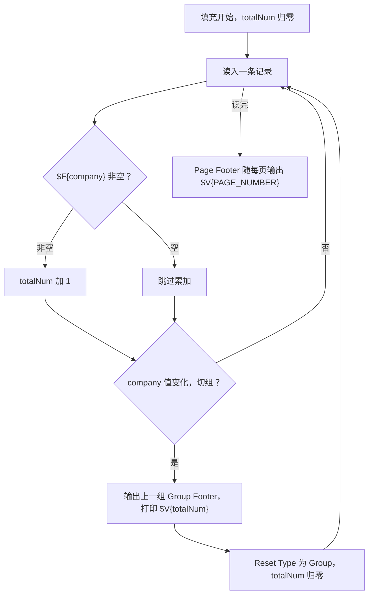

# 组尾小计与页脚页码：用 Variable 让报表引擎自己数数

分组报表跑通之后，需求又追加了两层：每组末尾要打一行「共计 N 条数据」的小计；纸的右下角要有页码，数据一多打印十几页时方便翻找。这两个数都不该由 Java 传参进来，数据本来就在填充过程里，让引擎自己数出来才是正路。

## 先给结论

- Variable（变量）是填充过程中由引擎动态计算的中间量；Parameter 是填充前定好的入参，两者分工不同。
- 组内小计：新建变量 `totalNum`，类型 Integer，Calculation 选 Count，Expression 写 `$F{company}`，Reset Type 必须改成 Group1。
- 把变量拖进 Group Footer，表达式拼成 `"共计：" + $V{totalNum} + " 条数据"`。
- 页码用内置变量 `$V{PAGE_NUMBER}`，放进 Page Footer band 即可；Page Footer 被删过就在 Outline 里右键 add band 加回来。
- Java 填充代码零改动，整场只动模板，改完重新编译拷贝 `testGroup.jasper` 即可。

## 统计数据为什么找 Variable 而不是找 Java

数据源里是一条条用户记录，云图科技 10 条、星河软件 5 条，组尾那行「共计 10 条」本质是填充过程中的计数结果。Java 能不能算好再传？能，但没必要：引擎填充时本来就逐条处理记录，再让 Java 按组把条数算好、按组传参，模板与代码的耦合就白捡回来了。

JasperReports 把这类「填充过程中算出来的值」称为 Variable。与 Parameters 的分工一句话说清：**Parameters 是填充前就定好的入参，填充期间值不变；Variable 是填充中引擎逐条维护的累计量。** Studio 内置了一组开箱即用的变量，都是同一套机制的现成实例：

| 内置变量 | 含义 |
|---|---|
| `$V{PAGE_NUMBER}` | 当前页码 |
| `$V{PAGE_COUNT}` | 当前页内已累计的记录数 |
| `$V{COLUMN_COUNT}` | 当前列已累计的记录数 |
| `$V{REPORT_COUNT}` | 整份报表已累计的记录数 |
| `$V{Group1_COUNT}` | 名为 Group1 的组内累计记录数，每建一个组自动生成一个 |

用不上就先放着，用得上直接往 band 里拖。

## 创建组内计数变量 totalNum

操作入口在 Outline 面板：Variables 节点右键 Create a new Variable，五个属性填下来：

- Name：`totalNum`
- Value Class Name：`java.lang.Integer`
- Calculation：`Count`
- Expression：`$F{company}`
- Reset Type：`Group`（下拉里选 Group1）

其中两个属性决定了这个变量的全部行为。

**Calculation 决定怎么累加。** Count 的语义是：每读入一条记录，表达式结果非空就计 1。表达式填 `$F{company}`，等于数这条记录的公司名有没有出现，出现一次计一次。除 Count 外还有 Sum、Average、Highest、Lowest 等枚举，合计类统计换一个 Calculation 就行。

**Reset Type 决定何时归零。** 新建变量的默认值是 Report，整份报表只在开头清一次零，那样每个组尾读到的都是全表总数 15。要的是组内计数，Reset Type 必须指到 Group1：每切进一个新组，变量先归零再重新累加，组尾读到的就是本组条数。

落成 jrxml 里的声明长这样（模板源文件未随资料包提供，片段为按本课操作还原的示例）：

```xml
<variable name="totalNum" class="java.lang.Integer"
          resetType="Group" resetGroup="Group1" calculation="Count">
    <variableExpression><![CDATA[$F{company}]]></variableExpression>
</variable>
```

变量在填充过程中的生命周期画出来一目了然：



关键路径在 G 与 H 之间：组尾打印的是归零前的累计值，打印完立刻归零，下一组从头数。

## 拖进 Group Footer，拼出小计文字

组头组尾的分工在建组时就定过：Group Header 放组名，Group Footer 放本组结束后的统计信息。把 `totalNum` 从 Variables 里拖进 Group Footer band，默认只显示一个数字，双击文本框把表达式扩写成完整句子：

```java
"共计：" + $V{totalNum} + " 条数据"
```

静态文字用英文双引号包住，加号拼接，与 Java 字符串拼接的写法同构。字体统一设成华文宋体 12 号，与整张报表保持一致。

## Page Footer 放页码

第二个需求是每页右下角打页码。band 的选择有讲究：页码是「每一页都要打」的内容，归宿是 Page Footer。此前做模板时把 Page Footer 删过，在 Outline 里选中报表根节点右键 add band 把它加回来，然后从 Variables 里把内置变量 PAGE_NUMBER 直接拖进去，不用写任何表达式，Studio 生成文本框时会处理好求值时机。

模板重新编译，把新的 `testGroup.jasper` 拷进工程的 `resources/templates`，重启微服务。浏览器刷新 `/testJasper5`：第一段组尾显示「共计：10 条数据」，第二段组尾显示「共计：5 条数据」，每页底部是当前页码，两个需求一次到位。

## Java 侧零改动

填充代码与上一篇一字不差（取自资料包工程的 `JasperController05`，包名已改为 `com.example`）：

```java
@RestController
public class JasperController05 {

    /** 分组报表 */
    @GetMapping("/testJasper5")
    public void createPdf(HttpServletRequest request, HttpServletResponse response) throws Exception {
        //1.引入jasper文件
        Resource resource = new ClassPathResource("templates/testGroup.jasper");
        FileInputStream fis = new FileInputStream(resource.getFile());

        //2.创建JasperPrint,向jasper文件中填充数据
        ServletOutputStream os = response.getOutputStream();
        try {
            Map parameters = new HashMap<>();
            //1.获取到对象的list集合
            List<User> userList = getUserList();
            //2.通过list集合创建javaBean的数据源对象
            JRBeanCollectionDataSource ds = new JRBeanCollectionDataSource(userList);
            JasperPrint print = JasperFillManager.fillReport(fis, parameters, ds);
            JasperExportManager.exportReportToPdfStream(print, os);
        } catch (JRException e) {
            e.printStackTrace();
        } finally {
            os.flush();
        }
    }
}
```

数据构造在上一篇给过：前 10 条云图科技、后 5 条星河软件。组尾计数与分组结果一一对应，正说明变量、分组、页码全是模板侧声明，引擎填充时自己消化，数据源只管递列表。

## 常见误区

- **Reset Type 忘改，留在默认 Report**：变量从填充开始一路累加到结束，每个组尾都显示全表总数 15。组内统计必须把 Reset Type 指到具体组。
- **想要总页数，直接拖 PAGE_NUMBER**：PAGE_NUMBER 的默认求值时机是当前页，打出来是「第几页」。要「共几页」，把文本框的 evaluation time 设为 Report，让引擎在整份报表填完后回头求值，同一个变量两个值。
- **引用变量名大小写写错**：声明是 `totalNum`，引用就得写 `$V{totalNum}`，写成 `totalnum` 编译直接报错，变量名区分大小写。
- **把页码元素放进 Detail**：Detail 按记录循环，一条记录打一个页码。页级内容只属于 Page Footer，组级内容只属于 Group Footer，放错 band 输出次数就全乱了。

## 面试可能被问到的问题

1. 面试官追问：「Variable 和 Parameter 的区别是什么？」
   答：Parameter 是填充前由外部传入或模板默认值确定的入参，整个填充过程值不变；Variable 是引擎在填充过程中按 Calculation 语义动态维护的累计量，随记录逐条变化。一个入场前定好，一个过程中算出来。

2. 面试官追问：「Calculation 有哪些常用值，语义分别是什么？」
   答：Nothing 表示每条记录重新求值不做累计；Sum 累加、Average 平均、Count 统计表达式非空的次数、Highest 与 Lowest 取最大最小，另有 StandardDeviation、Variance 等统计值。选哪种决定引擎的增量计算方式。

3. 面试官追问：「Reset Type 有哪些可选值？」
   答：Report 整表归零一次，Page 每页归零，Column 每列归零，Group 指定组每次切组归零，None 从不归零。组内小计就是 Group 归零的典型应用，每组开始时清零重新累加。

4. 面试官追问：「PDF 里怎么同时打印当前页码和总页数？」
   答：两者都用 $V{PAGE_NUMBER}，区别只在求值时机：Page Footer 里默认时机打出当前页码，evaluationTime 设为 Report 时引擎在全部页填充完后求值得到总页数。

5. 面试官追问：「组内统计为什么不在 Java 里算好再传？」
   答：数据源引擎本来就逐条处理，变量机制在填充现场完成计数，零代码且与分组天然联动；Java 预算则要按组拆数据、按组传参，分组维度一变就得改代码，模板与代码耦合变重。

## 配套资料

- 代码：`materials/code/02/day10-用户档案PDF报表/day10-用户档案PDF报表/代码/jasper-springboot/src/main/java/` 下 controller 包内 `JasperController05.java`（包名已改为 `com.example`）
- 工程配置：同工程 `pom.xml`、`src/main/resources/application.yml`、`src/main/resources/jasperreports_extension.properties` 与 `stsong/fonts.xml`
- 模板 `testGroup.jrxml` 未随资料包提供，变量声明与页脚表达式按课程操作还原，文中 XML 片段为按本课写法补全的示例
