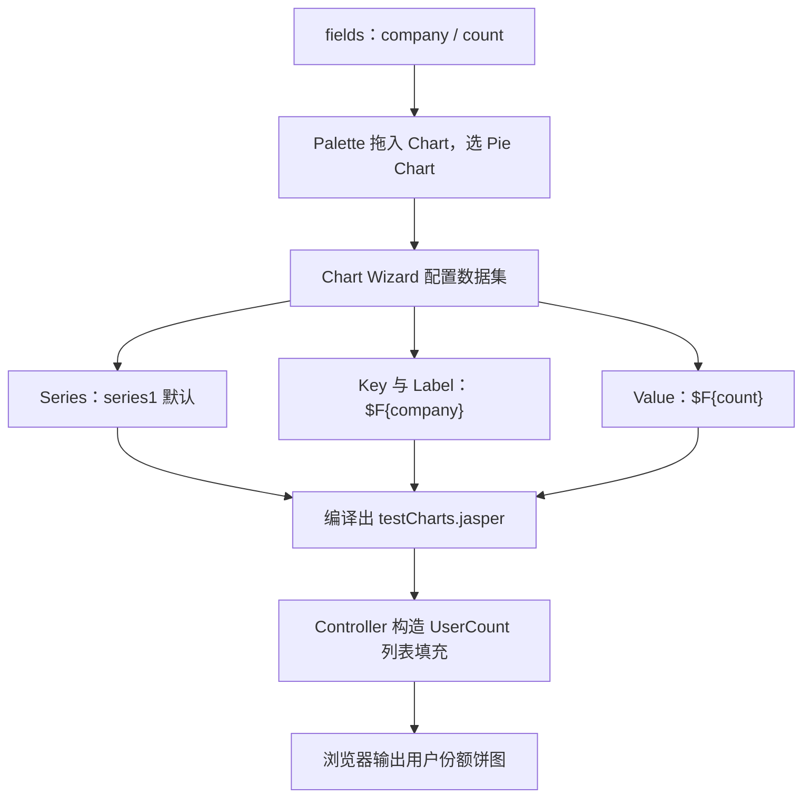

# 饼图报表实战：Chart Wizard 四槽位与 Controller 数据填充

需求分析定了 key 与 value，这一篇把模板和代码全部落地：建两个 fields、走一次 Chart Wizard、写一个 Controller，浏览器里出饼图。套路与前几篇一脉相承，差别只在图表元素的配置方式。

## 先给结论

- fields 两个：`company` 类型 String、`count` 类型 Long，名字与类型必须与 `UserCount` 实体属性严格对应。
- Chart Wizard 四个槽位：Series 填图名（默认字符串即可）、Key 填 `$F{company}`、Label 与 Key 同源、Value 填 `$F{count}`。
- 图表样式在 Properties 的 Chart 区调：title 表达式写「用户份额图形」，位置 Top，中文统一华文宋体 12 号。
- Controller 只换模板路径与数据构造：`UserCount` 列表三家各 1000 人，输出三个均分扇区。
- 柱状图、3D 柱状图等其余图表配置同构，只是多出坐标轴设置，学会饼图就学会了大半。

## 两个 fields 对准实体属性

模板能拿到什么，取决于 fields 声明了什么。数据载体 `UserCount` 在需求分析篇已经出现（取自资料包 domain 包，包名已改为 `com.example`）：

```java
public class UserCount {

    private String company;
    private Long count;

    public UserCount(String company, Long count) {
        this.company = company;
        this.count = count;
    }

    public String getCompany() {
        return company;
    }

    public Long getCount() {
        return count;
    }
    // set 方法省略
}
```

Outline 面板 Fields 节点右键 Create Field，建两个：第一个 name 为 `company`，类型 String，代表公司名称；第二个 name 为 `count`，类型 Long，代表员工数量。

**名称对上属性名，类型对上属性类型**，这条对齐关系不能有偏差。`JRBeanCollectionDataSource` 按 JavaBean 规范取值：field 名叫 `count` 时走 `getCount()`，field 类型声明为 Long，实体返回的也是 Long，三方对齐才不会出 `ClassCastException`。count 是 Long 不是 String，模板里把 field 类型建成 String 是这一步的高频翻车点。

## Chart Wizard：四个槽位各就各位

Palette 拖 Chart 进 Summary band，类型勾选 Pie Chart，点 Next 进入数据集配置页。这一页有四个槽位，逐一说明：

| 槽位 | 语义 | 本例取值 |
|---|---|---|
| Series | 这张饼图的名称系列 | 点三点按钮 Add 一条，用默认字符串 series1 |
| Key | 扇区名称，图例文字的来源 | `$F{company}` |
| Label | 扇区显示文字，与 Key 同源 | `$F{company}` |
| Value | 决定扇区大小的数值 | `$F{count}` |

Series 可以理解为给饼图起的名字，一张图一组就够，直接用默认值不动。Key 负责扇区的身份，填公司名称字段；Label 与 Key 语义相近，本例共用 `company`；Value 是算份额的数，选 `count`。表达式输入框支持双击列表里现成的 field 自动生成 `$F{}` 形式，语法记不住也不影响。

落成 jrxml 核心结构（模板源文件未随资料包提供，片段为按本课操作还原的示例）：

```xml
<pieChart>
    <chart>
        <reportElement x="0" y="0" width="555" height="300"/>
        <chartTitle position="Top">
            <titleExpression><![CDATA["用户份额图形"]]></titleExpression>
        </chartTitle>
    </chart>
    <pieDataset>
        <keyExpression><![CDATA[$F{company}]]></keyExpression>
        <valueExpression><![CDATA[$F{count}]]></valueExpression>
    </pieDataset>
    <piePlot/>
</pieChart>
```

四个槽位在 XML 里各归各位：`keyExpression` 与 `valueExpression` 定义扇区，`titleExpression` 定义图名。

配置链路串起来看：



## 图表样式微调

选中图表元素，Properties 面板切到 Chart 区。title 表达式写 `"用户份额图形"`，中文内容必须包在英文双引号里，表达式窗口里敲成全角引号是编译不过的；title 位置可在 Top 与 Bottom 之间换；title 的字体设为华文宋体 12 号。Title band 里放一个静态文本写「饼状图」当报表名，字体同步设中文。图表元素在 Properties 里还能调边距、图例位置等，有兴趣逐项玩一遍即可。

## Controller：换模板、换实体、换列表

资料包工程的 `JasperController06` 全貌（包名已改为 `com.example`）：

```java
@RestController
public class JasperController06 {

    /** charts图形报表 */
    @GetMapping("/testJasper6")
    public void createPdf(HttpServletRequest request, HttpServletResponse response) throws Exception {
        //1.引入jasper文件
        Resource resource = new ClassPathResource("templates/testCharts.jasper");
        FileInputStream fis = new FileInputStream(resource.getFile());

        //2.创建JasperPrint,向jasper文件中填充数据
        ServletOutputStream os = response.getOutputStream();
        try {
            Map parameters = new HashMap<>();
            //1.获取到对象的list集合
            List<UserCount> userList = getUserCountList();
            //2.通过list集合创建javaBean的数据源对象
            JRBeanCollectionDataSource ds = new JRBeanCollectionDataSource(userList);
            JasperPrint print = JasperFillManager.fillReport(fis, parameters, ds);
            JasperExportManager.exportReportToPdfStream(print, os);
        } catch (JRException e) {
            e.printStackTrace();
        } finally {
            os.flush();
        }
    }

    public List<UserCount> getUserCountList() {
        List<UserCount> list = new ArrayList<>();
        UserCount uc1 = new UserCount("云图科技", 1000L);
        UserCount uc2 = new UserCount("星河软件", 1000L);
        UserCount uc3 = new UserCount("蓝湾数据", 1000L);
        list.add(uc1);
        list.add(uc2);
        list.add(uc3);
        return list;
    }
}
```

与列表报表的差别只有两处：模板换成 `testCharts.jasper`，数据类型从 `User` 换成聚合后的 `UserCount`。填充四件套原封不动：空 Map、列表、`JRBeanCollectionDataSource`、`fillReport`。真实项目里这个列表来自按公司分组的统计查询，课程用硬编码数据演示，数字设成三个 1000，为的是看三个均分扇区。

编译好的模板拷进 `resources/templates`，重启微服务，浏览器访问 `/testJasper6`：一张「用户份额图形」饼图，三个扇区各占三分之一，图例并列三家公司名。扇区比例完全跟着 value 走，把 1000 改成 100 与 500 再试，图立刻随数据变化。

## 其他图表大同小异

回 Palette 再拖一个 Bar3D Chart 观察，向导比饼图多出 category axis 与 value axis 的设置：柱状图横轴是类别（公司名），纵轴是数值（人数），Series、Key、Value 的填法与饼图一致。Area、Line、Scatter 同理，**学会了饼图的 key 与 value 绑定，其余图表只是多几根轴的属性要填**，举一反三即可。

## 常见误区

- **field 类型与实体属性不一致**：模板里把 count 建成 String，实体返回 Long，填充时类型转换失败报错。fields 与实体两边严格对齐，建完互相检查一遍。
- **titleExpression 里用全角引号**：表达式内字符串必须是半角双引号，全角引号直接编译失败。凡写表达式，语法符号一律半角。
- **value 选了名称字段**：扇区大小要 Number，绑成 company 这类字符串字段填充报错；key 与 value 绑反了也是同款症状。
- **图表高度超出 band 高度**：Summary 高度 200 而图表 reportElement 高 300，导出的 PDF 里图形被截断。调高度以 Properties 里 reportElement 的数值为准，与 band 对齐。

## 面试可能被问到的问题

1. 面试官追问：「模板 fields 和 JavaBean 属性是怎么对应的？」
   答：JRBeanCollectionDataSource 按反射走 getter，field 名为 count 时调用 getCount()；field 类型需与返回类型兼容，命名不符报字段不存在，类型不匹配报类型转换异常。

2. 面试官追问：「饼图的扇区角度是怎么算出来的？」
   答：图表组件把数据集里所有 value 求和，每个扇区角度等于自身 value 除以总和再乘 360 度；key 决定扇区名与图例，value 决定份额。

3. 面试官追问：「Series、Key、Label、Value 四者什么关系？」
   答：Series 是数据系列名，一张图可有多系列；Key 是类目标识；Label 是展示文字；Value 是数值。饼图通常一系单一 Key 对一个 Value，柱状图多系列时 series 决定柱的分组归属。

4. 面试官追问：「统计类报表的数据应该在哪一层聚合？」
   答：优先 SQL 层 GROUP BY，返回的列表天然一行一汇总值，直接喂图表；模板里的分组与变量适合展示层的小计，图表数据源本身应当是聚合后的结果。

5. 面试官追问：「图内中文乱码怎么处理？」
   答：与正文同一套方案：字体扩展注册华文宋体，图表 title、图例等元素统一指定该字体，PDF 导出时用注册字体绘制即可。

## 配套资料

- 代码：`materials/code/02/day10-用户档案PDF报表/day10-用户档案PDF报表/代码/jasper-springboot/src/main/java/` 下 domain 包 `UserCount.java`、controller 包 `JasperController06.java`（包名已改为 `com.example`）
- 工程配置：`pom.xml`、`src/main/resources/application.yml`、`src/main/resources/jasperreports_extension.properties` 与 `stsong/fonts.xml`
- 模板 `testCharts.jrxml` 未随资料包提供，Chart Wizard 配置与 jrxml 片段为按本课写法补全的示例
