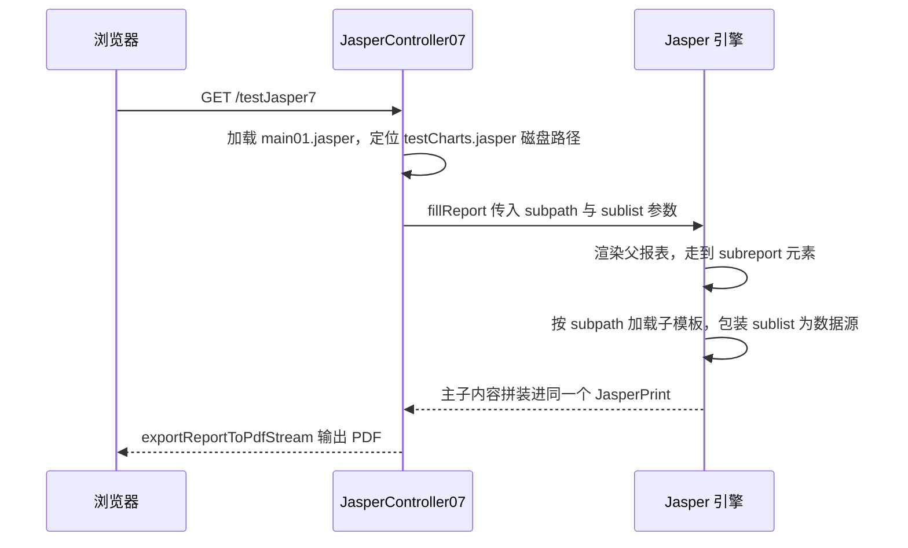

# 父子报表输出 PDF：一次 fillReport 填满主子两份模板

模板侧的参数与数据源表达式都配好了，最后一环是运行起来：Java 程序里能拿到的只有父报表，子报表的模板文件躺在工程的某个目录下，父报表并不认识它。得让 Java 程序把子报表的路径也作为参数递进去，父报表填充到 subreport 元素时才能顺着路径把子模板拉起来。这一篇把整条链路跑通，浏览器里看到主子内容拼装后的完整 PDF。

## 先给结论

- 父报表还要定义一个字符串参数 `subpath`，subreport 元素的模板路径表达式写 `$P{subpath}`，子报表路径由 Java 程序在运行时传入。
- Studio 向导里选的 workspace 引用只在设计器里有效，交给 Java 程序填充必须改成参数化路径，这是父子报表最容易漏改的一步。
- `fillReport` 只调用一次，入口永远是父报表；引擎填充到 subreport 元素时按 `subpath` 加载子模板，自己完成子报表的填充与嵌入。
- 父子两份 jrxml 都要编译成 .jasper，并一起拷到 `resources/templates`，缺一份运行时就报找不到文件。
- 子报表组件默认缩进会留出一大块空白，把它拖到版面最左边；标题中文不显示就设置中文字体。

## 模板侧收尾：路径参数化

在 Studio 里做父子报表时，subreport 元素是通过向导从 workspace 里挑的现成模板，此时元素的 Expression 栏记着的是设计器内部的引用方式。这套引用在 Studio 预览里没问题，一旦换到 Java 程序里填充就失效了，因为工程运行时没有 Studio 的 workspace 环境。

处理办法是把路径变成参数。父报表里再创建一个 parameter，名字取 `subpath`，class 用默认的 `java.lang.String`；然后选中 subreport 元素，在属性面板的 Expression 一栏把原来的固定引用改成 `$P{subpath}`。落到 jrxml 上，subreport 元素的完整声明长这样（片段为按本课写法补全的示例）：

```xml
<subreport>
    <reportElement x="0" y="0" width="555" height="200"/>
    <dataSourceExpression>
        <![CDATA[new net.sf.jasperreports.engine.data.JRBeanCollectionDataSource($P{sublist})]]>
    </dataSourceExpression>
    <subreportExpression><![CDATA[$P{subpath}]]></subreportExpression>
</subreport>
```

两个表达式各管一件事：`dataSourceExpression` 管子报表的数据从哪个参数来，`subreportExpression` 管子报表的模板从哪个参数来。至此父报表自身已经完整，它只等 Java 程序喂两个参数。

## 编译与部署：两份 jasper 都要拷

参数配完就编译。在 Studio 里右键父报表 `main01` 与子报表 `testCharts`，分别编译成 .jasper 文件。这一步常会撞上一个编译错误：元素超出 band 边界，problem 面板提示组件超出了所在 band 的范围，多半是之前手工调整过组件或 band 的宽高。把 band 高度调够、或者把组件尺寸收一收，重新保存再编译就能过。

编译产物两份都要拷进 Spring Boot 工程的 `src/main/resources/templates` 目录：

```bash
main01.jasper        # 父报表，填充入口
testCharts.jasper    # 子报表，父报表填充过程中按 subpath 加载
```

工程里已经配好中文支持：`resources/jasperreports_extension.properties` 注册了字体扩展，指向 `stsong/fonts.xml`。所以模板标题若出现中文不显示，把标题字体设为华文宋体、字号 12，重新编译即可，不需要再动工程配置。

## Java 程序：一次填充，主子齐活

填充入口是父报表。资料包工程 `JasperController07` 就是这个案例的完整落点（包名已改为 `com.example`，示例数据换成中性名称）：

```java
@RestController
public class JasperController07 {

    /** 父子报表 */
    @GetMapping("/testJasper7")
    public void createPdf(HttpServletRequest request, HttpServletResponse response) throws Exception {
        //1.加载父报表模板
        Resource resource = new ClassPathResource("templates/main01.jasper");
        FileInputStream fis = new FileInputStream(resource.getFile());

        //2.组装参数：子报表路径 + 子报表数据
        ServletOutputStream os = response.getOutputStream();
        try {
            Map parameters = new HashMap<>();
            Resource subResource = new ClassPathResource("templates/testCharts.jasper");
            parameters.put("sublist", getUserCountList());                 //子报表需要的数据
            parameters.put("subpath", subResource.getFile().getPath());    //子报表的磁盘路径

            //3.填充父报表，数据源只给一条空记录
            JasperPrint print = JasperFillManager.fillReport(fis, parameters, new JREmptyDataSource());
            JasperExportManager.exportReportToPdfStream(print, os);
        } catch (JRException e) {
            e.printStackTrace();
        } finally {
            os.flush();
        }
    }

    public List<UserCount> getUserCountList() {
        List<UserCount> list = new ArrayList<>();
        list.add(new UserCount("云图科技", 1000L));
        list.add(new UserCount("星河软件", 1000L));
        list.add(new UserCount("蓝湾数据", 1000L));
        return list;
    }
}
```

三个加载细节值得逐个看。

**第一，两份模板用了两种加载姿势。** 父报表直接 `ClassPathResource` 拿文件再包成 `FileInputStream`，因为 `fillReport` 的第一个参数要的就是输入流；子报表同样用 `ClassPathResource` 定位，但取的是 `getFile().getPath()` 这条磁盘绝对路径，因为父报表的 `subreportExpression` 约定的是按路径加载子模板。同一个类，两种消费方式，对应模板里两种参数。

**第二，`fillReport` 的第三个参数是 `new JREmptyDataSource()`。** 父报表自己没有业务数据，只给一条空记录让承载 subreport 元素的 band 渲染一次，`sublist` 里的数据全部流向子报表。

**第三，导出仍然只有一行。** `exportReportToPdfStream(print, os)` 把填充结果写进响应流，主子内容已经在 `JasperPrint` 里拼装完毕，导出环节感知不到父子结构的存在。

启动工程后浏览器访问 `http://localhost:8181/testJasper7`（工程 `application.yml` 配置的端口是 8181），返回的 PDF 里标题在上、chart 图形在下，主子两份模板的内容拼在同一页里。

整条运行链路用时序图表示：



关键分叉在引擎内部：`fillReport` 只发生一次，子报表的加载与填充是引擎渲染父报表途中自动发起的，调用方全程无感。

## 排版修正：让父子内容贴回版面

首次跑通后输出往往不理想，两处小修即可。其一，标题中文显示成空白或方块，进模板把标题字体改为华文宋体并调小字号，重新编译。其二，chart 图形整体偏右，父报表里 subreport 元素前面留了空位，子报表模板内部又有缩进，两段空白叠加；把 subreport 元素拖到最左边，两边重新编译并覆盖 .jasper，刷新即见内容贴左对齐。改模板后忘覆盖编译产物，是这一步最容易白忙活的地方。

## 常见误区

- **只拷父报表不拷子报表**：`fillReport` 填充父报表走到 subreport 元素时按 `subpath` 找文件，子报表的 .jasper 不在 templates 目录下就直接抛文件找不到异常。
- **留着 workspace 引用不改参数**：Studio 预览一切正常，Java 一填充子报表就空白。设计器内部引用只在 Studio 里有效，运行时路径必须参数化。
- **改了模板忘了重新编译覆盖**：jrxml 改完不编译、或编译了没把新 .jasper 拷进工程，页面永远是旧效果，排查半天代码其实代码没问题。
- **jar 包部署还用 `getFile()`**：打进 jar 后 classpath 资源没有文件系统路径，`getFile()` 会抛异常。开发期可以这么写，生产环境应改用 `getInputStream()` 按流加载，子报表路径也应换成流式方案。

## 面试可能被问到的问题

1. 面试官追问：「Java 程序填充父子报表时，为什么只需要调用一次 fillReport？」
   答：调用入口是父报表。引擎渲染父报表遇到 subreport 元素时，会按传入的路径参数加载子模板，用传入的数据参数自动完成子报表的填充并把结果嵌进父报表版面，子报表的填充对调用方透明。

2. 面试官追问：「子报表的路径参数一般怎么取？」
   答：用 `ClassPathResource` 定位 classpath 下的子报表 .jasper，再调 `getFile().getPath()` 拿磁盘绝对路径放进参数。模板里的 subreportExpression 引用这个参数完成加载。

3. 面试官追问：「Studio 里能预览子报表，Java 填充后却空白，查什么？」
   答：先查 subreport 元素是否还在用 workspace 引用，运行时必须改成参数化路径；再查子报表 .jasper 是否拷进了工程、路径参数值是否正确；最后查数据源表达式引用的参数名与 Java 侧 Map 的键是否一致。

4. 面试官追问：「父子报表的填充结果是一个 JasperPrint 还是两个？」
   答：一个。子报表渲染结果作为一块内容嵌入父报表的版面，最终导出用的是父报表的那个 JasperPrint，导出 API 不感知父子结构。

5. 面试官追问：「父子报表方案在打 jar 部署时有什么要改的？」
   答：classpath 资源打进 jar 后没有文件系统路径，`getFile()` 会抛 FileNotFoundException。模板加载与子报表定位都要改成 `getInputStream()` 流式读取，或在填充前把资源释放到临时目录再传路径。

## 配套资料

- 代码：`materials/code/02/day10-用户档案PDF报表/day10-用户档案PDF报表/代码/jasper-springboot/src/main/java/` 下 controller 包 `JasperController07.java`（包名已改为 `com.example`）
- 工程配置：同工程 `pom.xml`、`src/main/resources/application.yml`（端口 8181）、`jasperreports_extension.properties` 与 `stsong/fonts.xml`（中文字体扩展）
- 数据载体：同工程 domain 包 `UserCount.java`
- 模板 `main01.jrxml`、`testCharts.jrxml` 与编译产物未随资料包提供，subreport 元素声明按本课写法补全并已在文中注明
