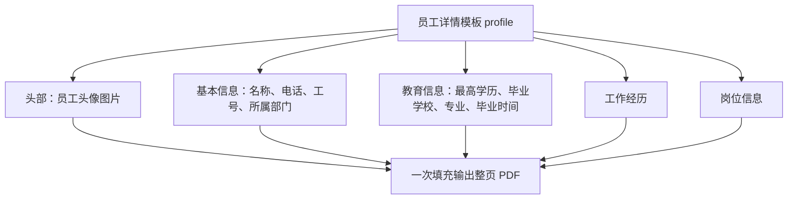

# 员工档案 PDF 下载需求：把报表技术拼成一份个人详情

网页上的员工详情看得见、存不下。HR 的日常场景是要把某个员工的档案打印出来归档，或者以 PDF 形式发给用人部门，浏览器页面满足不了这件事。人力资源系统做到这里，前面铺垫的报表技术刚好全部派上用场：数据填充、分组报表、chart 图表、父子报表，最后用一份员工详情模板把它们组合成一份可下载的个人档案 PDF。

## 先给结论

- 需求一句话：员工详情页加一个下载按钮，点击后下载该员工的 PDF 详情资料。
- 接口约定为 `GET /employees/{id}/pdf`，落在员工微服务里，前端用 `location.href` 直接触发浏览器下载。
- 详情模板按区块组织：头像、基本信息、教育信息、工作经历、岗位信息，版式固定、一人一页。
- 模板里的取值全部是 `$P{}` 占位，数据统一装进一个 Map 走 parameters，一次填充输出整页。
- 这类区块化档案也可以按父子报表的思路拆：基本信息、工作履历、获奖记录各自一个小模板，由主模板组合，区块能复用。

## 手上的报表工具盘一遍

把这个需求做出来之前，值得先把已经掌握的能力对号入座，免得需求来了不知道用哪把刀：

| 能力 | 关键点 | 适合的场景 |
|---|---|---|
| Parameters 填充 | Map 传值，模板里 `$P{}` 取 | 版式固定、字段零散的表单类页面 |
| Jdbc 数据源 | 传 Connection，模板里写 SQL 配 fields | 直接从库表出列表清单 |
| JavaBean 数据源 | List 包装成 `JRBeanCollectionDataSource` | 数据经过业务加工后的列表 |
| 分组报表 | 分组表达式加 variable 汇总 | 按部门、按月份分段统计 |
| chart 图表 | 饼状图、柱状图等图形组件 | 占比、对比类可视化 |
| 父子报表 | subreport 元素嵌套子模板 | 大报表拆块开发、区块复用 |

企业应用里绝大多数报表需求，都能在这六行里找到对应解法。个人详情档案这个需求，主体是 Parameters 填充，区块组织上可借鉴父子报表的拆分思想，属于两种能力的一次综合运用。

## 需求描述：详情页一个按钮，点击下载 PDF

系统现状是登录后进入员工模块，点开某个员工可以看到详情页，页面上有三个页签：登录账户设置、个人详情、岗位信息。要加的东西在详情页右上角：一个打印按钮，点击后浏览器直接下载这个员工的 PDF 详情资料。

前端改动就是给按钮挂一个下载动作，资料包里提供了这段真实的页面代码：

```javascript
// 下载文件
handleExport() {
  let id = this.$route.params.id;
  location.href="http://localhost:9003/employees/"+id+"/pdf"
}
```

实现非常直接：从路由里取当前员工的 id，把浏览器地址直接指到后端接口。后端响应的是 PDF 字节流，浏览器识别到内容类型后自动触发下载，前端不需要再做任何文件处理。由此也定下了接口约定：员工微服务（9003 端口）提供 `GET /employees/{id}/pdf`，返回值为空、直接向响应流写 PDF。

跑通这条链路的前提是微服务环境就绪。这个系统已经注册了 Eureka，启动顺序有讲究：先把 Eureka 注册中心拉起来，再启动系统微服务，最后启动员工微服务，员工详情页的数据与下载接口都挂在员工微服务上。

## 模板结构：一人一页的档案版式

课程资料里已经把模板做好了，取名 `profile`，对应员工详情资料。版式从上到下分几个区块：



左边是员工的一张头像图片，右边跟着用户名称、电话、工号、所属部门；底下依次是教育信息区的最高学历、毕业学校、专业、毕业时间，再往下是工作经历与岗位信息，和页面上展示的员工资料内容一一对应。模板不复杂，但组件多、要对齐，做起来比较繁琐，属于体力活。

关键的特征藏在取值方式里：整张模板里出现的全部是 `$P{}` 形式的占位。这意味着填充数据时不需要任何行级数据源，所有内容（包括头像）都装进一个 Map，以 parameters 的方式传进来。头像的取值同样是参数，模板里图片组件的表达式写成 `$P{staffPhoto}`，参数值放头像的 URL 地址，引擎填充时会自动把这个网络图片下载并嵌进报表，对应实体里的员工照片字段 `staffPhoto`。参数声明大致是下面这个样子（模板未随资料包提供，为按本课写法补全的示例）：

```xml
<parameter name="username" class="java.lang.String"/>
<parameter name="mobile" class="java.lang.String"/>
<parameter name="theHighestDegreeOfEducation" class="java.lang.String"/>
<parameter name="staffPhoto" class="java.lang.String"/>
```

## 为什么全走 parameters

这个问题值得停下来想清楚，因为它决定了后端组装数据的方式。

field 与 Detail band 服务的是行模型：数据源里有多少条记录，Detail 就循环渲染多少行，适合列表和分组。档案恰恰相反，它是一个人的静态版式，没有行循环，每个字段在版面上只出现一次，还有图片这种非文本内容。行模型在这里处处别扭，parameters 的键值模型反而严丝合缝：Map 里放用户名、电话、学历、头像地址，模板里一个占位对一个键，`fillReport` 配一个 `JREmptyDataSource` 填一次，整页就出来了。

顺带把需求里容易想偏的一点交代掉：档案里的区块（基本信息、工作经历、获奖记录这类）如果业务上还要继续膨胀，或者多个报表要复用同一个区块，就按父子报表的思路拆，每个区块一个子模板，主模板用 subreport 元素组合，区块模板独立开发独立复用。当前的详情模板字段规模用一张模板加一组参数就够，不必为了拆而拆。

## 常见误区

- **想用 field 加 Detail band 做档案页**：档案是一人一页的固定版式，没有行可循环，硬套行模型要么数据源造出许多单条记录，要么版面撑不起来。这类页面正确姿势是全量 parameters 加空数据源。
- **头像当成普通文件路径传**：`$P{staffPhoto}` 里放的应当是可访问的图片 URL，引擎按 URL 拉取图片；传本地相对路径或数据库字段原始值，图片位置就会空白。
- **忽略微服务启动顺序**：注册中心没起就先启动业务微服务，注册失败、服务调用不上，详情页数据都拿不全。先 Eureka，再系统微服务，最后员工微服务。

## 面试可能被问到的问题

1. 面试官追问：「下载员工 PDF 档案的接口应该怎么设计？」
   答：用 `GET /employees/{id}/pdf`，以路径变量传员工 id，方法返回 void，内部查数据、填模板，最后把 PDF 字节流写进 `HttpServletResponse` 的输出流。前端用 `location.href` 或 a 标签直接指向该地址即可触发下载。

2. 面试官追问：「为什么员工详情模板全部用 parameters 而不是 fields？」
   答：详情档案是一人一页的静态版式，每个字段只出现一次且包含图片，没有行循环语义。parameters 的键值模型与这种版式天然匹配，配合空数据源一次填充即得整页。

3. 面试官追问：「模板里的员工头像是怎么渲染出来的？」
   答：图片组件的表达式引用参数 `$P{staffPhoto}`，后端把头像的 URL 地址放进参数 Map，JasperReports 填充时按 URL 下载图片并嵌入报表版面。

4. 面试官追问：「如果档案要加获奖记录这类列表区块，怎么做？」
   答：把该区块拆成子模板，模板内声明自己的 fields，主模板放一个 subreport 元素引用它；主报表通过 parameters 把获奖记录列表传给子报表，数据源表达式包装成 JRBeanCollectionDataSource，这就是父子报表的区块复用思路。

## 配套资料

- 前端按钮代码：`materials/code/02/day10-用户档案PDF报表/day10-用户档案PDF报表/资源/工具代码/details.vue`（员工详情页，含 `handleExport` 下载方法）
- 员工微服务基础代码：`materials/code/02/day07 员工管理及POI入门/员工管理及POI入门/资源/后端/ihrm_employee/src/main/java/` 下 controller 包 `EmployeeController.java`（本课在其上新增 pdf 接口）
- 实体类：同资料包 实体类/employee 目录 `UserCompanyPersonal.java`（含 `staffPhoto` 员工照片字段）
- 模板 `profile.jrxml` 未随资料包提供，文中参数与结构描述依据课程演示，XML 片段为按本课写法补全的示例
