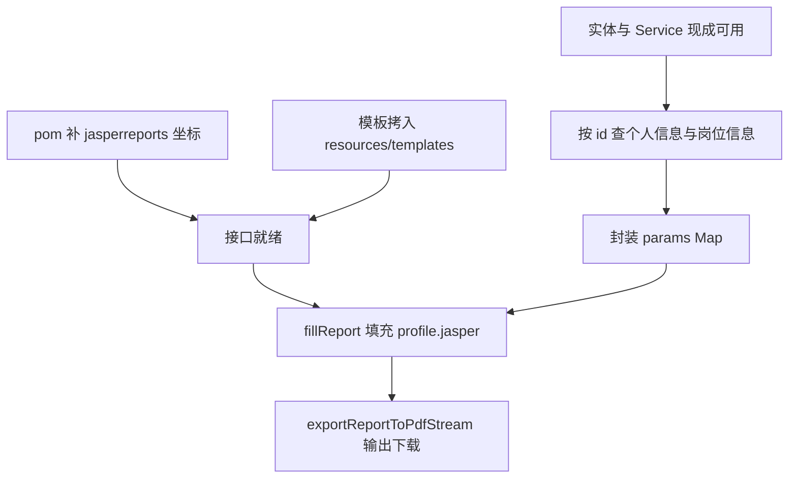
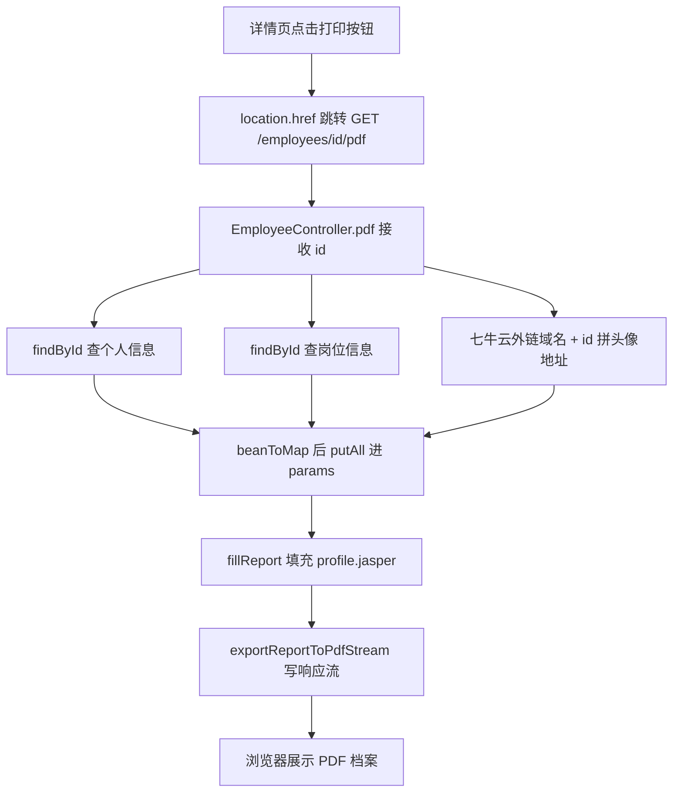

# 构造个人详情报表：员工 PDF 档案从环境搭建到输出下载的完整实现

## 先给结论

本系列 2 篇完成员工个人详情 PDF 报表的完整闭环：第一篇把模板、依赖、接口骨架三要素就位，第二篇接通数据线并从浏览器一键触发下载，两篇连读就是 JasperReports 做档案类报表的最小可运行路径。
方法论只有一句话：任何报表需求先按「模板、数据来源、填充数据」三要素拆解，员工档案也不例外，之前的分组、chart、父子报表都是这三步骤的不同变体。
环境搭建三件事：从报表案例工程整体拷 JasperReports 依赖块进员工微服务，模板拷进 `src/main/resources/templates` 用 `ClassPathResource` 定位加载，`EmployeeController` 挂 `GET /{id}/pdf` 接口返回 void、直接操作响应流。
数据侧零新建：`UserCompanyPersonal` 与 `UserCompanyJobs` 及对应 Service 现成可用，分别覆盖个人信息与岗位信息两张表；填充数据源给 `new JREmptyDataSource()`，因为档案模板全走 parameters 没有行级数据。
参数组装的省力写法：不逐个 `params.put`，用 `BeanMapUtils.beanToMap()` 把对象转 Map 后 `putAll` 整体并入，前提是模板参数名与实体属性名完全一致。
中文支持是环境收尾的最后一步：把字体扩展的 `jasperreports_extension.properties` 与 `stsong/fonts.xml` 拷进 resources，模板中文字体选华文宋体，少一个文件中文渲染就失败。
模板编译易错点：`profile.jrxml` 只是模板源码，`fillReport` 读的是编译后的 `profile.jasper`，控制器加载路径必须指向编译产物。
档案数据分三块：个人信息与岗位信息按 userId 各查一条，头像是七牛云 bucket 外链域名拼用户 id，喂给模板的 `$P{staffPhoto}` 图片组件。
前端触发最简实现：详情页加一个打印按钮，`location.href` 直接跳 `GET /employees/{id}/pdf`，浏览器拿到 PDF 字节流即触发预览下载，不需要任何额外逻辑。

## 第1部分：员工 PDF 档案环境搭建：模板、数据、填充三要素就位

需求已经清楚：详情页一个按钮，`GET /employees/{id}/pdf` 下载员工档案 PDF。动手做模板之前，先把工程架子搭出来。JasperReports 出一份 PDF，不管多复杂都逃不开三件事：模板、数据来源、填充数据。本课把这三件事对应的工程侧准备全部落位，接口骨架先立起来，数据组装留给下一课填肉。

### 模板与三要素

模板资料已经备好，不需要从零画。它的取值全部是 `$P{}` 形式，其中头像图片组件的表达式是 `$P{staffPhoto}`。在 Studio 里加图片的操作：从 Palette 拖一个 Image 组件进版面，选中后在属性面板的表达式栏填参数表达式，值放员工头像的 URL 地址，引擎填充时自动下载图片嵌进报表。这也决定了后端组装参数时，`staffPhoto` 这个键要放可访问的图片 URL。

三要素对着需求拆开看：模板是现成的 profile 档案模板；数据来源是员工微服务里按 id 查出的个人信息与岗位信息；填充就是把查询结果装进 Map 后调 `fillReport`。环境搭建就是把这三条线在工程里接好。

### 引坐标：把报表能力带进员工微服务

员工微服务工程里还没有 PDF 相关依赖。处理方式：打开之前的报表案例工程，把 jasperreports 依赖块拷进 HRM 工程的父 pom。案例工程的核心坐标如下（来自真实工程的 `pom.xml`）：

```xml
<dependency>
    <groupId>net.sf.jasperreports</groupId>
    <artifactId>jasperreports</artifactId>
    <version>6.5.0</version>
</dependency>
<dependency>
    <groupId>com.lowagie</groupId>
    <artifactId>itext</artifactId>
    <version>2.1.7</version>
</dependency>
<dependency>
    <groupId>org.olap4j</groupId>
    <artifactId>olap4j</artifactId>
    <version>1.2.0</version>
</dependency>
```

`jasperreports` 是引擎本体，`itext` 支撑 PDF 输出，`olap4j` 是引擎的部分功能依赖，三个一起拷省得运行时缺类。工程里原有的 POI 与七牛云 SDK 分别服务 Excel 和头像上传，互不冲突。

中文支持一并带上：案例工程里 `jasperreports_extension.properties` 与 `stsong/fonts.xml` 组成的字体扩展拷到 `resources` 下，模板里的中文字体才有得选。

### 接口骨架：EmployeeController 里的 pdf 方法

接口写进员工微服务的 `EmployeeController`。这个类是现成的，已有个人信息与岗位信息的保存读取方法，新增一个打印方法（包名已改为 `com.example`）：

```java
@RestController
@RequestMapping("/employees")
public class EmployeeController extends BaseController {

    @Autowired
    private UserCompanyPersonalService userCompanyPersonalService;
    @Autowired
    private UserCompanyJobsService userCompanyJobsService;

    /**
     * 打印员工pdf报表
     */
    @RequestMapping(value = "/{id}/pdf", method = RequestMethod.GET)
    public void pdf(@PathVariable(name = "id") String id,
                    HttpServletRequest request, HttpServletResponse response) throws IOException {
        //1.引入jasper文件：模板放在 resources/templates 下
        Resource resource = new ClassPathResource("templates/profile.jasper");
        FileInputStream fis = new FileInputStream(resource.getFile());

        //2.构造数据：按 id 查个人信息与岗位信息，封装进参数 Map
        Map<String, Object> params = new HashMap<>();

        //3.填充模板并输出 PDF
        ServletOutputStream os = response.getOutputStream();
        try {
            JasperPrint print = JasperFillManager.fillReport(fis, params, new JREmptyDataSource());
            JasperExportManager.exportReportToPdfStream(print, os);
        } catch (JRException e) {
            e.printStackTrace();
        } finally {
            os.flush();
        }
    }
}
```

几个签名上的要点：

**第一，返回值是 void。** PDF 直接写响应流，不走 Spring 的消息转换，浏览器拿到字节流即触发下载，与方法签名保持一致。

**第二，request 与 response 都要接进来。** response 是必须的，输出流从它身上拿；request 这类下载接口习惯性带上，后续要取请求上下文时不必改签名。

**第三，异常声明用 throws IOException。** `resource.getFile()` 与 `new FileInputStream()` 都抛受检异常，方法上必须声明，`JRException` 在 try-catch 里就地处理。

**第四，`params` 单独抽成变量。** 现在它还是空 Map，下一课把按 id 查出的档案字段放进去；先立住「数据统一走 parameters」的结构，填充代码就不需要再动。

模板加载是标准三步：`ClassPathResource` 定位 classpath 资源、`getFile()` 转成磁盘文件、包成 `FileInputStream` 交给 `fillReport`。所以模板必须放在 `src/main/resources/templates` 下，加载路径与文件名保持一致。

### 实体与 DAO：查询侧是现成的

数据来源这一环，工程里已有的持久层直接够用。两个核心实体：

```java
@Entity
@Table(name = "em_user_company_personal")
@Data
public class UserCompanyPersonal implements Serializable {
    @Id
    private String userId;
    private String username;        //姓名
    private String mobile;          //手机号
    private String staffPhoto;      //员工照片，对应模板头像参数
    private String theHighestDegreeOfEducation; //最高学历
    private String graduateSchool;  //毕业学校
    private String major;           //专业
    private String graduationTime;  //毕业时间
    // 其余 50 余个档案字段：证件、婚育、紧急联系人、社保公积金等
}
```

```java
@Entity
@Table(name = "em_user_company_jobs")
@Data
public class UserCompanyJobs implements Serializable {
    @Id
    private String userId;
    private String post;      //岗位
    private String rank;      //职级
    private String hrbp;      //HRBP
    private String workingCity; //工作城市
    // 合同、转正、汇报对象等岗位字段
}
```

对应的 Service 也是现成的，查询入口长这样：

```java
@Service
public class UserCompanyPersonalService {
    @Autowired
    private UserCompanyPersonalDao userCompanyPersonalDao;

    public UserCompanyPersonal findById(String userId) {
        return userCompanyPersonalDao.findByUserId(userId);
    }
}
```

`UserCompanyJobsService` 结构相同。岗位信息表的主键同样是 `userId`，一个员工 id 能把两张表各查一条，档案模板要的字段都在这两个实体里。下一课的组装工作就是把两条查询结果摊平放进 `params`，按模板参数名逐一对应。

环境搭完后的全景如下：



图里能看出本次搭建的分工：A、B 属于本课新增，C 原本就在，E 到 H 是下一课要补齐的组装逻辑。

## 第2部分：员工档案 PDF 全链路收口：查数据、组装参数、输出下载

上一课把员工微服务的 PDF 接口骨架立起来了，`params` 还是一个空 Map，点下载只能拿到一份没有数据的空壳 PDF。这一课把数据线接通：按 id 查出个人信息与岗位信息，拼上头像外链，全部塞进参数 Map，再让前端详情页的打印按钮直接触发下载。跑通之后，day10 的用户档案 PDF 就算完整落地。

### 中文支持收尾

环境还剩最后一小步。用 Studio 生成的模板对中文支持不完整，PDF 里的中文会变成空白或乱码。处理方式和之前的案例工程完全一样：把 `jasperreports_extension.properties` 与 `stsong/fonts.xml` 组成的字体扩展原样拷到员工微服务的 `resources` 目录下，模板里的中文字体选华文宋体。这一步拷完，环境才算真正结束。

```properties
net.sf.jasperreports.extension.registry.factory.simple.font.families=net.sf.jasperreports.engine.fonts.SimpleFontExtensionsRegistryFactory
net.sf.jasperreports.extension.simple.font.families.lobstertwo=stsong/fonts.xml
```

这个 properties 是 JasperReports 的扩展注册入口，指向 `stsong/fonts.xml`，后者声明了华文宋体的字体文件、`Identity-H` 编码与 PDF 内嵌开关。少任何一个文件，中文渲染都会失败。

### 数据从哪来：三块内容

档案模板要的数据在员工微服务里都是现成的，按来源拆成三块：

**第一块，个人信息。** `UserCompanyPersonalService` 的 `findById(id)` 查 `em_user_company_personal` 表，主键就是 userId，返回姓名、手机、学历、毕业院校等 50 余个档案字段。

**第二块，岗位信息。** `UserCompanyJobsService` 的 `findById(id)` 查 `em_user_company_jobs` 表，同样以 userId 为主键，返回岗位、职级、工作城市、转正评价等字段。

**第三块，头像。** 模板里的图片组件表达式是 `$P{staffPhoto}`，需要一个可访问的图片 URL。员工头像之前已经统一上传到七牛云，访问规则是 bucket 的外链域名拼上用户 id，域名部分在写上传功能时用过，从上传配置里原样拷过来即可。

### 组装 params：对象转 Map 再 putAll

查询代码写在上一课留好的位置（包名已改为 `com.example`）：

```java
/**
 * 打印员工pdf报表
 */
@RequestMapping(value = "/{id}/pdf", method = RequestMethod.GET)
public void pdf(@PathVariable(name = "id") String id,
                HttpServletRequest request, HttpServletResponse response) throws IOException {
    //1.加载编译后的模板
    Resource resource = new ClassPathResource("templates/profile.jasper");
    FileInputStream fis = new FileInputStream(resource.getFile());

    //2.构造数据
    UserCompanyPersonal personal = userCompanyPersonalService.findById(id);
    UserCompanyJobs jobs = userCompanyJobsService.findById(id);
    //用户头像：外链域名 + 用户 id
    String staffPhoto = "http://<bucket外链域名>/" + id;

    Map<String, Object> params = new HashMap<>();
    params.put("staffPhoto", staffPhoto);
    //对象转 Map，键名与模板参数同名，整体并入参数集
    params.putAll(BeanMapUtils.beanToMap(personal));
    params.putAll(BeanMapUtils.beanToMap(jobs));

    //3.填充模板并输出 PDF
    ServletOutputStream os = response.getOutputStream();
    try {
        JasperPrint print = JasperFillManager.fillReport(fis, params, new JREmptyDataSource());
        JasperExportManager.exportReportToPdfStream(print, os);
    } catch (JRException e) {
        e.printStackTrace();
    } finally {
        os.flush();
    }
}
```

`staffPhoto` 是唯一的散装参数，因为两个实体里虽然也有照片字段，但存的是相对路径，模板需要的是完整外链。剩下的字段为什么不逐个 put？模板里 50 多个参数逐个 `params.put(personal.getUsername())` 写到崩溃。做法是直接把整个对象转成 Map，再把 Map 里的键值对全部倒进 `params`。工具类是工程里现成的：

```java
public class BeanMapUtils {

    /**
     * 将对象属性转化为 Map 集合
     */
    public static <T> Map<String, Object> beanToMap(T bean) {
        Map<String, Object> map = new HashMap<>();
        if (bean != null) {
            BeanMap beanMap = BeanMap.create(bean);
            for (Object key : beanMap.keySet()) {
                map.put(key + "", beanMap.get(key));
            }
        }
        return map;
    }
}
```

它基于 Spring 自带的 cglib `BeanMap`，把对象的属性名与属性值抽成键值对。这套写法能成立有一个前提：设计模板时自定义参数的名称与实体类的属性名一模一样，比如 `$P{post}` 对应 `jobs.getPost()`，`$P{username}` 对应 `personal.getUsername()`。名字对得上，`putAll` 进去的键自然命中模板参数；对不上就是一批永远填不上的死参数。两个实体各转一个 Map，先后 `putAll`，键不重叠，互不覆盖。

### 模板编译：jrxml 与 jasper 的区别

控制器里还有一个隐患：加载的文件写的是模板源文件。`.jrxml` 是 Studio 里的模板源码，类似 Java 的 `.java`；`fillReport` 吃的是编译产物 `.jasper`，类似编译出的 `.class`。在 Studio 里打开模板执行一次编译，把生成的 `profile.jasper` 放进 `src/main/resources/templates`，控制器里的路径与文件名同步改成 `templates/profile.jasper`。这一步不做，运行时会直接读不出模板或者填充行为异常。

### 前端触发：一个按钮加一次跳转

员工详情页 `details.vue` 加一个打印按钮，点击后让页面跳转到员工微服务的下载接口：

```javascript
// 下载文件
handleExport() {
  let id = this.$route.params.id;
  location.href = "http://localhost:9003/employees/" + id + "/pdf"
}
```

```html
<a class="fa fa-print" aria-hidden="true" title="打印" @click='handleExport()'></a>
```

按钮拿路由参数里的员工 id，`location.href` 一跳，浏览器直接对该 GET 地址发起请求，后端把 PDF 写进响应流，浏览器自动展示。不需要 axios，不需要处理响应，因为要的就是浏览器原生的文件行为。

整条链路串起来是这样：



关键路径在 G 到 H：所有数据最终都要变成模板参数名能命中的键值对，`fillReport` 只认 parameters 里的键。数据查得再多，键名对不上模板就等于没查。

### 验证与收尾

重启员工微服务，进详情页点打印。PDF 出来后逐项核对：岗位、招聘渠道这些岗位字段有值，头像图片正常显示。头像偶尔第一次刷新不出来，原因是图片组件填充时要去七牛云现下载，多刷一两次即可，生产环境应换成后台预取或 CDN 缓存。

到这一课，PDF 报表这条线全部走完。回过头看，构造一份报表固定三步：制作模板、构造数据、填充数据。本阶段练过的分组报表、chart 图形报表、父子报表，差别只在模板结构与数据源形态，流程框架没有变过。

## 常见误区

- **坐标只拷 jasperreports 一条**：导出 PDF 时报类找不到。`itext`、`olap4j` 这些支撑依赖要与引擎一起拷，字体扩展文件同理。
- **模板放错位置**：`ClassPathResource("templates/profile.jasper")` 找的是 classpath 下的 templates 目录，模板随手放在工程根目录或 webapp 下都加载不到。
- **方法签名漏了 HttpServletResponse**：输出流拿不到，PDF 无处可写；漏写 `throws IOException` 则编译不过，`getFile()` 的受检异常必须声明。
- **看到空 Map 就换数据源**：`fillReport` 的第三个参数保持 `JREmptyDataSource`，不要因为它「空」就换成 Connection 或 JavaBean 集合，档案模板没有行级数据，数据全在参数 Map 里。
- **拿 `.jrxml` 直接填充**：Studio 里的 jrxml 是源码不是产物，`fillReport` 必须喂编译后的 `.jasper`，记得在 Studio 里编译一次并把加载路径改成 jasper 文件。
- **模板参数名与实体属性名不一致还用 putAll**：`putAll` 依赖键名命中，参数叫 `userName` 属性叫 `username` 都会导致该字段永远为空。要么统一命名，要么不一致的键单独 put 覆盖。
- **头像字段直接取实体里的值**：实体里的 `staffPhoto` 存的是上传时的相对路径，不是完整可访问 URL，模板要的是外链域名拼 id 后的完整地址。
- **忽略 `finally` 里的 `os.flush()`**：响应流不冲刷，浏览器可能拿到不完整的 PDF；写流式响应时 flush 收尾是固定动作。

## 面试可能被问到的问题

1. 面试官追问：「做一个 PDF 报表功能，你第一步会做什么？」
   答：按三要素拆解：模板长什么样、数据从哪来、怎么填充。先定模板与参数约定，再定查询与组装逻辑，最后写填充输出代码，接口骨架可以先行。
2. 面试官追问：「详情类报表的数据源为什么用 JREmptyDataSource？」
   答：详情档案是一人一页的静态版式，没有 Detail 行循环，所有字段走 parameters 传 Map。空数据源只提供一条空记录让 band 渲染一次，行级数据源在这里没有意义。
3. 面试官追问：「Spring Boot 里怎么加载 resources 下的报表模板？」
   答：用 `ClassPathResource("templates/xxx.jasper")` 定位，`getFile()` 拿磁盘文件再包 FileInputStream 交给 fillReport。注意打成 jar 后 `getFile()` 不可用，要改 `getInputStream()` 按流加载。
4. 面试官追问：「员工档案的个人信息和岗位信息分别存在哪，怎么查？」
   答：两张表都以 userId 为主键，个人信息在 em_user_company_personal 对应 UserCompanyPersonal 实体，岗位信息在 em_user_company_jobs 对应 UserCompanyJobs 实体，各自经 Service 的 findById 查一条，摊开放进参数 Map。
5. 面试官追问：「接口为什么设计成 GET 并且返回 void？」
   答：下载行为由浏览器直接发起最简单，GET 加 id 路径即可触发；方法把 PDF 写进响应流后即结束，没有返回体，void 语义最准确。
6. 面试官追问：「对象属性比较多时，怎么高效地把实体数据塞进报表参数 Map？」
   答：用 cglib 的 `BeanMap` 把对象转成属性名到属性值的 Map，再 `putAll` 并入参数集，一次搞定几十个字段。前提是模板参数名与实体属性名保持一致，个别不一致的键单独 put 覆盖。
7. 面试官追问：「jrxml 和 jasper 文件的区别是什么？」
   答：jrxml 是模板的可读源码，jasper 是它经 JasperReports 编译后的二进制产物。运行期 `fillReport` 加载的是 jasper，源码改动后必须重新编译并替换，类似 Java 源码与 class 文件的关系。
8. 面试官追问：「详情类 PDF 的头像是怎么渲染进报表的？」
   答：模板放一个 Image 组件，表达式指向 `staffPhoto` 参数，值是完整可访问的图片 URL。引擎填充时按 URL 拉取图片嵌入 PDF，所以后端要保证这个 URL 外网可达且稳定。
9. 面试官追问：「前端怎么触发一个文件下载接口？」
   答：最简单的方式是 `location.href` 直接指向 GET 接口，浏览器收到带附件语义的响应流后自动下载或预览，不需要 JS 处理响应体。需要带认证头时才改用 axios 拿二进制再构造下载。
10. 面试官追问：「两实体字段合并进同一个 Map，键冲突怎么办？」
   答：`putAll` 后写的覆盖先写的。个人信息与岗位信息的主键都是 userId，主键字段会重叠，但这类字段模板不需要；业务字段两表天然不重叠。设计时就应避免把需要展示的同名键放进两个实体。

## 配套资料

- 接口宿主类：`materials/code/02/day07 员工管理及POI入门/员工管理及POI入门/资源/后端/ihrm_employee/src/main/java/` 下 controller 包 `EmployeeController.java`（本课在其上新增 pdf 方法，包名已改为 `com.example`）
- 实体类：同资料包 实体类/employee 目录 `UserCompanyPersonal.java`、`UserCompanyJobs.java`
- Service 与 DAO：`ihrm_employee/src/main/java/` 下 service 包 `UserCompanyPersonalService.java`、`UserCompanyJobsService.java` 及 dao 包对应类
- 坐标来源：`materials/code/02/day10-用户档案PDF报表/day10-用户档案PDF报表/代码/jasper-springboot/pom.xml`（jasperreports 6.5.0 等依赖），中文支持见同工程 resources 下 `jasperreports_extension.properties` 与 `stsong/fonts.xml`
- 模板 `profile.jasper` 未随资料包提供，接口骨架中的加载路径按课程演示补全
- 接口宿主类：`materials/code/02/day07 员工管理及POI入门/员工管理及POI入门/资源/后端/ihrm_employee/src/main/java/com/ihrm/employee/controller/EmployeeController.java`（pdf 方法骨架与 Service 注入方式来自该类，包名已改为 `com.example`）
- BeanMap 工具类：`materials/code/02/day04 权限分配与jwt概述/权限分配与jwt概述/资源/通用代码/工具类/BeanMapUtils.java`（`beanToMap` 为原样引用）
- 前端按钮：`materials/code/02/day10-用户档案PDF报表/day10-用户档案PDF报表/资源/工具代码/details.vue`（`handleExport` 打印下载逻辑为原样引用）
- 依赖与中文支持：`materials/code/02/day10-用户档案PDF报表/day10-用户档案PDF报表/代码/jasper-springboot/`（`pom.xml`、`jasperreports_extension.properties`、`stsong/fonts.xml`）
- 模板 `profile.jasper` 未随资料包提供，加载路径按课程演示补全；头像外链域名以脱敏占位符表示
