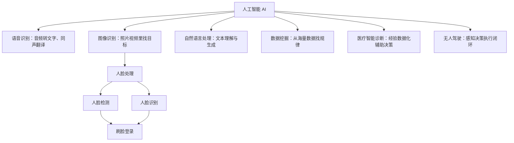

# 刷脸登录开篇：后端开发者该怎么用人工智能

HRM 系统做到第 11 天，需求只有一条：用 Java 实现刷脸登录。这个词听起来像要啃机器学习，实际对后端开发者来说，它就是「调几个云接口、处理几个 JSON 结果」的工程活。这课先把人工智能的能力版图和接入姿势讲清楚，弄明白刷脸登录在整个版图里的位置，后面几课的编码才有落脚点。

## 先给结论

- 人工智能是计算机科学的分支，目标是让计算机模拟人的思维方式对具体事情做出类似人的反应，它是能力定义，不是某个具体算法。
- 后端视角下，AI 能力按感知对象分类：处理声音的是语音识别，处理图片和视频的是图像识别，处理语言文字的是自然语言处理，另有数据挖掘、无人驾驶、医疗智能诊断等交叉应用方向。
- 刷脸登录属于图像识别分支下的人脸处理，核心是两个动作：人脸检测与人脸识别（对比）。
- 中小企业自研 AI 成本极高，工程上的正解是采购成熟云服务，本课用百度云 AI 的人脸识别接口完成功能，自己的代码只负责业务编排。
- day11 除刷脸登录主流程外，还涉及二维码生成与浏览器调用摄像头两块辅助能力，它们共同构成完整登录体验。

## 人工智能到底是什么

定义不必背书上的长句，抓住一句话：人工智能（Artificial Intelligence，缩写 AI）是计算机科学的一个分支，研究怎么让计算机模拟人的思维去完成一件事，并对这件事做出类似人的反应。

拿交通规则举例最直观。人从小被教育红灯停、绿灯行，开车看到红灯会踩刹车。把这套「感知、判断、执行」的思维过程灌给计算机：车载摄像头感知到前方红灯，判断出应当停车，于是执行制动。计算机完成了一件原本需要人类思维参与的事情，这就是人工智能要解决的问题。

对开发者来说还要再降一层：AI 不是玄学，它最终交付的形态是「输入数据、输出判断结果」的程序。语音识别收一段音频输出文字，图像识别收一张图片输出「图里有什么」，刷脸登录收两张人脸输出「是不是同一个人」。理解了这一点，后面所有内容都是在说：这些输入输出怎么接到自己的业务代码上。

## 热门应用方向：按处理对象分类

讲义上罗列的人工智能热门方向可以用「处理什么数据」来归位：



图里自上而下是从抽象到具体：AI 总类下按数据形态分出各方向，HRM 的刷脸登录落在图像识别之下的人脸处理这条支线上。分清归属的价值在于选型：确定了是图像识别问题，采购云服务时直接看对方的人脸类产品，语音与 NLP 的能力再强也与本需求无关。

各方向都有成熟落地：语音识别把说话内容实时转成文字，或者把英文口语即时翻译成中文；医疗智能诊断把医生依据指标推断疾病的经验逻辑喂给计算机，输入体检数据直接提示健康隐患；数据挖掘从交易流水里挖用户行为规律；无人驾驶综合前面所有能力做实时决策。

## 自研还是采购：中小企业的账

人脸检测、人脸识别这类程序背后是深度学习模型的训练与调优，涉及算法团队、标注数据、算力投入，从零自研的成本远超一般企业项目的预算。工程上的普遍做法是不碰模型层，直接采购市面上成熟的人工智能开放平台，把模型能力当成远程服务来调用。

目前提供人脸识别开放能力的主流平台有 Face++、阿里云、科大讯飞、百度云 AI 等几家，选型时对比识别精度、接口限流、价格与文档质量即可。本课程选用百度云 AI：注册账号拿到密钥，工程里引入它的 SDK，几行代码就能把「检测图片里有没有脸」「两张脸是不是同一个人」这类能力接进 Java 工程。业务代码的职责从「实现识别」降级为「编排识别结果」，这才是中小团队能扛得起的接入方式。

## 从接口视角预览刷脸登录

把摄像头拍到的照片交给云 AI 做人脸检测，开发者实际操作的就是一次接口调用（以下为示例，展示调用形态，密钥打码）：

```bash
# 人脸检测接口调用示例：图片 base64 化后作为参数提交
curl -i -X POST 'https://aip.baidubce.com/rest/2.0/face/v3/detect?access_token=24.xxx'
  --data '{"image_type":"BASE64","image":"<图片base64串>","face_field":"age,beauty,expression"}'
```

服务端返回的是结构化 JSON，业务代码要的信息全在里面（示例响应）：

```json
{
  "error_code": 0,
  "error_msg": "SUCCESS",
  "result": {
    "face_num": 1,
    "face_list": [
      {
        "face_probability": 1.0,
        "location": {"left": 314.63, "top": 219.75, "width": 322, "height": 340},
        "age": 27
      }
    ]
  }
}
```

`error_code` 为 0 表示调用成功，`face_num` 告诉你图里有几张脸，`face_list` 里带边框坐标、人脸置信度与各属性。刷脸登录的一切判断都建立在这种返回值之上：检测阶段看 `face_num`，识别对比阶段看相似度评分。后续课程把这些调用封装成工具类，再嵌进登录流程。

## day11 的全貌

功能点虽然只有刷脸登录一条，落地却要几块拼图：云 AI 侧的人脸注册与人脸搜索接口、后端的二维码生成与登录态轮询、浏览器端的摄像头调用与拍照上传。课程主线依次是人工智能概述、人脸登录原理、百度云 AI 的人脸识别能力盘点，之后进入编码。理解了「AI 能力即远程接口」这个定位，这些拼图的拼接方式就不再神秘。

## 常见误区

- **把刷脸登录当算法课题**：后端开发者的工作不是训练模型，而是选型云服务、封装调用、处理返回值与异常分支，模型层由平台负责。
- **AI 方向之间混为一谈**：语音识别与图像识别是完全不同的数据形态与接口体系，选型前先确认需求归属，别拿着语音的方案去做人脸。
- **低估辅助工程量**：真正写起来会发现，云接口调用只占少量代码，二维码状态管理、摄像头权限、图片上传这些周边工作才是主要工作量。

## 面试可能被问到的问题

1. 面试官追问：「你说项目里做了刷脸登录，识别算法是自己写的吗？」
   答：不是。识别能力来自云平台的开放接口，平台基于深度学习模型做人脸检测与对比。我的工作在工程层：封装调用、编排登录流程、处理相似度阈值与异常场景，这也是中小团队接入 AI 的标准姿势。

2. 面试官追问：「人工智能、机器学习、深度学习是什么关系？」
   答：人工智能是最大的概念，目标是让机器模拟人的思维做事；机器学习是实现它的主流手段，靠数据训练模型；深度学习又是机器学习的一个分支，用多层神经网络自动提取特征，人脸识别这类感知任务基本由深度学习方案支撑。

3. 面试官追问：「为什么选择采购云 AI 服务而不是自研？」
   答：自研要养算法团队、准备标注数据、投入训练算力，成本与周期都不可控。云服务把模型能力封装成稳定接口，接入成本低、精度有保障、按调用量计费，把有限的研发资源留给业务逻辑更划算。

4. 面试官追问：「刷脸登录在 AI 能力版图里属于哪一类？」
   答：属于图像识别分支下的人脸处理，具体依赖两个能力：人脸检测判断图片中是否有人脸并定位，人脸识别（对比）计算两张人脸的相似度评分，两者组合完成登录判定。

## 配套资料

- 本课为概念导入课，无对应源码包；文中 bash 与 JSON 为按云平台通用调用形态补全的示例，密钥已打码。
- 后续编码课的完整资料在 `materials/code/02/day11-刷脸登录/day11-刷脸登录/资源/代码/`（工具类 `BaiduAiUtil.java`、控制器 `FaceLoginController.java`、前端 `facelogin.vue` 等），可作为本概述的工程化印证。
