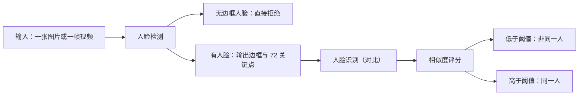
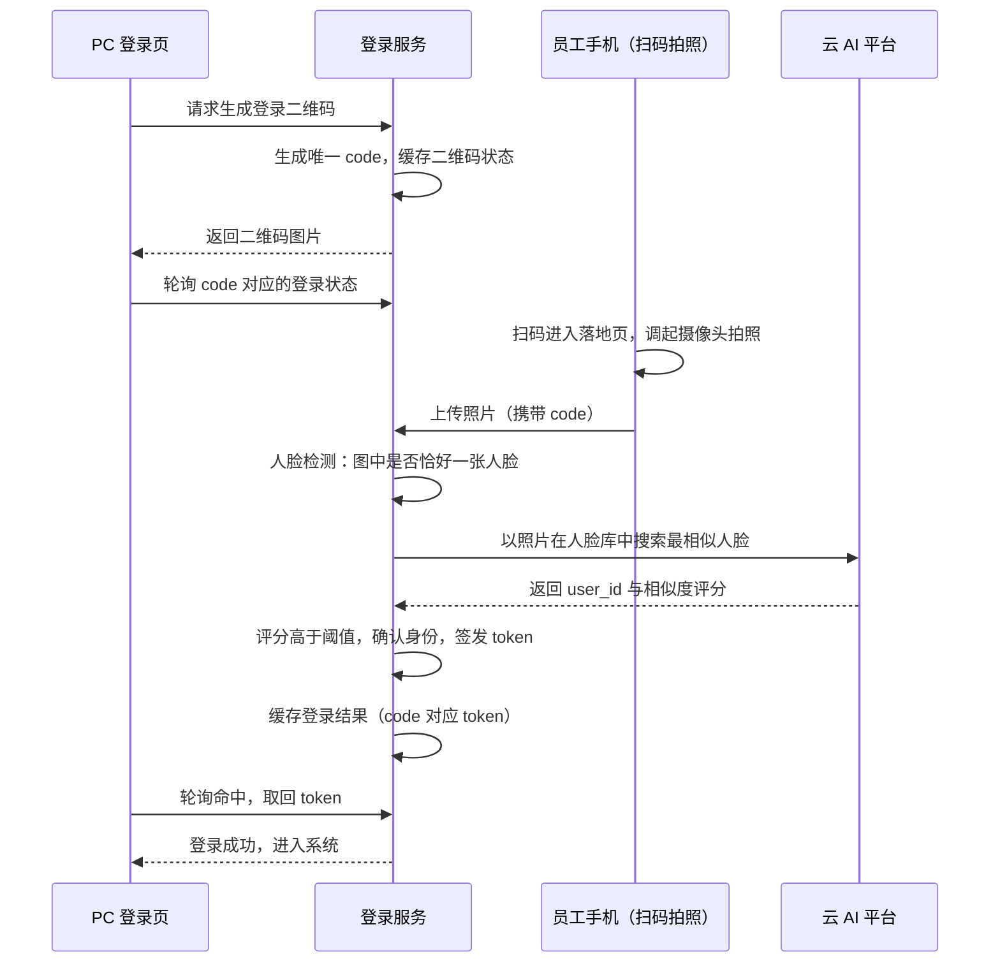

# 刷脸登录原理：从一张人脸到一枚 token

用户名密码登录做了这么多年，产品方突然要求「对着摄像头刷一下脸就登录」，后端该怎么接？这一课把刷脸登录的完整链路拆开：它依赖哪两个核心概念，一张照片如何变成登录态，相似度评分又该怎么用。原理通了，后面几课的编码就是把这条链路逐段实现。

## 先给结论

- 刷脸登录是基于人工智能、生物识别、3D 传感、大数据风控的登录形式，用户无需输入用户名密码，凭一张面部照片完成登录。
- 人脸处理有两个核心概念：人脸检测回答「图里有没有脸、在哪」，人脸识别（对比）回答「这两张脸是不是同一个人」。
- 人脸识别的结论不是「是/否」，而是相似度评分，业务侧用阈值卡线：低分判为不同人，高分判为同一人。
- 完整流程是：注册人脸入库 → 拍照上传 → 检测 → 在人脸库中搜索比对 → 按阈值确认身份 → 换发 token。
- 比对能力自研成本高，工程上采购云平台的人脸识别接口，主流可选 Face++、腾讯优图、科大讯飞、百度云 AI 等，本课程使用百度云 AI。

## 两个概念：人脸检测与人脸识别

**人脸检测，解决「有没有、在哪里」。** 刷脸的输入可以是一张照片，也可以是摄像头拍下的一段视频，前提是画面里得有人的面部。人脸检测负责判断一张图片或一帧视频画面中是否存在人脸，存在的话框出一个边框，再在框内分析眼、口、鼻的轮廓，常见方案会给出 72 个关键点的定位，顺带识别出性别、年龄、表情等属性。在登录流程里，它是第一道关卡：上传的东西里连一张人脸都没有，后面的比对根本没有意义。

**人脸识别（对比），解决「是不是同一个人」。** 它在检测的基础上提取人脸的特征，也就是口、眼、鼻位置与面部轮廓、颧骨形态这些关键点组合出的数值化描述，然后计算两张或多张人脸特征的相似程度。

关键在于：识别接口不会直接告诉你「这是同一个人」或「不是」，它返回的是相似度评分。同一个人做不同表情、光线角度变化，都会让特征产生细微差异，所以平台给的是百分制评分：50 分左右说明两张脸相似度很低，基本可以判定不是一个人；90 分甚至 99 分，就可以认定为同一人。评分到判定之间那道门槛，由业务代码自己定，这正是工程侧需要做决策的地方。



图里能看到两步是串联的：检测不过关直接短路返回，检测过关才把特征交给识别环节产出评分，业务代码拿评分对照阈值做最终裁决。

## 刷脸登录的完整时序

把两个概念放进 HRM 系统的真实登录流程里。系统里已有员工的人脸档案（注册阶段提前录入人脸库），登录时靠二维码把「PC 登录页」与「员工手机摄像头」两边接起来：



流程里有三个容易忽略的细节：

**第一，人脸注册是前置条件。** 人脸库里没有档案，搜索比对无从谈起。员工入驻时就要把头像照片通过人脸注册接口存进云平台的人脸库，并挂上唯一的用户标识，登录时搜索命中的就是这条档案。

**第二，二维码是状态载体。** PC 页面不知道谁在手机前刷了脸，靠唯一 code 把「拍照上传」与「等待登录」两边关联，登录页持续轮询这个 code 的状态，拿到 token 即登录完成。

**第三，token 是流程终点。** 刷脸本身只是证明了「你是谁」，证明通过后仍要走统一的认证签发：加载用户信息、生成 token 返回给前端，后续请求照常携带 token 走权限校验。刷脸替换的是「输入密码」这个动作，不是替换认证体系。

## 工程侧的代码形态

这条链路落在代码上，入口与比对逻辑大致如下（工具类来自课程资料，包名已改为 `com.example`，阈值为 80 分）：

```java
/**
 * 人脸登录：根据落地页随机拍摄的面部头像进行登录
 * 根据拍摄的图片调用云 AI 进行检索查找
 */
@RequestMapping(value = "/{code}", method = RequestMethod.POST)
public Result loginByFace(@PathVariable(name = "code") String code,
                          @RequestParam(name = "file") MultipartFile attachment) throws Exception {
    //照片上传后交由 Service 编排：检测、搜索、评分判定、签发 token
}
```

```java
/**
 * 人脸查找：在人脸库中查找最相似的人脸并返回数据
 * 用户的匹配得分（score）大于 80 分，即可认为是同一个用户
 */
public String faceSearch(String image) {
    JSONObject res = client.search(image, IMAGE_TYPE, groupId, options);
    if (res.has("error_code") && res.getInt("error_code") == 0) {
        JSONObject result = res.getJSONObject("result");
        JSONArray userList = result.getJSONArray("user_list");
        if (userList.length() > 0) {
            JSONObject user = userList.getJSONObject(0);
            double score = user.getDouble("score");
            if (score > 80) {
                return user.getString("user_id");
            }
        }
    }
    return null;
}
```

两段代码正好对应前文的两个层次：控制器接收照片与 code，是流程编排层；`faceSearch` 把照片交给人脸库搜索，取回最高相似度候选，用 80 分阈值换出用户标识，是能力调用层。返回 `null` 意味着库里没有过线的人脸，业务上直接判登录失败。评分阈值写成 80 是课程给出的经验值，实际项目应结合误识率与通过率的测试数据调整。

## 平台选型

人脸检测与识别背后是深度学习模型，自研要组建算法团队、积累标注数据、投入训练算力，对中小厂商不现实。市面上面向开发者开放此类能力的平台有 Face++、腾讯优图、科大讯飞、百度云 AI 等，能力大同小异，选型看精度、价格、限流策略与文档。本课程统一使用百度云 AI，下一课先盘一下它的人脸识别产品到底提供哪些功能点。

## 常见误区

- **把检测当识别**：检测只回答图里有没有脸、坐标在哪，不带身份判断；比相似度、认人要靠识别（对比）接口，两者是串联的两步，不能用其一替代另一个。
- **期望接口直接返回「是/否」**：识别返回的是相似度评分，判定同一人的阈值要业务自己定并实测调整，直接拿默认返回值当结论会误判。
- **跳过人脸注册直接登录**：人脸库中无档案时搜索只会得到低分结果，新员工必须先走人脸注册把照片与用户标识挂进人脸库，刷脸才有可比对的基准。
- **以为刷脸可以绕开认证体系**：刷脸只替换身份证明环节，token 签发、权限校验仍走原有框架，登录态的生命周期管理一点不少。

## 面试可能被问到的问题

1. 面试官追问：「人脸检测和人脸识别的区别是什么？」
   答：检测判断一张图里是否存在人脸，输出边框与关键点定位，可附带性别年龄等属性分析；识别在检测之上提取人脸特征，计算两张或多张人脸的相似度评分，用于判断是否同一人。检测是识别的前置步骤。

2. 面试官追问：「刷脸登录的相似度阈值怎么定？」
   答：接口返回的是评分不是结论，阈值要平衡误识率与通过率。课程里以 80 分为线，超过即认定同一人；正式项目应拿真实样本集测不同阈值下的误报与拦截数据，再结合安全要求选定。

3. 面试官追问：「PC 端刷脸登录为什么要引入二维码？」
   答：PC 浏览器调摄像头体验受限，二维码把登录请求转到手机端完成拍照。唯一 code 作为关联凭证：手机扫码后带着 code 上传照片，PC 页面轮询 code 状态取回 token，两端靠它衔接。

4. 面试官追问：「人脸比对通过之后，系统怎么完成登录？」
   答：比对命中的是用户标识，服务端据此加载用户信息，按原有认证机制签发 token 并缓存登录结果，前端轮询拿到 token 后携带它访问系统，权限校验流程与账号密码登录完全一致。

5. 面试官追问：「拿一张照片对着摄像头，能骗过刷脸登录吗？」
   答：只做人脸比对会被照片骗过，所以成熟方案都叠加活体检测，判断摄像头前是真人还是照片、视频、模具等攻击。接入云平台时开启活体检测参数即可获得这层防护，这也是选型时要关注的能力点。

## 配套资料

- 控制器入口：`materials/code/02/day11-刷脸登录/day11-刷脸登录/资源/代码/controller/FaceLoginController.java`（qrcode、轮询校验、loginByFace、checkFace 四个接口骨架）
- 比对工具类：同目录 `工具类/BaiduAiUtil.java`（`faceSearch`、`faceCheck` 为原样引用，包名已改为 `com.example`）
- 登录态实体：同目录 `实体类/FaceLoginResult.java`、`QRCode.java`（state、token、userId 与二维码结构）
- 业务编排：同目录 `service/FaceLoginService.java`（二维码创建、状态检查、刷脸登录的方法骨架）
