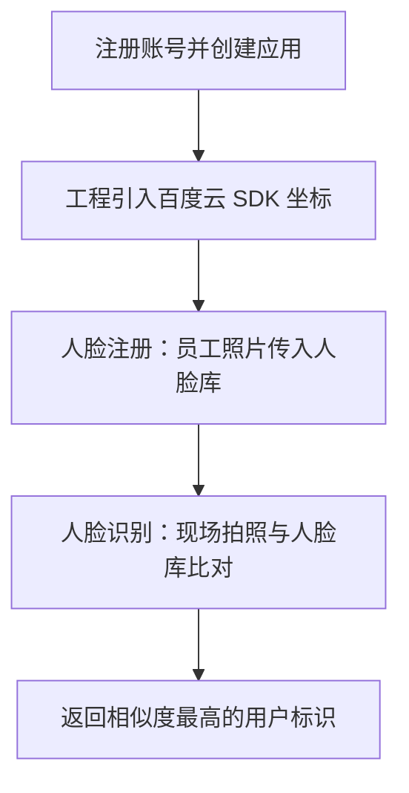

# 开通人脸识别服务：注册账号、创建应用，拿回 AppID、API Key、Secret Key

写代码之前有一道绕不开的手续：刷脸登录的比对能力放在云上，Java 程序要往云平台的人脸库里存照片、做识别、做比对，平台得先知道「你是谁、用的哪个应用」。这一课解决的就是这个前置问题：注册账号、开通人脸识别服务、创建应用，把三个关键凭证领回来。

## 先给结论

- 接入百度云 AI 人脸识别，开发主线固定四步：注册账号并创建应用、搭建工程导入依赖、人脸注册、人脸识别。
- 平台用「应用」来管理人脸库：一个应用对应一个人脸库，照片都挂在应用下面，创建应用是唯一要人工操作的一步。
- 应用详情页里的 AppID、API Key、Secret Key 是必须记下来的三元组，后续 Java 程序存照片、做识别、做比对全靠它们。
- 个人学习场景下人脸接口免费使用，但有 QPS 限制（每秒请求数，这里常见限制是 2），做演示足够，上生产要另行购买配额。
- Secret Key 属于敏感凭证，演示时也要打码，真实项目里放进配置中心或环境变量，不能提交到代码仓库。

## 开发四步全景

平台能力再多，开发者要走的流程其实很固定。人脸识别场景的四步如下：



前两步是准备，后两步是日常调用。人脸注册相当于给每个员工建档：把一张头像照片传上去，作为后续比对的基准。识别阶段则是拿一张新拍的照片进人脸库交叉比对，定位出「这是哪位员工」。这一课把第一步走完。

## 注册账号与进入控制台

打开百度云平台，首页右上角有注册入口；已经持有百度账号的直接登录即可，账号体系是通的。注册页要填用户名、密码、手机号和短信验证码，走完就拿到了控制台权限。

登录进控制台后，从左侧「产品服务」找到「人工智能」分类，选中「人脸识别」，进入这个产品的管理页面。概览页值得多看一眼，它把每个接口的状态、调用地址和限流都列出来了：

| API | 状态 | QPS 限制 |
|---|---|---|
| 人脸比对 | 免费使用 | 2 |
| 人脸搜索 | 免费使用 | 2 |
| h5 活体验证 | 免费使用 | 2 |
| h5 活体视频分析 | 免费使用 | 2 |

**免费配额的概念要建立起来。** 「免费使用」指的是接口本身可以零成本调用，但每秒并发被限制在 2 次（QPS 即 Queries Per Second，每秒允许的请求数）。学习与演示场景完全够用；一旦请求频率超出限制，接口会直接返回限流错误。企业生产环境则按调用量购买资源包，同时放开 QPS。

## 创建应用：一个应用对应一个人脸库

人脸识别的管理后台是围绕「应用」组织的。平台通过应用帮你管理所有的人脸数据：每个应用拥有独立的人脸库，注册的照片、后续的搜索请求都归属到创建它的应用名下。

在概览页点击「创建应用」，表单填四样：

- **应用名称**：本课填 `saas-hrm`，对应这套人力资源管理系统。
- **应用类型**：按业务归类选一个即可，例如「企业办公」，不影响接口能力。
- **接口选择**：勾选这个应用要用的接口，人脸识别相关的接口默认已勾选，保持不动就行。
- **应用描述**：一句话说明用途，例如「基于 SaaS 的人力资源管理系统」。

提交后应用立即创建成功，概览页的应用列表里会出现这条记录。

## 记下三元组：AppID、API Key、Secret Key

应用创建完，最关键的动作是打开它的「应用详情」页，那里有三个参数必须记下来：

- **AppID**：应用编号，标明这次调用属于哪个应用，人脸库也按它隔离。
- **API Key**：访问接口的公开标识。
- **Secret Key**：与 API Key 配对的私钥，参与签名鉴权，必须严格保密。

后续 Java 程序要做的一切操作，往人脸库存储照片、进行面部识别、做相似度比对，都要携带这三个参数。注册应用这一步的全部意义，就是把它们领回来。工程里的标准落点是配置文件，以下为打码示例，真实值从自己的应用详情页获取：

```yaml
ai:
  appId: "15246xxx"
  apiKey: "OPYvYVWd0mH1A89Xxxx"
  secretKey: "mvgF3pPoOLsMadGiEmuzxxx"
  imageType: "BASE64"
  groupId: "saas-hrm"
```

`imageType` 与 `groupId` 是两个业务参数：前者约定上传图片的编码形式，后者是人脸库里的用户组标识，会在后续调用中反复出现。工具类里用 `@Value` 把它们注入进来，构造客户端时就不用再手写死值：

```java
@Component
public class BaiduAiUtil {

    @Value("${ai.appId}")
    private String APP_ID;
    @Value("${ai.apiKey}")
    private String API_KEY;
    @Value("${ai.secretKey}")
    private String SECRET_KEY;

    private AipFace client;

    @PostConstruct
    public void init() {
        client = new AipFace(APP_ID, API_KEY, SECRET_KEY);
    }
}
```

这个 `AipFace` 客户端就是下一课的主角，它由 SDK 提供，三元组正是它的构造参数。

## 文档与 SDK 入口

应用详情页旁边就是技术文档入口。文档按功能列出人脸检测、人脸对比、人脸查找等接口，每个接口都给出请求参数、返回参数和在线调试工具，动手前扫一遍参数表收益很大。

对 Java 开发者来说，重点看 SDK 部分：平台提供了封装好的 jar 包，把签名、token 管理、HTTP 请求全部包掉，代码里只需要构造客户端、调用方法。本课后续的人脸注册、检测、搜索、更新全部通过这套 SDK 完成。

## 常见误区

- **把 Secret Key 提交进代码仓库**：密钥一旦入库，历史提交里都能翻出来，等于公开。正确做法是放配置文件（加入 `.gitignore`）或配置中心，仓库里只留占位符。
- **认为免费就随便调**：免费配额带 QPS 限制，压测或循环调用时很容易触发限流，报错后误以为代码有 bug。先看响应里的限流提示，再给调用加间隔。
- **跳过创建应用直接调接口**：没有应用就没有三元组，客户端构造不出来。所有调用都必须挂在某个应用名下。
- **应用详情页找不到 Secret Key 就慌**：平台对私钥做了展示保护，需要点击获取（会有「正在获取密钥」的过程），复制后立即妥善保存。

## 面试可能被问到的问题

1. 面试官追问：「接入云厂商的人脸识别，第一步为什么要创建应用？」
   答：平台以应用为单位管理资源与鉴权。应用绑定可用的接口集合，签发 AppID、API Key、Secret Key 三元组，人脸库也归属应用。没有应用，SDK 客户端无法构造，接口鉴权也通不过。

2. 面试官追问：「API Key 和 Secret Key 分别起什么作用？」
   答：API Key 是公开的访问标识，用于表明身份；Secret Key 是配对的私钥，用于对请求做签名，证明请求确实来自持有该 API Key 的一方。两者一个可示人、一个必须保密。

3. 面试官追问：「免费接口的 QPS 限制是什么概念，会带来什么问题？」
   答：QPS 指每秒允许的请求数，免费档常见为 2。超过限制的请求会被直接拒绝并返回限流错误码。开发时循环批量调用人脸接口要主动控制节奏，生产环境则购买更高配额。

4. 面试官追问：「刷脸登录的开发流程分几步？」
   答：四步。注册账号创建应用拿到凭证；工程引入 SDK 依赖；人脸注册，把用户照片传入人脸库建档；人脸识别，现场拍照去人脸库比对，返回相似度最高的用户标识，完成身份认证。

5. 面试官追问：「密钥在工程里怎么管理才规范？」
   答：敏感凭证与代码分离。本地开发放不入库的配置文件，用占位符注入；生产环境走配置中心或环境变量，配合权限管控与轮换机制。仓库里永远不出现真实密钥明文。

## 配套资料

- 工具类：`materials/code/02/day11-刷脸登录/day11-刷脸登录/资源/代码/工具类/BaiduAiUtil.java`（`@Value` 注入 `ai.appId`、`ai.apiKey`、`ai.secretKey` 的成例，包名已改为 `com.example`）
- 控制台创建应用、SDK Maven 坐标未随资料包提供，文中 `application.yml` 为按本课写法补全的打码示例
