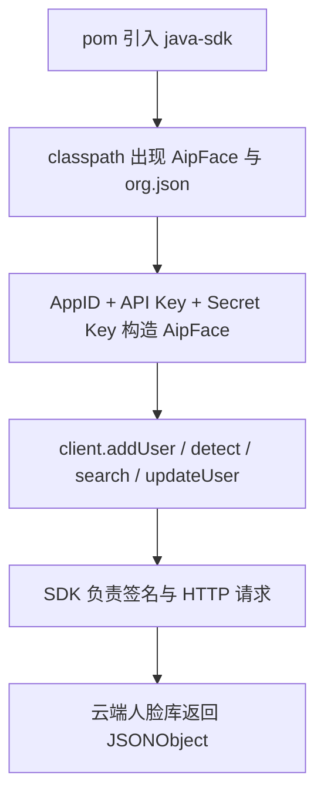

# 人脸识别开发环境搭建：java-sdk 依赖与 AipFace 客户端初始化

账号有了、应用建了、三元组到手，接下来轮到工程侧：把百度云的 Java SDK 引进来，构造出能与云端交互的客户端对象。这一步是纯体力活，但有几个高频翻车点：坐标从讲义复制过去编译报错、JUnit 依赖忘引、客户端对象在哪些位置初始化。本课把 `face-demo` 这个练手模块从零搭到「随时能调接口」的状态。

## 先给结论

- 依赖只有一个坐标：`com.baidu.aip:java-sdk:4.8.0`，它会传递引入 JSON 处理等一串工具包。
- 与云端交互的入口是 `AipFace` 客户端，构造参数就是 AppID、API Key、Secret Key 三元组，一个工程初始化一次即可复用。
- 坐标别直接从 PDF 复制，全角字符和不可见字符是 XML 解析报错的常见来源，建议手敲或从纯文本粘贴。
- 功能验证走 JUnit：不写 `main` 方法，一个 `@Test` 方法对应一个接口的演练，`@Before` 里集中初始化客户端。
- 工程级用法是把三元组交给 `application.yml`，用 `@Value` 注入，客户端在 `@PostConstruct` 里构造。

## 工程结构：一个干净的 face-demo 模块

练手代码不必动用整套 HRM 工程，单独建一个空工程，再挂一个 Maven 模块即可。模块命名 `face-demo`，groupId 用中性域名倒写，pom 骨架如下：

```xml
<?xml version="1.0" encoding="UTF-8"?>
<project xmlns="http://maven.apache.org/POM/4.0.0"
         xmlns:xsi="http://www.w3.org/2001/XMLSchema-instance"
         xsi:schemaLocation="http://maven.apache.org/POM/4.0.0
         http://maven.apache.org/xsd/maven-4.0.0.xsd">
    <modelVersion>4.0.0</modelVersion>

    <groupId>com.example</groupId>
    <artifactId>face-demo</artifactId>
    <version>1.0-SNAPSHOT</version>

    <dependencies>
        <!-- 百度云人脸识别 Java SDK -->
        <dependency>
            <groupId>com.baidu.aip</groupId>
            <artifactId>java-sdk</artifactId>
            <version>4.8.0</version>
        </dependency>
        <!-- 单元测试 -->
        <dependency>
            <groupId>junit</groupId>
            <artifactId>junit</artifactId>
            <version>4.12</version>
            <scope>test</scope>
        </dependency>
    </dependencies>
</project>
```

测试代码放在 `src/test` 目录下的独立包里，与主业务隔离，跑完即弃，不污染正式代码。

## 引入 java-sdk 坐标的两个坑

**第一，别信 PDF 的复制粘贴。** 讲义里的依赖片段看着没问题，复制进 `pom.xml` 却可能报「缺少元素」「非法字符」这类解析错误。原因是 PDF 排版会引入全角引号、不间断空格等不可见字符，XML 解析器对此零容忍。稳妥做法是照着屏幕手敲一遍，或先粘到纯文本编辑器清洗再进工程。

**第二，靠依赖传递确认引入成功。** 坐标写完刷新 Maven，`External Libraries` 里能看到 `java-sdk` 以及它带进来的 `org.json`、日志等包，说明整个依赖树就位。`org.json` 的 `JSONObject` 正是后续接接口返回值的载体，缺少它编译会直接报红。

## 初始化 AipFace：三元组进客户端

`AipFace` 是 SDK 提供的核心类，人脸注册、人脸检测、人脸搜索、人脸更新全部经它发出。它的构造方法签名很直白：

```java
public AipFace(String appId, String apiKey, String secretKey)
```

三个参数就是上一课从应用详情页记下的三元组。测试场景下，用 `@Before` 把构造动作集中起来，每个测试方法执行前都拿到一个现成的客户端：

```java
package com.example.test;

import com.baidu.aip.face.AipFace;
import org.junit.Before;
import org.junit.Test;

public class FaceTest {

    private AipFace client;

    @Before
    public void init() {
        // 三元组为打码示例，真实值取自应用详情页
        client = new AipFace("15246xxx", "OPYvYVWd0mH1A89Xxxx", "mvgF3pPoOLsMadGiEmuzxxx");
    }

    @Test
    public void testFaceRegister() {
        System.out.println(client);
    }
}
```

客户端构造一次就能反复使用，它内部替开发者处理了鉴权签名与 HTTP 细节。整条链路可以这样理解：



关键路径在 C 到 E：三元组决定了请求归属哪个应用、操作哪个人脸库；签名细节全部被 SDK 封死在内部，调用方只管拼业务参数。

## 生产工程的注入写法

测试类里把密钥写成字符串常量只适合演练。落到 HRM 正式工程，做法是三元组进 `application.yml`，工具类用 `@Value` 注入，客户端在 Bean 初始化完成后构造：

```java
@Component
public class BaiduAiUtil {

    @Value("${ai.appId}")
    private String APP_ID;
    @Value("${ai.apiKey}")
    private String API_KEY;
    @Value("${ai.secretKey}")
    private String SECRET_KEY;

    private AipFace client;

    @PostConstruct
    public void init() {
        client = new AipFace(APP_ID, API_KEY, SECRET_KEY);
    }
}
```

`@PostConstruct` 保证注入完成后才执行构造，顺序不会乱。这个类就是后面刷脸登录直接消费的工具类，四个功能方法都挂在它身上。

## 人脸库为空：下一件事是人脸注册

环境搭完，云端那个应用对应的人脸库里什么都没有。刷脸登录的原理是拿现场照片与人脸库存档照片交叉比对，库里没有档，比什么都比不出来。所以环境就绪后的第一个功能必然是人脸注册：把员工头像照片传上去建档，之后才谈得上「拍一张照片，云端比对出这是哪位员工」。

## 常见误区

- **坐标手抄时改了版本号或 groupId 大小写**：`com.baidu.aip` 写成 `com.baidu.AIP`，Maven 找不到构件，拉取直接失败。照官方写法原样录入。
- **测试类里 new 完客户端就丢**：每个方法各自 new 一个客户端，浪费且容易漏配。集中在 `@Before` 或 `@PostConstruct` 里初始化一份复用。
- **JUnit 依赖忘引**：`@Test` 注解报红才发现没加 `junit` 坐标。裸 Maven 工程不自带测试框架，pom 里要显式声明。
- **把密钥写进测试代码后随手提交**：演练代码也是代码，提交前把真实值换回打码示例，密钥只留在不入库的本地配置里。

## 面试可能被问到的问题

1. 面试官追问：「AipFace 的构造参数为什么是三个，缺一个行不行？」
   答：AppID 标明应用与人脸库归属，API Key 与 Secret Key 配对完成请求签名。三者缺一不可，少任何一个 SDK 都无法完成鉴权，调用会在服务端被拒。

2. 面试官追问：「为什么客户端对象只需要初始化一次？」
   答：AipFace 内部封装了 HTTP 客户端与签名逻辑，本身无状态且线程安全，构造一次即可复用。频繁创建只会增加开销，不会带来任何收益，通常以单例 Bean 的形式存在。

3. 面试官追问：「从文档复制依赖坐标后 pom 报错，一般是什么原因？」
   答：多半是复制内容夹带了全角引号、不间断空格等不可见字符，XML 解析器不认。清洗成半角字符重新粘贴，或直接手敲，再刷新 Maven 确认依赖树里出现 SDK。

4. 面试官追问：「@Value 注入的属性在构造方法里能用吗？」
   答：不能用。属性注入发生在对象构造之后，构造方法执行时它们还是 null。要等注入完毕再使用，就用 `@PostConstruct` 标注的初始化方法，此时字段已就位。

5. 面试官追问：「环境搭好后，为什么第一件事是人脸注册而不是直接调识别？」
   答：识别类接口都是在人脸库里找相似项，库为空时搜索没有意义，返回不到任何用户。先注册建档，人脸库有了基准照片，后续检测与搜索才有输入。

## 配套资料

- 工具类：`materials/code/02/day11-刷脸登录/day11-刷脸登录/资源/代码/工具类/BaiduAiUtil.java`（`@Value` 注入三元组、`@PostConstruct` 构造 `AipFace` 的原样成例，包名已改为 `com.example`）
- 依赖坐标 `com.baidu.aip:java-sdk:4.8.0` 与 JUnit 坐标未随资料包提供工程文件，pom 为按本课写法补全的可运行示例
