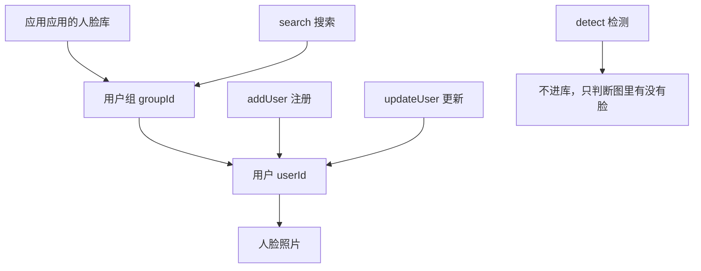

# 人脸识别四大接口实战：注册 addUser、检测 detect、搜索 search、更新 updateUser

环境就绪之后，刷脸登录要消费的云端能力就四个接口：把照片存进人脸库叫注册，判断一张图里有没有人脸叫检测，拿一张照片去库里找最相似的人叫搜索，库里的照片过时了叫更新。这一课把这四个接口的参数、返回值和封装方法一次讲透，全部代码来自课程成例 `BaiduAiUtil` 工具类，学完即可直接支撑刷脸登录。

## 先给结论

- 四个接口共用同一套调用范式：构造 `AipFace` 客户端、准备 `HashMap` 可选参数、把图片转成 URL 或 Base64 字符串、调用对应方法，返回值统一是 `JSONObject`。
- 成败判断只看 `error_code`：等于 0 表示成功，非 0 看 `error_msg` 定位原因，这是所有接口的第一判据。
- `addUser` 与 `updateUser` 参数完全相同，只差方法名；`groupId` 一旦定下，注册与搜索必须保持一致。
- 人脸搜索返回的 `user_list` 按相似度倒序排列，`score` 满分 100，经验阈值 80 分以上视为同一人。
- 业务封装时检测要确认 `result.face_num == 1`，搜索要校验 `score > 80` 才返回 `user_id`，把云平台的原始返回翻译成业务语义。

## 四个接口在人脸库上的分工

人脸库是平台侧的存储结构，层级为「应用 → 用户组（groupId）→ 用户（userId）→ 人脸照片」。四个接口就是围绕这棵树的四种操作：



注册与更新落在某个用户节点上，一个建档一个换档；搜索以一张照片为输入，在用户组里横向比对；检测不碰人脸库，只对单张图片做内容判断，常作为搜索前的入口校验。课程示例的用户组取 `saas-hrm`（由数字、字母、下划线组成，长度上限 128 字节），一旦定下，所有接口共用。

## 人脸注册 addUser：建档的固定四步

注册的代码套路固定四步：创建客户端、设置参数、构造图片、调用 API。落到测试方法里是这样的：

```java
//人脸注册：将用户照片存入人脸库
@Test
public void testFaceRegister() throws Exception {
    //1.创建 java 代码和百度云交互的 client 对象
    AipFace client = new AipFace("15246xxx", "OPYvYVWd0mH1A89Xxxx", "mvgF3pPoOLsMadGiEmuzxxx");
    //2.参数设置
    HashMap<String, String> options = new HashMap<>();
    options.put("quality_control", "NORMAL");   //图片质量控制
    options.put("liveness_control", "LOW");     //活体检测控制
    //3.构造图片：本地图转 Base64
    String path = "C:\\demo\\day11\\资源\\图片\\001.png";
    byte[] bytes = Files.readAllBytes(Paths.get(path));
    String image = Base64Util.encode(bytes);
    //4.调用 api 方法完成人脸注册
    JSONObject res = client.addUser(image, "BASE64", "saas-hrm", "1000", options);
    System.out.println(res.toString(2));
}
```

五个参数各有含义，逐个拆开：

- **参数一 image**：图片内容本身，可以是图片的 URL 地址，也可以是 Base64 字符串。本地文件不是 URL，只能走 Base64：`Files.readAllBytes` 读出字节数组，再用 SDK 自带的 `Base64Util.encode` 编码成字符串。Base64 的本质是把图片的二进制数据用文本形式表达，别看是一串字符，它就是那张图。
- **参数二 imageType**：告诉接口参数一按什么格式解析，取值 `URL` 或 `BASE64`，必须全大写。传了 Base64 字符串却写 `URL`，服务端会当成一个网址去解析，必然失败。
- **参数三 groupId**：用户组 ID，注册进哪个组。课程里固定一个字符串贯穿始终，因为注册时进了 A 组、搜索时却查 B 组，永远搜不到。
- **参数四 userId**：系统里的用户 ID。这一步把「云端的这张脸」和「业务系统里的这个人」绑定起来。搜索命中时接口原样把 `user_id` 还给你，系统就知道该让谁登录。
- **参数五 options**：可选参数集合，不传可给 `null`。常用的两个：

| 参数 | 取值 | 含义 |
|---|---|---|
| quality_control | NONE / LOW / NORMAL / HIGH | 图片质量控制。LOW 通过率高、拦截松；NORMAL 一般要求；HIGH 拦截严、通过率低 |
| liveness_control | NONE / LOW / NORMAL / HIGH | 活体检测档位，判断照片来自真人还是翻拍图片、屏幕 |

返回值是 `JSONObject`，判断成功与否只看一个字段：

```json
{
  "error_code": 0,
  "error_msg": "SUCCESS",
  "log_id": 1234567890,
  "timestamp": 1690000000,
  "cached": 0
}
```

`error_code == 0` 即注册成功。到控制台打开应用的人脸库验证：用户组、用户 ID、照片都在列表里，这条档就建实了。

## 人脸检测 detect：确认图里真有一张脸

注册时如果传上去的是一张没有头像的图（比如公司 logo），库里就存了一个无效档。所以上传前先做检测，判断图片中是否包含面部信息。SDK 的 `detect` 方法派上用场，客户端的初始化代码顺便抽到 `@Before` 里，测试方法只留业务部分：

```java
private AipFace client;

@Before
public void init() {
    client = new AipFace("15246xxx", "OPYvYVWd0mH1A89Xxxx", "mvgF3pPoOLsMadGiEmuzxxx");
}

//人脸检测：判断图片中是否具有面部信息
@Test
public void testFaceCheck() throws Exception {
    String path = "C:\\demo\\day11\\资源\\图片\\logo.jpg";
    byte[] bytes = Files.readAllBytes(Paths.get(path));
    String image = Base64Util.encode(bytes);
    //参数一：图片的 url 或 Base64 字符串
    //参数二：图片格式 URL 或 BASE64
    //参数三：可选参数，null 表示默认配置（可配 max_face_num、face_type 等）
    JSONObject res = client.detect(image, "BASE64", null);
    System.out.println(res.toString(2));
}
```

`toString(2)` 带缩进参数，控制台输出格式化的 JSON，比一坨长字符串好读得多。实测两张图的返回差别一目了然：传 `logo.jpg` 时 `error_code` 非 0，错误信息指向图片中没有面部；换成真人头像 `001.png` 后 `error_code` 变 0，`result` 里的 `face_num` 说明检测到几张脸。

业务封装不关心错误码细节，只关心「是不是恰好一张脸」：

```java
/**
 * 人脸检测：判断上传图片中是否具有面部头像
 */
public Boolean faceCheck(String image) {
    JSONObject res = client.detect(image, IMAGE_TYPE, options);
    if (res.has("error_code") && res.getInt("error_code") == 0) {
        JSONObject resultObject = res.getJSONObject("result");
        Integer faceNum = resultObject.getInt("face_num");
        return faceNum == 1 ? true : false;
    } else {
        return false;
    }
}
```

调用失败返回 `false`，成功还要看 `face_num`：一张脸才放行，两张以上说明图里有多人，同样不通过。

## 人脸搜索 search：一图进，千档比

搜索是刷脸登录的核心：上传一张现场照片，在指定用户组的所有人脸里找相似度最高的，返回用户标识和评分。测试代码沿用同一套构图流程：

```java
//人脸搜索：根据上传图片在指定人脸库中查找最相似的用户
@Test
public void testFaceSearch() throws Exception {
    String path = "C:\\demo\\day11\\资源\\图片\\002.png";
    byte[] bytes = Files.readAllBytes(Paths.get(path));
    String image = Base64Util.encode(bytes);
    //参数一：图片，参数二：格式，参数三：用户组，参数四：可选参数
    JSONObject res = client.search(image, "BASE64", "saas-hrm", null);
    System.out.println(res.toString(2));
}
```

返回结构里的关键字段是 `user_list` 数组，默认取相似度最高的一个，多张时按相似度倒序排列，每项包含 `group_id`、`user_id`、`user_info` 和 `score`（相似度评分，满分 100）。

课堂实验把评分这件事讲得很直白。库里已经注册了用户 1000 的一张头像（001），拿同一人的另一张照片（002）去搜：`error_code` 为 0，`user_list` 返回 `user_id` 为 1000，`score` 约 95，判定为同一人毫无悬念。换一位无关人员的照片（003）再搜：接口依然返回最相似的 `user_id` 1000，但 `score` 掉到 40 出头。机器比对按特征累加相似度，人人都有大眼睛、相似脸型这类共性，分不会是零；只是差距会被分数如实拉开。

**所以阈值必须自己定。** 平台推荐的经验值是 80 分以上视为同一人。低于 80 就返回失败，宁可让用户重拍，也不能把别人认成你。业务封装如下：

```java
/**
 * 人脸查找：查找人脸库中最相似的人脸并返回数据
 * 处理：用户的匹配得分 score 大于 80 分，即可认为是同一个用户
 */
public String faceSearch(String image) {
    JSONObject res = client.search(image, IMAGE_TYPE, groupId, options);
    if (res.has("error_code") && res.getInt("error_code") == 0) {
        JSONObject result = res.getJSONObject("result");
        JSONArray userList = result.getJSONArray("user_list");
        if (userList.length() > 0) {
            JSONObject user = userList.getJSONObject(0);
            double score = user.getDouble("score");
            if (score > 80) {
                return user.getString("user_id");
            }
        }
    }
    return null;
}
```

命中且过线返回 `user_id`，其余一切情况返回 `null`。调用方拿到非空值就完成身份认证，这正是刷脸登录的落脚点。

## 人脸更新 updateUser：换档只换方法名

人脸会随年龄、体型变化，几年前的存档照片可能越来越对不上真人，人脸库需要支持换档。更新的调用与注册几乎一字不差，唯一的区别是 `addUser` 换成 `updateUser`：

```java
//人脸更新：更新人脸库中指定用户的照片
@Test
public void testFaceUpdate() throws Exception {
    HashMap<String, String> options = new HashMap<>();
    options.put("quality_control", "NORMAL");
    options.put("liveness_control", "LOW");
    String path = "C:\\demo\\day11\\资源\\图片\\002.png";
    byte[] bytes = Files.readAllBytes(Paths.get(path));
    String image = Base64Util.encode(bytes);
    JSONObject res = client.updateUser(image, "BASE64", "saas-hrm", "1000", options);
    System.out.println(res.toString(2));
}
```

参数列表与 `addUser` 完全一致：图片、格式、用户组、用户 ID、可选参数。执行成功后刷新控制台的人脸库，用户 1000 名下的照片已经从 001 换成 002。业务侧同样按 `error_code == 0` 封装成布尔值即可。

## 从测试代码到工具类：BaiduAiUtil 成例

四个测试方法验证完接口，工程化时收敛成一个工具类，配置注入与客户端构造沿用上一课的骨架，四个方法一一对应四个接口：

```java
@Component
public class BaiduAiUtil {

    @Value("${ai.appId}")
    private String APP_ID;
    @Value("${ai.apiKey}")
    private String API_KEY;
    @Value("${ai.secretKey}")
    private String SECRET_KEY;
    @Value("${ai.imageType}")
    private String IMAGE_TYPE;
    @Value("${ai.groupId}")
    private String groupId;

    private AipFace client;

    private HashMap<String, String> options = new HashMap<String, String>();

    public BaiduAiUtil() {
        options.put("quality_control", "NORMAL");
        options.put("liveness_control", "LOW");
    }

    @PostConstruct
    public void init() {
        client = new AipFace(APP_ID, API_KEY, SECRET_KEY);
    }

    public Boolean faceRegister(String userId, String image) {
        JSONObject res = client.addUser(image, IMAGE_TYPE, groupId, userId, options);
        return res.getInt("error_code") == 0;
    }

    public Boolean faceUpdate(String userId, String image) {
        JSONObject res = client.updateUser(image, IMAGE_TYPE, groupId, userId, options);
        return res.getInt("error_code") == 0;
    }

    public Boolean faceCheck(String image) {
        JSONObject res = client.detect(image, IMAGE_TYPE, options);
        if (res.has("error_code") && res.getInt("error_code") == 0) {
            JSONObject resultObject = res.getJSONObject("result");
            return resultObject.getInt("face_num") == 1;
        }
        return false;
    }

    public String faceSearch(String image) {
        JSONObject res = client.search(image, IMAGE_TYPE, groupId, options);
        if (res.has("error_code") && res.getInt("error_code") == 0) {
            JSONArray userList = res.getJSONObject("result").getJSONArray("user_list");
            if (userList.length() > 0) {
                JSONObject user = userList.getJSONObject(0);
                if (user.getDouble("score") > 80) {
                    return user.getString("user_id");
                }
            }
        }
        return null;
    }
}
```

`imageType` 与 `groupId` 抽成配置项后，四个方法不再出现魔法值；调用方只传 `userId` 和图片，不感知云端细节。这个类是刷脸登录服务层直接注入的对象。

## 常见误区

- **imageType 与实际内容不匹配**：传 Base64 字符串却写 `URL`，或取值小写成 `base64`，服务端解析失败。取值只有 `URL` 和 `BASE64` 两种全大写形式，且必须与参数一的内容一致。
- **注册与搜索的 groupId 不一致**：照片注册进了 A 组，搜索却查 B 组，永远搜不到。组 ID 作为配置统一管理，全流程共用一份。
- **搜索拿到 user_id 就当登录成功**：接口永远返回最相似的那条，哪怕相似度只有 40 分。必须加 `score > 80` 的阈值校验，否则无关人员会被误认成注册用户。
- **注册前不做人脸检测**：logo、风景图这类无脸图片也能注册成功，库里多出无效档，登录时永远匹配不上。上传入口先用 `faceCheck` 拦一道，恰好一张脸才放行。

## 面试可能被问到的问题

1. 面试官追问：「人脸注册的 addUser 方法五个参数分别是什么含义？」
   答：image 是图片内容（URL 或 Base64 字符串）；imageType 声明图片格式，取 URL 或 BASE64；groupId 指定注册进哪个用户组；userId 是业务系统里的用户标识，用于把云端人脸与系统账号绑定；options 是可选参数，如图片质量控制 quality_control 与活体检测档位 liveness_control。

2. 面试官追问：「本地图片怎么变成接口能接受的参数？」
   答：本地路径不是 URL，走 Base64 通道。用 `Files.readAllBytes(Paths.get(path))` 读出字节数组，再用 SDK 提供的 `Base64Util.encode` 编码成字符串传入，imageType 传 BASE64。

3. 面试官追问：「怎么判断一次云端调用成功了？」
   答：统一看返回 JSONObject 的 error_code 字段，0 表示成功，非 0 时读 error_msg 定位原因。业务封装再把细节吃掉：注册与更新转成布尔值，检测额外要求 face_num 等于 1，搜索要求 score 过阈值。

4. 面试官追问：「人脸搜索返回的 user_list 是数组，为什么只取第一条？」
   答：数组按相似度倒序排列，第一条就是最相似的用户，登录场景只需要认定一个人。取第一条后再校验 score，80 分以上才认为同一人，低于阈值返回失败让用户重试。

5. 面试官追问：「同一人两张不同照片，搜索分数为什么不是 100？」
   答：评分是对两组人脸特征的相似度度量，光照、角度、清晰度都会拉低分数，同一人两张照片通常在 90 分上下。反之无关照片也有共性特征叠加，分数不为零，这解释了为什么必须设阈值而不是直接看名次。

6. 面试官追问：「人脸更新和人脸注册有什么区别，什么时候用更新？」
   答：参数与调用方式完全一致，只是方法从 addUser 换成 updateUser。注册用于新建档，对已存在的 userId 会冲突；更新用于覆盖已有档，典型场景是用户外貌变化较大时刷新照片，保证比对准确率。

## 配套资料

- 工具类：`materials/code/02/day11-刷脸登录/day11-刷脸登录/资源/代码/工具类/BaiduAiUtil.java`（faceRegister、faceUpdate、faceCheck、faceSearch 四方法原样成例，包名已改为 `com.example`，示例中的 groupId 由课程原名改为 `saas-hrm`）
- 各接口请求参数、返回参数明细见课程讲义人脸识别章节的参数表；测试类与图片资源未随资料包提供，文中测试方法为按本课写法补全的可运行示例，密钥均为打码示例
