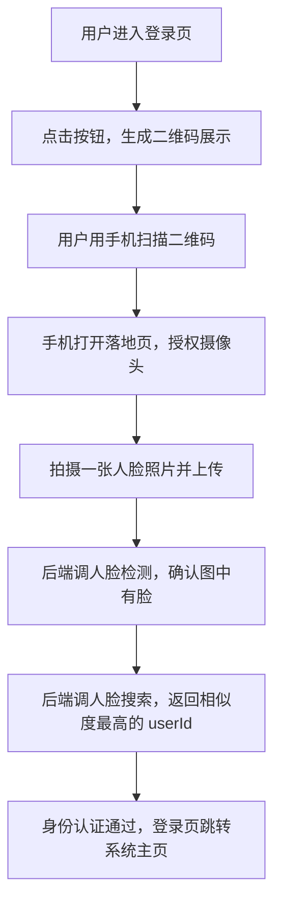
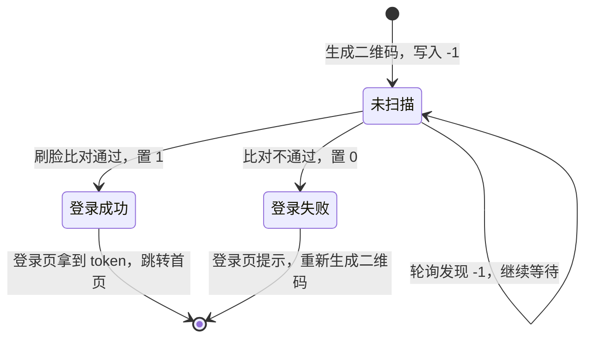

# 刷脸登录需求分析：二维码中转、落地页拍照与四个接口的分工

四大人脸接口都验证过了，现在要把它们编排成一个完整的业务功能：用户不输账号密码，刷脸进入人力资源管理系统。动手写代码前先把需求拆清楚，这件事比想象中绕：登录用的电脑不一定有摄像头，所以整个方案要靠一张二维码把「PC 浏览器」和「手机摄像头」串起来。

## 先给结论

- 现实约束决定方案形态：电脑可能没有摄像头，手机一定有，所以用二维码把拍照环节挪到手机上，扫码打开落地页完成拍摄。
- 全流程两个页面：登录页负责展示二维码并轮询状态，落地页负责调用摄像头拍照上传；手机端拍照成功后，完成跳转的是 PC 端页面。
- 登录状态放 Redis，以二维码唯一标志 code 为 key，值只有三种：-1 未扫描、1 登录成功、0 登录失败。
- 后端共四个接口：生成二维码、轮询二维码状态、图片人脸检测、刷脸登录，检测在登录之前，是搜索的守门员。
- 登录失败的出路是重新生成二维码重来一轮；安全边界靠人脸检测、相似度阈值与活体检测三层参数把守。

## 为什么绕道二维码

刷脸登录最自然的想象是对着电脑摄像头拍一张。可现实是办公电脑大量没有摄像头，这条最短路径直接走不通。方案做了一个折中：把「有摄像头」的设备换成手机。



这条链路里二维码只是载体：它编码了一个携带 code 参数的落地页地址，例如 `http://xxx/facelogin?code=1234`。手机扫码后进入的页面叫落地页，可以是手机浏览器页面，也可以用带摄像头的电脑打开，前提一样：能授权摄像头。

**一个容易忽略的细节是「谁在跳转」。** 手机端只负责拍照和上传，识别成功后手机页面不会发生登录跳转；真正跳进系统主页的是 PC 上的登录页，它靠轮询感知到登录成功才动作。两端各干各的，靠 Redis 里的状态对齐。

## 两个页面，各管一段

需求把登录功能拆成两个页面，职责边界很干净：

- **用户登录页面（PC）**：原有登录功能之外，新增一个刷脸登录按钮。点击后请求后端生成二维码并展示；随后页面启动定时器，带着 code 不停轮询后端，根据返回状态决定继续等待、跳转首页还是提示重来。
- **落地页（手机）**：扫码进入，页面只做一件事：请求摄像头权限，拍摄一张人脸照片，把图片上传给后端，等待比对结果。

角色分工对应到时序上就是：登录页造码并守着状态，手机页拍照并触发比对，Redis 充当两端之间的信箱。

## 用 Redis 记状态：-1、0、1 的状态机

二维码生成时，后端产生一个随机唯一标志 code（示例中为 1234），并把初始状态写入 Redis，key 的构造规则是 `qrcode_ + code`。之后所有环节都围绕这个 key 的值流转：



-1 表示二维码刚生成、还没有人扫；手机端刷脸比对通过后，后端把值改成 1，同时写入用户标识与令牌；比对失败则改成 0。PC 登录页轮询到 1 就携带 token 进入系统主页，轮询到 0 就提示失败并引导重新生成，轮询到 -1 说明用户还没扫，定时器继续跑。业务实体也是按这个模型设计的：

```java
@Data
@NoArgsConstructor
public class FaceLoginResult implements Serializable {
    /**
     * 二维码使用状态
     */
    private String state;
    /**
     * 登录信息
     */
    private String token;
    /**
     * 用户ID
     */
    private String userId;
}
```

轮询接口的返回值就是这个对象：未扫描时只有 state，成功时 state、token、userId 三样俱全。

## 四个接口清单

围绕上面这套流程，后端要提供四个接口，课程给出的控制器骨架完整暴露了这组设计：

```java
@RestController
@RequestMapping("/sys/faceLogin")
public class FaceLoginController {

    /**
     * 获取刷脸登录二维码
     */
    @RequestMapping(value = "/qrcode", method = RequestMethod.GET)
    public Result qrcode() throws Exception {
        return null;
    }

    /**
     * 检查二维码：登录页面轮询调用此方法，根据唯一标识 code 判断用户登录情况
     */
    @RequestMapping(value = "/qrcode/{code}", method = RequestMethod.GET)
    public Result qrcodeCeck(@PathVariable(name = "code") String code) throws Exception {
        return null;
    }

    /**
     * 人脸登录：根据落地页随机拍摄的面部头像进行登录
     * 根据拍摄的图片调用百度云 AI 进行检索查找
     */
    @RequestMapping(value = "/{code}", method = RequestMethod.POST)
    public Result loginByFace(@PathVariable(name = "code") String code,
                              @RequestParam(name = "file") MultipartFile attachment) throws Exception {
        return null;
    }

    /**
     * 图像检测，判断图片中是否存在面部头像
     */
    @RequestMapping(value = "/checkFace", method = RequestMethod.POST)
    public Result checkFace(@RequestParam(name = "file") MultipartFile attachment) throws Exception {
        return null;
    }
}
```

| 接口 | 调用方 | 职责 |
|---|---|---|
| `GET /qrcode` | PC 登录页 | 生成二维码与唯一标志 code，状态 -1 写入 Redis |
| `GET /qrcode/{code}` | PC 登录页轮询 | 按 code 查询状态，返回 state、token、userId |
| `POST /checkFace` | 落地页 | 上传照片，调人脸检测，确认图中有面部头像 |
| `POST /{code}` | 落地页 | 照片确有面部后调用，走人脸搜索完成登录并改写 Redis 状态 |

服务层与之对应是三个方法骨架：`getQRCode` 造码、`checkQRCode` 查状态、`loginByFace` 执行刷脸登录，内部统一用 `getCacheKey` 拼 Redis 的 key。为什么要拆出检测和登录两个接口？检测便宜且无副作用，先拦掉明显不合格的照片；搜索要在人脸库里跑全量比对，只让有脸的照片消耗这次调用量。

## 失败重试与安全边界

**失败重试的设计很简单：一轮一码，失败重来。** 轮询到 0 时，登录页不做任何等待，提示用户重新生成二维码，开启全新一轮。code 一次性使用，避免了旧码复用带来的状态混乱；成功轮次结束后旧码同样作废，状态只在生命周期内有效。

**安全边界有三层，全部落在调用云接口的参数上。** 第一层是人脸检测：`faceCheck` 要求图中恰好一张脸，多人合影、风景照、纯物品图直接拒收，这是准入门槛。第二层是相似度阈值：`faceSearch` 内部校验 `score > 80`，分数不过线视为没有匹配到人，防止无关人员被误认。第三层是活体检测档位：调用接口时携带 `liveness_control` 参数，让云端判断照片是真人实拍还是翻拍屏幕、打印照片，把「拿别人照片怼摄像头」这类低成本攻击挡在门外。三层叠加后，再配合短有效期的二维码与一次性的 code，整套方案的安全下限就有了保障。

## 常见误区

- **在手机端做登录跳转**：手机只负责拍照上传，登录态属于 PC 端会话。跳转逻辑必须放在轮询到成功状态的登录页里，两端混在一起会做错。
- **轮询不带 code 或不查 Redis**：轮询接口必须拿 code 精确定位那个二维码的状态，key 用 `qrcode_ + code` 统一构造，写和读要共用同一个方法，避免前缀对不上。
- **把检测接口当成可选步骤**：跳过检测直接搜索，无脸图片也消耗一次全量比对，还可能因云端报错打出难看的异常。先检测后有搜索，顺序不能颠倒。
- **二维码永不过期**：长期有效的二维码等于给重放攻击留门。生成时要设定过期时间，过期与使用过（成功或失败）的码一律失效，重新生成才有新码。

## 面试可能被问到的问题

1. 面试官追问：「电脑没有摄像头，刷脸登录方案怎么解决？」
   答：用二维码中转。登录页生成带唯一标志 code 的二维码，手机扫码打开落地页，借手机前置摄像头完成拍照上传，比对与登录状态由后端管理，PC 端轮询状态后完成跳转。

2. 面试官追问：「二维码的登录状态存在哪，为什么？」
   答：存 Redis，key 为 qrcode 加 code。二维码状态是短周期、高频读写的临时数据，PC 轮询与手机端触发都要秒级读写，Redis 的内存读写与过期机制正好匹配，用关系库反而要手动清理。

3. 面试官追问：「-1、0、1 三个状态分别在什么时候写入？」
   答：生成二维码时写入 -1 表示未扫描；刷脸比对通过置 1，并附带 token 与 userId；比对失败置 0。登录页轮询时按值分流：-1 继续等，1 跳首页，0 提示重试。

4. 面试官追问：「为什么刷脸登录要拆成检测和登录两个接口？」
   答：检测是无副作用的轻量校验，先确认照片里恰好一张脸；登录接口要做人脸库全量搜索并改写登录状态，成本高。拆开后无脸照片在检测层就被拒，节省比对资源，也让职责边界清晰。

5. 面试官追问：「拿一张别人的照片对着镜头，能通过这套登录吗？」
   答：概率被压到很低。人脸检测要求恰好一张脸，搜索要求相似度超过 80 分阈值，活体检测参数会判断照片是否来自翻拍。翻拍照片在活体层就被拦截，即便漏过，分数也难以过线。

6. 面试官追问：「二维码被别人截图拿到了，会发生什么？」
   答：拿到的人能打开落地页，但要通过刷脸认证仍需对应本人的人脸，比对过不了就置 0。配合二维码短有效期与一次性使用，截图外泄的风险窗口极小。

## 配套资料

- 控制器骨架：`materials/code/02/day11-刷脸登录/day11-刷脸登录/资源/代码/controller/FaceLoginController.java`（qrcode、qrcodeCeck、loginByFace、checkFace 四接口）
- 服务骨架：同目录 `service/FaceLoginService.java`（getQRCode、checkQRCode、loginByFace 与 `getCacheKey` 构造规则）
- 状态实体：同目录 `实体类/FaceLoginResult.java`、`实体类/QRCode.java`（state、token、userId 与 code、file 字段）
- 前端参考：`前端页面改造/` 目录下 `facelogin.vue`、`login.vue`、`api/base/faceLogin.js`
- Redis 写入与状态流转的实现代码未随资料包提供，文中状态机与流程为按本课讲法补全的说明，接口方法体以骨架形式原样引用
