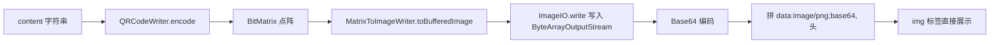

# 二维码不落盘：生成 DataURL 字符串直出图片，并把刷脸登录微服务的环境搭起来

上一课的二维码落成了本地文件，可用性立刻打了折扣：登录页要展示它，还得把文件暴露成静态资源或者写一个下载接口。真正合意的形态是一根字符串，后端直接返回，前端塞进 `` 就能显示。这一课先解决二维码的输出形态，再把刷脸登录需要的整套微服务环境搭起来，后面几课的业务代码全部跑在这套环境上。

## 先给结论

- DataURL 二维码就是「图片字节做 Base64 编码，前面拼上 `data:image/png;base64,` 头」，得到的字符串浏览器可以直接当图片渲染，不落盘、不产生二次请求。
- 生成路径在 ZXing 三步之上多两步：`MatrixToImageWriter.toBufferedImage` 拿到图片对象，`ImageIO.write` 把它写进 `ByteArrayOutputStream`，再对字节数组做 Base64 编码。
- 环境搭建四件事：引入百度 AI 与 ZXing 坐标、拷入两个实体类和两个工具类、补 `application.yml` 的 `ai.*` 与 `qr.url` 配置、搭好 Controller 与 Service 四接口骨架。
- 二维码接口返回 `QRCode(code, file)`，轮询接口返回 `FaceLoginResult(state, token, userId)`，状态取值 -1 未扫描、0 登录失败、1 登录成功。
- 工具类统一打 `@Component` 交给 Spring 容器，业务代码里 `@Autowired` 直接注入。

## DataURL 是什么，为什么适合二维码

DataURL 是把资源内容直接编码进 URL 字符串的方案，图片版长这样：`data:image/png;base64,` 后跟 Base64 编码的图片字节。浏览器解析到这种 src，不会发起网络请求，当场解码渲染。

它的收益正对二维码场景：200 乘 200 的黑白点阵编码后字符串不大，登录页拿到立刻显示，省掉文件落盘、静态资源映射、二次下载三个环节。代价也要清楚：Base64 会把体积放大约三分之一，大图不适合，二维码这种小图正合适。前端侧的使用非常直接：

```javascript
qrcode().then(res => {
  this.param.qrcode = res.data.data.file   // 后端返回的 DataURL 字符串
  this.centerDialogVisible = true          // 弹窗展示，img 直接绑定
})
```

## 生成 DataURL 二维码：在点阵之后多走两步

与落盘版本的差别从第三步开始：不再调 `writeToPath` 写文件，而是把点阵转成图片对象、再写进内存输出流，最后对字节数组做 Base64 编码。

```java
import com.google.zxing.BarcodeFormat;
import com.google.zxing.client.j2se.MatrixToImageWriter;
import com.google.zxing.common.BitMatrix;
import com.google.zxing.qrcode.QRCodeWriter;
import javax.imageio.ImageIO;
import java.awt.image.BufferedImage;
import java.io.ByteArrayOutputStream;
import java.util.Base64;

public class QRCodeDataUrlTest {
    public static void main(String[] args) throws Exception {
        // 1. 二维码中的信息
        String content = "https://www.example.com/faceLogin";
        // 2. 通过 ZXing 生成点阵
        QRCodeWriter writer = new QRCodeWriter();
        BitMatrix bt = writer.encode(content, BarcodeFormat.QR_CODE, 200, 200);
        // 3. 点阵转图片对象，写入内存输出流
        ByteArrayOutputStream os = new ByteArrayOutputStream();
        BufferedImage bufferedImage = MatrixToImageWriter.toBufferedImage(bt);
        ImageIO.write(bufferedImage, "png", os);
        // 4. 字节数组做 Base64 编码，拼上 DataURL 头
        String dataUrl = "data:image/png;base64,"
                + Base64.getEncoder().encodeToString(os.toByteArray());
        System.out.println(dataUrl);
    }
}
```

四个动作各有分工：`toBufferedImage` 把布尔点阵渲染成 JDK 标准的 `BufferedImage` 图片对象；`ImageIO.write` 的三个参数是图片对象、格式名、输出流，选 `ByteArrayOutputStream` 是为留在内存里；`Base64.getEncoder().encodeToString` 把 `os.toByteArray()` 编成字符串；头部的 `data:image/png;base64,` 声明了 MIME 类型与编码方式，少了它浏览器不会把字符串当图片渲染。



把这段逻辑抽成工程工具类，业务代码就能一行调用。课程资料里的封装如下（包名已改为 `com.example`，Base64 工具统一替换为 JDK 自带的 `java.util.Base64`，逻辑不变）：

```java
package com.example.system.utils;

import com.google.zxing.BarcodeFormat;
import com.google.zxing.client.j2se.MatrixToImageWriter;
import com.google.zxing.common.BitMatrix;
import com.google.zxing.qrcode.QRCodeWriter;
import org.springframework.stereotype.Component;
import javax.imageio.ImageIO;
import java.awt.image.BufferedImage;
import java.io.ByteArrayOutputStream;
import java.io.IOException;
import java.util.Base64;

@Component
public class QRCodeUtil {

    /**
     * 生成 Base64 二维码
     */
    public String crateQRCode(String content) throws IOException {
        ByteArrayOutputStream os = new ByteArrayOutputStream();
        try {
            QRCodeWriter writer = new QRCodeWriter();
            BitMatrix bitMatrix = writer.encode(content, BarcodeFormat.QR_CODE, 200, 200);
            BufferedImage bufferedImage = MatrixToImageWriter.toBufferedImage(bitMatrix);
            ImageIO.write(bufferedImage, "png", os);
            // 添加图片标识
            return "data:image/png;base64," + Base64.getEncoder().encodeToString(os.toByteArray());
        } catch (Exception e) {
            e.printStackTrace();
        } finally {
            os.close();
        }
        return null;
    }
}
```

类上的 `@Component` 是关键一笔：工具类成为容器里的一个 bean，业务类 `@Autowired` 注入即用，为后续 Service 调用铺平了路。

## 搭环境第一件事：坐标与配置

刷脸登录的后台逻辑全部落在系统微服务工程，往 `pom.xml` 追加三组依赖：百度人脸 SDK、ZXing 两件套、状态查询要用的 Redis 支持。

```xml
<dependency>
    <groupId>com.baidu.aip</groupId>
    <artifactId>java-sdk</artifactId>
    <version>4.0.0</version>
</dependency>
<dependency>
    <groupId>com.google.zxing</groupId>
    <artifactId>core</artifactId>
    <version>3.2.1</version>
</dependency>
<dependency>
    <groupId>com.google.zxing</groupId>
    <artifactId>javase</artifactId>
    <version>3.2.1</version>
</dependency>
<dependency>
    <groupId>org.springframework.boot</groupId>
    <artifactId>spring-boot-starter-data-redis</artifactId>
</dependency>
```

`application.yml` 里补两段配置。`ai.*` 是百度人脸应用的接入参数，`appId`、`apiKey`、`secretKey` 在控制台创建应用后拿得到，`imageType` 固定 `BASE64`，`groupId` 是人脸库分组；`qr.url` 是二维码要编码的落地页地址，手机扫码后打开的前端页面路由：

```yaml
ai:
  appId: 你的应用ID
  apiKey: 你的APIKey
  secretKey: 你的SecretKey
  imageType: BASE64
  groupId: hrm
qr:
  url: https://localhost:8080/#/faceLogin
```

Redis 的 `host`、`port` 与 JWT 配置工程里此前已有，无需重复添加。

## 两个实体类：接口返回的契约

四个接口的返回内容，靠两个实体类承载，都放在响应包里，与数据库无关。

**`QRCode` 对应生成二维码接口的返回。** 两个字段：`code` 是随机生成的唯一标志，`file` 是二维码文件，形态就是刚封装好的 DataURL 字符串。

```java
@Data
@AllArgsConstructor
@NoArgsConstructor
public class QRCode implements Serializable {
    /**
     * 随机生成码
     */
    private String code;
    /**
     * Base64 二维码文件
     */
    private String file;
}
```

**`FaceLoginResult` 对应轮询接口的返回。** `state` 是二维码使用状态：-1 表示二维码刚生成还没人扫，0 表示登录失败，1 表示登录成功；登录成功时另外两个字段才有值，`userId` 是命中的用户 ID，`token` 是登录令牌，登录页跳转全靠它。

```java
@Data
@NoArgsConstructor
@ToString
public class FaceLoginResult implements Serializable {
    /**
     * 二维码使用状态
     */
    private String state;
    /**
     * 登录信息
     */
    private String token;
    /**
     * 用户ID
     */
    private String userId;

    public FaceLoginResult(String state, String token, String userId) {
        this.state = state;
        this.token = token;
        this.userId = userId;
    }

    public FaceLoginResult(String state) {
        this.state = state;
    }
}
```

## 百度 AI 工具类：四个动作一次封装

`BaiduAiUtil` 把人脸库的全部交互收敛到一个类里。配置项用 `@Value` 从 `application.yml` 注入，客户端对象在 `@PostConstruct` 方法里创建，类本身打 `@Component` 进容器：

```java
@Component
public class BaiduAiUtil {

    @Value("${ai.appId}")
    private String APP_ID;
    @Value("${ai.apiKey}")
    private String API_KEY;
    @Value("${ai.secretKey}")
    private String SECRET_KEY;
    @Value("${ai.imageType}")
    private String IMAGE_TYPE;
    @Value("${ai.groupId}")
    private String groupId;

    private AipFace client;
    private HashMap<String, String> options = new HashMap<>();

    public BaiduAiUtil() {
        options.put("quality_control", "NORMAL");
        options.put("liveness_control", "LOW");
    }

    @PostConstruct
    public void init() {
        client = new AipFace(APP_ID, API_KEY, SECRET_KEY);
    }

    /**
     * 人脸注册：将用户照片存入人脸库
     */
    public Boolean faceRegister(String userId, String image) {
        JSONObject res = client.addUser(image, IMAGE_TYPE, groupId, userId, options);
        Integer errorCode = res.getInt("error_code");
        return errorCode == 0;
    }

    /**
     * 人脸更新：更新人脸库中的用户照片
     */
    public Boolean faceUpdate(String userId, String image) {
        JSONObject res = client.updateUser(image, IMAGE_TYPE, groupId, userId, options);
        Integer errorCode = res.getInt("error_code");
        return errorCode == 0;
    }

    /**
     * 人脸检测：判断上传图片中是否存在面部头像
     */
    public Boolean faceCheck(String image) {
        JSONObject res = client.detect(image, IMAGE_TYPE, options);
        if (res.has("error_code") && res.getInt("error_code") == 0) {
            JSONObject resultObject = res.getJSONObject("result");
            Integer faceNum = resultObject.getInt("face_num");
            return faceNum == 1;
        }
        return false;
    }

    /**
     * 人脸查找：返回相似度最高的 userId，score 大于 80 认定同一人
     */
    public String faceSearch(String image) {
        JSONObject res = client.search(image, IMAGE_TYPE, groupId, options);
        if (res.has("error_code") && res.getInt("error_code") == 0) {
            JSONObject result = res.getJSONObject("result");
            JSONArray userList = result.getJSONArray("user_list");
            if (userList.length() > 0) {
                JSONObject user = userList.getJSONObject(0);
                double score = user.getDouble("score");
                if (score > 80) {
                    return user.getString("user_id");
                }
            }
        }
        return null;
    }
}
```

几个内部约定值得记牢。`options` 里 `quality_control` 控制图片质量门槛，`liveness_control` 开启活体检测档位；`faceCheck` 校验 `face_num == 1`，合影、风景照直接拒收；`faceSearch` 只取 `user_list` 第一项，再卡 `score > 80` 阈值，双条件都过才返回 `user_id`，否则返回 null。

**客户端为什么放在 `@PostConstruct` 里创建，而不是构造方法里？** Spring 的属性注入发生在构造完成之后，构造方法执行时 `APP_ID` 等字段还是 null，`new AipFace(...)` 会拿到一串空参数；`@PostConstruct` 方法在依赖注入全部完成后执行，时机刚好。

## Controller 与 Service 骨架：四个接口对齐业务图

控制器按需求分析里的四个接口搭好轮廓，方法体留待后续逐个填充：

```java
@RestController
@RequestMapping("/sys/faceLogin")
public class FaceLoginController {

    @RequestMapping(value = "/qrcode", method = RequestMethod.GET)
    public Result qrcode() throws Exception { return null; }

    @RequestMapping(value = "/qrcode/{code}", method = RequestMethod.GET)
    public Result qrcodeCeck(@PathVariable(name = "code") String code) throws Exception {
        return null;
    }

    @RequestMapping(value = "/{code}", method = RequestMethod.POST)
    public Result loginByFace(@PathVariable(name = "code") String code,
                              @RequestParam(name = "file") MultipartFile attachment) throws Exception {
        return null;
    }

    @RequestMapping(value = "/checkFace", method = RequestMethod.POST)
    public Result checkFace(@RequestParam(name = "file") MultipartFile attachment) throws Exception {
        return null;
    }
}
```

| 接口 | 方法 | 职责 |
|---|---|---|
| `/qrcode` | GET | 生成二维码与唯一标志 code |
| `/qrcode/{code}` | GET | 登录页轮询，按 code 查登录状态 |
| `/checkFace` | POST | 图像检测，判断照片里是否有面部头像 |
| `/{code}` | POST | 刷脸登录，调人脸检索并改写状态 |

服务层与之一一对应，`FaceLoginService` 里四个同名业务方法加一个统一的缓存 key 构造方法，`@Value("${qr.url}")` 把落地页地址注入进来：

```java
@Service
public class FaceLoginService {

    @Value("${qr.url}")
    private String url;

    // 创建二维码
    public QRCode getQRCode() throws Exception { return null; }

    // 根据唯一标识，查询用户是否登录成功
    public FaceLoginResult checkQRCode(String code) { return null; }

    // 扫描二维码之后，使用拍摄照片进行登录
    public String loginByFace(String code, MultipartFile attachment) throws Exception {
        return null;
    }

    // 构造缓存 key
    private String getCacheKey(String code) {
        return "qrcode_" + code;
    }
}
```

Controller 只做参数接住和结果包装，业务全部下沉到 Service。环境到这里就绪：坐标、配置、实体、工具、骨架五样齐备，后续课程只需往方法体里填代码。

## 常见误区

- **忘拼 DataURL 头**：只返回 Base64 裸串，`` 不渲染。头部的 `data:image/png;base64,` 声明了 MIME 与编码，属于字符串的一部分，必须拼接。
- **把创建客户端写进构造方法**：构造时 `@Value` 字段尚未注入，`AipFace` 拿到的是 null 配置，调用时报鉴权错误。初始化逻辑放 `@PostConstruct` 方法里。
- **`imageType` 与数据形态不匹配**：传 Base64 字符串时第二个参数必须是 `BASE64`，传 URL 形态却声明 `BASE64`，云端直接解析失败。
- **`groupId` 与人脸库不一致**：注册进的组和检索用的组不是同一个，`faceSearch` 永远查不到人，返回值恒为 null。

## 面试可能被问到的问题

1. 面试官追问：「DataURL 方案和文件落盘方案怎么选？」
   答：小图、展示即用的场景选 DataURL，字符串随接口返回，前端直接渲染，省掉文件管理与二次请求；大图或需要 CDN 加速、多端缓存的场景落盘对象存储，Base64 会放大约三分之一的体积。

2. 面试官追问：「生成 DataURL 二维码的完整步骤？」
   答：`QRCodeWriter.encode` 得到 `BitMatrix` 点阵，`MatrixToImageWriter.toBufferedImage` 渲染成 `BufferedImage`，`ImageIO.write` 写入 `ByteArrayOutputStream`，再对 `toByteArray()` 做 Base64 编码，最后拼上 `data:image/png;base64,` 头返回。

3. 面试官追问：「为什么 `AipFace` 客户端在 `@PostConstruct` 方法里初始化？」
   答：`@Value` 属性注入发生在构造方法执行之后，构造时配置字段还是 null。`@PostConstruct` 标注的方法在依赖注入完成后回调，此时创建客户端才能拿到真实的 appId、apiKey、secretKey。

4. 面试官追问：「人脸检测为什么要求 `face_num == 1`？」
   答：刷脸登录的前提是单人照片。合影里多张脸时，检索结果不可控，可能匹配到其他人；风景照、物品图则根本无脸可检索。检测层先保证图里恰好一张脸，登录层的人脸搜索才有意义。

5. 面试官追问：「`faceSearch` 里 score 大于 80 这个阈值起什么作用？」
   答：相似度得分低于阈值时认为库里没有同一人，直接返回 null 走登录失败分支，防止把长相接近的陌生人误认成注册用户。阈值是安全性与通过率的平衡点，课程取 80 分，业务可以按误识率要求调整。

6. 面试官追问：「轮询接口为什么返回整个 `FaceLoginResult` 而不是只返回状态值？」
   答：轮询返回的不只是状态，登录成功时前端还需要 token 和 userId 才能完成跳转与初始化。把三者封装成一个对象，未扫描时只有 state 有值，成功时三个字段俱全，接口契约稳定，前端处理逻辑统一。

## 配套资料

- 二维码工具类：`materials/code/02/day11-刷脸登录/day11-刷脸登录/资源/代码/工具类/QRCodeUtil.java`（真实文件，`crateQRCode` 输出 DataURL）
- 百度 AI 工具类：同目录 `工具类/BaiduAiUtil.java`（真实文件，含 faceRegister、faceUpdate、faceCheck、faceSearch 四方法）
- 实体类：`实体类/QRCode.java`、`实体类/FaceLoginResult.java`（真实文件）
- 接口骨架：`controller/FaceLoginController.java`、`service/FaceLoginService.java`（真实文件，方法体留空，实现按本课进度后续填充）
- 前端参考：`前端页面改造/login.vue`（DataURL 赋值给二维码弹窗的取数逻辑）；DataURL 生成测试类 `QRCodeDataUrlTest` 为按本课视频写法补全的示例
