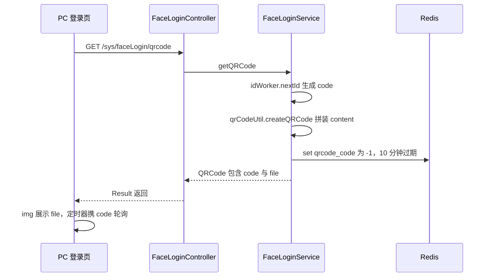

# 刷脸登录的二维码接口：IdWorker 造唯一码，Redis 记住每个码的状态

人脸注册搞定，工具类就绪，可以把它们接成刷脸登录的第一个业务接口：`GET /sys/faceLogin/qrcode`。这个接口的难点不在画图，`QRCodeUtil` 一行就出图；难点在于每个二维码要有身份、有状态、有寿命，生成身份、记录状态、设定寿命这三个决定定了，接口才算真懂业务。

## 先给结论

- Controller 只做编排：调 `faceLoginService.getQRCode()`，把 `QRCode` 实体包进 `Result` 返回，业务全在 Service。
- 唯一标志 code 用雪花算法 `idWorker.nextId()` 生成，全局唯一且趋势递增；二维码内容是 `落地页地址?code=xxx`，手机扫码即把 code 带进落地页。
- 状态存 Redis，key 统一用 `qrcode_ + code` 构造，值是 `FaceLoginResult` 对象，初始状态 `-1` 表示未扫描。
- 过期时间设 10 分钟，`TimeUnit.MINUTES` 指定单位，到期 Redis 自动清理，旧码作废，重开一轮必须重新生成。
- 需要引入 `spring-boot-starter-data-redis` 坐标并注入 `RedisTemplate`，Redis 连接配置此前已有。

## 接口的样子：Controller 只负责包装

控制器方法十几行，模式与系统里其他接口完全一致：

```java
@Autowired
private FaceLoginService faceLoginService;

/**
 * 获取刷脸登录二维码
 */
@RequestMapping(value = "/qrcode", method = RequestMethod.GET)
public Result qrcode() throws Exception {
    QRCode qrCode = faceLoginService.getQRCode();
    return new Result(ResultCode.SUCCESS, qrCode);
}
```

取出 Service 的结果套上统一响应结构就返回。前端拿到的 JSON 里，`data.code` 是唯一标志，`data.file` 是 DataURL 二维码字符串，赋给弹窗的图片变量即可显示。

## Service 的四步：造码、画图、记状态、返回

```java
@Service
public class FaceLoginService {

    @Value("${qr.url}")
    private String url;

    @Autowired
    private IdWorker idWorker;
    @Autowired
    private QRCodeUtil qrCodeUtil;
    @Autowired
    private RedisTemplate redisTemplate;

    // 创建二维码
    public QRCode getQRCode() throws Exception {
        // 1. 创建唯一标识
        String code = idWorker.nextId() + "";
        // 2. 生成二维码，内容是携带 code 的落地页地址
        String content = url + "?code=" + code;
        String file = qrCodeUtil.createQRCode(content);
        // 3. 存入二维码初始状态：未扫描
        FaceLoginResult result = new FaceLoginResult("-1");
        redisTemplate.boundValueOps(getCacheKey(code)).set(result, 10, TimeUnit.MINUTES);
        // 4. 返回唯一标志与二维码文件
        return new QRCode(code, file);
    }

    // 构造缓存 key
    private String getCacheKey(String code) {
        return "qrcode_" + code;
    }
}
```

逐条拆开看每一步为什么这么写。

**第一步，code 用 `IdWorker` 生成。** 雪花算法靠「时间戳 + 机器标识 + 序列号」拼出全局唯一的 long 型 ID，不依赖数据库与协调服务，批量生成也不重号。code 要在登录页、落地页、后端 Redis 三方之间传递并精确定位一轮会话，唯一性是硬要求；`nextId()` 结果拼上空串转成字符串使用。

**第二步，二维码内容是完整地址而不是裸 code。** `content` 由配置里的落地页地址拼上 `?code=` 组成。手机扫码后打开的就是这个 URL，code 作为查询参数被带进落地页；落地页再把它塞回上传接口的路径里，后端才知道这次拍照对应哪一轮扫码。

**第三步，状态对象初始值 `-1` 写进 Redis。** 存的是 `FaceLoginResult` 而不是简单的字符串：当前只有 state 有值，等刷脸比对出结果，同一个对象结构还要装 token 和 userId，一开始就把结构定好。`boundValueOps` 绑定 key 后的 `set(value, timeout, unit)` 在写入的同时挂上过期。

**第四步，返回 `new QRCode(code, file)`。** 前端展示图片与后续轮询的 code 一次带全。



图里最后一步是接口的下游：登录页每 5 秒轮询一次 `qrcode/{code}`，状态流转全靠 Redis 里这个 key。

## 状态与寿命：为什么是 Redis、为什么是 10 分钟

**Redis 是唯一合理的位置。** 二维码状态是短周期、高频读写的临时数据：PC 端定时器反复读，手机端触发时写，数据过期即无意义。Redis 的内存读写满足频率，自带的过期机制满足寿命；放 MySQL 里则要建表、定时清理过期行。

**key 规则收在 `getCacheKey` 一个方法里。** 写状态用 `qrcode_ + code`，轮询查询也必须用同一个方法构造 key，前缀、分隔符完全一致。状态机随后续课程展开：比对通过置 `1` 并补充 token 与 userId，比对失败置 `0`，登录页按值分流决定跳转或重试。

**10 分钟过期是安全与体验的平衡。** 二维码长期有效等于给重放攻击留门，截图、转发都能让旧码活着。设了过期，Redis 到点自动删除，重新生成成本不过一次点击。

前端侧的配合在 `login.vue` 里可见：`qrcode()` 拿到 file 填进弹窗，`setInterval` 每 5 秒轮询，状态为 1 且 token 存在即 `setToken` 跳转首页，后端存什么结构前端就怎么消费。

## 常见误区

- **写读两处的 key 拼法不一致**：写入用 `qrcode_ + code`，查询时漏了前缀，轮询永远查到 null。key 构造必须收敛到 `getCacheKey` 一个方法。
- **二维码内容只放 code 不放地址**：手机端扫出一串数字，没有落地页可去。content 必须是完整 URL，code 以查询参数形式随地址传递。
- **只存状态字符串不存结果对象**：成功时刻要补 token 和 userId，存裸字符串后面就得换结构、改代码。一开始就存 `FaceLoginResult`，状态机各阶段共用同一契约。依赖同理，漏引 `spring-boot-starter-data-redis` 时 `RedisTemplate` 注入直接报找不到 bean。
- **过期时间不设或设得过长**：Redis 里残留大量死状态，旧码被截图后长期可用，重放风险随有效期水涨船高。写入时必须带 timeout 与时间单位。

## 面试可能被问到的问题

1. 面试官追问：「生成 code 为什么用雪花 ID，UUID 不行吗？」
   答：两者都满足唯一性，雪花 ID 是趋势递增的 long 型，字符串更短，作为二维码参数与 Redis key 都更省；UUID 32 位且无序，二维码里编码内容更长。项目已引入 `IdWorker` 组件，复用成本为零。

2. 面试官追问：「二维码状态为什么放 Redis 而不是 MySQL？」
   答：状态是短生命周期的高频临时数据，PC 端每几秒轮询一次，Redis 内存读写轻松承接；数据 10 分钟后就该消失，过期机制原生支持，MySQL 还要建表加定时清理。

3. 面试官追问：「`boundValueOps(getCacheKey(code)).set(result, 10, TimeUnit.MINUTES)` 做了什么？」
   答：`boundValueOps` 把 `RedisTemplate` 绑定到指定 key 上返回值操作对象，`set` 带过期参数的重载在写入值的同时设置 10 分钟 TTL，到点自动删除。等价于写入后追加一条 `expire`，但一次网络往返完成。

4. 面试官追问：「二维码内容为什么要带 code 参数？」
   答：code 是这一轮登录会话的唯一标志。扫码打开落地页时它随 URL 进入手机端，落地页上传照片时又把它带回后端，后端据此定位并改写 Redis 里的状态。

5. 面试官追问：「用户 10 分钟后才扫码会怎样？」
   答：key 已过期删除，拍照上传后后端查不到状态，按无效码处理并提示重新生成。一轮一码、码带寿命，杜绝旧码复活和截图重放。

6. 面试官追问：「为什么 Controller 只做一行包装，逻辑全下沉到 Service？」
   答：保持分层纪律。Controller 负责协议与响应结构，Service 承载业务与状态管理，四个刷脸接口之间才能复用同一套 `FaceLoginResult` 状态机与缓存 key 规则，单测也可直接打在 Service 层。

## 配套资料

- 服务层骨架：`materials/code/02/day11-刷脸登录/day11-刷脸登录/资源/代码/service/FaceLoginService.java`（真实文件，`@Value("${qr.url}")` 注入、`getCacheKey` 返回 `qrcode_ + code` 为资料包原样；`getQRCode` 方法体为按本课视频写法补全）
- 控制器：同目录 `controller/FaceLoginController.java`（真实文件）
- 实体类：`实体类/QRCode.java`、`实体类/FaceLoginResult.java`（真实文件，构造方法与字段与文中一致）
- 二维码工具类：`工具类/QRCodeUtil.java`（真实文件，`crateQRCode` 输出 DataURL）
- 雪花 ID 组件：`materials/code/02/day01 SAAS-HRM系统概述与搭建环境/SAAS-HRM系统概述与搭建环境/资源/通用代码/IdWorker.java`（真实文件，`nextId` 生成全局唯一 ID）
- 前端轮询逻辑：`materials/code/02/day11-刷脸登录/day11-刷脸登录/资源/代码/前端页面改造/login.vue`（真实文件，5 秒定时器与状态分支）
