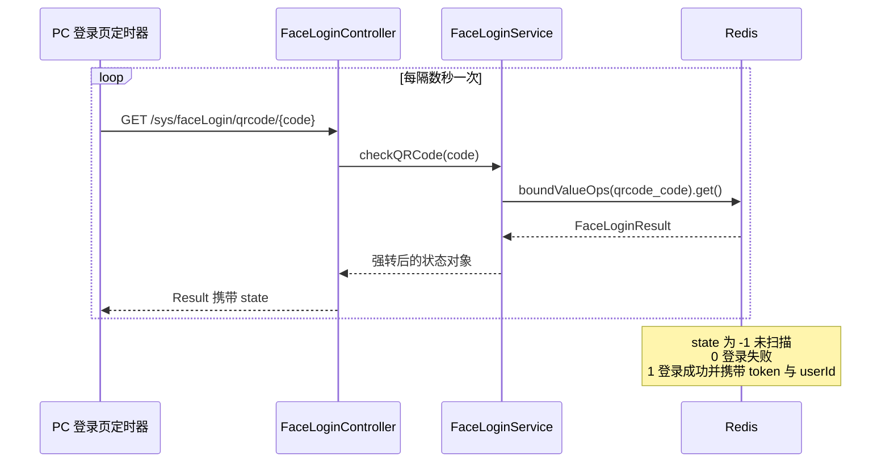

# 轮询二维码登录状态：登录页每隔几秒问一次 Redis，用 -1、0、1 回答

二维码生成接口通了，Postman 一发就能拿到 code 和 DataURL 图片，但问题马上跟着来：二维码挂在 PC 登录页上，手机扫没扫、扫完登录成功没有，PC 端怎么知道？答案是一个独立的查询接口 `GET /sys/faceLogin/qrcode/{code}`，登录页用定时器每隔几秒调一次，后端拿 code 去 Redis 里查状态对象原样返回。这一课把这个轮询接口补完，顺带解决测试前必须处理的认证放行问题。

## 先给结论

- 刷脸登录涉及的全部接口都必须配置 Shiro 匿名访问，`filterMap.put("/sys/faceLogin/**", "anon")`，否则用户还没登录，二维码接口第一个就被拦截。
- 轮询接口的 Controller 只做转发：从路径取 `code`，调 `faceLoginService.checkQRCode(code)`，结果包进 `Result` 返回。
- Service 的核心只有两行：用 `getCacheKey(code)` 构造 key，`redisTemplate.boundValueOps(key).get()` 取出并强转为 `FaceLoginResult`。
- 状态语义三种：`-1` 未扫描（生成二维码时写入的初始值）、`0` 登录失败、`1` 登录成功，成功状态的对象里才携带 token 与 userId。
- 测试时反复发同一个请求，`state` 一直是 `-1`；手工把 Redis 里的值改成 `0` 或 `1`，就能模拟失败与成功两条分支。

## 测试之前：先把匿名访问放开

系统里所有微服务的认证授权统一由 Shiro 控制，配置类里维护着一张「URL 到过滤器」的链表：多数路径配的是 `authc`，要求登录之后才能访问。而刷脸登录这条链路有点特殊，从生成二维码到轮询状态再到上传照片，全都没有登录态，如果沿用默认配置，第一个请求就会被重定向到登录错误页。

处理方式是把这几个接口整段放行。真实工程里的 `ShiroConfiguration` 已经给出了标准写法，key 支持通配符，`/**` 结尾代表该路径下的全部子路径（也包含路径本身）：

```java
Map<String, String> filterMap = new LinkedHashMap<>();
// 刷脸登录相关接口：生成二维码、轮询状态、人脸检测、人脸登录
// 用户此时尚未登录，必须全部匿名访问
filterMap.put("/sys/faceLogin/**", "anon");
// 认证之后访问（登录之后可以访问）
filterMap.put("/**", "authc");
filterFactory.setFilterChainDefinitionMap(filterMap);
```

LinkedHashMap 保证过滤器按插入顺序匹配，`/sys/faceLogin/**` 必须排在兜底的 `/**` 之前，否则先被 `authc` 截住，后面的匿名规则没有机会生效。配置完成后重启系统微服务，用 Postman 请求 `GET localhost:9002/sys/faceLogin/qrcode`，拿到 `code` 与 `file` 两个数据，把控制台打印的 DataURL 直接粘进浏览器地址栏，二维码图片渲染出来，说明匿名放行生效。

## 轮询接口：Controller 一层转发，Service 查一次 Redis

Controller 里新增一个带路径参数的方法，浏览器端定时器每次轮询都把 code 拼在路径上带回来：

```java
/**
 * 校验二维码：登录页面轮询调用此方法
 * 根据唯一标识 code 判断用户登录情况
 * 返回值：FaceLoginResult，state 为 -1、0、1
 */
@RequestMapping(value = "/qrcode/{code}", method = RequestMethod.GET)
public Result qrcodeCheck(@PathVariable(name = "code") String code) throws Exception {
    FaceLoginResult checkQRCode = faceLoginService.checkQRCode(code);
    return new Result(ResultCode.SUCCESS, checkQRCode);
}
```

Service 侧的 `checkQRCode` 在课程骨架里原本是空方法，实现思路上没有新东西：生成二维码那一刻，状态对象 `FaceLoginResult` 已经以 `qrcode_ + code` 为 key 存进 Redis，初始值 `-1`，有效期 10 分钟。轮询查询要做的只是用同样的规则构造 key，把这个对象取出来：

```java
// 根据唯一标识，查询用户是否登录成功
public FaceLoginResult checkQRCode(String code) {
    // 1. 构造缓存 key，与写入时使用同一个方法
    String key = getCacheKey(code);
    // 2. 从 Redis 中查询并返回
    return (FaceLoginResult) redisTemplate.boundValueOps(key).get();
}

// 构造缓存 key
private String getCacheKey(String code) {
    return "qrcode_" + code;
}
```

写和读共用 `getCacheKey` 是这段代码最值得强调的纪律。前缀、分隔符任何一处不一致，轮询拿到的永远是 null，前端表现为二维码永远显示「未扫描」，而后端日志一片安静，这类问题排查起来非常浪费时间，收敛到一个私有方法后想错都难。

整个轮询过程的状态流转可以用一张时序图表达：



图上要盯住中间那条线：Service 对 Redis 只有一次读操作，不写任何东西。轮询接口是纯观察者，改状态的只有手机端落地页触发的人脸登录接口，读写分离在这条链路里天然成立。

## 状态语义：为什么恰好是 -1、0、1

`FaceLoginResult` 里真正被轮询消费的就是 `state` 字段。`-1` 在二维码生成时写入，语义是「码还活着，但没人扫」；`0` 表示落地页已经提交过照片，但比对失败，这一次扫码宣告作废；`1` 表示登录成功，此时对象里的 `token` 和 `userId` 才有值，token 用于 PC 端免密跳转首页。

用 Postman 验证时，二维码刚生成就反复请求，返回的 `state` 恒为 `-1`，这证明读取链路是通的。手工模拟后续状态也很直接：在 Redis 客户端里把同一个 key 的值改成 `0`，再发请求，返回跟随变化；改成 `1` 时，因为构造的对象还没有 token 与 userId，恰好印证了「成功状态的信息要靠人脸登录接口补齐」，下一课的实现会把这个闭环补上。

## 常见误区

- **过滤器顺序写反**：把 `filterMap.put("/**", "authc")` 放在前面，匿名规则永远匹配不到，二维码接口直接 302 到错误页。精确路径必须写在通配兜底之前。
- **读写两侧 key 拼法不一致**：写入用 `qrcode_ + code`，查询时手写成 `code` 裸值或换了分隔符，轮询恒返回 null。key 构造必须收敛在 `getCacheKey` 一个方法里。
- **漏掉强转或强转类型不对**：`boundValueOps(key).get()` 的返回值是 Object，必须转成 `FaceLoginResult`；若序列化器配置不一致，取出来的可能是 JSON 字符串，强转直接抛 ClassCastException。
- **把轮询接口写成先查后写**：观察状态的接口不应该修改状态，改写 `-1` 的动作只属于人脸登录那一侧，否则两个定时请求并发时会互相覆盖。

## 面试可能被问到的问题

1. 面试官追问：「二维码登录为什么用轮询而不是 WebSocket 推送？」
   答：轮询实现成本极低，一个定时器加一个只读接口就能跑通，对查询频率不高的登录场景完全够用；WebSocket 能省掉无效请求并降低感知延迟，但要维护长连接与服务端推送，登录这种分钟级的短流程收益有限。课程选择轮询，重点是把状态机的读写职责切干净。

2. 面试官追问：「为什么刷脸登录的接口要配置 anon 匿名访问？」
   答：这条链路的入口发生在登录之前，用户此时没有任何会话凭证。如果沿用全局 `authc` 规则，生成二维码的第一个请求就会被拦截。放行范围用 `/sys/faceLogin/**` 精确圈定，不影响其他接口的认证要求。

3. 面试官追问：「state 为什么用 -1、0、1 三种值，一个布尔不够吗？」
   答：布尔只能表达成功失败，无法区分「还没扫」和「扫了但失败」。登录页需要根据三态做不同动作：`-1` 继续等待，`0` 关闭弹窗提示重试，`1` 携带 token 跳转首页。三态恰好覆盖了二维码从生成到终结的完整生命周期。

4. 面试官追问：「`boundValueOps` 和 `opsForValue` 有什么区别？」
   答：`boundValueOps(key)` 先绑定 key 再做后续操作，同一 key 的连续读写不必每次传 key，代码更收敛；`opsForValue` 每个方法都要显式携带 key。功能上两者等价，绑定式写法在同一个 key 被反复操作的场景下更清晰。

5. 面试官追问：「轮询间隔设置成多少合适，太密会怎样？」
   答：登录场景 3 到 5 秒一次是常见取值。间隔过短会让大量请求打在 Redis 的同一个 key 上，虽然单次读很轻，但用户量上来后就是无意义的放大流量；过长则扫码后要等下一个周期才跳转，体验变差。二维码本身有 10 分钟过期兜底，轮询可以在过期后自然停止。

## 配套资料

- 控制器骨架：`materials/code/02/day11-刷脸登录/day11-刷脸登录/资源/代码/controller/FaceLoginController.java`（真实文件，`qrcodeCheck` 方法签名与 `/qrcode/{code}` 路由为资料包原样，方法体按本课视频补全）
- 服务层骨架：`materials/code/02/day11-刷脸登录/day11-刷脸登录/资源/代码/service/FaceLoginService.java`（真实文件，`getCacheKey` 返回 `qrcode_ + code` 为资料包原样，`checkQRCode` 方法体按本课视频补全）
- 状态实体：`materials/code/02/day11-刷脸登录/day11-刷脸登录/资源/代码/实体类/FaceLoginResult.java`（真实文件，state、token、userId 三字段）
- Shiro 配置参考：`materials/code/02/day07 员工管理及POI入门/员工管理及POI入门/资源/后端/ihrm_employee/src/main/java/com/ihrm/employee/ShiroConfiguration.java`（真实文件，filterMap 的 anon 与 authc 配置模式同源）
- 前端轮询消费侧：`materials/code/02/day11-刷脸登录/day11-刷脸登录/资源/代码/前端页面改造/login.vue`（真实文件，定时器按 state 分支跳转）
