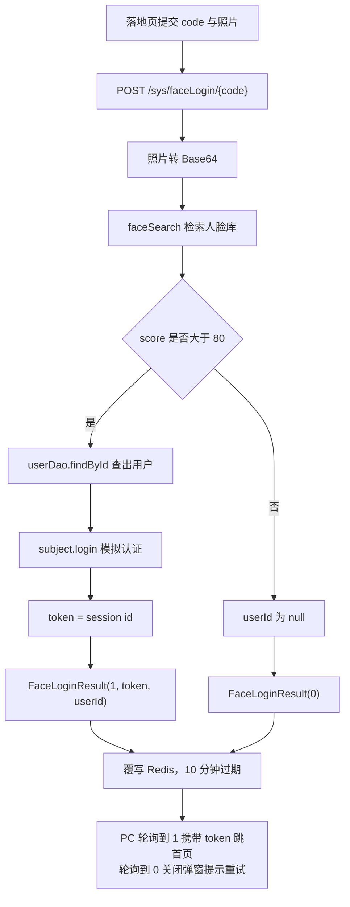

# 人脸登录接口：faceSearch 找到人、模拟 Shiro 登录换 token、覆写二维码状态

刷脸登录的最后一环，也是唯一会改变系统状态的接口：手机落地页把照片连同 code 一起提交到 `POST /sys/faceLogin/{code}`，后端拿照片去人脸库检索，认定是哪个用户，替他完成一次登录，再把登录成功后的 token 与 userId 写回 Redis。PC 登录页那边下一轮轮询就会看到 state 从 `-1` 变成 `1`，携带 token 直接跳转首页。这一课把这三步串起来，整个刷脸登录功能就闭环了。

## 先给结论

- Controller 只判断成败：调 `faceLoginService.loginByFace(code, attachment)` 拿 userId，非空返回 `ResultCode.SUCCESS`，为空返回 `ResultCode.FAIL`，落地页只关心这个布尔语义。
- Service 做三件事：`faceSearch` 检索人脸库、模拟 Shiro 登录换取 token、把 `FaceLoginResult` 覆写回 Redis。
- 相似度阈值是硬编码的 `score > 80`：`client.search` 返回的 `user_list` 里取第一名，得分超过 80 才认定同一用户并返回其 `user_id`，否则返回 null。
- token 来自 Shiro 会话：`subject.getSession().getId()`，因为系统的认证体系建立在 Shiro 加 Redis 会话之上；换成 JWT 体系时只需把这一处置换成签发 JWT 字符串。
- 无论成功失败，状态都要写回 Redis，失败置 `0` 终结这轮二维码，成功置 `1` 并补上 token 与 userId，写回时必须重新带上过期时间。

## Controller：成败只有一线之隔

接口路径里带 code，请求体里带照片文件，两个参数对应两件事：code 定位 Redis 里那一轮扫码会话，照片提供比对的原料。

```java
/**
 * 人脸登录：根据落地页拍摄的面部头像进行登录
 * 根据拍摄的图片调用百度云 AI 进行检索查找
 */
@RequestMapping(value = "/{code}", method = RequestMethod.POST)
public Result loginByFace(@PathVariable(name = "code") String code,
                          @RequestParam(name = "file") MultipartFile attachment) throws Exception {
    String userId = faceLoginService.loginByFace(code, attachment);
    if (userId != null) {
        return new Result(ResultCode.SUCCESS);
    } else {
        return new Result(ResultCode.FAIL);
    }
}
```

返回值刻意保持简陋，token 与 userId 都不从这里下发，而是通过 Redis 交给 PC 端的轮询接口转发。原因是消费方不同：手机落地页只需要知道「成功还是失败」来提示用户，PC 登录页才需要 token 去完成跳转，一次拍照的成果通过 Redis 中转给两端分别消费，这正是把状态集中放在 Redis 的好处。

## Service 三步：检索、登录、写状态

方法骨架围绕一个「先置失败、成功再覆写」的结果对象展开：

```java
// 扫描二维码之后，使用拍摄照片进行登录
public String loginByFace(String code, MultipartFile attachment) throws Exception {
    // 1. 调用百度云 AI 人脸搜索，得分大于 80 才返回 user_id
    String userId = baiduAiUtil.faceSearch(Base64Utils.encode(attachment.getBytes()));
    // 2. 构造结果对象，先置为登录失败
    FaceLoginResult result = new FaceLoginResult("0");
    if (userId != null) {
        // 3. 模拟自动登录：查询用户并走一遍 Shiro 认证
        User user = userDao.findById(userId).get();
        if (user != null) {
            Subject subject = SecurityUtils.getSubject();
            subject.login(new UsernamePasswordToken(user.getMobile(), user.getPassword()));
            // 4. token 即 Shiro 会话 id
            String token = (String) subject.getSession().getId();
            // 5. 覆写为登录成功，补齐 token 与 userId
            result = new FaceLoginResult("1", token, userId);
        }
    }
    // 6. 状态写回 Redis，过期策略与生成二维码时一致
    redisTemplate.boundValueOps(getCacheKey(code)).set(result, 10, TimeUnit.MINUTES);
    return userId;
}
```

**第一步，人脸搜索。** `faceSearch` 在工具类里已经有完整实现：`client.search(image, IMAGE_TYPE, groupId, options)` 提交 Base64 图片，云端在 `groupId` 人脸库里找出最相似的人，应答里的 `user_list` 按得分降序排列，取第一名判分：

```java
if (userList.length() > 0) {
    JSONObject user = userList.getJSONObject(0);
    double score = user.getDouble("score");
    if (score > 80) {
        return user.getString("user_id");
    }
}
```

score 是 0 到 100 的相似度评分，80 这条线是经验阈值：低于它，两张脸很可能只是「有点像」，放行等于允许长得像的人互登。检索命中返回的 `user_id` 就是人脸注册时写入的业务 userId，凭它可以直接 `userDao.findById` 查出用户，不需要任何映射表。

**第二步，模拟登录。** 检索只告诉你「这是谁」，登录态还得自己造。系统的账号密码登录走的是 Shiro 的 `subject.login(token)` 那一套，会话由 shiro-redis 托管在 Redis 里；刷脸登录复用同一条路径：查出用户后，用 `user.getMobile()` 与 `user.getPassword()` 构造 `UsernamePasswordToken`，交给当前 `Subject` 执行认证。认证通过，会话建立，`subject.getSession().getId()` 拿到的会话 id 就是下发给前端的 token，后续请求携带它，既有鉴权体系照常工作。

**第三步，状态覆写。** 结果对象先以 `new FaceLoginResult("0")` 兜底，任何一步失败（检索不命中、用户查不到），写进 Redis 的就是 state 为 0 的对象，PC 端轮询到 0 关闭弹窗提示重试。成功分支用三参构造器把 state、token、userId 一次赋齐。写回的 `set` 带上了与生成时相同的 10 分钟过期，这一步不能省。



图中两条分支最终都汇到 Redis 覆写上：一次拍照必然终结一轮二维码，要么成功要么失败，不存在「拍完没人管」的中间态，这是轮询模型能够收敛的前提。

## 一个真实的空指针：userDao 没注入

课程演示这段代码时踩了一个很有代表性的坑：Postman 发起登录请求，控制台在 Service 第 76 行抛出 `NullPointerException`。排查下来不是业务逻辑问题，`UserDao` 字段压根没加 `@Autowired`，注入失败字段保持 null，代码执行到 `userDao.findById(userId)` 直接炸掉。

这类错误的信号很明确：报错行号指向字段调用而不是某个具体业务值，且异常发生在第一次访问该字段时。成员变量注入后为 null，九成是注解漏写或类不在组件扫描范围内。`FaceLoginService` 里陆续要注入 `baiduAiUtil`、`redisTemplate`、`userDao`、`idWorker`、`qrCodeUtil` 五个依赖，写完方法体回头补一遍 `@Autowired` 清单，是值得一养的习惯。

## 常见误区

- **依赖注入漏标 `@Autowired`**：`userDao` 字段为 null，运行到查询处抛 `NullPointerException`。注入清单要与字段清单一一核对，视频演示里这个坑真实出现过。
- **覆写状态时不再设过期时间**：Redis 的 SET 类命令会清除原有 TTL，覆写时不带过期参数，这个 key 将永不过期，逐步积累成内存垃圾。每次写都要带上 `10, TimeUnit.MINUTES`。
- **阈值判断方向写反**：把 `score > 80` 写成 `score < 80` 时返回 userId，长得不像反而放行；或者拿到 `user_list` 不判空直接取下标 0，无人命中时抛数组越界。
- **绕过模拟登录直接造 token**：自己拼一个字符串塞进 Redis，前端拿着它请求业务接口会被鉴权层拦下，因为它在 Shiro 的会话管理里不存在。token 必须由认证体系签发，刷脸只是替代了「输密码」这个动作，认证通道没有变。

## 面试可能被问到的问题

1. 面试官追问：「相似度阈值 80 是怎么定的，设高设低各有什么后果？」
   答：score 表示两张脸的相似度评分，80 是安全与体验的经验平衡点。设低了，容貌相近的人可能互相登录，属于安全漏洞；设高了，本人稍微侧脸、光线变化就会被拒识，反复重拍体验差。生产上还会配合 quality_control 与 liveness_control 调整整体拒识率。

2. 面试官追问：「刷脸登录为什么复用 Shiro 的 login，而不是直接发一个自定义 token？」
   答：认证、会话管理、Redis 托管这套基础设施是现成的，走一遍 `subject.login` 能把会话正常绑定到 Redis，后续所有接口的鉴权、登出、会话超时全部沿用既有逻辑。自己造 token 意味着鉴权体系要为它开口子，改动面大且容易留下绕过认证的缝隙。

3. 面试官追问：「token 用 session id 合理吗，和 JWT 比有什么差别？」
   答：在服务端会话体系里 session id 就是凭证，天然唯一且可被服务端主动销毁，适合单体或会话集中的架构。JWT 是无签发状态的自包含令牌，适合跨服务鉴权。两者切换只影响 `loginByFace` 里生成 token 的那一行，状态写入 Redis 的结构不变。

4. 面试官追问：「登录失败为什么要写 state 0 回 Redis，不写会怎样？」
   答：不写的话 PC 端轮询到的永远是生成时的 -1，用户在手机上已经失败，PC 却还在无限等待，二维码处于假活状态。写入 0 让两端对这一轮扫码达成共识：二维码终结，PC 关弹窗，手机提示重拍，状态机没有悬空分支。

5. 面试官追问：「检索返回的 user_id 为什么能直接当业务用户主键用？」
   答：人脸注册阶段存入人脸库的 user_id 就是业务用户表的主键，二者在同一命名空间约定俗成。检索命中的 user_id 因此可以直达 `userDao.findById`，省掉一层第三方 ID 与业务 ID 的映射维护，也避免了映射表与用户表不一致的脏数据风险。

6. 面试官追问：「一个人脸库里有几万用户，search 的性能和准确性怎么保证？」
   答：人脸检索是向量相似度搜索，云端在百万级以下规模通常毫秒级返回，`user_list` 只回传最相似的若干条。准确性上，group 划分可以缩小检索范围，score 阈值过滤掉低分命中，质量与活体控制则在入口处挡掉垃圾图片，三层配合让误识率可控。

## 配套资料

- 服务层骨架：`materials/code/02/day11-刷脸登录/day11-刷脸登录/资源/代码/service/FaceLoginService.java`（真实文件，`loginByFace` 方法签名与 `getCacheKey` 为资料包原样，方法体按本课视频补全）
- 人脸工具类：`materials/code/02/day11-刷脸登录/day11-刷脸登录/资源/代码/工具类/BaiduAiUtil.java`（真实文件，`faceSearch` 的 score 大于 80 判定与 `user_list` 解析均为资料包原样实现）
- 控制器骨架：`materials/code/02/day11-刷脸登录/day11-刷脸登录/资源/代码/controller/FaceLoginController.java`（真实文件，`/{code}` POST 路由与参数声明为资料包原样）
- 状态实体：`materials/code/02/day11-刷脸登录/day11-刷脸登录/资源/代码/实体类/FaceLoginResult.java`（真实文件，三参与单参构造器与文中一致）
- 前端消费侧：`materials/code/02/day11-刷脸登录/day11-刷脸登录/资源/代码/前端页面改造/login.vue`（真实文件，轮询到 state 1 后 `setToken` 跳转首页）
