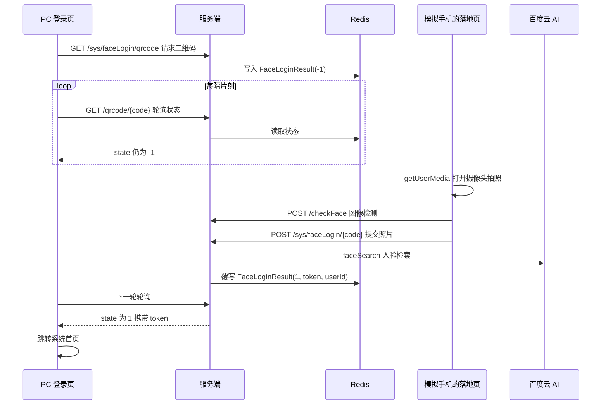
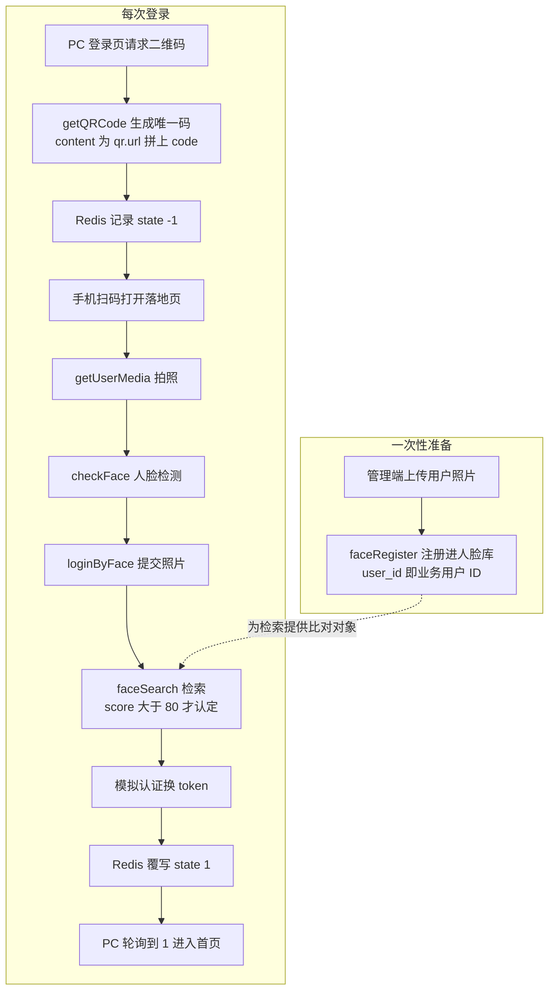

# 刷脸登录全链路联调：用两个浏览器窗口跑通一次真实登录

功能代码全部就位之后，还剩最后一件事：把整条链路真实地跑一遍。按设计，刷脸登录需要手机扫码、手机打开落地页调起摄像头拍照，可手头往往只有一台电脑。这一课演示完整的联调过程，顺带把人脸注册、二维码、轮询、人脸检索这些散落的知识点收拢成一张全景图，给刷脸登录整章画上句号。

## 先给结论

- 联调的关键技巧：把二维码的 `content` 直接打印在服务端控制台，用第二个浏览器窗口打开这个 URL，等价于手机扫码。
- 二维码内容是 `qr.url` 配置项拼上唯一码得到的落地页地址，测试期配 `localhost:8080`，上线只改配置不改代码。
- 登录页持续轮询 `/sys/faceLogin/qrcode/{code}`，扫码前状态一直是 `-1`；拍照匹配成功后变 `1`，页面携带 token 跳进首页。
- 人脸检索命中的 `user_id` 就是人脸注册时写入的业务用户 ID，凭它直接定位用户并完成模拟登录。
- 刷脸登录整章的本质，是百度云 AI 与二维码两项技术的综合演练。

## 联调技巧：把二维码内容暴露出来

`getQRCode` 方法里先拿 `idWorker` 生成唯一码，再拼出落地页地址。测试时把这段拼接结果直接打印：

```java
// 生成二维码
public QRCode getQRCode() throws Exception {
    // 1.生成唯一码
    String code = idWorker.nextId() + "";
    // 2.生成二维码
    String content = url + "code=" + code;
    System.out.println(content);
    // 后续将 content 交给二维码工具类生成图片
}
```

`url` 字段通过 `@Value("${qr.url}")` 注入，值放在配置文件里。本机测试配成前端工程的地址即可：

```yaml
qr:
  url: http://localhost:8080/#/faceLogin?code=
```

重启工程，在登录页点击刷脸登录，页面上弹出二维码，同时服务端控制台打印出一行完整地址，形如 `localhost:8080/#/faceLogin?code=1077112622496722944`，问号后面那串数字就是 `idWorker.nextId()` 生成的唯一码。

**为什么这一步等价于扫码？** 手机扫二维码得到的只是这个 URL 字符串，浏览器打开它就是落地页。内容一致，动作就一致：把 URL 拷进另一个浏览器窗口，等于模拟了「扫码进入落地页」，笔记本自带的摄像头顺势接管了手机摄像头的角色。

## 两个窗口对起来看：轮询里的状态机

屏幕左右各开一个窗口，左边是 PC 登录页，右边是模拟手机的落地页。打开开发者工具的 Network 面板可以看到，二维码弹出后登录页在持续发送同一个请求 `/sys/faceLogin/qrcode/{code}`，响应里的状态一直是 `-1`，表示还没有人扫码。状态约定承接前几课的设计：`-1` 已生成未扫码，`0` 已扫码但登录尚未成功，`1` 登录成功。轮询接口读 Redis，落地页的拍照结果写 Redis，两端靠同一个 key 对齐。



图里最值得看的一环是：PC 端从头到尾只是轮询者，它从不主动获取 token；所有状态变化都由 Redis 中转，落地页的一次拍照通过存储层递给了另一头的登录页。

## 从拍照到进入首页：匹配发生在哪

落地页打开后 `getUserMedia` 调起摄像头，把视频流绘到画布上截帧。提交之前先走一次图像检测，确认拍到的确实是人脸：

```java
// 图像检测，判断图片中是否含人脸图像
@RequestMapping(value = "/checkFace", method = RequestMethod.POST)
public Result checkFace(@RequestParam(name = "file") MultipartFile attachment) throws Exception {
    String image = Base64Util.encode(attachment.getBytes());
    Boolean aBoolean = baiduAiUtil.faceCheck(image);
    if (aBoolean) {
        return new Result(ResultCode.SUCCESS);
    } else {
        return new Result(ResultCode.FAIL);
    }
}
```

检测通过后，落地页把照片连同 code 一起提交到 `POST /sys/faceLogin/{code}`，服务端调 `faceSearch` 去人脸库检索。测试账号事先在百度云人脸库注册过自己的照片，注册时写入的 `user_id` 就是系统里这个用户的 ID，所以检索命中返回的 `user_id` 可以直接用来查询用户，再走一遍与密码登录相同的认证流程换取 token，最终覆写 Redis 状态。这一次演示里，摄像头开启后很快提示「验证成功」，左边窗口几乎同步跳进了系统首页，全程没有输入过用户名和密码。

**刷脸登录与账号密码登录殊途同归。** 两种方式最终都拿到一份合法会话，后续接口的鉴权完全一致。刷脸只是把「证明我是我」的手段从密码换成了人脸，认证通道本身没有变。

## day11 收束：一张全景图

把整章内容压成一张图：上半部分是一次性的人脸注册，下半部分是每次登录都要走完的链路。



至此刷脸登录的全部服务端代码都已落地。前端部分不属于本课重点，但有两处值得抽空读一读：`login.vue` 里的表单校验与轮询逻辑，`facelogin.vue` 里调用摄像头、截帧、封装表单数据的写法，这些在浏览器里都属于比较专的 API 用法。

## 常见误区

- **只盯着页面上的二维码图片找入口**：二维码只是 `content` 的载体，真正决定跳到哪的是拼接好的字符串。控制台打印的那行输出才是测试的钥匙。
- **把落地页地址硬编码在代码里**：本机测试与线上环境只差 `qr.url` 一个配置项，写死意味着上线前还要改代码重新打包。
- **没有注册人脸就直接开测**：人脸库里没有对应照片，`faceSearch` 必然检索不到，登录永远返回失败。测试前先确认人脸注册环节完成过。
- **把状态 `-1` 当成异常**：轮询响应里 state 为 `-1` 是正常中间态，含义是「还没有人扫码」，出现它说明轮询在正常工作。

## 面试可能被问到的问题

1. 面试官追问：「二维码登录为什么每轮要生成唯一码？」
   答：唯一码把一张二维码与一次登录会话绑定，Redis 以它为 key 存状态。没有它，多个登录页会互相串状态，也无法区分过期与重放。PC 端与扫码设备正是靠它对齐同一轮操作。

2. 面试官追问：「轮询有什么缺点，生产上怎么优化？」
   答：轮询大部分请求得到的都是未变化的状态，空转且有秒级延迟。可以换成 WebSocket 或 SSE 由服务端推送，状态变化时主动通知登录页；也可以用长轮询减少空请求，或者拉长间隔降低压力。

3. 面试官追问：「图像检测 checkFace 和人脸登录 loginByFace 为什么要分成两个接口？」
   答：职责不同。checkFace 只判断图片里有没有人脸，是轻量前置校验，不消耗检索额度也不改状态；loginByFace 才做检索并改写登录状态。分开后前端能先给用户明确提示，避免拿一张无效照片去打检索接口。

4. 面试官追问：「没有手机的情况下怎么联调刷脸登录？」
   答：把二维码内容打印出来，它本来就是扫码后得到的落地页 URL。在另一个浏览器窗口直接打开这个 URL，摄像头由笔记本提供，链路与真机扫码完全一致。

5. 面试官追问：「刷脸登录成功后 token 从哪里来？」
   答：检索命中的 user_id 定位到用户后，走一遍与密码登录相同的认证流程，会话 id 即 token，写入 Redis 供轮询接口下发给前端。刷脸替换的只是身份证明方式，签发与鉴权体系不变。

## 配套资料

- 服务层与控制器骨架：`materials/code/02/day11-刷脸登录/day11-刷脸登录/资源/代码/service/FaceLoginService.java`、`materials/code/02/day11-刷脸登录/day11-刷脸登录/资源/代码/controller/FaceLoginController.java`（接口路径、`@Value("${qr.url}")` 与 `getCacheKey` 为资料包原样，方法体按本课视频补全）
- 落地页：`materials/code/02/day11-刷脸登录/day11-刷脸登录/资源/代码/前端页面改造/facelogin.vue`（`getUserMedia` 开摄像头、先 `checkFace` 再提交 `/api/sys/faceLogin/{code}` 的调用顺序为资料原样）
- 状态实体：`materials/code/02/day11-刷脸登录/day11-刷脸登录/资源/代码/实体类/FaceLoginResult.java`（state、token、userId 三个字段与文中一致）
