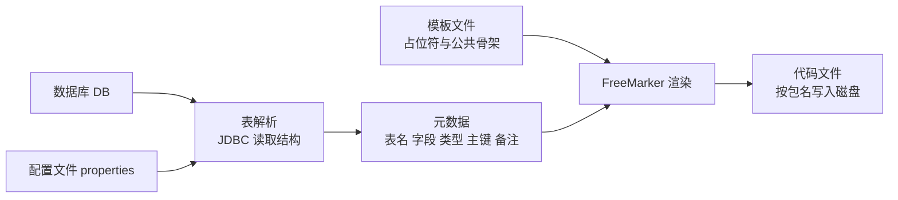

# 模板加元数据等于代码文件：代码生成器的实现思路

需求已经明确：吃进数据库连接与模板，吐出四层代码。怎么实现？把这件事抽象到底，其实只剩一个公式，模板加数据模型等于产出。数据模型从哪来？从数据库表结构解析出来的元数据。模板怎么变成代码？靠占位符替换。这一节把这个公式拆开讲透，为接下来的 FreeMarker 与元数据两节铺路。

## 先给结论

- 整个生成器只有两个核心动作：解析出元数据，用模板引擎做替换后输出文件。
- 元数据有两个来源：数据库表结构是主来源，配置文件用来补充个性化参数，两者汇入同一个解析环节。
- 生成代码里的类名、属性名、属性类型全部由元数据映射而来，映射规则要事先约定，类型映射靠一份配置表维护。
- 模板里写占位符与公共骨架，替换完成后就是完整源码，以文件形式写回磁盘，生成即结束。
- 技术选型上，模板引擎用 Java 生态里最成熟的 FreeMarker，元数据读取走 JDBC。

## 一、为什么必须解析数据库：代码的一切都在表里

生成的代码长什么样，不是拍脑袋定的，而是从表结构一步步推出来的。表名 `tb_user` 按规则剥前缀、首字母大写，得到类名 `User`；表里的每个字段对应实体类的一个属性；字段的数据库类型经映射变成 Java 类型；有了属性名，getter 与 setter 的方法名也随之确定。生成器要做的第一件事，就是把这张表的结构信息完整读出来，读到的这批数据统称数据库元数据。

类型映射是最容易遗漏的一环，资料包里专门有一份映射配置：

```properties
#SQL类型和java类型替换规则
VARCHAR=String
BIGINT=Long
INT=Integer
DATE=java.util.Date
DATETIME=java.util.Date
DOUBLE=Double
TEXT=String
NUMBER=Long
CHAR=String
#Table的前缀或者后缀
tableRemovePrefixes="tb_,co_"
```

`VARCHAR` 对 `String`，`BIGINT` 对 `Long`，日期类型统一映射到 `java.util.Date`，文件末尾还约定了可剥离的表名前缀 `tb_` 与 `co_`。没有这份映射，解析出来的字段类型没法直接写进 Java 源码，生成物根本编译不过。

## 二、元数据装进对象里长什么样

解析结果不能散着传，资料包里把它收拢成两个实体。表对象：

```java
public class Table {
    private String name;      //表名称
    private String name2;     //处理后的表名称（剥前缀转驼峰）
    private String comment;   //表介绍
    private String key;       //主键列
    private List<Column> columns; //列集合
}
```

列对象：

```java
public class Column {
    private String columnName;    //列名称
    private String columnName2;   //处理后的列名称
    private String columnType;    //列类型（映射后的 Java 类型）
    private String columnDbType;  //列数据库类型
    private String columnComment; //列备注
    private String columnKey;     //是否是主键
}
```

每个字段都带一个「处理后」的副本，原始值留着与数据库对照，处理后的值供生成代码使用，这张对照关系正是模板替换时的数据模型。`columnComment` 也在，表备注会被搬进生成代码的注释里，代码的可读性在建表那一刻就决定了。

## 三、配置文件：元数据的第二来源

只靠数据库够不够？不够。有些生成需求不走数据库，或者数据库里没有想带进代码的信息，比如作者、版本、自定义常量。思路是提供插件化的配置文件，按固定写法往里填键值对，解析时一并读进元数据：

```java
public class PropertiesUtils {
    public static Map<String, String> customMap = new HashMap<>();

    static {
        File dir = new File("properties");
        List<File> files = FileUtils.searchAllFile(new File(dir.getAbsolutePath()));
        for (File file : files) {
            if (file.getName().endsWith(".properties")) {
                Properties prop = new Properties();
                prop.load(new FileInputStream(file));
                customMap.putAll((Map) prop);
            }
        }
    }
}
```

工具启动时扫描 `properties` 目录下所有 `.properties` 文件，全部加载进 `customMap`。想扩展生成器的能力，不需要改一行 Java 代码，往目录里加一个配置文件即可，这就是「插件化」三个字落到实现上的样子。

## 四、模板与替换：从占位符到源码文件

模板是预先抽取公共内容写成的文件，其中可变的部分用占位符标出。所谓占位符，就是一枚待替换的标记：写 `${tableName}` 的地方将来填表名，写 `${ClassName}` 的地方将来填类名。模板引擎负责把数据模型里的值填进这些标记。以生成实体类的模板为例：

```java
@Entity
@Table(name = "${table.name}")
public class ${ClassName} implements Serializable {

    <#list table.columns as column>
    <#if column.columnKey??>
    @Id
    </#if>
    private ${column.columnType} ${column.columnName2};
    </#list>
}
```

`<#list>` 循环元数据里的列集合，`<#if>` 判断该列是否主键，主键补 `@Id` 注解。拿城市表 `bs_city` 实际生成一次，得到的就是这样的结果：

```java
@Entity
@Table(name = "bs_city")
public class City implements Serializable {

    @Id
    private String id;
    private String name;
    private java.util.Date createTime;
}
```

**第一，模板引擎不是必须写 `replace` 循环。** Java 世界里做这件事最普遍、最完善的工具是 FreeMarker，它把「模板加数据模型等于输出」固化成一个 API：加载模板文件，传入数据 Map，得到渲染结果，同类产品还有 Velocity。没有引擎时用 `String.replace` 也能跑通一次演示，但循环、条件、格式化这些需求一上来，手写替换的成本远高于引入引擎。

**第二，替换完成即生成完成。** 渲染结果已包含全部源码，写回磁盘的目标路径（目录按包名创建）就结束了，没有第三步。

## 五、整体流程：一张图收拢



图上的主干是一条「解析加替换」的流水线：数据库与配置文件两股信息汇入表解析，产出元数据；元数据与模板在渲染环节相遇，产出代码文件。后续两节分别攻两端：FreeMarker 解决模板怎么写、怎么渲染，元数据解决 JDBC 怎么把表结构读全。

## 常见误区

- **以为生成器理解代码语义**：它全程只做文本替换，不知道什么是对象、什么是编译。规则（前缀剥离、驼峰转换、类型映射）全是人事先写进程序的，规则错则产物错。
- **类型映射配置不全**：只映射了 `VARCHAR` 与 `INT`，遇到 `DATETIME` 生成的属性类型就是原文，源码直接编译失败。上线前拿全量类型过一遍映射表。
- **把元数据当成表里的业务数据**：元数据是「关于数据的数据」，即表名、字段名、类型这些结构信息，不是表里的行记录。解析阶段用不着查询行数据。
- **配置文件塞进业务逻辑**：`properties` 适合键值对形式的参数补充，写进复杂规则反而破坏插件化的初衷，复杂逻辑应该留在代码与模板里。

## 面试可能被问到的问题

1. 面试官追问：「JDBC 里能拿到哪些元数据？」
   答：常用的有三类，`DatabaseMetaData` 描述数据库级信息（库、表、列、主键），`ResultSetMetaData` 描述结果集的列名与类型，`ParameterMetaData` 描述预编译语句的参数。代码生成器主要用第一类，把表结构读成 `Table` 与 `Column` 对象。

2. 面试官追问：「为什么用 FreeMarker 这类模板引擎，而不是手写字符串拼接？」
   答：拼接在简单场景可用，但生成实体类需要遍历字段、按主键判断注解、处理缩进与循环，拼接代码会迅速失控。模板引擎把这些控制逻辑写进模板文件，Java 侧只负责准备数据模型，职责分离且模板可以独立修改。

3. 面试官追问：「数据库类型到 Java 类型的映射应该怎么设计？」
   答：用一份可维护的映射配置，键是 SQL 类型，值是 Java 类型全限定名，未匹配的类型要么报错要么走默认值。设计成配置而非硬编码，是为了适配不同数据库方言，Oracle 的 `NUMBER` 与 MySQL 的 `BIGINT` 都能落到 `Long`。

4. 面试官追问：「配置文件参与元数据，带来什么好处？」
   答：把可变参数外置，扩展生成器不用改代码，加配置文件即可；不同团队可以带不同的配置产出不同风格的代码，这就是插件化配置的价值，代价是需要约定格式并做加载校验。

5. 面试官追问：「表名到类名的转换规则遇到边界情况怎么办？」
   答：前缀用可配置列表剥离，如 `tb_`、`co_`；下划线后首字母大写拼成驼峰；全大写表名先统一转小写。遇到数字开头或关键字冲突的表名，规则覆盖不了，需要保留一份人工映射兜底，这也是生成器保留配置能力的原因之一。

## 配套资料

- 类型映射配置：`materials/code/02/day13-代码生成器实现/day13-代码生成器实现/资源/代码/typeConverter.properties`（SQL 类型到 Java 类型的映射规则与 `tableRemovePrefixes` 为资料包原样）
- 元数据实体：`materials/code/02/day12-代码生成器原理分析/day12-代码生成器原理分析/资源/工具代码/entity/db/Table.java`、`entity/db/Column.java`（字段结构与注释为原样，包名已改写为 `com.example`）
- 配置文件加载：`materials/code/02/day12-代码生成器原理分析/day12-代码生成器原理分析/资源/工具代码/utils/PropertiesUtils.java`（扫描 `properties` 目录加载进 `customMap` 的实现为原样）
- FreeMarker 模板与生成结果：`materials/code/02/day13-代码生成器实现/day13-代码生成器实现/资源/SpringBoot模板/` 下的 `${ClassName}.java` 模板，对照 `资源/测试/生成代码路径/ihrm_company/src/main/java/com/ihrm/system/pojo/City.java`（真实模板与真实产物）
