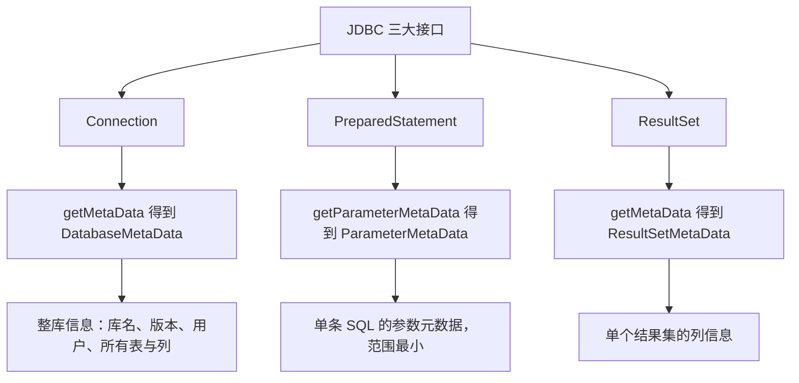

# 元数据概述：代码生成器先要读懂「描述数据的数据」

想让程序照着一张表自动生成 Pojo、Dao、Service、Controller，程序面前横着一串问题：这个库里有哪些表？每张表有哪些列？列是什么类型？哪一列是主键？注释写了什么？这些答案不在业务数据里，而在另一类特殊数据里：元数据，也就是描述数据的数据。

代码生成器原理这条线，模板与指令是一条腿，元数据是另一条腿。这一节先把元数据的概念、JDBC 里三种元数据的来源和分工讲清楚，再看课程生成器用什么结构去承接它们。

## 先给结论

- 元数据是定义数据结构的数据：数据库名、表名、列名、列类型、主键、注释、当前登录用户、数据库版本号，全都算。
- JDBC 按获取来源分三种元数据：Connection 给出 DatabaseMetaData（整库），PreparedStatement 给出 ParameterMetaData（一条 SQL 的参数），ResultSet 给出 ResultSetMetaData（结果集的列）。
- 代码生成器的输入不是表里的业务数据，而是 getTables、getColumns 读出来的元数据，装进 Table、Column 这类实体后再喂给模板。
- 学元数据有两个收益：代码生成器直接要用；看懂 MyBatis、Hibernate 这类框架的底层实现。
- 不同数据库的元数据行为有差异，MySQL 上的经验拿到 Oracle 上要重新核对 API。

## 一、什么是元数据：定义数据结构的数据

直接背「定义数据结构的数据」不好理解，打开数据库看一眼就清楚了。以一张用户表为例，它的建表语句长这样（示例）：

```sql
CREATE TABLE user_info (
    id       VARCHAR(32) PRIMARY KEY COMMENT '主键',
    mobile   VARCHAR(16)             COMMENT '手机号',
    username VARCHAR(32)             COMMENT '用户名',
    password VARCHAR(32)             COMMENT '密码'
);
```

将来存进这张表的一条条用户记录是「数据」，而定义这些数据长什么样的东西是「元数据」：id 是主键、mobile 是 16 位字符串、username 这一列的含义是用户名。元数据描述的是结构和约束，不是值。

把范围放大，数据库里到处都是元数据：

- 库和表的层面：数据库名、表名、表注释，比如用户表、企业表各自对应哪张物理表。
- 列的层面：列名、类型、长度、是否主键、默认值、注释。
- 环境的层面：当前登录用户名、数据库版本号、驱动名称、是否支持事务、连接 URL。

从 SQL 查询结果里拿到的列名和类型同样属于元数据。一句话概括：凡是描述「结构长什么样」的，都是元数据。

## 二、JDBC 里的三种元数据

Java 程序操作数据库只有一条正路：JDBC，MyBatis、Hibernate 再怎么封装，底层也是 JDBC 连接。获取元数据自然也走 JDBC，而且 JDBC 的三个核心接口各自对应一种元数据，谁的对象谁来获取，一一对应：

| 接口 | 获取方法 | 元数据对象 | 管辖范围 |
|---|---|---|---|
| Connection | `getMetaData()` | DatabaseMetaData | 整个数据库：产品名、版本、所有表 |
| PreparedStatement | `getParameterMetaData()` | ParameterMetaData | 一条 SQL 的占位参数个数与类型 |
| ResultSet | `getMetaData()` | ResultSetMetaData | 一个结果集：列数、列名、列类型 |



三个范围从小到大排列：ParameterMetaData 只看得见一条 SQL 的 `?` 占位参数；ResultSetMetaData 看得见一个结果集的列定义；DatabaseMetaData 看得见整个数据库，连「库里有哪些表、表里有哪些列」都能查。代码生成器靠的正是最后这个，它的常用方法包括 `getDatabaseProductName`（产品名称）、`getDatabaseProductVersion`（版本号）、`getUserName`（用户名）、`getURL`（连接地址）、`getDriverName`（驱动名称）。

## 三、元数据怎么变成生成器的输入

课程代码生成器的工具代码里，有三个实体专门承接元数据（包名已改为 `com.example`）：

```java
// 数据库实体：连接信息由它统一组装
public class DataBase {
    private String dbType;   // 数据库类型：MYSQL 或 ORACLE
    private String driver;   // 根据类型确定驱动类名
    private String userName;
    private String passWord;
    private String url;      // 按模板拼出连接地址
}

// 表实体：getTables 的结果装进这里
public class Table {
    private String name;          // 表名称
    private String name2;         // 处理后的表名称
    private String comment;       // 表介绍
    private String key;           // 主键列
    private List<Column> columns; // 列集合
}

// 列对象：getColumns 的结果
public class Column {
    private String columnName;    // 列名称
    private String columnName2;   // 处理后的列名称
    private String columnType;    // Java 类型
    private String columnDbType;  // 数据库类型
    private String columnComment; // 列备注
    private String columnKey;     // 是否是主键
}
```

链路是这样的：`DatabaseMetaData.getTables` 读出所有表装成 `List<Table>`，再用 getColumns 把每张表的列装进 `Table.columns`，期间把列名处理成 `columnName2`、把数据库类型映射成 Java 的 `columnType`，最后整个对象放进 FreeMarker 数据模型。模板里写的 `${table.name}`、`<#list table.columns as column>`，取的就是这些元数据。

元数据学习的第二个收益在框架层面。MyBatis 能把查询结果映射成对象，靠的是读结果集的列名再匹配字段；Hibernate 能根据实体维护表结构，靠的也是读取和比对元数据。这些框架打日志时能打出参数、表名和返回结果，背后同样是元数据在工作。打通这一层，再去看框架源码，很多「魔法」就变成了对元数据的常规操作。

## 常见误区

- **把元数据当成业务数据**：用户表里存的手机号是数据，手机号这一列的类型和注释才是元数据；代码生成器一行业务数据都不读，读的全是后者。
- **三种元数据张冠李戴**：想拿表清单却去 ResultSet 里找，方向就错了。Connection、PreparedStatement、ResultSet 一一对应各自那一种元数据。
- **以为元数据跨库通用**：MySQL 下 catalog 对应库名，Oracle 下 schema 对应大写的用户名，不同数据库获取元数据的细节有差异，换库要查对应 API。
- **低估注释的价值**：列注释直接决定生成的 Java 字段注释，不设 `remarksReporting` 这类驱动参数，某些数据库里拿到的备注是空。

## 面试可能被问到的问题

1. 面试官追问：「什么是数据库元数据？」
   答：定义数据结构的数据。库表列的名字、类型、主键、注释，以及数据库版本、当前用户、驱动信息都算。业务数据回答「值是什么」，元数据回答「结构长什么样」。

2. 面试官追问：「JDBC 有哪几种元数据，分别从哪来？」
   答：三种。Connection.getMetaData 得到 DatabaseMetaData，描述整库；PreparedStatement.getParameterMetaData 得到 ParameterMetaData，描述一条 SQL 的占位参数；ResultSet.getMetaData 得到 ResultSetMetaData，描述结果集的列。

3. 面试官追问：「代码生成器为什么不直接读业务数据？」
   答：生成器关心的是结构不是内容。表名决定类名，列名和类型决定字段名和字段类型，主键决定 Id 注解，注释决定字段注释，这些全部来自元数据，表里的业务数据对生成代码没有任何贡献。

4. 面试官追问：「MyBatis 这类框架和元数据有什么关系？」
   答：框架把查询结果映射成对象，靠 ResultSetMetaData 读出列名再匹配实体字段；参数设置要确认类型信息。理解元数据是读懂这类数据库框架底层实现的前提。

## 配套资料

- 元数据承接实体：`materials/code/02/day12-代码生成器原理分析/day12-代码生成器原理分析/资源/工具代码/entity/db/DataBase.java`、同目录 `Table.java`、`Column.java`
- 元数据的使用方（生成器界面，测试连接后拉取库列表填充下拉框）：`materials/code/02/day12-代码生成器原理分析/day12-代码生成器原理分析/资源/工具代码/ui/DatabaseUtil.java`
