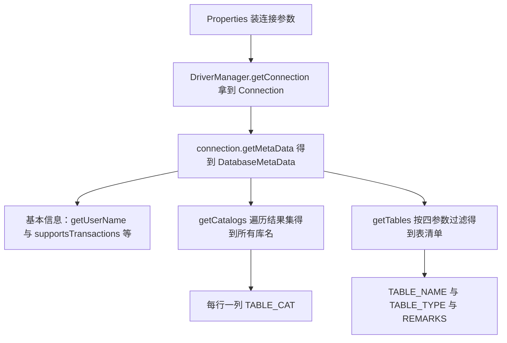

# JDBC 元数据实操：用 DatabaseMetaData 从库信息读到表清单

概念清楚了，接下来是三段能直接敲的代码：先用 DatabaseMetaData 读数据库自身的基本信息，再列出连接上所有数据库名，最后钻进指定库把表清单翻出来。这三步正是代码生成器「连库、选库、选表」交互流程的底层动作，走完它们，元数据就从名词变成了手感。

## 先给结论

- `connection.getMetaData()` 拿到 DatabaseMetaData，产品名、版本号、用户名、是否支持事务等整库信息随手可读。
- 连接 URL 不带库名时连的是根地址，`getCatalogs()` 返回结果集，逐行 `getString(1)` 就能列出所有数据库名。
- `getTables(catalog, schemaPattern, tableNamePattern, types)` 四个参数划出查询范围，MySQL 下 catalog 传库名或 null、schema 传 null、types 传 `{"TABLE"}`。
- getTables 返回的结果集固定有 TABLE_CAT、TABLE_SCHEM、TABLE_NAME、TABLE_TYPE、REMARKS 列，表名从 `rs.getString("TABLE_NAME")` 拿。
- 连接参数改用 Properties 传，并加 `remarksReporting=true`，否则部分驱动下表和列的备注拿到的是空。

## 一、公共环境：把连接抽进 init 方法

三个测试方法都要先拿连接，把重复动作抽到 `@Before` 方法里（包名已改为 `com.example`，连接参数沿用课程代码）：

```java
public class DatabaseMetaDataTest {

    private Connection connection;

    @Before
    public void init() throws Exception {
        String driver = "com.mysql.jdbc.Driver";
        // 不带库名，连到的是整个 MySQL 的根地址
        String url = "jdbc:mysql://127.0.0.1:3306?useUnicode=true&characterEncoding=utf8";
        String username = "root";
        String password = "111111";
        Properties props = new Properties();
        props.put("remarksReporting", "true"); // 获取数据库的备注信息
        props.put("user", username);
        props.put("password", password);
        // 1. 注册驱动并获取连接
        Class.forName(driver);
        connection = DriverManager.getConnection(url, props);
    }
}
```

两个细节值得停下来看。**第一，URL 没有写库名。** `jdbc:mysql://127.0.0.1:3306?...` 连的是根地址，代表整个数据库服务的入口，后面才能用 getCatalogs 列出所有库；如果一上来就写 `/hrm`，连接就锁定在单个库里了。**第二，连接参数走 Properties 而不是三参数重载。** `DriverManager.getConnection(url, user, pass)` 只装得下账号密码，而 `remarksReporting` 是驱动级参数，必须通过 Properties 形式传进去。它的作用是让驱动把表和列的备注一起取回来，不设置时部分数据库里 REMARKS 拿到的就是空。

现场还踩过一个空指针：Properties 继承自 Hashtable，键和值都不允许为 null，put 的值漏传或写成未初始化的引用，直接抛 NullPointerException。把所有键值统一按字符串传之后程序才正常跑通。

## 二、获取数据库基本信息

```java
@Test
public void test01() throws Exception {
    // 2. 通过连接获取元数据
    DatabaseMetaData metaData = connection.getMetaData();
    // 3. 读取数据库基本信息
    System.out.println(metaData.getUserName());            // root@localhost
    System.out.println(metaData.supportsTransactions());   // true，是否支持事务
    System.out.println(metaData.getDatabaseProductName()); // MySQL
}
```

控制台依次输出 `root@localhost`、`true`、`MySQL`，用户名、事务支持、产品名一次到手。DatabaseMetaData 上这类「读自身信息」的方法很多，常用的有：

| 方法 | 返回内容 |
|---|---|
| `getDatabaseProductName()` | 数据库产品名，如 MySQL |
| `getDatabaseProductVersion()` | 数据库版本号 |
| `getUserName()` | 当前登录用户名 |
| `getURL()` | 连接的 URL |
| `getDriverName()` | 驱动名称 |
| `isReadOnly()` | 数据库是否只读 |
| `supportsTransactions()` | 是否支持事务 |

这些信息平时用得不多，真正有分量的是它后面的两个方法：getCatalogs 和 getTables。

## 三、获取所有数据库名称

```java
@Test
public void test02() throws Exception {
    DatabaseMetaData metaData = connection.getMetaData();
    // 2. 获取所有库列表，返回的是结果集
    ResultSet rs = metaData.getCatalogs();
    while (rs.next()) {
        // 每行只有一列，就是数据库名
        System.out.println(rs.getString(1));
    }
    // 3. 释放资源
    rs.close();
    connection.close();
}
```

getCatalogs 返回的不是集合，是一个 ResultSet。断点打在 while 循环里能看到，这个结果集只有一列，列名 `TABLE_CAT`，每行一个数据库名：`information_schema`、`mysql`、`hrm`……按 `rs.getString(1)` 或 `rs.getString("TABLE_CAT")` 取值都行。debug 时盯着结果集的 fields 看列名，是摸清元数据结果集结构最直接的办法，后面的 getTables 也用同一招。

这段代码在课程生成器里有真实对应。工具界面上「测试连接」按钮的处理逻辑是：连接成功后调 `DataBaseUtils.getSchemas(db)` 拉库列表，逐个填进下拉框（包名已改为 `com.example`）：

```java
// DatabaseUtil.java 节选：连接成功后填充数据库下拉框
List<String> catalogs = DataBaseUtils.getSchemas(db);
jComboBox2.removeAllItems();
for (String c : catalogs) {
    jComboBox2.addItem(c);
}
```

下拉框里让用户选的那个库，底层就是 getCatalogs 遍历出来的。

## 四、获取指定数据库的表信息

test03 把 URL 换成带库名的 `jdbc:mysql://127.0.0.1:3306/hrm?useUnicode=true&characterEncoding=utf8`，连接直接定位到 hrm 库，然后调 getTables：

```java
@Test
public void test03() throws Exception {
    DatabaseMetaData metaData = connection.getMetaData();
    // 2. 获取当前库中所有表的信息
    // catalog：操作的目录，MySQL 里就是库名；URL 已定位到 hrm，传 null
    // schemaPattern：MySQL 中没有对应概念，传 null
    // tableNamePattern：表名匹配模式，null 表示所有表
    // types：表类型过滤，只取真表，不要视图
    String[] types = {"TABLE"};
    ResultSet rs = metaData.getTables(null, null, null, types);
    while (rs.next()) {
        String tableName = rs.getString("TABLE_NAME");
        String tableType = rs.getString("TABLE_TYPE");
        String remarks = rs.getString("REMARKS"); // 表备注，依赖 remarksReporting
        System.out.println(tableName + " | " + tableType + " | " + remarks);
    }
    rs.close();
    connection.close();
}
```

四个参数决定了查询范围，也是换数据库时最容易踩坑的地方：

| 参数 | 含义 | MySQL 与 Oracle 的差异 |
|---|---|---|
| catalog | 当前操作的目录 | MySQL 里对应库名；Oracle 里对应实例名，如 `jdbc:oracle:thin:@ip:1521:ORCL` 中的 ORCL |
| schemaPattern | 模式 | MySQL 中没有实际意义，传 null；Oracle 里填用户名，且必须大写 |
| tableNamePattern | 表名匹配模式 | null 查全部表，写 `em%` 只查 em 开头的表 |
| types | 表类型数组 | `{"TABLE"}` 只要真表；把 `VIEW` 放进去才会带出视图 |

debug 时看结果集的字段，一行表信息由这几个字段组成：`TABLE_CAT` 所属数据库、`TABLE_SCHEM` 所属模式、`TABLE_NAME` 表名、`TABLE_TYPE` 类型、`REMARKS` 表备注。hrm 库跑完，控制台把库里所有真表列了出来：

```text
em_resignation
em_transferposition
em_user_company
em_user_company_jobs
pe_permission
pe_permission_api
pe_permission_menu
pe_role
pe_role_permission
pe_user
```

三个方法串起来的调用关系如下：



到这里，「读库、读表」两件事都通了。再往下一层是 `getColumns` 读列清单，配合 remarksReporting 把列注释一起拿到，装进 Table 与 Column 实体，代码生成器要的原料就齐了。

## 常见误区

- **想列所有库，URL 却带了库名**：URL 写成 `/hrm` 后连接被锁进单库；列库清单用根地址，读指定库的表再切带库名的 URL，两个场景两种 URL。
- **getCatalogs 的返回值当成集合**：它返回 ResultSet 而不是 List，要按结果集方式 while 加 `rs.next()` 遍历，用完记得 close。
- **types 传 null 就想要纯表清单**：types 传 null 时视图、系统表会一起回来，只要真表就明确传 `{"TABLE"}`。
- **备注一直是空的**：部分驱动默认不回传 REMARKS，连接参数里不加 `remarksReporting=true`，表和列的注释拿不到，生成器里字段注释全空多半是它。
- **把 MySQL 的 catalog 与 schema 经验平移到 Oracle**：Oracle 的 schema 是用户名而且要大写，catalog 对应实例名，两套语义不一样，换库先查 API。

## 面试可能被问到的问题

1. 面试官追问：「DatabaseMetaData 怎么获取，能拿到哪些信息？」
   答：Connection 对象调 getMetaData 获得。它能读数据库产品名、版本号、驱动名、连接 URL、当前用户、是否支持事务等整库级信息，还能通过 getCatalogs、getTables、getColumns 拿到所有库、表、列的结构清单。

2. 面试官追问：「getTables 的四个参数分别是什么？」
   答：catalog 是目录，MySQL 下就是库名；schemaPattern 是模式，MySQL 传 null，Oracle 下填大写用户名；tableNamePattern 是表名匹配模式，null 表示全部；types 是类型数组，传 `{"TABLE"}` 只取真表。返回 ResultSet，表名在 TABLE_NAME 列。

3. 面试官追问：「remarksReporting 这个参数是干什么的？」
   答：连接参数，设为 true 时驱动会把表和列的备注一起返回到 REMARKS 字段。部分数据库默认不返回备注，代码生成器要靠注释生成字段说明，这个参数不设就全空。

4. 面试官追问：「三种 JDBC 元数据的获取入口分别是什么？」
   答：DatabaseMetaData 从 Connection.getMetaData 拿，ParameterMetaData 从 PreparedStatement.getParameterMetaData 拿，ResultSetMetaData 从 ResultSet.getMetaData 拿。范围从整库、单条 SQL 参数到单个结果集依次收窄。

5. 面试官追问：「代码生成器选中一张表后，怎么知道它有哪些列、哪个是主键？」
   答：用 getColumns 传入库名和表名，遍历结果集读 COLUMN_NAME、TYPE_NAME、REMARKS 等字段；主键再用 getPrimaryKeys 查询。把这些装进 Table 和 Column 实体，交给模板渲染。

## 配套资料

- 生成器界面（测试连接后用元数据拉库列表填充下拉框）：`materials/code/02/day12-代码生成器原理分析/day12-代码生成器原理分析/资源/工具代码/ui/DatabaseUtil.java`
- 按数据库类型拼驱动与 URL 的连接实体：`materials/code/02/day12-代码生成器原理分析/day12-代码生成器原理分析/资源/工具代码/entity/db/DataBase.java`
- 元数据落地实体：`materials/code/02/day12-代码生成器原理分析/day12-代码生成器原理分析/资源/工具代码/entity/db/Table.java`、同目录 `Column.java`
