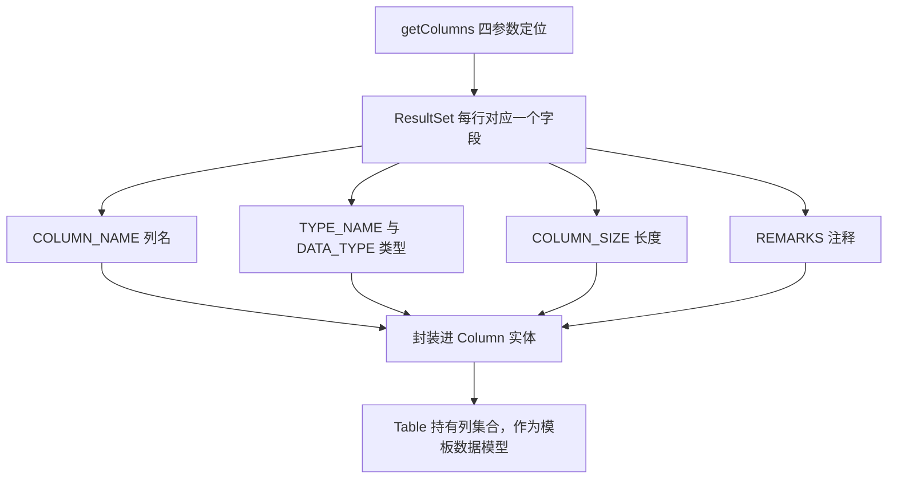

# getColumns 挖到最后一层：读出指定表的全部字段属性

表清单能列出来了，实体类却还写不出来：每个字段叫什么、什么类型、多长、注释是什么，这些信息不拿到手，模板里的 `${column.columnName}` 就是无米之炊。这一层信息藏在 DatabaseMetaData 的 getColumns 方法返回的结果集里，它也是「库、表、列」三级钻取的最后一钻。

## 先给结论

- getColumns 用四个参数定位：catalog、schemaPattern、tableNamePattern、columnPattern，范围从整库一路缩到单列；MySQL 下前两个传 null 即可。
- 返回的 ResultSet 一行对应一个字段，每行带 20 多个属性列，常用的有 COLUMN_NAME、DATA_TYPE、TYPE_NAME、COLUMN_SIZE、REMARKS、COLUMN_DEF、ORDINAL_POSITION。
- 属性列名记不住不丢人，查 JDK 文档里 getColumns 的返回值说明即可；取值时列名按文档全大写写。
- 条件不匹配不报错，只会返回空结果集：连接落在 ihrm 库，却去查别的库的表，循环一次都不进。
- 字段属性的归宿是 Column 实体：列名、类型、注释、是否主键，正好是代码生成器的模板原料。

## 一、四个参数：从整库缩到单列

test04 与读表的 test03 骨架完全一样，还是先拿元数据，再换一个查询方法（连接在 `@Before` 方法里建好，URL 已定位到 ihrm 库）：

```java
// 获取指定表中的字段信息
@Test
public void test04() throws Exception {
    DatabaseMetaData metaData = connection.getMetaData();
    // catalog：操作的库；URL 已带库名，传 null 或写库名都行
    // schemaPattern：MySQL 下没有对应概念，传 null；Oracle 下传大写用户名
    // tableNamePattern：表名，想看 bs_user 的字段就写 bs_user
    // columnPattern：列名匹配模式，null 表示全部列，写列名只看那一列
    ResultSet rs = metaData.getColumns(null, null, "bs_user", null);
    while (rs.next()) {
        System.out.println(rs.getString("COLUMN_NAME"));
    }
    rs.close();
    connection.close();
}
```

四个参数决定了查询范围，也是换数据库时最容易踩坑的地方：

| 参数 | 含义 | MySQL 与 Oracle 的差异 |
|---|---|---|
| catalog | 操作的目录 | MySQL 里是库名，null 表示跟随连接；Oracle 里对应实例名 |
| schemaPattern | 模式 | MySQL 传 null；Oracle 填用户名，必须大写 |
| tableNamePattern | 表名匹配模式 | 精确写表名只看一张表，写 null 覆盖所有表 |
| columnPattern | 列名匹配模式 | null 查所有列，写列名只看那一列 |

跑完控制台把 bs_user 的列名一条条打出来：id、mobile、username、password、create_time…… 与数据库客户端里看到的表结构一一对应。查询条件要和连接所在的库对上，连接写的是 ihrm，表名却是别的库里的，结果集就是空的，这一点排查时最容易误判。

## 二、结果集里到底有什么

debug 时把断点放在 while 循环里，观察 rs 变量，类型是 `com.mysql.jdbc.JDBCResultSet`，展开 fields 能看到一行数据的完整字段：TABLE_CAT、TABLE_SCHEM、TABLE_NAME、SQL_DATA_TYPE…… 单是属性列就有 20 多个，远不止打印出来的那个列名。常用的属性列整理如下：

| 结果集列 | 含义 |
|---|---|
| TABLE_CAT / TABLE_SCHEM | 所属库、所属模式 |
| TABLE_NAME | 字段所属的表名 |
| COLUMN_NAME | 字段名 |
| DATA_TYPE | SQL 类型编号，对应 java.sql.Types 常量，12 是 VARCHAR、4 是 INT、93 是 DATETIME |
| TYPE_NAME | 数据库里的类型名，varchar、int、datetime |
| COLUMN_SIZE | 长度或精度，varchar(32) 就是 32 |
| REMARKS | 字段注释，依赖连接参数 remarksReporting=true |
| COLUMN_DEF | 字段默认值 |
| ORDINAL_POSITION | 字段在表中的序号，从 1 开始 |

想取哪个就 `rs.getString("属性列名")`。这些属性列名由 JDBC 规范和驱动约定死，统一全大写，照着文档抄最稳。

## 三、记不住就查文档，顺便看好类型映射的路线

**第一，JDK 文档就是这 20 多列的权威说明书。** 课程资料里带了离线版 API 文档，搜 getColumns 方法，返回值部分逐列解释了每个属性名的含义，比背清单靠谱得多。哪一列有需要就用哪一列，DATA_TYPE、TYPE_NAME、COLUMN_SIZE、REMARKS 是生成器场景里出场率最高的四个。

**第二，类型编号是通往 Java 类型的第一级台阶。** DATA_TYPE 输出的是数字，12、4、93 谁也看不懂，换成 TYPE_NAME 就有了 varchar、int、datetime；生成 Java 代码时再做一次映射：varchar 转 String、int 转 Integer、datetime 转 java.sql.Timestamp。getColumns 到这里只负责把数据库侧的类型拿全，数据库类型到 Java 类型的映射表，是代码生成器下一步要准备的原料。

## 四、字段属性的落点：Column 实体

生成器资料包里的 Column 实体，与 getColumns 的输出一一对应（包名已改为 com.example）：

```java
package com.example.generate.entity.db;

/**
 * 列对象：getColumns 结果集的 Java 化封装
 */
public class Column {

    private String columnName;     // 列名，来自 COLUMN_NAME
    private String columnName2;    // 处理后的列名，如 userName
    private String columnType;     // 映射后的 Java 类型，如 String
    private String columnDbType;   // 数据库类型名，来自 TYPE_NAME
    private String columnComment;  // 列注释，来自 REMARKS
    private String columnKey;      // 是否主键

    // getter/setter 省略
}
```

一个字段的原始信息经过这次封装，就变成了模板可以直接替换的数据。整条链路如下：



图里最关键的是最后一跳：getColumns 的原始结果没有人直接拿去渲染模板，先落到 Column 与 Table 实体上，模板里 `${table.name}`、`${column.columnName}` 这类占位符才有数据可填。

## 常见误区

- **结果为空以为方法坏了**：getColumns 对不存在的表、别的库的表不报错，只返回空结果集。先确认连接 URL 落在哪个库，再核对表名。
- **只记得 COLUMN_NAME**：类型、长度、默认值、注释都在同一行结果集里，只打列名等于白跑一趟，需要什么按文档取什么。
- **把 DATA_TYPE 的数字直接输出给用户**：12、4、93 是 java.sql.Types 常量，给人看用 TYPE_NAME，程序判断用常量名。
- **指望 getColumns 顺便告诉你哪个是主键**：它描述的是普通列属性，主键信息要用 getPrimaryKeys 单独查询，生成器里 Column.columnKey 的值来自那里。

## 面试可能被问到的问题

1. 面试官追问：「getColumns 的四个参数分别起什么作用？」
   答：catalog 指定目录，MySQL 下就是库名；schemaPattern 指定模式，MySQL 传 null，Oracle 传大写用户名；tableNamePattern 是表名匹配模式；columnPattern 是列名匹配模式，null 表示全部列。四个参数把查询范围从整库缩到单列。

2. 面试官追问：「getColumns 返回的结果集里有哪些常用列？」
   答：一行对应一个字段，常用 COLUMN_NAME 列名、DATA_TYPE 类型编号、TYPE_NAME 类型名、COLUMN_SIZE 长度、REMARKS 注释、COLUMN_DEF 默认值、ORDINAL_POSITION 序号。列名全部大写，完整清单在 JDK 文档的方法说明里。

3. 面试官追问：「DATA_TYPE 返回 12 是什么意思？」
   答：12 是 java.sql.Types.VARCHAR 的值。DATA_TYPE 用数字编号表达 SQL 类型，可读性差，展示用 TYPE_NAME，程序判断用 Types 常量。

4. 面试官追问：「怎么拿到字段的注释？」
   答：连接参数里设置 remarksReporting=true 让驱动回传备注，再从结果集的 REMARKS 列读取。不设这个参数时部分驱动返回的注释是空。

5. 面试官追问：「代码生成器拿到字段属性之后怎么用？」
   答：把每行结果封装成 Column 对象，列名做驼峰处理、数据库类型映射成 Java 类型，再挂到 Table 的列集合里，作为 FreeMarker 的数据模型渲染实体类。

## 配套资料

- 列实体（getColumns 结果的最终落点）：`materials/code/02/day12-代码生成器原理分析/day12-代码生成器原理分析/资源/工具代码/entity/db/Column.java`
- 表实体（持有列集合）：`materials/code/02/day12-代码生成器原理分析/day12-代码生成器原理分析/资源/工具代码/entity/db/Table.java`
- 连接实体（按库类型拼驱动与 URL）：`materials/code/02/day12-代码生成器原理分析/day12-代码生成器原理分析/资源/工具代码/entity/db/DataBase.java`
- 元数据测试类未收录进资料包，文中 test04 示例按课程写法补全
