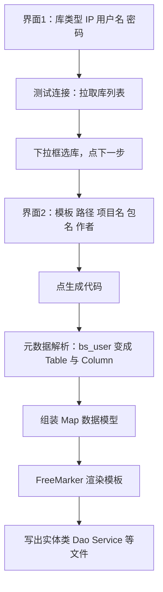
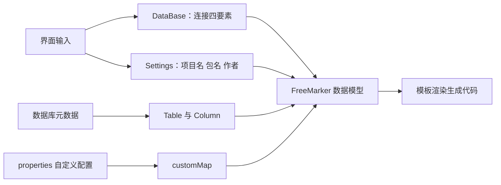
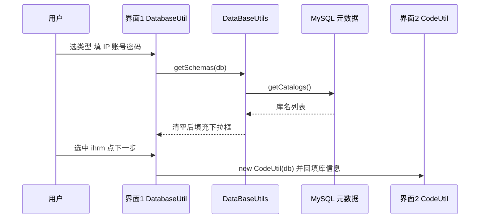

# 构造代码生成器环境三部曲：需求分析、实体类与工具类设计、配置界面接通

## 先给结论

构造代码生成器环境是造工具的三部曲：先想清楚界面形态与数据建模，再备齐实体类与工具类，最后把配置界面接通、让生成按钮交齐参数。目标是做出一个读库表结构、按模板批量生成代码的桌面小工具。
三部曲各有侧重：需求分析定下两块界面与一个生成按钮的形态，Table、Column、DataBase、Settings 四个实体把库表与用户输入各自建模；实体与工具类篇把三样依赖、四个实体、三个工具类的分工讲透；配置界面篇用 DataBaseUtils 测试连接拉出库表列表，模板目录约定与生成入口收尾。开工顺序也定好了：先实体后工具再界面，每一步都有可验证的产出。
边界意识贯穿全程：界面是壳，连接、路径、模板目录这些边界才是重点。
三讲依次是：
- 需求分析：目标形态、数据库侧建模与用户输入建模、开工顺序。
- 实体类和工具类介绍：工程依赖、四实体三工具类各管什么。
- 配置界面：测试连接、两块界面接力与生成入口。

## 第1部分：代码生成器开工前的需求分析：先想清界面、实体和工具

FreeMarker 的指令会用了，三种 JDBC 元数据也会查了，把这两样拼在一起，就是一个能生成代码的小工具。动手写之前先把需求拆开：界面长什么样、用户输入怎么建模、数据库信息怎么建模、要提前备好哪些工具类。这些想不清，模板和数据模型永远对不上。

### 一、目标形态：两块界面，一个生成按钮

需求对应一个已经演示过的成品工具：打开后选择数据库类型（MySQL、Oracle），填服务器 IP、用户名、密码，点「测试连接」，当前服务上的所有数据库被拉出来填进下拉框；进入下一界面，配置用哪套模板（生成 Spring 还是 Spring Boot 程序）、代码输出路径、项目名、包名、作者；点「生成代码」，才进入真正干活的部分：拿元数据、跑 FreeMarker。

资料包里的生成器骨架就是按这个形态写的，第一块界面的核心逻辑节选如下（包名已改为 com.example）：

```java
public class DatabaseUtil extends JFrame {

    // 窗口打开时，往类型下拉框填可选项
    private void formWindowOpened(java.awt.event.WindowEvent evt) {
        String[] dbTypes = new String[]{"MYSQL", "ORACLE"};
        for (String key : dbTypes) {
            this.jComboBox1.addItem(key);
        }
        setLocationRelativeTo(null);
    }

    // 测试连接：封装 DataBase 对象，拉取库列表填进下拉框
    private void jButton1ActionPerformed(java.awt.event.ActionEvent evt) {
        String ip = jTextField3.getText();
        String username = jTextField1.getText();
        String password = jTextField2.getText();
        String dbType = (String) jComboBox1.getSelectedItem();
        DataBase db = new DataBase(dbType, ip, "3306", "");
        db.setUserName(username);
        db.setPassWord(password);
        // 内部走 DatabaseMetaData.getCatalogs
        List<String> catalogs = DataBaseUtils.getSchemas(db);
        jComboBox2.removeAllItems();
        for (String c : catalogs) {
            jComboBox2.addItem(c);
        }
    }

    // 下一步：带着选中的库进入第二个界面 CodeUtil
    private void jButton2ActionPerformed(java.awt.event.ActionEvent evt) {
        String dbName = jComboBox2.getSelectedItem().toString();
        String dbType = (String) jComboBox1.getSelectedItem();
        String ip = jTextField3.getText();
        DataBase db = new DataBase(dbType, ip, "3306", dbName);
        CodeUtil codeUtil = new CodeUtil(db, null);
        codeUtil.setDbInfo(db, dbName);
        codeUtil.setVisible(true); // 打开第二块界面
        setVisible(false);         // 隐藏第一块
    }
}
```

第二块界面 CodeUtil 上的字段与成品一致：模板、代码生成路径、项目名（英文）、项目中文名称、包名、作者，外加一个「生成代码」按钮。两块界面本质上都在采集用户输入，按钮背后才是核心流水线：



流程图前三步是信息采集，后三步才是代码生成；元数据课上的 getTables、getColumns 就发生在第五步。

### 二、数据库侧建模：Table 与 Column

以 bs_user 表为例，目标是生成 User.java。表名和类名之间有转化规则，转化过程需要表的原始信息：表名、表注释，还有整张表的字段列表。把这些抽象成一个 Table 实体（真实代码，包名已改）：

```java
package com.example.generate.entity.db;

import java.util.List;

/**
 * 表实体
 */
public class Table {

    private String name;            // 原始表名，如 bs_user
    private String name2;           // 处理后的表名，也就是类名，如 User
    private String comment;         // 表注释
    private String key;             // 主键列
    private List<Column> columns;   // 字段集合

    // getter/setter 省略
}
```

每个字段同样要建模，Column 里放的是字段名与属性名的对应关系，外加是否主键、映射后的 Java 类型、数据库类型与注释。Table 与 Column 合在一起，就是「一张表」在 Java 世界里的完整投影，FreeMarker 模板里的 `${table.name2}`、`${column.columnName2}` 都从这里取值。

### 三、用户输入建模：DataBase 与 Settings

连接信息不能散着传，DataBase 实体负责把库类型、IP、端口、库名、账号密码装在一起，并在构造时拼好驱动与 URL（真实代码，包名已改）：

```java
package com.example.generate.entity.db;

/**
 * 数据库实体类
 */
public class DataBase {

    private static String mysqlUrl = "jdbc:mysql://[ip]:[port]/[db]?useUnicode=true&characterEncoding=UTF8";
    private static String oracleUrl = "jdbc:oracle:thin:@[ip]:[port]:[db]";

    private String dbType;   // 数据库类型
    private String driver;   // 驱动类名
    private String userName;
    private String passWord;
    private String url;

    public DataBase(String dbType, String ip, String port, String db) {
        this.dbType = dbType;
        if ("MYSQL".endsWith(dbType.toUpperCase())) {
            this.driver = "com.mysql.jdbc.Driver";
            this.url = mysqlUrl.replace("[ip]", ip).replace("[port]", port).replace("[db]", db);
        } else {
            this.driver = "oracle.jdbc.driver.OracleDriver";
            this.url = oracleUrl.replace("[ip]", ip).replace("[port]", port).replace("[db]", db);
        }
    }

    // getter/setter 省略
}
```

URL 模板里挖了 `[ip]`、`[port]`、`[db]` 三个坑，构造时按用户输入逐个填上，MySQL 与 Oracle 的差异就被关在实体内部，界面代码完全不用关心驱动怎么拼。

第二块界面上的项目信息（项目名、包名、路径、作者）进 Settings 实体。它有个值得看的细节：getSettingMap 用反射把全部字段转成 Map，正好充当 FreeMarker 的数据模型（真实代码节选）：

```java
package com.example.generate.entity;

import java.lang.reflect.Field;
import java.util.HashMap;
import java.util.Map;

public class Settings {

    private String project = "example";           // 项目名
    private String pPackage = "com.example.demo"; // 包名
    private String projectComment;                // 项目描述
    private String author;                        // 作者
    private String path1 = "com";                 // 包名按点拆开后的目录段
    private String path2 = "example";
    private String path3 = "demo";
    private String pathAll;

    public Settings(String project, String pPackage, String projectComment, String author) {
        // 空值兜底后，把包名按点拆成目录段
        String[] paths = pPackage.split("\\.");
        path1 = paths[0];
        path2 = paths.length > 1 ? paths[1] : path2;
        path3 = paths.length > 2 ? paths[2] : path3;
        pathAll = pPackage.replaceAll(".", "/"); // 有坑，见常见误区
    }

    // 反射把所有字段转成 Map，给模板当数据模型
    public Map<String, Object> getSettingMap() {
        Map<String, Object> map = new HashMap<>();
        Field[] declaredFields = Settings.class.getDeclaredFields();
        for (Field field : declaredFields) {
            field.setAccessible(true);
            try {
                map.put(field.getName(), field.get(this));
            } catch (Exception e) {}
        }
        return map;
    }
}
```

### 四、开工顺序与三件套工具

需求拆完，编码顺序就定了：建工程导依赖，写 Table、Column、DataBase、Settings 四个实体，再写解析元数据、组装 Map 的逻辑，然后接 FreeMarker 渲染，最后做一套自定义模板实测工具好不好用。过程中反复用到的工具能力有三类，骨架里都有现成实现：

- 字符串工具 `utils/StringUtils.java`：表名转类名全靠它，removePrefix 摘掉业务前缀，makeAllWordFirstLetterUpperCase 把 bs_user 变成 BsUser，toJavaVariableName 再给出属性名 bsUser。
- 文件工具 `utils/FileUtils.java`：渲染结果落盘成 .java 文件。
- 配置工具 `utils/PropertiesUtils.java`：读取用户自定义的配置文件。

骨架里还留了一个空壳 `core/GeneratorFacade.java`，generatorByTable(db, tableName) 的方法签名已经画好，方法体是空的，这就是下一步要填的核心：读元数据、建 Table 与 Column、组装 Map、调 FreeMarker。
## 第2部分：代码生成器备料：四个实体类与三个工具类各管什么

需求分析把界面和数据流向画清楚之后，建工程的第一件事不是写模板，而是决定「数据放在什么对象里」。界面收集的连接信息、项目信息，数据库里查出来的表和列，模板要用的每一份数据都得有落脚点。

### 一、工程与依赖：三样坐标就够

建一个普通 Java 工程当生成器的壳，依赖只需要三样：FreeMarker 负责渲染，MySQL 驱动负责连库取元数据，JUnit 留着写验证。课程给定的坐标版本如下：

```xml
<dependencies>
    <dependency>
        <groupId>org.freemarker</groupId>
        <artifactId>freemarker</artifactId>
        <version>2.3.20</version>
    </dependency>
    <dependency>
        <groupId>junit</groupId>
        <artifactId>junit</artifactId>
        <version>4.12</version>
        <scope>test</scope>
    </dependency>
    <dependency>
        <groupId>mysql</groupId>
        <artifactId>mysql-connector-java</artifactId>
        <version>5.1.8</version>
    </dependency>
</dependencies>
```

实体类在资料包里已经备齐，直接拷进 `com.example.generate.entity` 包即可，不必逐个手敲。

### 二、DataBase：连接信息连驱动一起装进对象

界面上用户只填四样：数据库类型、IP、端口、库名，但 JDBC 还要驱动类名和完整 URL。这两样不该让用户填，构造函数里按类型判断后现拼。真实骨架的写法（包名已改）：

```java
package com.example.generate.entity.db;

/**
 * 数据库实体类
 */
public class DataBase {

    private static String mysqlUrl = "jdbc:mysql://[ip]:[port]/[db]?useUnicode=true&characterEncoding=UTF8";
    private static String oracleUrl = "jdbc:oracle:thin:@[ip]:[port]:[db]";

    private String dbType;   // 数据库类型
    private String driver;   // 驱动类名
    private String userName;
    private String passWord;
    private String url;

    public DataBase(String dbType, String ip, String port, String db) {
        this.dbType = dbType;
        if ("MYSQL".endsWith(dbType.toUpperCase())) {
            this.driver = "com.mysql.jdbc.Driver";
            this.url = mysqlUrl.replace("[ip]", ip).replace("[port]", port).replace("[db]", db);
        } else {
            this.driver = "oracle.jdbc.driver.OracleDriver";
            this.url = oracleUrl.replace("[ip]", ip).replace("[port]", port).replace("[db]", db);
        }
    }

    // getter/setter 省略
}
```

内置的 URL 常量里挖了 `[ip]`、`[port]`、`[db]` 三个占位，构造时三行 replace 逐个填上。输入 `mysql、127.0.0.1、3306、ihrm`，出来的就是 `jdbc:mysql://127.0.0.1:3306/ihrm?useUnicode=true&characterEncoding=UTF8`，MySQL 与 Oracle 的差异被关在两个常量加一个 if 分支里。

### 三、Settings：包名拆段，反射转 Map

```java
package com.example.generate.entity;

public class Settings {

    private String project = "example";           // 项目名
    private String pPackage = "com.example.demo"; // 完整包名
    private String projectComment;                // 项目中文描述
    private String author;                        // 作者
    private String path1 = "com";                 // 包名拆出的目录段
    private String path2 = "example";
    private String path3 = "demo";
    private String pathAll;

    public Settings(String project, String pPackage, String projectComment, String author) {
        if (StringUtils.isNotBlank(project)) { this.project = project; }
        if (StringUtils.isNotBlank(pPackage)) { this.pPackage = pPackage; }
        this.projectComment = projectComment;
        this.author = author;
        // 包名按点拆开，对应磁盘上一层层目录
        String[] paths = pPackage.split("\\.");
        path1 = paths[0];
        path2 = paths.length > 1 ? paths[1] : path2;
        path3 = paths.length > 2 ? paths[2] : path3;
        pathAll = pPackage.replaceAll(".", "/"); // 正则坑，照抄要改
    }

    // 反射把所有字段转成 Map，直接当 FreeMarker 数据模型用
    public Map<String, Object> getSettingMap() {
        Map<String, Object> map = new HashMap<>();
        for (Field field : Settings.class.getDeclaredFields()) {
            field.setAccessible(true);
            try { map.put(field.getName(), field.get(this)); } catch (Exception e) {}
        }
        return map;
    }
}
```

用户填的是一行包名 `com.example.ihrm`，但生成代码要建的是 `com/example/ihrm` 这样的三层物理目录，模板里的目录占位符 `${path1}/${path2}/${path3}` 各取一段。`getSettingMap` 用反射遍历全部字段，字段名做 key、字段值做 value，界面上每一项输入原样变成模板变量，以后加字段也不用改转换代码。

### 四、Table 与 Column：原始名和处理名分开存

数据库侧的信息拆成两个实体，各字段都带「原始名加处理名」一对：

```java
public class Table {
    private String name;            // 原始表名，如 bs_user
    private String name2;           // 处理后的表名，也就是类名，如 User
    private String comment;         // 表注释
    private String key;             // 主键列名
    private List<Column> columns;   // 列集合
}

public class Column {
    private String columnName;      // 原始列名，如 user_name
    private String columnName2;     // 处理后的列名，也就是属性名，如 userName
    private String columnType;      // 映射后的 Java 类型
    private String columnDbType;    // 数据库原始类型
    private String columnComment;   // 列备注
    private String columnKey;       // 是否主键
}
```

原始名留给 SQL 层用，比如生成 `@Table(name = "bs_user")` 注解；处理名给 Java 代码用，属性声明、getter 拼接都读它。转换逻辑集中在给实体赋值的那一步做完，模板里只读现成结果。

### 五、工具类：把杂活提前封好

名字加工全部压在 `StringUtils` 里，核心几个方法（真实代码节选）：

```java
public class StringUtils {

    public static boolean isBlank(String str) {
        return str == null || str.trim().length() == 0;
    }

    public static boolean isNotBlank(String str) {
        return !isBlank(str);
    }

    // 取文件后缀名
    public static String getExtension(String str) {
        if (str == null) return null;
        int i = str.lastIndexOf('.');
        return i >= 0 ? str.substring(i + 1) : null;
    }

    // bs_user 转 BsUser：小写后按下划线拆词，逐词首字母大写
    public static String makeAllWordFirstLetterUpperCase(String sqlName) {
        String[] strs = sqlName.toLowerCase().split("_");
        String result = "";
        String preStr = "";
        for (int i = 0; i < strs.length; i++) {
            if (preStr.length() == 1) {
                result += strs[i];
            } else {
                result += capitalize(strs[i]);
            }
            preStr = strs[i];
        }
        return result;
    }

    // 类名转属性名：BsUser 转 bsUser
    public static String toJavaVariableName(String str) {
        return uncapitalize(toJavaClassName(str));
    }
}
```

`isBlank` 与 `isNotBlank` 给界面输入做兜底判断，`getExtension` 取文件后缀，驼峰转换是 `toUnderscoreName`、`makeAllWordFirstLetterUpperCase`、`uncapitalize` 三个方法的接力。

`FileUtils` 管文件层面的三件事：递归收集目录下所有文件、按相对路径定位文件、建文件前补齐父目录（真实代码节选）：

```java
// 文件处理工具类
public class FileUtils {

    // 查询某个目录下的所有文件
    public static List<File> searchAllFile(File dir) throws IOException {
        ArrayList arrayList = new ArrayList();
        searchFiles(dir, arrayList);
        return arrayList;
    }

    // 递归获取某个目录下的所有文件
    public static void searchFiles(File dir, List<File> collector) throws IOException {
        if (dir.isDirectory()) {
            File[] subFiles = dir.listFiles();
            for (int i = 0; i < subFiles.length; i++) {
                searchFiles(subFiles[i], collector);
            }
        } else {
            collector.add(dir);
        }
    }

    // 创建文件，父目录不存在就先补齐
    public static File mkdir(String dir, String file) {
        if (dir == null) throw new IllegalArgumentException("dir must be not null");
        File result = new File(dir, file);
        if (result.getParentFile() != null) {
            result.getParentFile().mkdirs();
        }
        return result;
    }
}
```

`PropertiesUtils` 负责读自定义配置，这里先记约定：所有自定义配置都要写成 `.properties` 文件，放到工程相对路径的 `properties` 目录下，它只在启动时扫这一个位置。加载链的实现留到数据模型一课拆开。

四个实体与三类工具在数据模型里的位置如下：



实体是承重的梁，工具是拧螺丝的手，两者备齐后，剩下的元数据查询与渲染只是把它们串起来。
## 第3部分：配置界面接通：测试连接拉库列表，生成按钮交齐四个参数

实体和工具类备齐后，界面还动不起来：点「测试连接」要真去数据库把库列表拉回来填进下拉框，点「生成代码」要把界面输入交到核心逻辑手上。这一课补上中间缺的 `DataBaseUtils`，把两块 Swing 界面串成一条链，到 `generator` 入口为止把参数交齐，day12 的环境搭建到此收束。

### 一、DataBaseUtils：测试连接背后干活的人

获取 MySQL 里所有数据库名，元数据课做过实验，这里把实验代码固化成工具类的两个静态方法（该类未随资料包提供，代码按本课视频写法整理，包名已改）：

```java
package com.example.generate.utils;

public class DataBaseUtils {

    public static Connection getConnection(DataBase db) throws Exception {
        Properties props = new Properties();
        props.put("remarksReporting", "true"); // 获取数据库的备注信息
        props.put("user", db.getUserName());
        props.put("password", db.getPassWord());
        Class.forName(db.getDriver()); // 注册驱动
        return DriverManager.getConnection(db.getUrl(), props);
    }

    public static List<String> getSchemas(DataBase db) throws Exception {
        Connection connection = getConnection(db);
        DatabaseMetaData metaData = connection.getMetaData();
        // 获取所有的数据库列表
        ResultSet rs = metaData.getCatalogs();
        List<String> list = new ArrayList<>();
        while (rs.next()) {
            list.add(rs.getString(1));
        }
        rs.close();
        connection.close();
        return list;
    }
}
```

两个细节值得停一下。连接参数走 `Properties` 对象而不是拼进 URL，账号密码里的特殊字符不用转义，还顺带塞进了 `remarksReporting=true`，MySQL 驱动收到这个参数后，元数据查询才会把列注释带回来，没有它生成的实体注释全是空。`getCatalogs()` 返回的结果集取第一列就是库名，读完立刻关闭连接。

### 二、两块界面的接力

第一块界面 `DatabaseUtil` 的三段关键代码（真实骨架，包名已改）：

```java
public class DatabaseUtil extends JFrame {

    // 窗口打开时填入可选的数据库类型
    private void formWindowOpened(java.awt.event.WindowEvent evt) {
        String[] dbTypes = new String[]{"MYSQL", "ORACLE"};
        for (String key : dbTypes) {
            this.jComboBox1.addItem(key);
        }
        setLocationRelativeTo(null);
    }

    // 测试连接：拉取库列表填进第二个下拉框
    private void jButton1ActionPerformed(java.awt.event.ActionEvent evt) {
        jButton1.setText("连接中...");
        jButton1.setEnabled(false);
        final Thread t = new Thread(new Runnable() {
            public void run() {
                try {
                    DataBase db = new DataBase((String) jComboBox1.getSelectedItem(),
                            jTextField3.getText(), "3306", "");
                    db.setUserName(jTextField1.getText());
                    db.setPassWord(jTextField2.getText());
                    List<String> catalogs = DataBaseUtils.getSchemas(db);
                    jComboBox2.removeAllItems();
                    for (String c : catalogs) {
                        jComboBox2.addItem(c);
                    }
                    JOptionPane.showMessageDialog(null, "连接成功", "提示",
                            JOptionPane.DEFAULT_OPTION);
                    jButton2.setText("下一步");
                } catch (Exception e) {
                    e.printStackTrace();
                }
                jButton1.setEnabled(true);
                jButton1.setText("测试连接");
            }
        });
        t.start();
    }

    // 下一步：带着选中的库打开第二块界面
    private void jButton2ActionPerformed(java.awt.event.ActionEvent evt) {
        if (this.jButton2.getText().equals("下一步")) {
            String dbName = jComboBox2.getSelectedItem().toString();
            DataBase db = new DataBase((String) jComboBox1.getSelectedItem(),
                    jTextField3.getText(), "3306", dbName);
            db.setUserName(jTextField1.getText());
            db.setPassWord(jTextField2.getText());
            CodeUtil codeUtil = new CodeUtil(db, null);
            codeUtil.setDbInfo(db, dbName);
            codeUtil.setVisible(true); // 打开第二块界面
            setVisible(false);         // 隐藏第一块
        }
    }
}
```

整条链路是这样走的：



关键路径在「下一步」：这里重新构造了一个 `DataBase`，这次把选中的库名带了进去，连接目标从服务器级收窄到库级，账号信息通过 `setDbInfo` 回填到第二块界面上展示。

### 三、模板目录约定与生成入口

第二块界面 `CodeUtil` 上有模板、代码生成路径、项目名、项目中文名称、包名、作者几项输入。模板下拉框的数据源是一个约定目录，窗口打开时扫描它的子文件夹（真实代码）：

```java
// 获取当前文件夹下模板目录里的所有子文件夹
private void formWindowOpened(java.awt.event.WindowEvent evt) {
    File directory = new File(new File("").getAbsolutePath() + "\\模板");
    File[] listFiles = directory.listFiles();
    if (listFiles != null) {
        for (File f : listFiles) {
            if (f.isDirectory()) {
                this.jComboBox1.addItem(f.getName());
            }
        }
    }
}
```

想提供生成 Spring Boot 工程的一套模板、生成 Vue 页面的另一套模板，就在 `模板` 目录下各建一个子文件夹，界面自动识别，目录名支持中文。点「生成代码」后，界面收集输入并调生成入口（真实代码节选）：

```java
private void jButton1ActionPerformed(java.awt.event.ActionEvent evt) {
    // 生成动作放进新线程，避免冻结界面
    String project = jTextField6.getText();
    String pPackage = jTextField7.getText();
    String projectComment = jTextField8.getText();
    String author = jTextField9.getText();
    Settings settings = new Settings(project, pPackage, projectComment, author);
    generator(templetPath, outpath, settings, db);
}

/**
 * UI 调用代码生成器的入口
 * @param templetPath 模板所在路径
 * @param outpath     代码生成路径
 * @param settings    工程配置对象
 * @param db          数据库信息
 */
private void generator(String templetPath, String outpath, Settings settings, DataBase db) {
    System.out.println(templetPath);
    System.out.println(outpath);
    System.out.println(settings);
    System.out.println(db);
}
```

四个参数恰好覆盖生成代码需要的全部信息：模板从哪读、代码往哪写、项目信息是什么、连哪个库。方法体现在只打印，说明环境已经搭好、接口已经定型，实现篇从这里接手。

### 四、界面是壳，边界才是重点

Swing 在这个工程里只扮演演示壳的角色，属于被淘汰的桌面技术，`GroupLayout` 布局、组件声明这些代码由绘图工具生成，能看懂按钮事件在哪、输入从哪个文本框取就够了。真正要带走的是分层边界：界面只做采集与展示，连接、查元数据、生成全部下沉到工具类与核心包。哪天把界面换成网页表单，只要还能构造出 `Settings` 和 `DataBase`，底层一行不用动。
## 常见误区

- **跳过实体直接写模板**：模板占位符要的就是 Table、Column、Settings 里的字段，数据模型不建模，模板写完也对不上数。
- **照抄 pathAll 那一行**：replaceAll 第一个参数是正则，点号匹配任意字符，`com.example.demo` 会被整体换成斜杠。按字面替换要用 replace('.', '/') 或转义后的 `\\.`，改造骨架时要顺手修掉。
- **包路径只拆三段**：path1、path2、path3 写死三层，用户填四层包名就丢段，应按数组长度动态处理。
- **在事件线程里做耗时操作**：测试连接要连数据库，生成代码要写文件，骨架里都包了新线程再执行，Swing 界面卡死多半是这一步没处理。
- **漏拷加工字段**：实体只抄了 `columnName`，漏掉 `columnName2`，模板里 `${column.columnName2}` 取出来是空，生成的属性名全空。`name2`、`path1` 到 `path3` 都是给模板用的，少一个断一处。
- **构造参数顺序记错**：`DataBase` 的签名是 `(dbType, ip, port, db)`，把端口和库名颠倒，URL 变成 `jdbc:mysql://127.0.0.1:ihrm/3306`，表现是连接超时。
- **依赖 `endsWith` 的侥幸**：真实骨架里判断类型写的是 `"MYSQL".endsWith(dbType.toUpperCase())`，语义应是比较相等，输入不是标准 MySQL 字符串时会误入 Oracle 分支，改造骨架时建议改成 `equals`。
- **配置目录随手放**：把自定义配置丢进 `src` 根目录或 classpath 里，`PropertiesUtils` 只扫工程相对路径的 `properties` 目录，读不到就静默为空。
- **点了测试连接没反应也不报错**：事件里起的是独立线程，异常被 `printStackTrace` 吞在控制台，真实骨架的弹窗提示会引导去看 error.log。驱动没引是「无法加载驱动类」，账号密码错对应 SQLException 分支的提示。
- **以为备注会自动带来**：`remarksReporting=true` 不配，`getCatalogs` 还能用，但后面取列注释拿到的全是空，生成出来的实体没有一句注释。
- **下拉框残留旧数据**：第二次测试连接前先 `removeAllItems()` 再逐个 `addItem`，直接追加会越加越多。
- **去改 `.form` 文件**：它是界面绘制工具生成的描述文件，调整布局应在绘图工具里改，或直接改生成的 Java 代码。
- **在事件线程里直连数据库**：连接要几秒，事件线程卡住整个窗口像死机，必须像骨架那样另起线程，完成后再恢复按钮状态。

## 面试可能被问到的问题

1. 面试官追问：「一个代码生成器由哪几部分组成？」
   答：用户输入采集（连接信息、模板与项目配置）、数据库元数据解析、数据模型组装、模板渲染、文件输出。核心链路是元数据转实体、实体转 Map、FreeMarker 渲染、写出文件。

2. 面试官追问：「为什么要把表结构抽象成 Table 和 Column 实体？」
   答：模板占位符需要结构化数据，实体让元数据变成有类型的 Java 对象，也把表名转类名、列名转属性名这类加工逻辑收在赋值阶段一次做完，模板里只留干净的占位符。

3. 面试官追问：「bs_user 怎么变成 User？」
   答：字符串规则处理：先按下划线拆词，去掉业务前缀，再把每个词首字母大写得到类名；属性名用小驼峰。这些能力封装在字符串工具类里，全项目复用。

4. 面试官追问：「FreeMarker 的数据模型为什么常用 Map？」
   答：模板按 key 取值，Map 能把异构信息（表、列、项目配置）装进同一棵数据树；Settings 还用反射把字段批量转成 Map，省去逐个手工 put，字段增减也不用改转换代码。

5. 面试官追问：「生成器里哪些操作不能放在 Swing 事件线程？」
   答：连数据库的测试连接、批量写文件的生成过程都是耗时操作，放进事件线程会冻结界面，应另起线程执行，完成后再回到事件线程更新 UI。

6. 面试官追问：「为什么把 driver 和 url 的拼接收进 DataBase 构造函数？」
   答：用户只关心类型、地址、库名这些业务输入，驱动类名和 URL 格式属于 JDBC 细节。收进构造函数后，两种数据库的差异被封装在一个类里，界面层和核心生成逻辑都不用感知，换库只改实体不改调用方。

7. 面试官追问：「Table 里为什么同时保留 name 和 name2？」
   答：name 是数据库里的原始表名，生成 `@Table` 注解这类内容时要用原名；name2 是按规则加工后的类名，给 Java 代码用。两套名字分开存，加工在赋值阶段一次做完，模板保持简单。

8. 面试官追问：「getSettingMap 用反射转 Map，好处和代价是什么？」
   答：好处是字段增减不用维护转换代码，界面输入直接映射成模板变量；代价是反射有性能开销、绕过编译期检查，字段改名要到运行期才暴露。配置类字段少、调用次数少，可以接受。

9. 面试官追问：「这些工具方法和 Commons Lang 功能重叠，为什么不直接引库？」
   答：生成器要打成独立小工具分发，依赖越少越好；自己封装还能按业务裁剪，比如对数据库命名风格的特殊处理。没有体积与分发限制的普通项目，优先用维护成熟的现成库。

10. 面试官追问：「PropertiesUtils 在 static 代码块里加载配置，怎么看这个设计？」
   答：自定义配置属于全局只读数据，类首次被访问时加载一次、后续全走内存，用起来最省事。风险是加载时机不可控、失败只打印堆栈，调用方可能拿到空 Map 毫无察觉，工程化场景应换成显式初始化加失败快报。

11. 面试官追问：「`getCatalogs()` 和 `getSchemas()` 有什么区别？」
   答：两者都是 `DatabaseMetaData` 的方法。在 MySQL 里 catalog 对应数据库，schema 约等于 catalog，`getCatalogs()` 拿到的是所连服务器上所有库名；不同数据库对这两个概念的映射不同，Oracle 里 catalog 为空、schema 对应用户，工具要跨库就得按数据库类型分别处理。

12. 面试官追问：「为什么用 Properties 传连接参数而不拼在 URL 里？」
   答：密码里的特殊字符拼 URL 需要转义，Properties 按键值传递没有这个问题；还能传递 `remarksReporting` 这类驱动特有的开关，让 URL 保持干净。

13. 面试官追问：「Swing 界面点按钮做耗时操作，怎么避免界面卡死？」
   答：事件监听默认在事件分发线程执行，耗时操作要另起工作线程，完成后通过 `SwingUtilities.invokeLater` 回到事件线程更新组件。骨架里测试连接和生成代码都包了新线程，就是这个原因。

14. 面试官追问：「界面层和生成核心怎么解耦？」
   答：靠 `generator(templetPath, outpath, settings, db)` 这个入口划界，界面只负责凑齐四个参数，核心逻辑不感知 Swing 的存在。换 Web 界面时只要还能构造出 `Settings` 和 `DataBase`，核心代码零改动。

15. 面试官追问：「测试连接应该覆盖哪些失败场景？」
   答：至少三类：驱动类加载失败说明依赖缺失；SQLException 覆盖 IP、端口、账号密码错误；其他异常兜底提示并留日志。分支不同提示不同，用户才能自己排障。

## 配套资料

- 生成器骨架真实代码位于 `materials/code/02/day12-代码生成器原理分析/day12-代码生成器原理分析/资源/工具代码/`：
  - 界面：`ui/DatabaseUtil.java`（连接与选库）、`ui/CodeUtil.java`（模板与项目配置）
  - 实体：`entity/db/Table.java`、`entity/db/Column.java`、`entity/db/DataBase.java`、`entity/Settings.java`
  - 工具：`utils/StringUtils.java`、`utils/FileUtils.java`、`utils/PropertiesUtils.java`
  - 核心空壳：`core/GeneratorFacade.java`
- 实体与工具真实代码位于 `materials/code/02/day12-代码生成器原理分析/day12-代码生成器原理分析/资源/工具代码/`：
  - 实体：`entity/db/DataBase.java`、`entity/db/Table.java`、`entity/db/Column.java`、`entity/Settings.java`
  - 工具：`utils/StringUtils.java`、`utils/FileUtils.java`、`utils/PropertiesUtils.java`
- 坐标版本来自课程讲义画面：`org.freemarker:freemarker:2.3.20`、`mysql:mysql-connector-java:5.1.8`、`junit:junit:4.12`
- 界面真实代码：`materials/code/02/day12-代码生成器原理分析/day12-代码生成器原理分析/资源/工具代码/ui/DatabaseUtil.java`、`ui/CodeUtil.java`
- 实体：同目录 `entity/db/DataBase.java`、`entity/Settings.java`
- `DataBaseUtils` 未随资料包提供，文中代码按本课视频写法整理，放进 `utils` 包即可编译
