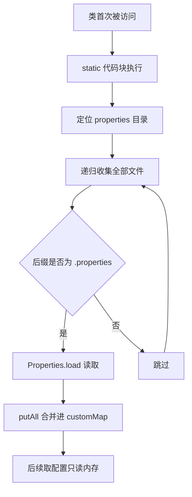

# 自定义数据进模型：properties 加载链与类型映射表

模板里的数据一部分来自数据库，另一部分来自用户自定义配置。自定义听起来随意，实际上有严格约定：放哪个目录、什么后缀、怎么被加载、key 撞了怎么办。这一课把 `PropertiesUtils` 的加载链拆开，再把课程自带的类型映射表 `typeConverter.properties` 讲透。

## 先给结论

- 约定两条：自定义配置写成 `.properties` 文件，放在工程相对路径的 `properties` 目录下；满足约定就自动加载，免任何注册。
- `PropertiesUtils` 在 static 代码块里干活：递归扫 `properties` 目录、只认 `.properties` 后缀、逐个 load 后 `putAll` 进公开的 `customMap`。
- 课程自带的 `typeConverter.properties` 装两类规则：数据库类型到 Java 类型的映射、表名前后缀删减配置 `tableRemovePrefixes`。
- 多个配置文件合并进同一张 Map，key 重名时后加载的覆盖先加载的，约定 key 不许重复。
- 对使用者这是一个扩展点：想给模板喂新数据，加一个配置文件就行，不用动生成器代码。

## 一、约定：放哪、叫什么、怎么生效

想定义自己的配置，在 `properties` 目录下建一个文件即可，比如 `custom.properties`（该示例文件未随资料包提供，按本课约定补全）：

```properties
testkey=testvalue
```

加载器只认两个条件：文件在 `properties` 目录下，后缀是 `.properties`。目录定位用的是相对路径 `new File("properties")`，也就是运行程序时的工作目录。跑一遍加载器自带的 main 方法，控制台输出：

```bash
testkey--testvalue
```

看到键值对被原样读出，说明配置进了内存里的 `customMap`，此后所有取值都走这张 Map，不再碰磁盘。

## 二、加载链：static 代码块里的四步

`PropertiesUtils` 的完整实现（真实代码，包名已改）：

```java
package com.example.generate.utils;

public class PropertiesUtils {

    public static Map<String, String> customMap = new HashMap<>();

    static {
        File dir = new File("properties");
        try {
            List<File> files = FileUtils.searchAllFile(new File(dir.getAbsolutePath()));
            for (File file : files) {
                if (file.getName().endsWith(".properties")) {
                    Properties prop = new Properties();
                    prop.load(new FileInputStream(file));
                    customMap.putAll((Map) prop);
                }
            }
        } catch (IOException e) {
            e.printStackTrace();
        }
    }

    public static void main(String[] args) {
        PropertiesUtils.customMap.forEach((k, v) -> {
            System.out.println(k + "--" + v);
        });
    }
}
```

四步拆开看：

**第一，定位目录。** `new File("properties")` 指向工作目录下的 `properties` 文件夹，与用户约好的唯一入口。

**第二，递归收集。** `FileUtils.searchAllFile` 沿目录树走到底，把所有文件收进一个 List。

**第三，按后缀过滤。** 目录里可能有说明文档、临时文件，只有 `.properties` 结尾的才进入下一步。

**第四，装载合并。** 每个 `Properties` 对象读一个文件，`putAll` 把键值对并进 `customMap`，多个文件的配置最终混在一张 Map 里。



图里要留意两条静默分支：不满足后缀的文件只是被跳过，目录本身不存在时也不报错，`customMap` 静默为空，排障时最容易漏。

## 三、typeConverter.properties：类型映射与表名删减

课程资料里带着一份生成器必备的公共配置（真实文件）：

```properties
#SQL类型和java类型替换规则
VARCHAR=String
BIGINT=Long
INT=Integer
DATE=java.util.Date
DATETIME=java.util.Date
DOUBLE=Double
TEXT=String
VARCHAR2=String
NVARCHAR2=String
NUMBER=Long
CHAR=String
#Table的前缀或者后缀
tableRemovePrefixes="tb_,co_"
```

前半段是数据库类型到 Java 类型的翻译表。元数据查出来的字段类型是 `VARCHAR`、`BIGINT`、`DATETIME` 这类数据库方言，模板里 `private ${column.columnType} ${column.columnName2}` 要的是合法 Java 类型，中间全靠这张表转换：变长字符归 `String`，整数归 `Integer` 或 `Long`，日期时间归 `java.util.Date`，浮点归 `Double`。Oracle 风格的 `VARCHAR2`、`NVARCHAR2`、`NUMBER` 也在表里，同一份配置兼容两种数据库。

这张表直接决定生成代码能否编译：某个类型漏配，渲染出的字段类型就是空的，整个类编译不过。类型映射外置成配置文件，换数据库、调映射偏好都只改文件不改代码。

后半段 `tableRemovePrefixes` 服务于表名加工：库里的表常带业务前缀，`bs_user`、`co_company`，转类名时前缀要剁掉，只留 `User`、`Company`，多个前缀用逗号分隔，可继续追加。这行在资料里带了一对英文引号，properties 的值是字面的，加载后引号也属于值的一部分，按逗号拆分时第一段会带着引号，删前缀永远匹配不上。照抄这份配置要么先去掉引号，要么代码里做一次 strip。

## 四、扩展：模板要的独特数据怎么进来

类型映射和前缀规则属于生成器的公共配置，用户自己的独特需求走同一条路：数据库里没有、模板里想用的数据，写进 `custom.properties` 这类自定义文件，启动即被收进 `customMap`，模板里 `${testkey}` 直接可用。唯一要守的规矩是 key 全局唯一：多个文件合并成一张 Map，重名时后加载的覆盖先加载的，而加载顺序取决于文件遍历结果。

## 常见误区

- **配置放在 `src/main/resources` 下就以为生效**：加载器找的是工作目录下名为 `properties` 的文件夹，不是 classpath。开发时在工程根建 `properties` 目录；打成 jar 后工作目录随启动方式漂移，部署时要把这个目录带上。
- **目录不存在静默通过**：对不存在的路径，`searchAllFile` 不抛异常，过滤后一个文件都不进 Map，程序照常跑，模板里取自定义 key 全是空。先跑 main 方法看输出，再怀疑别处。
- **key 重名靠覆盖**：多个配置文件有同名 key，结果取决于遍历顺序，不可复现的覆盖是隐藏炸弹。公共配置与自定义配置都要保证 key 唯一。
- **照抄 `tableRemovePrefixes` 连引号一起抄**：引号进入值以后，前缀匹配的首字符就是引号，规则永远不生效。
- **在配置里写中文值不当回事**：`Properties.load(InputStream)` 按 ISO 8859-1 解码，中文会乱码，值要用 Unicode 转义，或改用 `load(Reader)` 指定 UTF-8。

## 面试可能被问到的问题

1. 面试官追问：「在 static 代码块里读配置有什么风险？」
   答：加载时机绑定在类首次被访问，早于任何日志与监控；失败通常只打印堆栈，调用方拿到一张空 Map 毫无察觉。改进方向是显式初始化、失败快报，或交给 Spring 这类容器的配置机制管理。

2. 面试官追问：「Properties 是什么数据结构，putAll 转 Map 要注意什么？」
   答：`Properties` 继承自 `Hashtable`，键值都是 Object。`customMap.putAll((Map) prop)` 是把 `Hashtable<Object,Object>` 强转塞进 `Map<String,String>`，成立的前提是加载出来的键值一定是字符串。稳妥写法是遍历 `stringPropertyNames()` 逐个 put。

3. 面试官追问：「类型映射为什么外置成 properties，而不写死在代码里？」
   答：不同数据库的类型名不同，团队对包装类型、日期类型的偏好也不同。外置后换数据库或调映射只改配置文件；写死则每次都要改代码重新打包，违背生成器配置驱动的设计初衷。

4. 面试官追问：「生产环境还会用工作目录加 properties 这套方案吗？」
   答：本地小工具可以，服务端不会。工作目录随启动方式漂移、路径不可控，一般换成 classpath 内置默认值加外部文件覆盖、环境变量、配置中心这类方案，把配置来源与优先级显式化。

## 配套资料

- 加载器真实代码：`materials/code/02/day12-代码生成器原理分析/day12-代码生成器原理分析/资源/工具代码/utils/PropertiesUtils.java`、`utils/FileUtils.java`
- 公共配置真实文件：`materials/code/02/day13-代码生成器实现/day13-代码生成器实现/资源/代码/typeConverter.properties`
- `custom.properties` 未随资料包提供，文中 `testkey=testvalue` 示例为按本课约定补全
