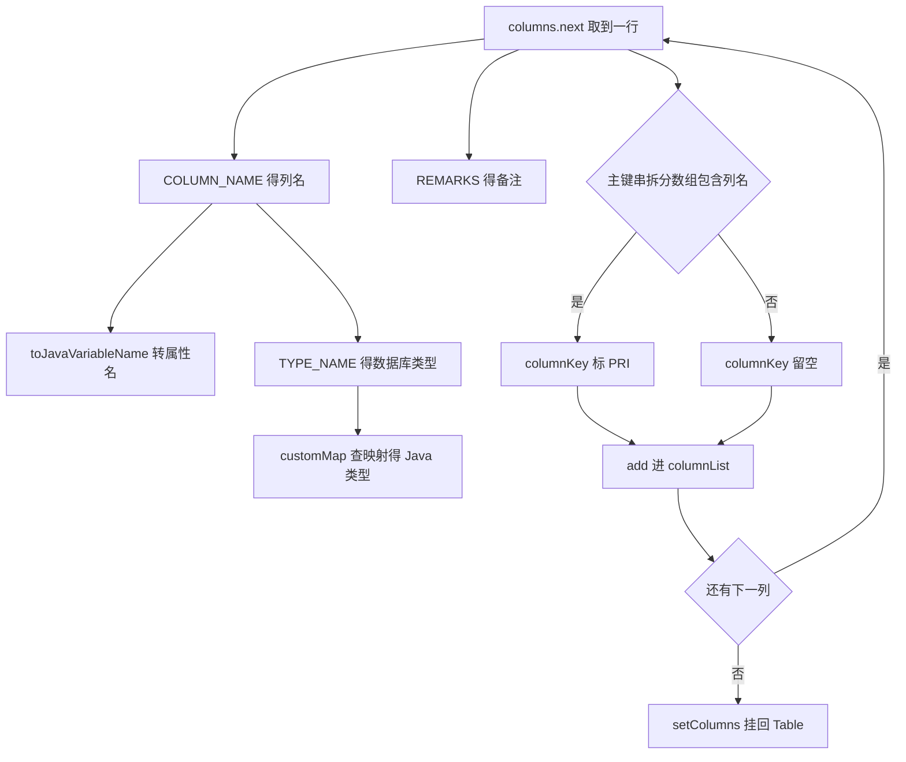

# 元数据处理代码收尾与完善：把每一列读成 Column

> 🔒 安全提示：文中示例的口令/密钥均为课程教学环境演示口径，生产环境的安全要求见《安全与合规须知》。

`getDbInfo` 的前半程已经把表名、类名、注释、主键装进了 `Table`，方法还差最后一块：表里的每一列。列的加工比表多两层转换，名字要从下划线风格转成驼峰属性名，类型要从数据库方言翻译成 Java 类型，还要判断它是不是主键。这一层收尾做完，元数据处理才真正闭环，`List<Table>` 才能拿去喂模板。

## 先给结论

- 每张表调 `metaData.getColumns` 拿字段结果集，一行读成一个 `Column`，六个属性一次填齐：列名、属性名、数据库类型、Java 类型、备注、是否主键。
- 属性名用 `StringUtils.toJavaVariableName` 转换，`user_id` 变 `userId`、`create_time` 变 `createTime`。
- 数据库类型取 `TYPE_NAME`，Java 类型拿它去 `customMap` 查 `typeConverter.properties` 的映射表，查不到就是 `null`，生成代码必编译不过。
- 是否主键的判断：把 `Table` 里拼好的主键串按逗号拆开，包含当前列名就标 `PRI`。
- 收尾三连关资源：`columns`、`tables`、`connection`，从内层结果集关到外层连接。

## 一、getColumns：一张表的字段全在这

字段查询在元数据练习课上已经玩过一次：`getColumns` 的前两个参数与 `getTables` 相同，传 `null` 即可，第三个参数是表名，第四个是列名过滤模式，`null` 表示全部列。当时练习里写死了 `bo_user`，这次换成循环里解析出来的 `tableName`，方法里每个表各查一遍：

```java
// 处理表中的所有字段
ResultSet columns = metaData.getColumns(null, null, tableName, null);
List<Column> columnList = new ArrayList<>();
```

外层结构照旧：一行一个 `Column` 对象，收进 `columnList`，循环结束后 `tab.setColumns(columnList)` 挂回 `Table`。大架子两行写完，中间的属性赋值才是本课重点。

## 二、六个属性一次填齐

循环体里的完整赋值如下，字段名与资料包里的 `Column` 实体一一对应：

```java
while (columns.next()) {
    Column cn = new Column();
    // 1.列名：user_id
    String columnName = columns.getString("COLUMN_NAME");
    // 2.属性名：userId
    String attName = StringUtils.toJavaVariableName(columnName);
    // 3.数据库类型：VARCHAR / DATETIME
    String dbType = columns.getString("TYPE_NAME");
    // 4.Java 类型：查映射表得到 String / java.util.Date
    String javaType = PropertiesUtils.customMap.get(dbType);
    // 5.备注
    String columnComment = columns.getString("REMARKS");
    // 6.是否主键：主键串里有当前列名就标 PRI
    if (Arrays.asList(keys.split(",")).contains(columnName)) {
        cn.setColumnKey("PRI");
    }
    cn.setColumnName(columnName);
    cn.setColumnName2(attName);
    cn.setColumnDbType(dbType);
    cn.setColumnType(javaType);
    cn.setColumnComment(columnComment);
    columnList.add(cn);
}
tab.setColumns(columnList);
list.add(tab);
return list;
```

**第一，属性名的转换是链式的。** `toJavaVariableName` 内部先把下划线风格转成驼峰再统一小写首字母，`user_id` 到 `userId`、`company_name` 到 `companyName`，模板里 `private ${column.columnType} ${column.columnName2}` 生成的字段声明直接可用，不用再清洗。

**第二，Java 类型是查表查出来的，不是猜的。** `TYPE_NAME` 返回数据库方言，如 `VARCHAR`、`BIGINT`；`customMap` 里装的就是 `typeConverter.properties` 的键值对，`VARCHAR=String`、`BIGINT=Long`。配置里没登记的类型查出来是 `null`，生成的 `private null id` 必然编译失败，所以每接入一种新类型都要记得补配置。

**第三，主键判断复用上一课的主键串。** `keys` 在外层已经拼成 `id,` 这样的字符串，`split(",")` 拆开成数组后看当前列名在不在里面。`StringUtils.contains` 那样的判断工具课程里单独封过，语义就是「数组中是否包含该列名」，这里用 `Arrays.asList(...).contains(...)` 表达同一件事，可以直接编译运行。匹配上的列标 `PRI`，其余列保持 `null`，模板里 `column.columnKey??` 据此决定要不要打 `@Id`。

一列从查出到落袋的完整路径：



## 三、main 方法测试与一次真实的翻车

方法写完立刻用 `main` 验证，先给实体补上 `toString`，输出才直观：

```java
public static void main(String[] args) throws Exception {
    // 两参构造指定库名，驱动与 URL 由构造器拼好
    DataBase db = new DataBase("MYSQL", "ihrm");
    db.setUserName("root");
    db.setPassWord("123456");
    List<Table> dbInfo = DataBaseUtils.getDbInfo(db);
    for (Table table : dbInfo) {
        System.out.println(table);
    }
}
```

跑起来的输出长这样（节选）：

```text
Table(name='co_company', name2='Co_company', comment='公司表', key='id,',
columns=[Column(columnName='id', columnName2='id', columnType='String',
columnDbType='VARCHAR', columnComment='主键', columnKey='PRI'), ...])
```

第一遍跑出来的结果里就藏着一个不对劲：`name2` 是 `Co_company` 而不是 `Company`，前缀没删掉，只做了驼峰。往下排查配置 `tableRemovePrefixes`，发现值被写成了带英文引号的 `"co_,tb_"`，properties 的值是字面量，引号也算值的一部分，拆分后第一段带着引号永远匹配不上，后面的段倒是能匹配，可顺序敏感、表现就时灵时不灵。把引号删掉重跑，`co_` 被正常剥掉，`name2` 变成 `Company`。这个坑在配置加载那课专门预告过，正式实现里还是差点踩进去，properties 文件里不要给值套引号。

## 四、别忘了关资源

方法里开了三层资源：连接、表结果集、每张表的列结果集。列循环结束后按从内到外的顺序关：

```java
columns.close();
tables.close();
connection.close();
```

顺序的依据是依赖关系：`columns` 的查询依赖 `tables` 里的表名，两者都依赖 `connection`，谁被谁用着就后关谁。工具类用完即走，这种方式勉强够用；生产代码更推荐 `try-with-resources`，把三个资源声明进 try 括号，异常路径也能保证关闭。

## 常见误区

- **`columnList.add(cn)` 写进了主键判断的 if 里**：结果集里只剩主键列，非主键字段全部蒸发，生成的实体一个字段都没有。add 必须在 if 外，每个循环周期执行一次。
- **映射表缺类型不当回事**：`customMap.get(dbType)` 返回 `null` 不报错，坏结果要等到生成代码编译时才暴露。加新类型先补 `typeConverter.properties`。
- **资源只关了连接**：`Connection.close` 在多数驱动下会顺带释放其上创建的语句，但显式关闭结果集是明确的契约，依赖隐式行为换驱动就有隐患。
- **用 `keys.contains(columnName)` 直接判断主键**：字符串包含会误伤，列名 `id` 会匹配上 `company_id`。按逗号拆成数组再做等值判断才可靠。

## 面试可能被问到的问题

1. 面试官追问：「`getColumns` 的结果集里除了列名和类型还能拿到什么？」
   答：还有 `DATA_TYPE`（规范化的 JDBC 类型码）、`COLUMN_SIZE`（长度）、`NULLABLE`（是否可空）、`IS_AUTOINCREMENT`（是否自增）、`REMARKS`（注释）等。要做校验注解、文档生成，这些列都有用。

2. 面试官追问：「Java 类型为什么从配置映射，不写个 switch？」
   答：不同数据库类型名不同，团队对包装类与日期类型的偏好也不同，外置配置换库或调映射只改文件；写死在代码里每次都要重新编译发版，而且配置文件还能被用户自定义覆盖。

3. 面试官追问：「`DatabaseMetaData` 和 `ResultSetMetaData` 有什么区别？」
   答：前者描述数据库的结构性信息，如表、主键、存储过程，靠连接获取；后者描述一次查询结果集的列信息，靠已有结果集获取。逆向工程建模型用前者，运行期动态处理查询结果用后者。

4. 面试官追问：「资源关闭的顺序有什么讲究，try-with-resources 如何解决？」
   答：按依赖从内到外关，先结果集后连接。`try-with-resources` 声明的资源在 try 块结束时按声明的逆序自动关闭，异常时也会关，还能保留被抑制的异常，比手写 finally 可靠。

## 配套资料

- Column 实体与字符串工具真实代码：`materials/code/02/day12-代码生成器原理分析/day12-代码生成器原理分析/资源/工具代码/entity/db/Column.java`、`utils/StringUtils.java`（含 `toJavaVariableName`）
- 类型映射配置：`materials/code/02/day13-代码生成器实现/day13-代码生成器实现/资源/代码/typeConverter.properties`
- 元数据组装产出的真实生成物示例：`materials/code/02/day13-代码生成器实现/day13-代码生成器实现/资源/测试/生成代码路径/ihrm_company/src/main/java/com/ihrm/system/pojo/Company.java`
- `DataBaseUtils.getDbInfo` 的课堂完整实现未随资料包提供，文中代码按视频讲解与真实实体、工具类补全
