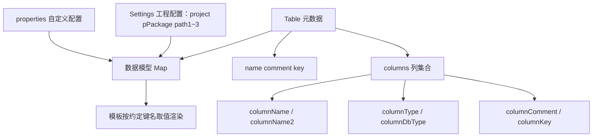

# 模板制作开工前的三份约定：位置、自定义数据与一份完整文件清单

代码生成器的程序部分收尾之后，能不能「一键生成一套工程」，决定权落在模板手里。模板不是提笔就写的：它放在哪、自定义数据从哪进模型、模板里能拿到哪些字段、要覆盖哪些文件，这些约定不定清楚，写出来的模板要么取不到值，要么生成出来的工程缺胳膊少腿。这一课先把约定和清单立好，后面几个课时再逐个文件动工。

## 先给结论

- 模板统一放到工程相对路径的「模板」文件夹下，按目标程序类型分子目录，例如「springboot程序的模板」「vue的前端界面模板」，生成时按名字选择。
- 自定义数据统一放 `properties` 文件夹下的 `.properties` 文件，加载后并入数据模型，模板里 `${key}` 直接取用。
- 数据模型根节点的键是约定好的：`author`、`project`、`path1` 到 `path3`、`pPackage`、`projectComment`、`ClassName`，外加一个 `table` 对象。
- `table` 里装 `name`、`comment`、`key`、`columns`，每个 `column` 再带 `columnName`、`columnName2`、`columnType`、`columnDbType`、`columnComment`、`columnKey` 六个字段。
- 一套 Spring Boot 通用模板的清单是五类：实体类、dao、service、controller、配置文件（pom、application.yml、启动类）。

## 一、两条存放约定：模板在哪，自定义数据在哪

**模板按程序类型分目录。** 生成器面向的不只一种程序，今天生成 Spring Boot 微服务，明天可能生成 Vue 前端页面，所以模板根目录下按类型再分一层：`templates/模板/springboot程序的模板/`、`templates/模板/vue的前端界面模板/`。目录名就是界面下拉框里的选项，起一个能辨识的名字，生成器会自动识别，互不干扰。

**自定义数据进 `.properties` 文件。** 数据模型里除了程序自动采集的部分，还允许用户自带扩展数据，约定位置是工程相对目录的 `properties` 文件夹，以 `.properties` 文件承载。比如在文件里写一行 `testkey=testvalue`，它就会出现在数据模型里，模板里 `${testkey}` 随处可用。类型映射也是走这条通道，资料包里的 `typeConverter.properties` 就是现成例子：

```properties
#SQL类型和java类型替换规则
VARCHAR=String
BIGINT=Long
INT=Integer
DATE=java.util.Date
DATETIME=java.util.Date
DOUBLE=Double
TEXT=String
VARCHAR2=String
NVARCHAR2=String
NUMBER=Long
CHAR=String
#Table的前缀或者后缀
tableRemovePrefixes="tb_,co_"
```

键是数据库类型，值是 Java 类型，`tableRemovePrefixes` 声明表名去前缀规则。这些键值对全部平铺进模型，模板取值时不需要任何前缀。

## 二、数据格式：模板里能拿到哪些值

约定清单里最需要背下来的一张表，是数据模型根节点的内容：

| 键 | 含义 |
|---|---|
| `author` | 作者，配置页填入 |
| `project` | 工程名（英文），配置页填入 |
| `path1` / `path2` / `path3` | 包名拆成的三段，如 `com`、`example`、`system` |
| `pPackage` | 完整包名，三段拼回一个字符串 |
| `projectComment` | 工程描述 |
| `ClassName` | 由表名转换出的类名 |
| `table` | 整个表的元数据对象 |

`table` 是个嵌套结构，往下还有两层。第一层是表级字段：`name` 表名、`comment` 表注释、`key` 表主键、`columns` 全部列的集合。第二层是每个 `column` 对象的六个字段，对应资料包里 `Column` 类的真实属性：

```java
public class Column {
    private String columnName;   // 列名称（数据库原样）
    private String columnName2;  // 列名称（处理后的 Java 属性名）
    private String columnType;   // Java 类型（映射后的）
    private String columnDbType; // 数据库类型
    private String columnComment;// 列备注
    private String columnKey;    // 是否主键
}
```

`columnName` 与 `columnName2` 的分工要格外留心：数据库列名是 `create_time`，转换成属性名就是 `createTime`，模板里写 Java 属性必须用后者；`columnType` 也不是数据库里的 `VARCHAR`，而是经过 properties 映射后的 `String`。这些转换早在元数据处理阶段完成，模板只消费结果。



## 三、需求清单：一套模板要生成哪些文件

需求只有一句话：制作一套 Spring Boot 程序的通用模板，拿到手就能把一个完整工程生成出来。展开成清单，每个文件要动态化的点并不一样：

**实体类。** 要有类的包路径、类名、全部属性，以及每个属性对应的 getter 与 setter。属性列表、主键判断、类型都来自 `table.columns`。

**持久化层 dao。** 要有包路径、类名，并正确引用实体类。项目用的是 Spring Data JPA，接口只需要继承 `JpaRepository` 与 `JpaSpecificationExecutor`，资料包成品模板里的 dao 模板一共三行有效代码：

```java
package ${pPackage}.dao;

import ${pPackage}.pojo.${ClassName};
import org.springframework.data.jpa.repository.JpaRepository;
import org.springframework.data.jpa.repository.JpaSpecificationExecutor;

public interface ${ClassName}Dao extends JpaRepository<${ClassName},String> ,JpaSpecificationExecutor<${ClassName}> {
}
```

**业务逻辑层 service。** 包路径、类名之外，还要引用实体类与 dao，把保存、更新、删除、按 id 查询、查询全部五个通用方法写全。

**视图层 controller。** 包路径、类名，引用 service，再加上 REST 风格的请求路径，五个增删改查接口一一对应。

**配置文件。** pom 文件要参数化父工程、本模块坐标与依赖；Spring Boot 的 `application.yml` 要参数化服务名与数据源；启动类也做成模板。配置文件齐了，生成出来的才算「一个工程」而不是一堆类。

资料包里已经有一套按这份清单做好的成品模板，目录结构与清单一一对应：

```text
SpringBoot模板/${path2}_${project}/
├── pom.xml
└── src/main/
    ├── java/${path1}/${path2}/${path3}/
    │   ├── CompanyApplication.java
    │   ├── controller/${ClassName}Controller.java
    │   ├── dao/${ClassName}Dao.java
    │   ├── pojo/${ClassName}.java
    │   └── service/${ClassName}Service.java
    └── resources/application.yml
```

模板文件名同样占位符化：`${ClassName}.java`、`${ClassName}Dao.java`、`${ClassName}Service.java`、`${ClassName}Controller.java`。对照上一课「路径即模板」的渲染机制就能明白，目录名和文件名带占位符不是巧合，而是这套清单能一次生成整套工程的机制基础。

## 常见误区

- **模板文件随手放在模板根目录**：不同程序类型的模板混在一起，界面上无法按类型选择，相对路径也会互相污染。按程序类型分子目录是硬约定。
- **自定义数据写进 yml 或 json**：生成器只按约定加载 `properties` 文件夹下的 `.properties` 文件，其他格式根本进不了数据模型。
- **属性名误用 `columnName`**：`create_time` 直接拼进 Java 代码不是编译报错就是风格灾难，Java 属性一律取转换后的 `columnName2`。
- **以为模板里写的是数据库类型**：`columnType` 是映射后的 Java 类型；数据库原样类型在 `columnDbType` 里，混用两者会导致生成代码类型错乱。

## 面试可能被问到的问题

1. 面试官追问：「代码生成器的模板设计，动手前要先定什么？」
   答：三件事：模板存放位置与按程序类型的目录划分、自定义数据的加载通道与格式、数据模型的键名约定。约定先行，模板与生成器才能各自独立演进，模板只依赖模型键名，不依赖生成器内部实现。

2. 面试官追问：「为什么把数据库类型到 Java 类型的映射做成 properties 配置，而不是写死在代码里？」
   答：不同数据库类型体系不同，项目也常有私有类型约定。放配置文件里，遇到未覆盖的类型加一行就能扩展，用户还可以塞入自定义键值进数据模型，不需要改生成器代码重新编译。

3. 面试官追问：「`columnName` 和 `columnName2` 为什么要存两份？」
   答：前者保留数据库列原样，用于生成 SQL 相关内容或注释对照；后者是去掉下划线、转驼峰后的 Java 属性名，用于生成字段声明与方法名。一份元数据服务两种语法环境，转换在元数据处理阶段一次性完成。

4. 面试官追问：「一套模板为什么要连 pom 和 application.yml 都做成模板？」
   答：目标是生成一个可直接导入运行的完整工程。只有类文件没有坐标与配置，生成物还要手工补工程骨架，自动化程度就断在一半。配置文件参数化之后，项目名、包名、服务名在一次生成里全部一致。

## 配套资料

- 成品 Spring Boot 模板目录与各层模板文件：`materials/code/02/day13-代码生成器实现/day13-代码生成器实现/资源/SpringBoot模板/`（含 `${ClassName}.java`、`${ClassName}Dao.java`、`${ClassName}Service.java`、`${ClassName}Controller.java`、`pom.xml`、`application.yml`）
- 自定义数据与类型映射真实文件：`materials/code/02/day13-代码生成器实现/day13-代码生成器实现/资源/代码/typeConverter.properties`
- `table` 与 `column` 元数据真实类：`materials/code/02/day12-代码生成器原理分析/day12-代码生成器原理分析/资源/工具代码/entity/db/Table.java`、同目录 `Column.java`
