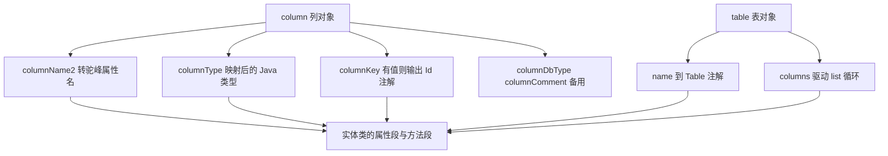

# 逐行拆解实体类模板：字段循环、主键判断与 Getter/Setter 生成

工程外壳的模板搞定之后，开始精修内部类文件，第一个动的是实体类。它是整套模板里信息密度最高的一个：要循环列集合生成属性，要判断哪列是主键补上 `@Id`，要把数据库类型换成 Java 类型，还要为每个属性配一对 getter 与 setter。一个模板写下来，FreeMarker 的循环、条件、内置函数全都用上了。这一课把这个模板逐行拆开，顺带复盘一次真实的渲染报错与修复。

## 先给结论

- 文件名与类名都用 `${ClassName}`，包名用 `${pPackage}.pojo`，表名用 `${table.name}`，这三处决定了「一张表对应一个实体类」。
- 属性段是一层 `<#list table.columns as column>`，循环体内用 `${column.columnType}` 声明类型、`${column.columnName2}` 声明属性名。
- 主键判断用 `<#if column.columnKey??>`：`??` 判断变量是否存在，主键列的 `columnKey` 有值就输出 `@Id`。
- getter/setter 再开一层同样的循环，方法名首字母大写靠内置函数 `?cap_first` 完成。
- `columnType` 来自 `typeConverter.properties` 的映射，映射缺失会在渲染期抛 `InvalidReferenceException`，往映射表里补行即修。

## 一、从成品实体类反推模板结构

动手写模板前，先看目标长什么样。资料包生成物里 `bs_city` 表对应的实体类（包名已改为 `com.example`），结构非常固定：

```java
package com.example.system.pojo;

import javax.persistence.Column;
import javax.persistence.Entity;
import javax.persistence.Id;
import javax.persistence.Table;
import java.io.Serializable;

@Entity
@Table(name = "bs_city")
public class City implements Serializable {

    @Id
    private String id;
    private String name;
    private java.util.Date createTime;

    public void setId(String value) {
        this.id = value;
    }
    public String getId() {
        return this.id;
    }
    public void setName(String value) {
        this.name = value;
    }
    public String getName() {
        return this.name;
    }
    public void setCreateTime(java.util.Date value) {
        this.createTime = value;
    }
    public java.util.Date getCreateTime() {
        return this.createTime;
    }
}
```

哪些部分随表而变，哪些恒定不变，一眼可辨：包名、类名、表名、属性列表、方法名全部动态；import 列表、`@Entity`、`implements Serializable` 恒定。把动态位置挖出来填上占位符，静态位置原样保留，就是模板。这里沿用课程约定：实体类不用 Lombok，getter/setter 由模板直接生成，上一课删掉注解的位置正等着补回来。

## 二、模板骨架：包名、注解与类声明

资料包里成品模板的前半段原文如下（文件名本身就是 `${ClassName}.java`）：

```java
package ${pPackage}.pojo;


import javax.persistence.Column;
import javax.persistence.Entity;
import javax.persistence.Id;
import javax.persistence.Table;
import java.io.Serializable;

@Entity
@Table(name = "${table.name}")
public class ${ClassName} implements Serializable {

    // 属性与 getter/setter 由循环生成，见下文
}
```

三个占位符各司其职。`${pPackage}` 是完整包名，来自 `Settings` 经反射进入数据模型的字段；`${table.name}` 取 `table` 对象的表名，落到 `@Table` 注解上，类与表的映射关系由它建立；`${ClassName}` 是数据模型根节点上的类名，由门面从 `table.getName2()` 提取，文件名与类名共用同一个占位符，保证两者永远一致。`serialVersionUID` 一类细节在课程里被刻意省略，赋个默认值即可，模板保持最短可读。

## 三、属性循环与主键判断

属性的生成靠第一层循环。模板原文：

```java
<#list table.columns as column>
<#if column.columnKey??>
@Id
</#if>
private ${column.columnType} ${column.columnName2};
</#list>
```

循环指令 `<#list table.columns as column>` 遍历列集合，每次迭代把当前列对象绑定到 `column` 上。循环体内只关心两件事：类型用 `${column.columnType}`，这是数据库类型经 properties 映射后的 Java 类型；属性名用 `${column.columnName2}`，这是转驼峰后的属性名，`create_time` 进来，`createTime` 出去。

`@Id` 的输出挂着一个条件指令，`??` 是 FreeMarker 的存在性判断：`column.columnKey??` 在 `columnKey` 有值时为真，没值时为假。往回捋一遍数据的来路就通了：元数据处理阶段收集主键信息，是主键的列 `columnKey` 存入 `PRI` 之类的值，普通列存空。于是「有值就输出 `@Id`」恰好等价于「是主键就标注」，不需要额外的布尔字段。



## 四、Getter 与 Setter：第二层循环加 cap_first

所有属性罗列完之后是方法区。模板原文：

```java
<#list table.columns as column>
public void set${column.columnName2?cap_first}(${column.columnType} value) {
    this.${column.columnName2} = value;
}
public ${column.columnType} get${column.columnName2?cap_first}() {
   return this.${column.columnName2};
}
</#list>
```

结构上与属性循环完全一样，差别在三处。**方法名要大写首字母**：属性是 `createTime`，方法却必须叫 `getCreateTime`，`?cap_first` 把表达式结果的首字母转成大写，占位符直接内嵌在方法名中间也能正常求值。**参数名统一用 `value`**：不必为每个属性想参数名，方法体内 `this.${column.columnName2} = value` 完成赋值，getter 对称地 `return this.${column.columnName2}`。**类型再次引用 `columnType`**：参数类型与字段类型自动保持一致。

两段分开循环而不是在属性循环里顺手写方法，是刻意的取舍：循环跑两遍多花一点时间，换来的输出完全符合「先集中声明字段，再集中写方法」的阅读习惯，生成物与人手写的代码结构一致，review 时不会别扭。

## 五、类型映射缺失：一次真实报错的排查

模板写完跑第一轮生成，控制台抛了异常：

```text
freemarker.core.InvalidReferenceException:
The following has evaluated to null or missing:
==> column.columnType  [...]
```

这类问题在模板开发里很常见，而 FreeMarker 的报错又只指模板行号，不告诉你是哪张表的哪一列出了问题，定位要靠笨办法：打开输出目录里已生成的实体类，与数据库表逐列对照。对照到用户表时发现，渲染停在某个头像字段上，往上的列全部正常，问题就锁定在这一列的类型上。

根因在 `typeConverter.properties`：这列的数据库类型没有出现在映射表里，元数据处理阶段换不出 Java 类型，`columnType` 自然是空，模板一取就炸。修复就是在映射表里补行，键统一大写：

```properties
BLOB=String
TINYINT=Integer
LONGTEXT=String
```

头像类大文本字段按 `String` 处理，`tinyint` 对应 `Integer`。补全映射重新生成，异常消失，输出目录里所有表的实体类完整生成。抽一个 `City` 验证：`@Id` 落在 `id` 字段上，`createTime` 的类型是 `java.util.Date`，方法名 `getCreateTime` 首字母大写无误，getter/setter 成对出现，实体类模板定稿。

## 常见误区

- **用 `columnName` 声明属性**：`create_time` 这类列名原样进 Java 代码，编译都过不了。属性、方法体里引用字段一律用 `columnName2`。
- **把 `?cap_first` 用到属性名上**：首字母大写只属于方法名，属性名要保持小写驼峰，两处混用会生成 `GetCreateTime` 与 `CreateTime` 这种非主流命名。
- **主键判断写成 `column.columnKey?has_content` 或漏掉问号**：`??` 是存在性判断，写错运算符要么永远不输出 `@Id`，要么渲染报语法错误。
- **报错后盯着模板改**：`InvalidReferenceException` 指向模板行，但根源常在数据侧。先对照已生成文件确认停在哪一列，再回头查类型映射表，而不是盲改模板结构。

## 面试可能被问到的问题

1. 面试官追问：「FreeMarker 里 `column.columnKey??` 的 `??` 是什么含义？」
   答：存在性判断运算符，变量有值时返回 true，缺失或为 null 时返回 false，且不会像直接取值那样抛 `InvalidReferenceException`。常用于可选输出场景，比如主键标注这种「有才渲染」的逻辑。

2. 面试官追问：「`?cap_first` 和 `?uncap_first` 分别用在哪？」
   答：`cap_first` 把首字母转大写，用于从属性名拼 getter/setter 方法名；`uncap_first` 反之，用于从类名 `User` 拼出小写变量名 `user`，dao 与 service、controller 的成员变量命名靠它。两者都是字符串内置函数，写在占位符表达式后面即可。

3. 面试官追问：「数据库类型到 Java 类型的映射为什么放配置文件，渲染期才生效？」
   答：类型体系因库而异，还常有项目私有约定，放 properties 里加一行就能扩展。代价是映射缺失推迟到渲染期才暴露，所以要用真实表全量跑一遍生成当冒烟测试，把缺映射的列提前逼出来。

4. 面试官追问：「模板渲染抛 InvalidReferenceException，你的排查路径是什么？」
   答：先看报错引用的变量名，判断是哪个占位符取空；再对照已生成的部分产物，定位到具体哪张表哪一列之后停止；然后回查数据侧，常见根因是类型映射缺失或数据模型少放了键；修复数据后重新生成，而不是去改模板结构。

5. 面试官追问：「属性和方法分两段循环，为什么要多跑一遍？」
   答：为了让生成物符合「先字段后方法」的书写习惯，与人手写的类结构一致。代码生成是低频操作，多一次循环的开销可以忽略，可读性收益是长期的。

## 配套资料

- 实体类模板原文：`materials/code/02/day13-代码生成器实现/day13-代码生成器实现/资源/SpringBoot模板/${path2}_${project}/src/main/java/${path1}/${path2}/${path3}/pojo/${ClassName}.java`
- 类型映射真实文件（报错修复即在此文件补行）：`materials/code/02/day13-代码生成器实现/day13-代码生成器实现/资源/代码/typeConverter.properties`
- 生成物参考（`bs_city` 表对应的实体类）：`materials/code/02/day13-代码生成器实现/day13-代码生成器实现/资源/测试/生成代码路径/ihrm_company/src/main/java/com/ihrm/system/pojo/City.java`
- 列元数据真实类（`columnName2`、`columnKey` 等字段定义）：`materials/code/02/day12-代码生成器原理分析/day12-代码生成器原理分析/资源/工具代码/entity/db/Column.java`
