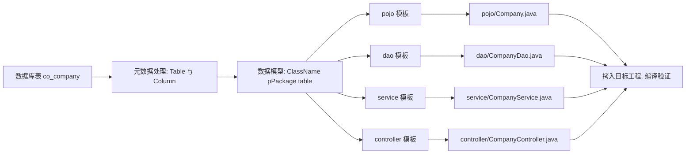

# 一张表生成三层代码：Dao、Service、Controller 模板逐层拆解

实体类模板定稿之后，剩下的活儿看起来还有三份，实际一份比一份薄：持久层是两个空接口，业务层是五个方法，视图层是五个 REST 端点，外加一份配置文件。写法上全部沿用同一套思路，找一份手写好的标准代码，把随表变化的位置挖出来换成占位符，静态部分原样保留。这一课把三层模板一次做完，每写完一层就清空生成目录重新跑一轮，让每一步都有真实产物可以对照。

## 先给结论

- Dao 模板几乎没有自由度：类名是 `${ClassName}Dao`，继承 `JpaRepository<${ClassName}, String>` 与 `JpaSpecificationExecutor<${ClassName}>`，增删改查能力全部来自父接口，模板里不写任何方法。
- Service 模板的关键是新招：`<#assign classNameLower = ClassName?uncap_first>`，用 `assign` 指令把类名的小写形式存成模板内变量，成员变量名、方法参数名全靠它。
- Controller 模板固定五件套：POST 保存、PUT 更新、DELETE 删除、GET 单查、GET 列表，返回值统一是 `Result`，`@RequestMapping` 的路径用 `${classNameLower}` 拼出来。
- `application.yml` 也算模板的一部分，服务名、端口、数据源这些工程级信息跟着一起出，生成完的工程才是完整可启动的。
- 模板只生成骨架代码，业务逻辑不进模板，默认状态、权限校验这类内容在生成之后按需补。

## 一、持久层模板：两个父接口定下全部能力

Dao 这一层的特点是「没有内容」。Spring Data JPA 的惯例是接口不写任何方法，`JpaRepository` 自带 `save`、`findById`、`deleteById`、`findAll`，`JpaSpecificationExecutor` 补上动态条件查询的能力。既然方法全是父接口给的，模板要做的只有一件事：把类名和泛型里的实体类换成占位符。资料包里成品模板的全文如下（包名体系统一改写为 `com.example`）：

```java
package ${pPackage}.dao;

import ${pPackage}.pojo.${ClassName};
import org.springframework.data.jpa.repository.JpaRepository;
import org.springframework.data.jpa.repository.JpaSpecificationExecutor;

public interface ${ClassName}Dao extends JpaRepository<${ClassName},String> ,JpaSpecificationExecutor<${ClassName}> {
}
```

占位符只有两个。`${pPackage}` 是完整包名，由界面上的包名输入框直接喂进数据模型，dao、pojo 两层的 import 关系靠它对齐；`${ClassName}` 是类名，文件名 `${ClassName}Dao.java` 与接口名共用同一个变量，永远不可能不一致。

拿 `co_company` 这张表跑一遍，生成物是这个样子：

```java
package com.example.system.dao;

import com.example.system.pojo.Company;
import org.springframework.data.jpa.repository.JpaRepository;
import org.springframework.data.jpa.repository.JpaSpecificationExecutor;

public interface CompanyDao extends JpaRepository<Company,String> ,JpaSpecificationExecutor<Company> {
}
```

模板五行，产物九行，这层就结束了。数据库里有二十张表，同样一份模板跑二十遍，二十个 Dao 一个不落。

## 二、业务层模板：assign 指令补上小写变量名

Service 模板会遇到一个新问题。手写代码的习惯是 `private CompanyDao companyDao;`，成员变量名是类名首字母小写，可数据模型里只有大写的 `${ClassName}`，直接拼出来就是 `CompanyDao CompanyDao`，连编译都过不了。FreeMarker 的内置函数 `?uncap_first` 专门干这件事：把表达式结果的首字母转成小写。配合 `assign` 指令把结果存成模板内变量，声明一次，全文件可用：

```java
<#assign classNameLower = ClassName?uncap_first>
package ${pPackage}.service;

import com.example.common.utils.IdWorker;
import ${pPackage}.dao.${ClassName}Dao;
import ${pPackage}.pojo.${ClassName};
import org.springframework.beans.factory.annotation.Autowired;
import org.springframework.stereotype.Service;
import java.util.List;

@Service
public class ${ClassName}Service {

    @Autowired
    private ${ClassName}Dao ${classNameLower}Dao;

    @Autowired
    private IdWorker idWorker;

    /**
     * 保存
     */
    public void add(${ClassName} ${classNameLower}) {
        //基本属性的设置
        String id = idWorker.nextId()+"";
        ${classNameLower}.setId(id);
        ${classNameLower}Dao.save(${classNameLower});
    }

    /**
     * 更新
     */
    public void update(${ClassName} ${classNameLower}) {
        ${classNameLower}Dao.save(${classNameLower});
    }

    /**
     * 删除
     */
    public void deleteById(String id) {
        ${classNameLower}Dao.deleteById(id);
    }

    /**
     * 根据id查询
     */
    public ${ClassName} findById(String id) {
        return ${classNameLower}Dao.findById(id).get();
    }

    /**
     * 查询列表
     */
    public List<${ClassName}> findAll() {
        return ${classNameLower}Dao.findAll();
    }
}
```

首行的 `assign` 是这份模板的点睛之处：`classNameLower` 这个名字是模板作者自己定的，等号右边 `ClassName?uncap_first` 才是数据。求值一次，后面十来处引用全部走这个变量，改起来也只动一行。`IdWorker` 生成的分布式 ID 在 `add` 里补上主键，保存之前先赋值，这是这套工程的固定动作，值得原样进模板。

有两个刻意为之的取舍。其一，手写版的保存方法里还有设置默认状态这类业务动作，做模板时全部删掉，模板只保留最通用的增删改查骨架，业务在生成之后按模块补。其二，注释重写得更通用，方法注释只写「保存」「更新」，不出现具体业务词，这样同一份模板放到任何工程都不违和。

对照产物 `CompanyService.java`（节选）：

```java
@Service
public class CompanyService {

    @Autowired
    private CompanyDao companyDao;

    @Autowired
    private IdWorker idWorker;

    public void add(Company company) {
        String id = idWorker.nextId()+"";
        company.setId(id);
        companyDao.save(company);
    }
}
```

`companyDao`、`company` 两处小写名都来自 `${classNameLower}`，与手写习惯完全一致。

## 三、视图层模板：五个 REST 端点与统一返回

Controller 模板的改写量比 Service 大，好在有批量替换帮忙。做法是在编辑器里按 `Ctrl+R` 打开替换，打开区分大小写：大写 `Company` 全部替换成 `${ClassName}`，小写 `company` 全部替换成 `${classNameLower}`，`Replace All` 一遍完成大半工作，剩下的包名与 import 逐个核对。成品模板如下：

```java
<#assign classNameLower = ClassName?uncap_first>
package ${pPackage}.controller;

import com.example.common.entity.Result;
import com.example.common.entity.ResultCode;
import com.example.common.exception.CommonException;
import ${pPackage}.service.${ClassName}Service;
import ${pPackage}.pojo.${ClassName};
import org.springframework.web.bind.annotation.*;
import java.util.List;

//解决跨域问题
@CrossOrigin
@RestController
@RequestMapping(value="/${classNameLower}")
public class ${ClassName}Controller {

    @Autowired
    private ${ClassName}Service ${classNameLower}Service;

    //保存
    @RequestMapping(value="",method = RequestMethod.POST)
    public Result save(@RequestBody ${ClassName} ${classNameLower})  {
        ${classNameLower}Service.add(${classNameLower});
        return new Result(ResultCode.SUCCESS);
    }

    //根据id更新
    @RequestMapping(value = "/{id}",method = RequestMethod.PUT)
    public Result update(@PathVariable(value="id") String id, @RequestBody ${ClassName} ${classNameLower} ) {
        ${classNameLower}.setId(id);
        ${classNameLower}Service.update(${classNameLower});
        return new Result(ResultCode.SUCCESS);
    }

    //根据id删除
    @RequestMapping(value="/{id}",method = RequestMethod.DELETE)
    public Result delete(@PathVariable(value="id") String id) {
        ${classNameLower}Service.deleteById(id);
        return new Result(ResultCode.SUCCESS);
    }

    //根据id查询
    @RequestMapping(value="/{id}",method = RequestMethod.GET)
    public Result findById(@PathVariable(value="id") String id) throws CommonException {
        ${ClassName} ${classNameLower} = ${classNameLower}Service.findById(id);
        return new Result(ResultCode.SUCCESS,${classNameLower});
    }

    //查询全部
    @RequestMapping(value="",method = RequestMethod.GET)
    public Result findAll() {
        List<${ClassName}> list = ${classNameLower}Service.findAll();
        Result result = new Result(ResultCode.SUCCESS);
        result.setData(list);
        return result;
    }
}
```

有几个位置值得圈出来。类上的 `@RequestMapping(value="/${classNameLower}")` 决定了整组接口的 URL 前缀，`Company` 表生成出来就是 `/company`，前端按这个约定拼路径。跨域注解 `@CrossOrigin` 与统一返回结构 `Result`、`ResultCode` 属于全项目通用件，放在 `common` 模块里，模板原样引入。更新接口里 `setId(id)` 这一行不能省，REST 风格的主键在 URL 上，请求体里未必带。

生成物 `CompanyController.java` 的五个端点与模板一一对应，URL 是 `/company`，请求映射与手写版完全一致。

## 四、配置文件也进模板

`resources` 目录下的 `application.yml` 同样是生成物的一部分，端口、服务名、数据源这些信息每个工程都不同，但结构完全一样，天然适合模板化：

```yaml
#服务配置
server:
  port: 9001
#spring配置
spring:
  #1.应用配置
  application:
    name: company-service #指定服务名
  #2.数据库连接池
  datasource:
    driver-class-name: com.mysql.jdbc.Driver
    url: jdbc:mysql://localhost:3306/hrm?useUnicode=true&characterEncoding=utf8
    username: root
    password: 111111
  #3.JPA
  jpa:
    database: MySQL
    show-sql: true
    open-in-view: true
```

改法与代码模板一致，把服务名、数据库名这些位置换成占位符即可，课程里把具体的替换留作练习，思路与前面三层完全相同。至此模板目录里四份 Java 模板加一份配置，一个 Spring Boot 微服务的骨架齐了。

## 五、每写完一层就重新生成一轮

三层模板不是一口气写完才验证的。每改完一个模板，都把生成目录里上一轮的内容全部删掉，重新生成一遍，逐个目录核对。整个链路可以画成一张图：



图中从数据模型分出去的四条支线就是四个模板文件，它们消费的是同一份数据。这也是这套生成器好维护的根本原因：加一张表不用动模板，改模板不用动数据，两边只靠 `${ClassName}`、`${pPackage}`、`${table}` 这几个约定好的键衔接。

## 常见误区

- **把业务逻辑写进模板**：保存时设置默认状态、记录操作人之类的内容进了模板，生成器就只能服务这一个项目，换套表结构全部作废。模板出骨架，业务生成后手补。
- **手写小写变量名而不建 `assign`**：在模板里直接写 `companyDao`，换一张 `User` 表生成的代码里还是 `companyDao`，编译错一片。小写名必须由 `${classNameLower}` 派生。
- **URL 占位符用了大写类名**：`@RequestMapping` 写成 `/${ClassName}`，生成出 `/Company`，与前端约定的小写路径对不上，接口 404。URL 一律用 `${classNameLower}`。
- **模板盲写完不做生成验证**：编辑器对 FreeMarker 文件没有语法提示，少一个分号、漏一个花括号都不会被当场发现，必须用真实表跑一轮生成并把产物编译一遍，错误才会浮出来。

## 面试可能被问到的问题

1. 面试官追问：「代码生成器里，Dao 层模板为什么几乎是空的？」
   答：因为 Spring Data JPA 的编程模型是「接口即实现」，继承 `JpaRepository` 与 `JpaSpecificationExecutor` 就自动获得基础增删改查和条件查询能力。模板只需要把接口名与泛型中的实体类替换成占位符，方法体一个都不用写。

2. 面试官追问：「`<#assign>` 指令在模板里起什么作用？」
   答：它在模板内部定义一个自定义变量，等号右侧的表达式求值一次，之后整个模板都能引用。典型用法是 `<#assign classNameLower = ClassName?uncap_first>`，把大写类名转成小写驼峰，供成员变量名、参数名、URL 路径复用，避免在多处重复书写带内置函数的表达式。

3. 面试官追问：「`?uncap_first` 和 `?cap_first` 的区别与使用场景？」
   答：`uncap_first` 把首字母转小写，用于从类名派生变量名，如 `User` 到 `user`；`cap_first` 把首字母转大写，用于从属性名拼 getter、setter 方法名，如 `createTime` 到 `getCreateTime`。一个服务「类名转变量名」，一个服务「属性名转方法名」。

4. 面试官追问：「为什么生成器的模板里不写业务逻辑？」
   答：模板的价值在于复用，业务逻辑是模块私有的。模板只生成与具体业务无关的 CRUD 骨架，任何一张表都能套用；带业务的代码在生成结果上继续开发。这样模板数量恒定、维护成本最低，生成器也不会因为业务变化而频繁改动。

5. 面试官追问：「生成的 Controller 如何做到返回结构统一？」
   答：模板里固定引入公共模块的 `Result` 与 `ResultCode`，五个端点全部返回 `Result`，数据放在 `data` 字段里，异常统一抛 `CommonException` 交给全局异常处理器。接口格式在模板层就被固化，生成出来的所有模块天然一致。

6. 面试官追问：「模板数量多了以后怎么组织？」
   答：按目标工程的目录结构摆放模板文件，模板路径即生成路径，文件名即产物文件名，占位符目录如 `${pPackage}` 对应包名。生成器扫描模板目录整体渲染，新增一种产物只需加一个模板文件，不改生成器代码。

## 配套资料

- 持久层模板原文：`materials/code/02/day13-代码生成器实现/day13-代码生成器实现/资源/SpringBoot模板/${path2}_${project}/src/main/java/${path1}/${path2}/${path3}/dao/${ClassName}Dao.java`
- 业务层模板原文：同目录 `service/${ClassName}Service.java`（`assign` 与 `?uncap_first` 的真实用例）
- 视图层模板原文：同目录 `controller/${ClassName}Controller(1).java`
- 配置模板：同模板工程 `src/main/resources/application.yml`
- 生成物对照：`materials/code/02/day13-代码生成器实现/day13-代码生成器实现/资源/测试/生成代码路径/ihrm_company/src/main/java/com/ihrm/system/` 下的 `dao/CompanyDao.java`、`service/CompanyService.java`、`controller/CompanyController.java`（文中包名已统一改写为 `com.example`，服务名改写为 `company-service`）
