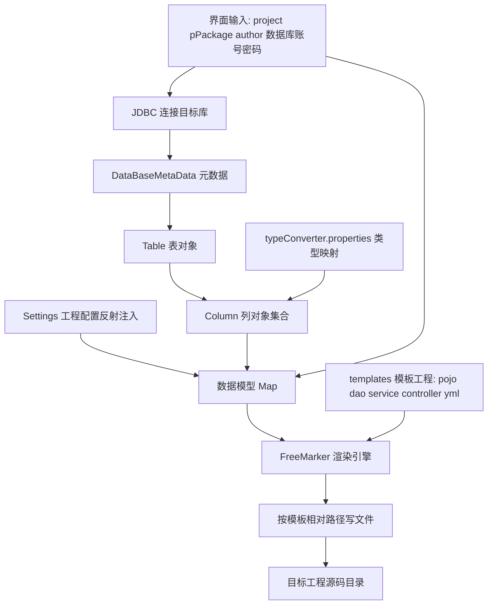

# 复盘代码生成器全链路：从元数据到落盘的五个环节

两天的代码生成器课程走到收尾：元数据、FreeMarker、数据模型、模板制作，这些散落的知识点最终拼成了一个能跑的工具。趁热把整条链路串成一篇复盘，以后想自己写生成器，或者想改造现成的生成器，按这五个环节对号入座即可。

## 先给结论

- 生成器的本质是一条五步流水线：连库拿元数据、组装数据模型、准备模板工程、FreeMarker 渲染、按路径落盘。
- 数据模型是全链路的枢纽，界面输入、数据库元数据、类型映射三路数据汇进一个 Map，模板里所有的 `${...}` 都从它取值。
- 模板按目标工程的目录结构摆放，模板路径即生成路径，这是「加产物只加模板、不改生成器代码」的关键。
- Swing 界面只是壳，核心逻辑在 core 与 templates 里，想换 Web 界面或打包成 EXE 都不影响链路本身。
- 这套东西的通用性来自约定：`${ClassName}`、`${pPackage}`、`${table}` 这几个键的语义定好，换一套模板就能服务另一个项目。

## 一、一张数据格式总表，定死模板与数据的契约

课程讲义里有一张「数据格式」表，把生成器里流通的所有变量列全了。这张表值得背下来，它是模板作者与生成器作者之间的契约：

| 名称 | 说明 |
|---|---|
| `author` | 作者 |
| `project` | 工程名（英文） |
| `path1`、`path2`、`path3` | 包名的三段 |
| `pPackage` | 完整包名 |
| `projectComment` | 工程描述 |
| `ClassName` | 类名（由表名转换） |
| `table` | 数据库信息对象 |
| `table.name` | 表名 |

前六个来自生成器界面上的输入框，`ClassName` 与 `table` 来自数据库元数据。模板里出现的每一个占位符都能在这张表里找到来路，反过来，数据模型也必须把这张表里的键全部塞进 Map，少一个键，模板渲染时就抛 `InvalidReferenceException`。

## 二、五步流水线：整条链路长什么样

两天内容的骨架就是下面这张图，从左到右五步，任何一步出问题都能在这里定位：



关键路径在中间的汇合点：界面输入走 `Settings`，元数据走 `Table` 与 `Column`，类型映射在元数据处理阶段把 `varchar` 换成 `String`、`datetime` 换成 `java.util.Date`，三路数据在数据模型里汇合，模板只认这一个模型。

**第一环节，元数据采集。** JDBC 的 `DataBaseMetaData` 能拿到数据库里的表清单、每张表的列名、数据库类型、是否主键、备注。课程里的 `Table` 与 `Column` 两个实体类就是元数据的载体：

```java
public class Table {
    private String name;          //表名称
    private String name2;         //处理后的表名称, 即类名来源
    private String comment;       //介绍
    private String key;           //主键列
    private List<Column> columns; //列集合
}

public class Column {
    private String columnName;    //列名称
    private String columnName2;   //处理后的列名称, 转驼峰
    private String columnType;    //映射后的 Java 类型
    private String columnDbType;  //数据库原始类型
    private String columnComment; //列备注
    private String columnKey;     //是否是主键
}
```

原始字段与处理后字段成对出现，`name2`、`columnName2` 是给模板准备的「干净值」，模板里只用它们，不需要在模板里做字符串加工。

**第二环节，数据模型组装。** 自定义的 `typeConverter.properties` 提供类型映射，`Settings` 里的工程配置通过反射注入 Map，最终形成 FreeMarker 要求的嵌套数据结构。映射表长这样，缺类型就在这里补：

```properties
VARCHAR=String
BIGINT=Long
INT=Integer
DATE=java.util.Date
DATETIME=java.util.Date
DOUBLE=Double
TEXT=String
CHAR=String
```

**第三环节，模板工程。** `templates` 目录下按目标工程的结构摆文件，`pojo`、`dao`、`service`、`controller` 各一个模板，`application.yml` 一份，目录里的 `${path2}_${project}` 这类占位符目录名负责生成包路径。模板与数据模型的契约就是第一节的表。

**第四环节，渲染。** FreeMarker 的标准三步：配置加载模板目录、取 `Template`、传数据模型执行 `process`。核心代码骨架如下（课程源码里此段被封装在核心处理类中，此处为按本课写法补全的等价示例）：

```java
Configuration cfg = new Configuration(Configuration.VERSION_2_3_0);
cfg.setDirectoryForTemplateLoading(new File(templetPath));
cfg.setDefaultEncoding("UTF-8");

Template template = cfg.getTemplate("service/${ClassName}Service.java");
Writer out = new OutputStreamWriter(new FileOutputStream(targetFile), StandardCharsets.UTF_8);
template.process(dataModel, out);
```

**第五环节，落盘。** 按模板在模板工程里的相对路径，把渲染结果写到输出目录，包名中的点换成路径分隔符，目标工程里就多出一棵完整的源码树。

## 三、工程组织：ui 是壳，core 与 templates 是芯

课程配套的生成器工程是一个 Maven 项目，目录分三块：`ui` 放 Swing 界面类，`core` 放渲染门面，`templates` 放模板工程。界面上「生成代码」按钮背后的处理逻辑能看清这个分工：

```java
private void generator(String templetPath, String outpath, Settings settings, DataBase db) {
    // 模板路径、输出路径、工程配置、数据库信息, 四个输入齐了, 交给核心层
}
```

界面只负责收集四个输入：模板在哪、生成到哪、工程信息是什么、连哪个库。真正干活的在 core 层的门面类里。还有一个细节藏在窗口初始化代码里：界面启动时扫描当前目录下的「模板」文件夹，把每个子目录名填进下拉框，这就是「一套模板对应一种技术栈」的入口，想做一套 MyBatis 版模板，加一个子目录就行。

```java
File directory = new File(new File("").getAbsolutePath() + "\\模板");
File[] listFiles = directory.listFiles();
for (File f : listFiles) {
    if (f.isDirectory()) {
        this.jComboBox1.addItem(f.getName());
    }
}
```

## 四、两个延伸方向

界面用的是 Swing，属于比较老的技术，课程里给了打包部署文档，可以按步骤把它打成 EXE，双击即用，不必每次开 IDE 再运行 main 方法。如果不喜欢桌面 UI，还可以把整个生成器改造成 Web 程序：表单提交工程配置、页面勾选要生成的表，后台复用同一套 core 与 templates。这两个方向都不动五步流水线本身，生成器的价值全在数据模型与模板的契约上，界面怎么换都行。

## 常见误区

- **把生成器当成模板的合集**：只盯着模板学，忽略数据模型。占位符取不到值就抛异常，先搞清每个键的来路，再动模板。
- **元数据与数据模型混为一谈**：元数据是数据库里的原始信息，数据模型是喂给模板的加工品，类型映射、驼峰转换、工程配置注入都发生在两者之间。
- **界面层当核心来读**：Swing 代码量大且是生成的布局代码，读源码直接跳过 ui 包，从 core 的门面类进入。
- **改模板不跑全量验证**：模板改动的验证方式永远是用真实库全量生成一轮，缺类型映射、缺键的坑只有真数据能逼出来。

## 面试可能被问到的问题

1. 面试官追问：「让你实现一个代码生成器，整体怎么设计？」
   答：按五步流水线设计：JDBC 元数据采集、数据模型组装、模板工程、FreeMarker 渲染、落盘。元数据转成 Table 与 Column 对象，合并界面配置形成数据模型；模板按目标工程目录摆放；渲染后按模板相对路径输出。数据模型与模板的键约定是设计的核心。

2. 面试官追问：「元数据在生成器里起什么作用？」
   答：它是「数据库里有什么」的唯一事实来源。通过 `DataBaseMetaData` 拿到表名、列名、数据库类型、主键与备注，加工成 Table 与 Column 对象后驱动模板循环生成，保证了生成物与表结构永远一致，不需要人工维护字段清单。

3. 面试官追问：「数据模型为什么要做类型映射，直接用数据库类型不行吗？」
   答：数据库类型与 Java 类型不是一一对应，`varchar`、`text` 都是 `String`，`datetime` 要映射成 `java.util.Date`。把映射放配置文件里，不同数据库、不同项目约定各配一份，扩展时加一行即可，同时也能强制暴露未覆盖的类型，避免生成出编译不过的属性。

4. 面试官追问：「生成器怎么支持多套模板，比如一套 JPA 一套 MyBatis？」
   答：模板按套组织成多个目录，界面下拉框扫描模板根目录自动列出可选集，每套目录内自持完整的目标工程结构。生成时按选中的目录渲染，core 层代码完全不用改。

5. 面试官追问：「FreeMarker 渲染时抛 InvalidReferenceException，你的排查顺序？」
   答：先看异常指出的变量名与模板行号，判断是哪个键取空；再对照数据格式契约表，确认这个键应该由哪一路数据提供；然后回查数据侧，常见根因是数据模型少放键、类型映射缺行或反射注入字段名对不上；修复数据后全量重新生成验证。

6. 面试官追问：「这套生成器和主流脚手架比，局限在哪？」
   答：它面向单表 CRUD 的骨架代码，表结构变更后需要重新生成并合并手写业务；不支持跨表关系、复杂业务模式的抽象。优势是完全可控、贴合团队规范，适合作为内部工具与脚手架互补，而不是替代。

## 配套资料

- 生成器工具源码（ui、core、entity、utils 全量）：`materials/code/02/day12-代码生成器原理分析/day12-代码生成器原理分析/资源/工具代码/`（`ui/CodeUtil.java` 界面入口、`core/GeneratorFacade.java` 门面、`entity/db/Table.java` 与 `Column.java` 元数据载体）
- 模板工程成品：`materials/code/02/day13-代码生成器实现/day13-代码生成器实现/资源/SpringBoot模板/${path2}_${project}/`
- 类型映射配置：`materials/code/02/day13-代码生成器实现/day13-代码生成器实现/资源/代码/typeConverter.properties`
- 生成物样例：`materials/code/02/day13-代码生成器实现/day13-代码生成器实现/资源/测试/生成代码路径/ihrm_company/`
- 文中 FreeMarker 渲染代码为按本课写法补全的可运行示例，课程源码中该逻辑封装在核心处理类内
