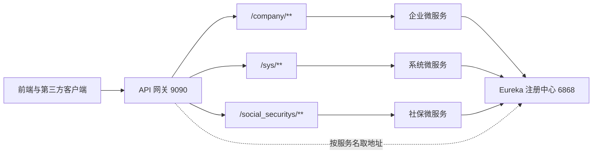
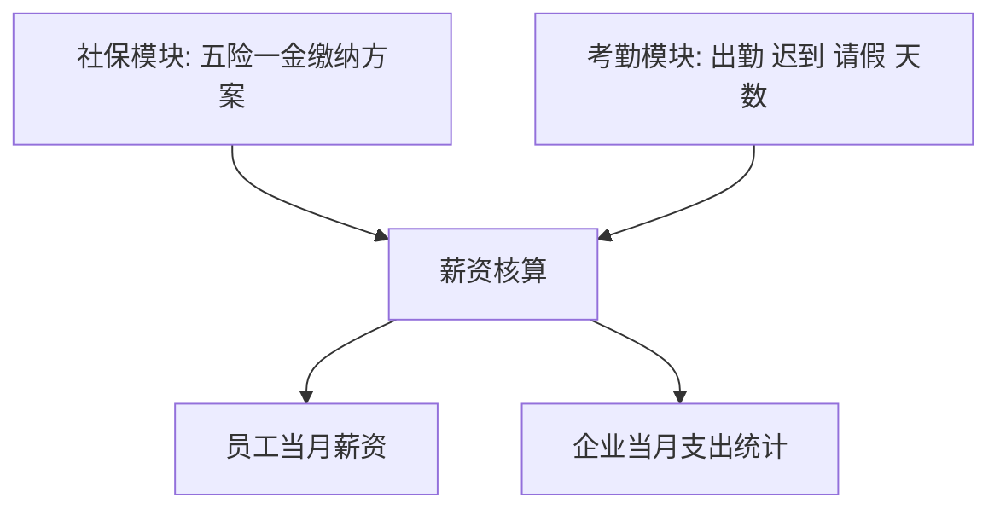

# 给微服务群装一扇门：day14 开篇，API 网关与社保模块的路线图

人事系统的地基已经打完：权限体系、Shiro 认证授权、POI 报表、Jasper 报表、刷脸登录都落了地。但站在客户端视角看这个微服务群，还有一个别扭的地方没解决：服务越拆越多，前端要记住的地址也越来越多。day14 从这个痛点切入，上半场搭 API 网关并做统一鉴权，下半场进入人力资源管理最核心的业务三件套之一：社保。

## 先给结论

- 微服务拆得越细，客户端要记的地址越多，网关的使命就是把这几十个地址收敛成一个统一入口。
- 网关选用 Zuul，一个 `@EnableZuulProxy` 注解开启能力，路由规则写进 `application.yml`，服务地址从 Eureka 注册中心按服务名取。
- 网关顺手解决统一鉴权：自定义一个 `pre` 类型的 Zuul 过滤器校验 Authorization 头，没有 token 直接 401，请求根本到不了业务服务。
- 接下来三四天的业务主线是一条因果链：社保定扣款、考勤定出勤、两者汇成薪资，企业维度再汇总成当月支出。
- 社保模块要做四件事：企业社保设置、员工社保列表、当月报表、历史归档，对应一个独立微服务。

## 一、客户端的困惑：地址多到记不住

微服务架构初具雏形之后，每个服务都有自己的网络地址：企业服务一个端口、系统服务一个端口、员工服务又一个端口。客户端要访问一个完整业务流程，往往要跨好几个服务，每个服务的 IP 加端口都得记在配置里；服务一扩容、一迁移，前端跟着改。讲义里把这问题描述得很直白：不同的微服务有不同的网络地址，客户端访问时必须记住几十甚至几百个地址，太复杂也难以维护。

解法是在服务群前面立一道门：所有请求先进网关，网关按路径规则转发到对应微服务。客户端只认识网关一个地址，服务地址的变化被网关吸收。整个结构长这样：



网关自己也是注册中心的一个客户端，转发目标不写死 IP，而是按服务名从 Eureka 查，负载均衡与扩缩容都是免费的。

## 二、网关搭建：一个注解加一段路由

网关本身就是一个 Spring Boot 工程。启动类三个注解各管一件事（包名已改写为 `com.example`）：

```java
@SpringBootApplication(scanBasePackages = "com.example")
//开启zuul网关功能
@EnableZuulProxy
//开启服务发现功能
@EnableDiscoveryClient
public class GateApplication {

    public static void main(String[] args) {
        SpringApplication.run(GateApplication.class);
    }
}
```

真正的工作量在路由配置里。课程工程的真实配置把四个服务的路径规则全部列了出来（服务名已按语义改写）：

```yaml
server:
  port: 9090
spring:
  application:
    name: gateway-service
#配置路由规则
zuul:
  routes:
    company-service:              #路由id, 随便写
      path: /company/**           #需要映射的路径地址
      serviceId: company-service  #Eureka 注册中心中的服务id
      stripPrefix: false          #不删除请求前缀
      customSensitiveHeaders: true #对指定路由开启自定义敏感头
    system-service:
      path: /sys/**
      serviceId: system-service
      stripPrefix: false
      customSensitiveHeaders: true
    social-security-service:
      path: /social_securitys/**
      serviceId: social-security-service
      stripPrefix: false
      customSensitiveHeaders: true
```

两个配置项值得单独解释。`stripPrefix: false` 表示转发时不裁剪路径前缀，请求 `/sys/city` 到达系统微服务后仍是 `/sys/city`，与各服务内部的 `@RequestMapping` 约定对齐。`customSensitiveHeaders: true` 配合敏感头设置为空，是为了让 Authorization 这类头信息能顺利穿过网关传给下游，鉴权体系依赖它。

## 三、网关的第二份工作：统一鉴权

前面 JWT 校验散落在各个微服务里，有了网关就有了更好的位置：所有请求都过这道门，鉴权做一次就够。做法是写一个自定义 Zuul 过滤器，核心代码如下：

```java
public class LoginFilter extends ZuulFilter {

    public String filterType() {
        return "pre";    //在执行路由请求之前执行
    }

    public int filterOrder() {
        return 2;        //数字越小, 优先级越高
    }

    public boolean shouldFilter() {
        return true;
    }

    public Object run() {
        //1.通过 Zuul 上下文拿到 request
        RequestContext rc = RequestContext.getCurrentContext();
        HttpServletRequest request = rc.getRequest();
        //2.获取 Authorization 头
        String token = request.getHeader("Authorization");
        //3.没有 token 就拦截
        if (token == null || "".equals(token)) {
            rc.setSendZuulResponse(false);  //不再向下游转发
            rc.setResponseStatusCode(HttpStatus.UNAUTHORIZED.value()); //401
        }
        return null;
    }
}
```

`filterType` 返回 `pre`，让过滤器在路由转发之前执行；`run` 里拿到请求头中的 token，缺失就调用 `setSendZuulResponse(false)` 掐断转发并回 401。token 本身的签发与解析靠公共模块的 `JwtUtils`，配置项 `jwt.config.key` 与 `jwt.config.ttl` 控制签名私钥与失效时长。登录服务签发 token，网关校验 token，下游服务专注业务，职责就此分层。

## 四、业务主线：社保、考勤、薪资一条链

网关之外，day14 还要开启后面三四天的业务地图。人力资源管理剩下的业务逻辑画出来是一条因果链：



社保定的是「扣多少钱」：员工入职企业，按城市缴纳方案确定五险一金的缴纳基数与比例，属于企业代扣代缴的法定项目。考勤定的是「上了多少天班」：某个月里出勤、迟到、请假、外出的记录。两条线在薪资模块汇合，扣完社保、算完出勤，得到员工当月薪资；全企业员工的薪资与社保支出汇总，就是企业当月的人力成本。

**社保模块今天开工，范围有四块。** 一是企业社保设置，决定企业是否开通社保、以哪个月份为当前统计周期；二是员工社保列表，逐个员工的缴纳项目与基数；三是当月报表，按统计周期出新报表；四是历史归档，报表归档留痕。课程资料里的社保微服务骨架已经就位，能看出它与其他服务的协作方式：

```java
@SpringBootApplication(scanBasePackages = "com.example")
@EntityScan(value = "com.example.domain")
@EnableEurekaClient
@EnableDiscoveryClient
@EnableFeignClients   //跨服务调用: 员工与系统数据走 Feign
public class SocialSecuritysApplication {

    public static void main(String[] args) {
        SpringApplication.run(SocialSecuritysApplication.class, args);
    }
}
```

服务名 `social-security-service`，端口 9004，通过网关的 `/social_securitys/**` 规则对外暴露；员工信息、企业设置这类数据不在本库，靠 Feign 客户端向员工服务与系统服务发起调用。社保数据天然按月成批，工程里还注册了 `OpenEntityManagerInViewFilter` 处理懒加载的 no session 问题，这些细节后面写业务时会一一展开。

## 五、day14 的三个学习目标

回到讲义上列的目标：理解 Zuul 网关的作用、完成 Zuul 网关的搭建、实现社保模块的代码开发。对应到动手清单就是三步：把网关工程跑起来并配通四条路由；在网关上挂过滤器完成 token 校验，打通统一鉴权；进入社保微服务，从企业设置开始把四块业务逐一实现。

## 常见误区

- **把网关当负载均衡器**：负载均衡只是网关顺带的能力，网关的核心价值是统一入口、统一鉴权、统一治理，三者缺一不可，只配路由不做过滤等于只装了半扇门。
- **`stripPrefix` 不看就用默认值**：默认会裁掉第一段路径前缀，下游接口如果没有同名前缀就 404。这套工程约定各服务自带前缀，所以显式配 `false`。
- **鉴权头过不了网关还查服务代码**：Zuul 默认对部分敏感头做隔离处理，Authorization 传不到下游时要在路由上开 `customSensitiveHeaders` 并放行敏感头，问题出在网关配置而不是业务服务。
- **社保数据自己算员工信息**：员工、部门数据归属各自微服务，社保服务只管缴纳方案与记录，跨域数据用 Feign 调用获取，别把别人的家底抄进自己的库。

## 面试可能被问到的问题

1. 面试官追问：「微服务架构里为什么需要 API 网关？」
   答：服务数量多之后，客户端直接调用每个服务要维护几十上百个地址，且跨域、鉴权、限流这些问题要在每个服务重复处理。网关提供统一入口，收敛地址、集中完成鉴权与治理，服务地址变化由网关路由吸收，客户端无感。

2. 面试官追问：「Zuul 的过滤器有哪几种类型，鉴权放在哪种？」
   答：pre 在路由转发前执行，routing 在路由转发时执行，post 在转发后执行，error 在异常时执行。鉴权放在 pre 阶段，不合法的请求在转发前就被掐断，`setSendZuulResponse(false)` 加 401 状态码即可，不给下游造成无效流量。

3. 面试官追问：「网关统一鉴权和每个服务自己鉴权，怎么取舍？」
   答：身份校验这类通用逻辑放网关做一次，减少重复代码并挡住无效请求；但细粒度权限校验（如某接口需要特定权限点）仍需在服务内做，因为网关不掌握业务语义。常见分层是网关验 token 真伪与登录态，服务内验接口权限。

4. 面试官追问：「Zuul 转发时 Authorization 头丢了，可能是什么原因？」
   答：Zuul 默认对部分敏感头做隔离处理，Authorization 在默认敏感头清单里。需要在路由配置中设置 `customSensitiveHeaders: true` 并把该路由的敏感头置空，让头信息透传给下游服务。

5. 面试官追问：「社保、考勤、薪资为什么拆成独立模块而不是塞进一个大服务？」
   答：三者的变更节奏与计算逻辑完全不同，社保跟着政策与城市方案走，考勤跟着打卡记录走，薪资是两者的消费方且涉及敏感数据。拆开后各自独立迭代与部署，数据边界清晰，跨模块取数走 Feign，符合微服务按业务能力划分的原则。

6. 面试官追问：「网关的服务地址写 IP 还是服务名？」
   答：写注册中心里的服务名。网关作为 Eureka 客户端按服务名拉取实例列表再做转发，服务扩容、缩容、换端口都无需改网关配置；写死 IP 会让网关变成新的单点配置负担。

## 配套资料

- 网关工程资料：`materials/code/02/day14 微服务网关与社保模块开发/day14/03-资料/网关相关资料/ihrm_gate/`（`GateApplication.java`、`filter/LoginFilter.java`、`application.yml` 路由配置，文中包名与服务名已改写为 `com.example` 与语义化服务名）
- 社保微服务骨架：`materials/code/02/day14 微服务网关与社保模块开发/day14/03-资料/社保模块相关资料/ihrm_social_securitys/`（启动类、`controller/SocialSecurityController.java` 设置与报表接口、`application.yml`）
- JWT 工具类：`materials/code/02/day14 微服务网关与社保模块开发/day14/03-资料/common模块的工具类/JwtUtils.java`
- 社保库表结构：`materials/code/02/day14 微服务网关与社保模块开发/day14/ihrm.sql`
