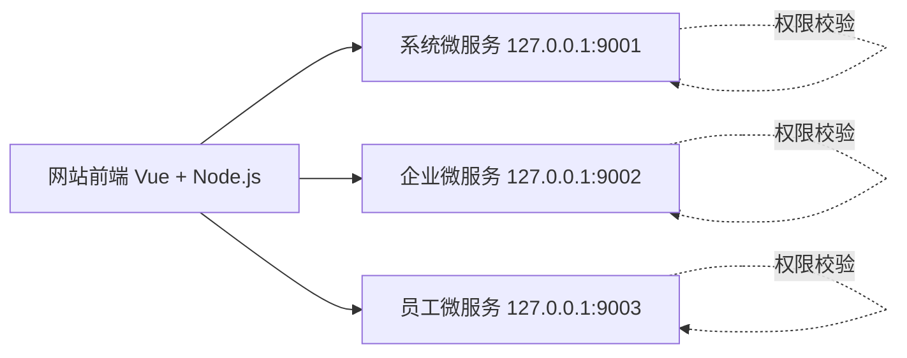

# 前端直连三个微服务有多难受：API 网关引入前的三个痛点

人事系统的权限、认证、报表都落了地，微服务的数量也涨了起来：系统服务一套端口、企业服务一套端口、员工服务又是一套端口。前后端分离的架构里，前端拿到的不是「一个系统」，而是「一串 IP 加端口」。这一节先不急着写代码，把直连模式的问题摆到桌面上，网关的价值自然就出来了。

## 先给结论

- 前端直连多个微服务，会同时踩到三个坑：URL 多到难维护、跨域请求时灵时不灵、权限校验在每个服务里重复写。
- 每个微服务的真实 IP 和端口都暴露给浏览器端，内部拓扑等于对外的公开信息。
- 跨域的根源是浏览器的同源策略，Vue 配合 Node.js 的纯前端访问方式最容易撞上它，而且只有部分服务能靠注解侥幸绕过。
- 权限校验是人事系统里一块有特色的功能，三个服务各自做一套，代码重复且口径容易不一致。
- 收敛这三个问题的办法只有一个：在服务群前面立一个统一入口，也就是 API 网关。

## 一、直连架构长什么样

项目采用前后端分离：后端按业务拆成三个微服务，前端用 Vue 加 Node.js 构建，跑在浏览器里向微服务发请求。三个服务各自监听各自的端口，以本机开发环境为例：

- 系统微服务：`127.0.0.1:9001`
- 企业微服务：`127.0.0.1:9002`
- 员工微服务：`127.0.0.1:9003`

前端每发起一次请求，都要自己判断该连哪个地址。把这个结构画出来是这样的：



三个箭头就是三条直连链路，每条链路末端都要挂一遍权限校验。服务只有三个时还能记，等微服务涨到十几个，这张图就会变成蛛网。

## 二、痛点逐个拆

**第一，前端要维护多个 URL，还要背住路由规则。** 请求地址不统一，端口各不相同，前端必须按业务语义把每个请求分发到对应服务：用户相关的去 9001，企业相关的去 9002，员工相关的去 9003。这部分逻辑没有任何框架兜底，全靠前端硬编码。服务迁移一次、扩容一次，前端配置跟着改一遍，开发和维护成本都压在了不该承担它的那一层。

顺带还有一层隐性问题：所有服务的真实地址都以明文形式躺在前端代码或请求日志里。内部网络拓扑、每个服务的端口规划，对浏览器端完全透明，暴露面被拉到最大。

**第二，跨域请求时灵时不灵。** 前端是 Vue 配合 Node.js 的纯 JS 访问方式，页面源与接口源不一致就会触发浏览器的同源策略拦截。实际现象往往是：访问系统微服务没问题，换成企业微服务、员工微服务就被浏览器拦下来。课程工程里的企业服务控制器上就留着这类补丁的痕迹（包名已改写为 `com.example`）：

```java
//解决跨域问题
@CrossOrigin
@RestController
@RequestMapping(value="/company")
public class CompanyController {

    @Autowired
    private CompanyService companyService;

    //保存
    @RequestMapping(value="", method = RequestMethod.POST)
    public Result save(@RequestBody Company company) {
        companyService.add(company);
        return new Result(ResultCode.SUCCESS);
    }
}
```

一个 `@CrossOrigin` 只救一个服务，每个服务都要想一遍自己要不要加、怎么加。跨域问题在服务入口处各自为政，正是直连模式最典型的代价。

**第三，权限校验在每个服务里重复做。** 请求里携带的身份信息，不管打到哪里，服务端都得验一遍：系统微服务要有权限校验，企业微服务要有权限校验，员工微服务同样要有。而权限模块恰恰是人事系统里一块相当有特色的功能，逻辑不轻。三套服务各写一份，等于把同一块核心逻辑复制三份，改动一次就要回归三处，口径稍有出入还会出现「A 服务放行、B 服务拒绝」的诡异行为。

## 三、三个问题指向同一个答案

把三个痛点放到一起看，会发现它们的共同点是「入口不统一」：地址多了、域多了、校验点也多了。反过来说，只要在微服务群前面立一个统一入口，让前端所有请求都先打到它，再由它按规则转发到内部服务，三个问题就同时失去了存在的基础：

- 前端只认一个地址，多个 URL 的维护成本归零；
- 前端与这个入口绑在同一个域上，跨域自然消解；
- 身份校验集中在入口处做一次，下游服务只管业务。

这个统一入口就是 API 网关。它具体如何承担路由转发、过滤器链这些职责，下一节展开。

## 常见误区

- **把「跨域」当成后端 Bug 来修**：同源策略是浏览器行为，请求根本没到业务逻辑就被拦了。在服务上加注解只能单点绕过，正确思路是让前端所有请求同源（统一走网关），而不是逐个服务打补丁。
- **认为服务数量少就不用网关**：三个服务就要维护三套地址、三份校验，服务每加一个成本线性上涨。网关引入得越晚，前端存量 URL 改造的工作量越大。
- **把前端维护多个 URL 理解成「配置文件多写几行」**：真正的成本在请求分发逻辑散落在前端各处，以及服务地址变化时的全量回归，这些都是隐性账单。

## 面试可能被问到的问题

1. 面试官追问：「前端直连微服务会有哪些问题？」
   答：主要有三个。一是前端要按业务维护多个服务地址，服务变化就得改前端；二是浏览器同源策略导致跨域，部分服务可能被拦截；三是鉴权等横切逻辑要在每个服务重复实现，代码冗余且口径容易不一致。此外内部服务地址全部暴露，安全性也差。

2. 面试官追问：「跨域是怎么产生的，为什么有的服务能访问有的不能？」
   答：浏览器同源策略规定页面只能请求与页面源（协议、域名、端口）一致的接口。前端与各个微服务端口不同，全部属于跨域；能否访问取决于对应服务有没有显式允许跨域，例如加了 `@CrossOrigin` 或配置了 CORS 响应头，所以表现为「时灵时不灵」。

3. 面试官追问：「为什么权限校验适合收敛到统一入口？」
   答：身份校验是横切逻辑，与具体业务无关，每个服务都做一遍是纯重复。收敛到入口做一次，可以挡住无效请求、统一校验口径，下游服务专注业务；细粒度的接口权限仍可在服务内补充，两层各管一段。

4. 面试官追问：「引入统一入口会不会造成单点故障？」
   答：入口确实关键，但网关本身可以多实例部署，配合注册中心与负载均衡避免单点。相比把风险分散到「前端配错地址、服务漏做鉴权」这类不确定性上，集中一个可扩展、可监控的入口反而是更可控的架构选择。

## 配套资料

- 企业微服务控制器（`@CrossOrigin` 与 `/company` 路由的真实出处）：`materials/code/02/day13-代码生成器实现/day13-代码生成器实现/资源/测试/生成代码路径/ihrm_company/src/main/java/com/ihrm/system/controller/CompanyController.java`（文中包名已改写为 `com.example`）
- day14 网关相关资料：`materials/code/02/day14 微服务网关与社保模块开发/day14/03-资料/网关相关资料/`（`ihrm_gate` 工程、路由配置 `application.yml`）
