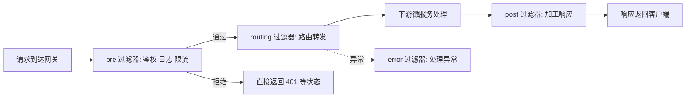

# Zuul：Netflix 出品的过滤器式网关，三步接入 Spring Cloud

选型时第一个冒出来的问题：Spring Cloud 生态里网关组件不止一个，主流的有 Zuul 和 Spring Cloud Gateway，本项目用哪个、为什么？这一节先把 Zuul 的出身和能力讲清楚，再给出它的标准开发路径。Zuul 的门槛其实很低：一个依赖、一个注解、一段路由配置，难点全部集中在路由规则的规划上。

## 先给结论

- Zuul 是 Netflix 公司开源的微服务网关，Spring Cloud 已将其整合为组件，引入 `spring-cloud-starter-netflix-zuul` 即可使用；同一生态里还有 Spring Cloud Gateway 可选，本项目采用 Zuul。
- Zuul 出身 Netflix，与 Eureka（服务发现）、Ribbon（负载均衡）、Hystrix（熔断）等组件天然配合，组合起来威力更强。
- 它的一切能力都建立在过滤器链之上：请求穿过一串过滤器完成鉴权、路由、响应加工，四种类型是 pre、routing、post、error。
- 官方给它的能力清单：动态路由、压力测试、负载分配、静态响应处理、身份认证和安全。
- 开发只有三步：建网关微服务工程、写启动类（`@SpringBootApplication` + `@EnableZuulProxy`）、在 `application.yml` 里配路由规则；最费脑子的是路由规则。

## 一、Zuul 是什么，在 Netflix 栈里站什么位置

Zuul 这个词来自电影《捉鬼敢死队》里的守门神，定位非常贴切：它是整个微服务群的门。它是 Netflix 公司开源的微服务网关，而 Netflix 正是 Eureka、Ribbon、Hystrix 这一批经典组件的缔造者。同一家的产品组合起来没有磨合成本：

- Eureka 负责服务注册与发现，网关从注册中心按服务名找到下游服务；
- Ribbon 负责客户端负载均衡，网关转发时在多个实例之间分流；
- Hystrix 负责熔断降级，下游抖动时网关侧及时止损。

网关天然是全量流量的汇聚点，有了这一层，限流、灰度、监控这类横切需求也有了统一落点。Spring Cloud 把 Zuul 整合进自己的微服务体系，坐标就是 `spring-cloud-starter-netflix-zuul`，配置方式与 Spring Cloud 的其他组件保持一致。

## 二、过滤器：Zuul 一切能力的来源

Zuul 内部通过一系列过滤器工作。请求从前端打过来，先在网关侧穿过一条过滤器链，再被路由转发；每个过滤器负责一段横切逻辑，权限校验、负载分配都可以挂在链上。一个请求的完整旅程如下：



四种类型各守一段：`pre` 在路由转发之前执行，鉴权放这里最合适，不合法的请求在转发前就被掐断；`routing` 在路由转发时执行，负责把请求送到下游；`post` 在 routing 与 error 过滤器之后执行，可以加工响应；`error` 在请求出现异常时执行，统一兜底。课程工程的过滤器源码注释里把这段契约写得很直白（包名已改写为 `com.example`）：

```java
/**
 * 自定义过滤器
 * filterType 返回值定义过滤器类型:
 *     pre     : 在执行路由请求之前执行
 *     routing : 在路由请求时调用
 *     post    : 在 routing 和 error 过滤器之后执行
 *     error   : 处理请求出现异常的时候执行
 */
public class LoginFilter extends ZuulFilter {
    // 实现 filterType / filterOrder / shouldFilter / run 四个方法
}
```

挂上过滤器之后，Zuul 官方列出的能力都能落地：动态路由（按配置实时调整转发规则）、压力测试（灰度引流）、负载分配、静态响应处理（部分请求网关直接应答）、身份认证和安全。这也是为什么说网关是微服务架构里不可缺少的组件。

## 三、开发三步

把 Zuul 用起来的工程量不大，操作路径固定为三步。

**第一步，创建一个微服务网关工程。** 网关本身就是一个普通的 Spring Boot 微服务，在父工程下新建模块即可。前端的所有请求以后都发给这个工程，由它按配置转发到不同微服务。

**第二步，写启动类。** 两个注解缺一不可（包名已改写为 `com.example`）：

```java
package com.example.gate;

import org.springframework.boot.SpringApplication;
import org.springframework.boot.autoconfigure.SpringBootApplication;
import org.springframework.cloud.netflix.zuul.EnableZuulProxy;

/**
 * 网关启动类
 */
@SpringBootApplication  //声明boot工程
@EnableZuulProxy        //开启zuul网关功能
public class GateApplication {

    public static void main(String[] args) {
        SpringApplication.run(GateApplication.class);
    }
}
```

`@SpringBootApplication` 声明这是 boot 工程，`@EnableZuulProxy` 才是真正开启网关功能的开关，漏掉它工程能启动但不具备任何转发能力。

**第三步，在 `application.yml` 里配置路由规则。** 规则的语义是「什么样的请求路径发到哪个微服务」，比如把 `/company/**` 映射到企业微服务。三步里工程搭建和启动类都是体力活，路由规则才是要动脑子的部分：路径前缀怎么划分、目标写固定 url 还是服务名、前缀要不要剥离，这些放到下一节实测展开。

## 常见误区

- **以为 Zuul 和 Spring Cloud Gateway 是同一代产品**：两者都是 Spring Cloud 生态的网关组件，Zuul 出自 Netflix 第一代体系，Gateway 是后续推出的替代方案。选型看项目版本与团队积累，不必都学，但要能说清差异。
- **只写 `@SpringBootApplication` 忘了 `@EnableZuulProxy`**：工程照常启动、端口照常监听，但所有请求不会被转发，现象是「服务活着、路由全 404」。排查时先看启动类注解。
- **把业务逻辑写进网关过滤器**：过滤器适合放鉴权、日志、限流这类横切逻辑；业务一旦写进网关，任何业务改动都要重新发布全站入口，网关也会退化成单体。
- **认为过滤器只有一种类型**：pre、routing、post、error 四段职责不同，把响应加工写在 pre 里、把鉴权写在 post 里，都会让校验形同虚设或时序错乱。

## 面试可能被问到的问题

1. 面试官追问：「Zuul 是什么，由谁开源的？」
   答：Zuul 是 Netflix 公司开源的微服务网关，后被 Spring Cloud 整合为组件。它与同属 Netflix 体系的 Eureka、Ribbon、Hystrix 可以无缝配合，网关转发时借助注册中心做服务发现、客户端负载均衡和熔断降级，是微服务架构中的核心入口组件。

2. 面试官追问：「Zuul 的过滤器有哪几种类型，各自在什么时机执行？」
   答：四种。pre 在路由转发之前执行，常做鉴权与限流；routing 在路由转发时执行，把请求送往下游；post 在 routing 和 error 之后执行，可加工响应；error 在请求出现异常时执行，统一兜底。自定义过滤器继承 `ZuulFilter` 并实现 filterType、filterOrder、shouldFilter、run 四个方法。

3. 面试官追问：「Zuul 能做哪些事？」
   答：官方能力清单包括动态路由、压力测试、负载分配、静态响应处理、身份认证和安全。这些能力全部建立在过滤器链上，鉴权与权限校验通常放在 pre 阶段，让无效请求在转发前就被拦下。

4. 面试官追问：「搭建一个 Zuul 网关工程需要几步？」
   答：三步。创建一个微服务工程作为网关；启动类加 `@SpringBootApplication` 和 `@EnableZuulProxy`；在 `application.yml` 中配置 `zuul.routes` 路由规则。前两步固定，路由规则是核心：决定请求路径映射到哪个微服务，以及前缀剥离等转发细节。

5. 面试官追问：「Zuul 与 Spring Cloud Gateway 怎么选？」
   答：Zuul 属于 Netflix 第一代体系，基于 Servlet 阻塞式 IO，成熟稳定、资料多；Gateway 是 Spring 官方后续推出的网关，基于响应式编程，性能与动态路由能力更强。老项目或课程环境沿用 Zuul 没有问题，新项目若已在响应式技术栈上可优先考虑 Gateway。

## 配套资料

- 网关工程与启动类：`materials/code/02/day14 微服务网关与社保模块开发/day14/03-资料/网关相关资料/ihrm_gate/src/main/java/com/ihrm/gate/GateApplication.java`（`@EnableZuulProxy` 的真实出处，文中包名已改写为 `com.example`）
- 过滤器类型注释出处：`materials/code/02/day14 微服务网关与社保模块开发/day14/03-资料/网关相关资料/ihrm_gate/src/main/java/com/ihrm/gate/filter/LoginFilter.java`
- 依赖坐标出处：`materials/code/02/day14 微服务网关与社保模块开发/day14/03-资料/网关相关资料/ihrm_gate/pom.xml`
