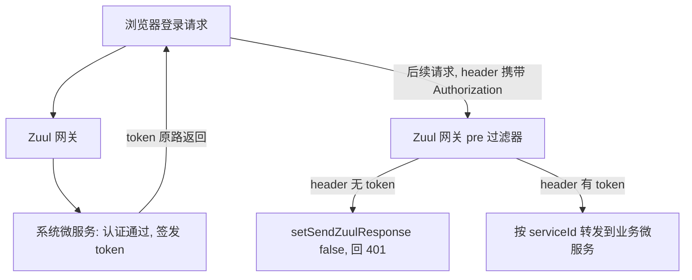

# 用 pre 过滤器把 JWT 校验收进网关：没有 token 就 401

上一课把过滤器的骨架搭好了，run 方法里还只是打印一句话。这一课给它塞进真正的业务：统一鉴权。系统里的 token 由系统微服务在登录成功时签发，校验却不必每个微服务都做一遍，既然所有请求都过网关，就在网关的 pre 过滤器里一次校验完成。

## 先给结论

- 登录成功后微服务签发 JWT token，前端后续每次请求都把它放在 `Authorization` 请求头里带到网关。
- 网关的 pre 过滤器做两级校验：先看请求头里有没有 token，没有直接拦下并回 401；有则放行转发，需要时再解析 token 内容校验权限。
- 四个关键 API：`RequestContext.getCurrentContext()` 拿请求上下文，`rc.getRequest()` 拿 request 对象，`rc.setSendZuulResponse(false)` 中断转发，`rc.setResponseStatusCode(401)` 设置响应状态码。
- `run()` 返回 null 不等于拦截，只有 `setSendZuulResponse(false)` 才会终止路由转发。
- 真正的 token 签发与解析复用 common 模块的 `JwtUtils`，网关一次校验，下游微服务对鉴权零感知。

## 一、链路：token 从哪里来，在哪里校验

整条鉴权链路涉及三方：浏览器、Zuul 网关、微服务。登录时浏览器请求打到系统微服务，认证通过后由它签发 token 字符串并原路返回；之后浏览器再请求企业微服务等任何业务接口时，都要在请求头里携带这个 token，网关就成了唯一卡口。



图里上下两条路径的分岔点就在网关的 pre 过滤器：请求没带 token，直接在网关层终止，根本不往微服务走；带了 token 才继续路由。校验明确两件事：一是 token 必须携带在请求的 header 信息里，二是要校验 token 是否存在、以及 token 中携带的权限信息是否满足访问要求。课堂实现先做第一层（有没有 token），权限级别的解析作为扩展。

## 二、改造 LoginFilter：从打印一句话到真正拦截

对上一课的过滤器做改造，`filterType` 保持 `pre` 不用动（鉴权必然在路由之前），`filterOrder` 与 `shouldFilter` 维持原样，重点全在 `run` 方法。课程成例的完整代码如下（包名已改写为 `com.example`）：

```java
package com.example.gate.filter;

import com.netflix.zuul.ZuulFilter;
import com.netflix.zuul.context.RequestContext;
import com.netflix.zuul.exception.ZuulException;
import org.springframework.http.HttpStatus;
import org.springframework.stereotype.Component;

import javax.servlet.http.HttpServletRequest;

/**
 * 自定义过滤器
 */
@Component
public class LoginFilter extends ZuulFilter {

    public String filterType() {
        return "pre";
    }

    public int filterOrder() {
        return 2;
    }

    public boolean shouldFilter() {
        //对某些请求过滤(不执行过滤器)
        return true;
    }

    /**
     * run方法 : 过滤器中负责的具体业务逻辑
     *   使用过滤器进行jwt的鉴权
     */
    public Object run() throws ZuulException {
        //1.获取请求对象request
        //1.1 获取Zuul提供的请求上下文的对象(工具类)
        RequestContext rc = RequestContext.getCurrentContext();
        //1.2 从上下文对象获取request对象
        HttpServletRequest request = rc.getRequest();
        //2.从request中获取Authorization的头信息
        String token = request.getHeader("Authorization");
        //3.判断
        if(token == null || "".equals(token)) {
            //没有传递token信息, 需要登录, 拦截
            rc.setSendZuulResponse(false);
            //返回错误的401状态码
            rc.setResponseStatusCode(HttpStatus.UNAUTHORIZED.value());
        }
        return null;
    }
}
```

run 方法的业务分三步：

**第一，拿到 request 对象。** 在 Zuul 的过滤器里 request 不是随口就能拿的，要通过请求上下文：`RequestContext.getCurrentContext()` 拿到 Zuul 提供的上下文对象（可以当成工具类理解），再 `rc.getRequest()` 从中取出 `HttpServletRequest`。上下文贯穿整个请求生命周期，后面想往下游传数据也靠它。

**第二，从请求头取 token。** `request.getHeader("Authorization")` 拿到的就是登录时签发的 JWT 字符串，约定俗成放在 Authorization 这个头里。

**第三，判断并拦截。** token 为 null 或空串，说明用户没有登录。此时做两个动作：`rc.setSendZuulResponse(false)` 让 Zuul 不再把请求路由到微服务；`rc.setResponseStatusCode(HttpStatus.UNAUTHORIZED.value())` 回一个 401 状态码，`HttpStatus.UNAUTHORIZED.value()` 本质就是数字 401。

这里有个容易混淆的点要说透：run 方法最后 `return null` 的含义是「继续往后执行」。如果 token 存在，代码自然走到 return null，请求继续被路由到企业微服务；只有设置了 `setSendZuulResponse(false)`，请求才会在网关层终结，不再发往下游。返回值与拦截是两回事。

## 三、实测：401 与放行

重启网关，用 Postman 按三种姿势验证：

```bash
# 1. 直连企业微服务 9001, 不经过网关, 没有鉴权逻辑, 状态码 200 正常返回数据
curl http://127.0.0.1:9001/company

# 2. 走网关 9090, 请求头不带 Authorization, 过滤器拦下, 状态码 401
curl -i http://127.0.0.1:9090/company

# 3. 走网关并加上 Authorization 头(课堂演示随便写一个值), 请求继续转发, 拿到数据
curl -i -H "Authorization: demo-token" http://127.0.0.1:9090/company
```

三种结果正对应三种场景：直连没有过滤器逻辑所以畅通；走网关没带 token 得到 401，代表未认证；带上请求头后网关放行，数据正常返回。课堂演示为了聚焦拦截机制，头里的值随便写都能过；生产上第三步要在网关里真正解析 token。另外 401 之后除了裸状态码，还可以做重定向或跳转登录页，属于友好化的自由发挥。

## 四、从「有没有 token」到「token 合不合法」

只判断头是否为空挡不住伪造请求，往下走一步就要解析 token。项目 common 模块里的成例 `JwtUtils` 已经封装好了签发与解析（包名已改写）：

```java
@Getter
@Setter
@ConfigurationProperties("jwt.config")
public class JwtUtils {
    //签名私钥
    private String key;
    //签名的失效时间
    private Long ttl;

    /**
     * 解析token字符串获取claims
     */
    public Claims parseJwt(String token) {
        Claims claims = Jwts.parser().setSigningKey(key).parseClaimsJws(token).getBody();
        return claims;
    }
}
```

网关引入 common 模块后，把 run 里的判断升级为：有 token 就调 `parseJwt` 解析，解析失败（签名不对、已过期）或 claims 中的权限不满足，同样 `setSendZuulResponse(false)` 并回 401。按本课写法补全的判断片段如下（示例，基于成例 `JwtUtils`）：

```java
String token = request.getHeader("Authorization");
if(token == null || "".equals(token)) {
    rc.setSendZuulResponse(false);
    rc.setResponseStatusCode(HttpStatus.UNAUTHORIZED.value());
    return null;
}
try {
    Claims claims = jwtUtils.parseJwt(token);   //解析失败会抛异常
    //可继续校验 claims 中的权限信息是否满足本次请求
} catch (Exception e) {
    rc.setSendZuulResponse(false);
    rc.setResponseStatusCode(HttpStatus.UNAUTHORIZED.value());
}
return null;
```

这样校验强度就完整了：没有 token 拦、伪造的 token 拦、过期的 token 拦，全部在网关一次完成，微服务里不再重复写鉴权代码。

## 常见误区

- **只设状态码不设 `setSendZuulResponse(false)`**：`setResponseStatusCode(401)` 只是登记了状态码，请求仍会继续转发到微服务，看起来 401 了其实数据照样返回。两者必须成对出现。
- **`RequestContext` 选错包**：要引 `com.netflix.zuul.context.RequestContext`，IDE 自动补全时选错同名类，`getRequest` 等方法直接编译不过。
- **只判 null 忘了空串**：`token == null` 挡不住「头存在但值为空」的请求，条件要写成 `token == null || "".equals(token)`。
- **对 `return null` 产生误解**：它不是「什么都不做就放行」的开关，放行是默认行为；把注意力放在 `setSendZuulResponse` 这个真正的断路开关上。

## 面试可能被问到的问题

1. 面试官追问：「网关统一 JWT 鉴权的完整流程是什么？」
   答：登录时系统微服务认证通过并签发 token 返回前端；前端后续请求在 Authorization 头里携带 token；网关的 pre 过滤器取出头信息，先判存在性再解析签名与过期时间，必要时校验 claims 里的权限；校验失败通过 setSendZuulResponse(false) 终止路由并回 401，成功则按 serviceId 转发到业务微服务。

2. 面试官追问：「setSendZuulResponse(false) 和 run 返回 null 有什么区别？」
   答：run 返回 null 表示本次过滤器逻辑执行完毕，请求继续走后续过滤链和路由，是正常的放行路径；setSendZuulResponse(false) 是在请求上下文上打标记，Zuul 的 routing 阶段看到该标记就不再向微服务发起调用，配合 setResponseStatusCode 直接把响应回给客户端。前者是流程的自然结束，后者才是主动拦截。

3. 面试官追问：「为什么过滤器里要借助 RequestContext 拿 request？」
   答：Zuul 把一次请求的全部状态（request、response、路由信息、自定义数据）集中维护在 RequestContext 中，它绑定当前线程，贯穿 pre 到 post 的整个生命周期。通过它既能拿到 request 读取请求头，也能设置路由开关与响应状态，还能在过滤器之间传递数据，是过滤器编程的标准入口。

4. 面试官追问：「鉴权放在网关做和放在每个微服务做，怎么取舍？」
   答：网关做的好处是收敛：一处实现、一处维护，微服务专注业务，缺点是网关成为关键依赖，它出问题所有请求都受影响。微服务各自做的好处是服务自治、可按服务定制规则，缺点是逻辑重复且容易漏配。实践中通常网关做统一的身份认证，微服务只保留细粒度的授权判断。

5. 面试官追问：「401 响应除了状态码还能做什么？」
   答：可以写响应体返回统一的错误 JSON，让前端明确知道是未登录；也可以重定向到登录页。另外登录接口本身要在 shouldFilter 或路径判断里放行，否则用户连登录请求都过不了网关。

## 配套资料

- 网关过滤器成例（即文中 pre 过滤器实现的原型）：
  `materials/code/02/day14 微服务网关与社保模块开发/day14/03-资料/网关相关资料/ihrm_gate/src/main/java/com/ihrm/gate/filter/LoginFilter.java`
- JWT 工具类成例（签发与解析）：
  `materials/code/02/day14 微服务网关与社保模块开发/day14/03-资料/common模块的工具类/JwtUtils.java`
  （文中包名已统一改写为 `com.example`；run 方法中 try-catch 解析段为按本课写法补全的示例）
