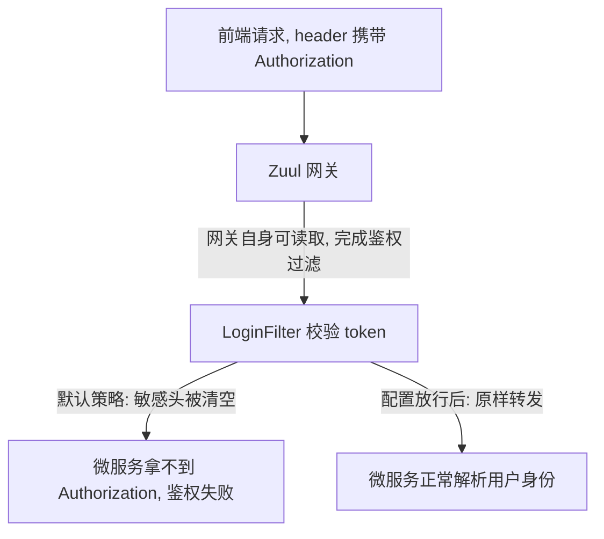
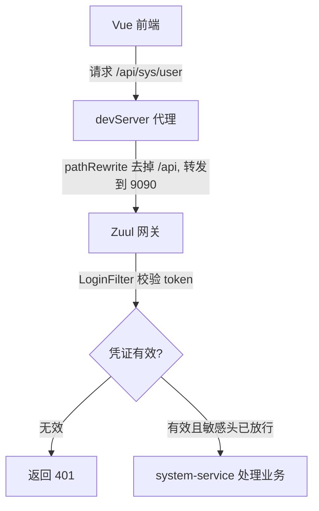

# 接入网关后的收尾改造：别让 Zuul 把 Authorization 头偷偷丢掉

单体拆成微服务之后，登录凭证从前端出发要穿过网关才能到达业务服务。直接请求微服务时一切正常，一旦把流量切到网关，登录成功后的接口却开始返回 401，微服务端怎么也拿不到用户身份。这一课讲的就是这类问题的根源与改造清单：Zuul 默认会丢弃哪些请求头、用什么配置放行、路由表怎么补齐、前端请求地址怎么收敛到网关。

## 先给结论

- Zuul 内置「敏感头」机制：`Authorization`、`Cookie`、`Set-Cookie` 这三类请求头默认被网关拦截，网关自己能读到，但不会向下游微服务转发。
- 放行办法是每个路由加两行配置：`sensitiveHeaders:` 置空，再加 `customSensitiveHeaders: true` 启用这份自定义白名单。
- 网关的路由表要把所有微服务补齐：`/company/**`、`/sys/**`、`/employees/**`、`/social_securitys/**` 分别映射对应服务。
- 前端不再维护多条代理规则，`proxyTable` 只保留一条，`target` 统一指向网关端口 `http://localhost:9090`，跨域处理也随之上收到网关一处完成。

## 一、敏感头机制：Authorization 为什么到不了微服务

前端每次请求都会在请求头里携带 `Authorization` 字段，里面的 token 是所有需要鉴权接口的通行证。请求到达网关时，网关当然能读到这个头，`LoginFilter` 正是靠它做 jwt 校验的。问题出在转发环节：Zuul 对「敏感头」有一套内置的默认策略，认为凭证类信息由网关处理就够了，转发给下游时会把它们清空。



图里的分叉点就是本课要解决的问题：同样是携带 `Authorization` 的请求，配置前后在网关处走向完全不同。这个默认行为出于安全考虑（防止内部凭证外泄），但在「网关只做转发、鉴权仍在微服务内完成」的架构里，它直接打断了凭证链路。

## 二、两行配置放行敏感头

解决手段极其轻量，网关的 `application.yml` 里，每个路由节点下加两行：

```yaml
zuul:
  routes:
    company-service:
      path: /company/**
      serviceId: company-service
      stripPrefix: false
      sensitiveHeaders: #敏感头设置为空, 即白名单不拦任何头
      customSensitiveHeaders: true #对指定路由开启自定义敏感头
```

两个字段各司其职。`sensitiveHeaders` 定义这条路由的敏感头名单，值留空意味着名单为空，没有任何头需要被清掉；`customSensitiveHeaders: true` 则告诉 Zuul 使用这份路由级的自定义名单，而不是套用全局默认值。缺了后者，空名单不生效，`Authorization` 照样被丢。

真实工程里四个微服务的完整路由配置如下（服务名与包名已改为中性命名）：

```yaml
zuul:
  routes:
    company-service:
      path: /company/**
      serviceId: company-service
      stripPrefix: false
      sensitiveHeaders:
      customSensitiveHeaders: true
    system-service:
      path: /sys/**
      serviceId: system-service
      stripPrefix: false
      sensitiveHeaders:
      customSensitiveHeaders: true
    employee-service:
      path: /employees/**
      serviceId: employee-service
      stripPrefix: false
      sensitiveHeaders:
      customSensitiveHeaders: true
    social-security-service:
      path: /social_securitys/**
      serviceId: social-security-service
      stripPrefix: false
      sensitiveHeaders:
      customSensitiveHeaders: true
```

`stripPrefix: false` 保留原始路径前缀，各微服务的 `@RequestMapping` 里本来就带 `/company`、`/sys` 这些前缀，转发时不能删。配置改完，把注册中心、网关、企业、员工、系统微服务依次启动，从网关端口逐个验证登录与左侧菜单（组织架构、员工、权限设置）的请求，全部能带证通行，网关侧的改造才算闭环。

## 三、前端请求地址收敛到网关

网关就位后，前端再为每个模块单独配代理就显得多余。改造前，前端 `config/index.js` 的 `proxyTable` 里每个模块一条代理、各指向各的微服务端口；改造后整张表只留一条，`target` 换成网关地址：

```javascript
proxyTable: {
  '/api': {
    target: 'http://localhost:9090', //统一指向网关
    changeOrigin: true,
    pathRewrite: {
      '^/api': '' //去掉统一前缀, 还原真实接口路径
    }
  }
},
```

`/api` 是前端代码里约定的统一前缀，转发前用 `pathRewrite` 抹掉，落到网关的就是 `/sys/user`、`/company/list` 这类真实路径。所有请求在浏览器眼里都发往同一个开发服务器端口，天然同源，开发期的跨域问题被 devServer 代理消化掉了；到了前后端分域名部署的生产环境，跨域配置也不该散落在各个微服务里，而是上收到网关统一放行。网关侧加一个全局的 CORS 配置即可（此段为按本课写法补全的示例）：

```java
@Bean
public CorsFilter corsFilter() {
    UrlBasedCorsConfigurationSource source = new UrlBasedCorsConfigurationSource();
    CorsConfiguration config = new CorsConfiguration();
    config.addAllowedOrigin("*");   //允许的来源, 生产环境应收紧为具体域名
    config.addAllowedHeader("*");   //放行所有请求头, 含 Authorization
    config.addAllowedMethod("*");   //放行所有方法
    source.registerCorsConfiguration("/**", config);
    return new CorsFilter(source);
}
```

改造完成后的完整链路如下：



关键路径在倒数第二环：校验通过之后，`Authorization` 必须原样到达下游，业务接口里的用户信息解析才有原料。任何一环丢了头，表现都是接口 401 或返回数据里没有用户身份。

## 常见误区

- **以为网关报错才是网关的问题**：敏感头被清空后，报错出现在下游微服务（拿不到用户信息），排查时容易在微服务里兜圈子。先确认请求头是否原样到达下游，再回头查网关配置。
- **只写 `sensitiveHeaders:` 不写 `customSensitiveHeaders: true`**：空名单不启用，默认敏感头照样被清，两行缺一不可。
- **配置项拼写错误且无任何报错**：真实资料里出现过把 `sensitiveHeaders` 写成 `sentiviteHeaders` 的情况，YAML 不会校验未知键，错误拼写只是让放行逻辑静默失效，凭证依旧丢失。
- **`stripPrefix` 与微服务路径约定不一致**：微服务 Controller 映射里已带 `/sys`、`/company` 前缀时转发不能删前缀，若误用默认的删前缀行为，请求会 404。

## 面试可能被问到的问题

1. 面试官追问：「Zuul 的敏感头机制是什么，怎么放行 Authorization？」
   答：Zuul 默认把 `Authorization`、`Cookie`、`Set-Cookie` 视为敏感头，转发到下游前会从请求里移除，网关自身仍可读取。在路由配置里把 `sensitiveHeaders` 置为空名单，并设置 `customSensitiveHeaders: true` 启用这份路由级名单，即可让凭证头原样透传。

2. 面试官追问：「为什么前端接了网关之后反而出现 401？」
   答：多数情况是凭证头没能到达微服务。可能是敏感头被 Zuul 默认策略清空，也可能是鉴权过滤器拒绝后未设置响应体。排查顺序是先在微服务入口打印请求头，确认头是否到达，再回头检查网关的路由与过滤器配置。

3. 面试官追问：「接入网关后，前端要改哪些地方？」
   答：把原来按模块拆分的多条代理规则收敛成一条，`target` 指向网关地址，统一前缀由 `pathRewrite` 还原。此后前端只认识网关一个入口，微服务的增减、扩容、换端口对前端完全透明。

4. 面试官追问：「跨域为什么建议收敛到网关处理？」
   答：跨域是浏览器对响应头的约束，谁对外提供服务谁负责放行。请求都从网关进出时，在网关加一个全局 CORS 配置就能覆盖所有服务；散落在各微服务里则要重复维护，且经过网关转发后容易与下游的 CORS 头叠加，出现重复 `Access-Control-Allow-Origin` 报错。

5. 面试官追问：「`stripPrefix` 设成 false 意味着什么？」
   答：转发时保留请求路径的第一段前缀。本系统的微服务在 `@RequestMapping` 里自带 `/company`、`/sys` 等模块前缀，网关必须原样转发才能命中接口；如果下游接口不带前缀，就应该让 Zuul 删掉前缀再转发，两种约定二选一，前后要配套。

## 配套资料

- 网关路由与敏感头配置：`materials/code/02/day14 微服务网关与社保模块开发/day14/03-资料/网关相关资料/ihrm_gate/src/main/resources/application.yml`（文中已修正该文件里 `sensitiveHeaders` 的拼写，并将服务名、包名改为中性命名）
- 网关启动类与鉴权过滤器：`materials/code/02/day14 微服务网关与社保模块开发/day14/03-资料/网关相关资料/ihrm_gate/src/main/java/com/ihrm/gate/GateApplication.java`、同目录 `filter/LoginFilter.java`
- 前端 `config/index.js` 的改造以视频画面为准，资料包未含前端工程；网关侧 CORS 配置为按本课写法补全的示例
