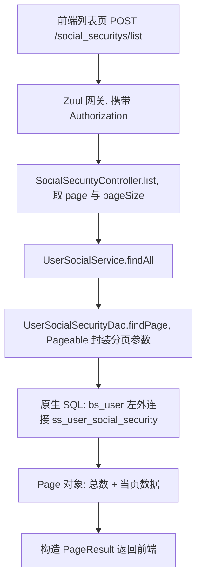

# 企业社保设置与员工参保列表：一条配置记录，一条左外连接的分页 SQL

社保模块搭好环境后先解决两个问题：企业第一次进来要把统计月份落库；列表页要把「所有员工的用户信息加参保信息」分页查出来。前者是一条主键即企业 id 的配置记录，后者藏着一个微服务架构下的经典取舍：用户数据在另一个服务里，列表要跨域拿数据，到底是逐条远程调用，还是同库联表一次查完。这一课把这两件事连同 Spring Data JPA 的原生 SQL 分页写法一起讲透。

## 先给结论

- 企业设置只有查询与保存两个接口，共用 `/social_securitys/settings` 路径，GET 判断设置过没有，POST 落库时把 `isSettings` 置为 1。
- 查询结果必须用 `Optional` 判空后再取值，未设置过时对象为 null，直接 `get` 会抛异常，前端表现为「系统繁忙」。
- 列表页数据由用户基本信息与参保信息拼接，用户在系统微服务、参保数据在社保库；本系统所有表同库，采用 `bs_user` 左外连接 `ss_user_social_security` 一条 SQL 查完，替代逐条 Feign 远程调用。
- JPA 原生 SQL 分页三件套：dao 方法返回 `Page<Map>` 并接收 `Pageable`，`@Query` 里 `nativeQuery = true` 写查询 SQL，`countQuery` 写统计总数的 SQL。
- 页码从 1 开始传给前端，进 dao 前要减一：`PageRequest(page - 1, pageSize)`。

## 一、企业设置：进入模块的第一道开关

前端进入社保模块时先发一个查询，判断当前企业是否设置过统计月份；没设置过就渲染一个输入月份的表单，用户填完再提交保存。两个接口路径相同、方法不同：

```java
/**
 * 查询企业是否设置过社保
 */
@RequestMapping(value = "/settings", method = RequestMethod.GET)
public Result settings() {
    CompanySettings cs = companySettingsService.findById(companyId);
    return new Result(ResultCode.SUCCESS, cs);
}

/**
 * 保存企业设置
 */
@RequestMapping(value = "/settings", method = RequestMethod.POST)
public Result saveSettings(@RequestBody CompanySettings companySettings) {
    companySettings.setCompanyId(companyId);
    companySettingsService.save(companySettings);
    return new Result(ResultCode.SUCCESS);
}
```

`companyId` 由父类 `BaseController` 从请求头解析，前端提交的对象里不允许自带企业 id，一律以服务端解析的为准，这是 SaaS 多租户数据的底线。保存逻辑里有一个容易被忽略的状态位：

```java
@Service
public class CompanySettingsService {
    @Autowired
    private CompanySettingsDao companySettingsDao;

    //保存企业设置
    public void save(CompanySettings companySettings) {
        companySettings.setIsSettings(1); //已经完成当月设置
        companySettingsDao.save(companySettings);
    }
}
```

`ss_company_settings` 表只有三个字段：`company_id` 主键、`is_settings` 状态、`data_month` 统计月份。`isSettings` 置 1 的动作必须在 service 里做，不信任前端传值；由于主键就是企业 id，同一家企业反复保存走的都是主键更新，不会产生第二条记录。

这里踩过一个真实的坑。查询接口最初直接写成 `companySettingsDao.findById(companyId).get()`，企业从未设置过社保时查不到数据，`Optional.get()` 抛出异常，页面直接报「系统繁忙」。修正后用 `isPresent` 先判断：

```java
//根据企业id查询
public CompanySettings findById(String companyId) {
    Optional<CompanySettings> optional = companySettingsDao.findById(companyId);
    return optional.isPresent() ? optional.get() : null;
}
```

查无数据时返回 null，`Result` 的 data 为空，前端据此渲染设置表单。「数据不存在」在这条业务里不是错误，而是引导用户补设置的正常分支。

## 二、列表页的数据形态：左边用户，右边参保

设置完成后进入员工社保列表。页面每一行分两段：左侧是用户基本属性（姓名、手机号、工号、部门、入职时间），右侧才是参保数据（参保城市、公积金城市、社保基数、公积金基数）。新入职还没办社保的员工，左侧有值、右侧一片空白，这个形态决定了后面的查询方式。

接口约定为 POST `social_securitys/list`，请求体带分页参数。POST 方法的内容要封装成对象接收，这里参数只有两个，用 Map 直接接：

```java
/**
 * 查询企业员工的社保信息列表
 */
@RequestMapping(value = "list", method = RequestMethod.POST)
public Result list(@RequestBody Map map) {
    //1.获取请求参数, page, pageSize
    Integer page = (Integer) map.get("page");
    Integer pageSize = (Integer) map.get("pageSize");
    //2.调用service查询
    PageResult pr = userSocialService.findAll(page, pageSize, companyId);
    return new Result(ResultCode.SUCCESS, pr);
}
```

分页查询要返回总数与数据列表两样东西，service 返回公共模块的 `PageResult`，构造参数是总数与当页数据，前端拿它渲染表格和分页条。

## 三、数据从哪来：Feign 调用与同库联表的取舍

严格按微服务的边界走，列表数据应该这样拼：社保服务借助 Feign 调用系统微服务拿到当页用户列表，再拿每个用户 id 去查本地社保表，最后在内存里组装。这条路在架构上最纯粹，却有一个性能硬伤：每页几十条用户数据，意味着几十次远程往返，一次列表请求被拆成几十次 HTTP 调用，慢且脆弱。

本系统的现实是所有微服务共用一个 MySQL 库，用户表 `bs_user` 和社保表 `ss_user_social_security` 物理上就在一起，于是采用更直接的做法，两条表联查一次出结果：

```sql
SELECT * FROM bs_user u
LEFT JOIN ss_user_social_security s ON u.id = s.user_id
WHERE u.company_id = 1
```

连接方式必须是左外连接，依据在页面的数据形态里：用户一定存在（左侧必须有），参保数据可有可无（右侧可以为空）。用内连接的话，还没设置社保的员工会整行消失，列表缺人，这是业务不允许的。



链路里唯一容易被忽视的环节是最后一步：dao 返回的是 Spring Data 的 `Page`，还要转成系统统一的 `PageResult`，前端才能按既定格式解析。

## 四、JPA 原生 SQL 分页的完整写法

派生查询方法应付不了联表，dao 里要自己写 SQL。Spring Data JPA 对「原生 SQL 加分页」有一套固定约定，dao 方法长这样：

```java
public interface UserSocialSecurityDao
        extends JpaRepository<UserSocialSecurity, String>,
                JpaSpecificationExecutor<UserSocialSecurity> {

    /**
     * 基于 SQL 的分页
     * 返回值 Page, 泛型用 Map: 一行记录组装成一个 Map,
     * key 是查询列的别名, value 是该列的值
     */
    @Query(nativeQuery = true,
            value = "SELECT bu.id userId," +
                    "       bu.username," +
                    "       bu.mobile," +
                    "       bu.work_number  workNumber," +
                    "       bu.department_name departmentName," +
                    "       bu.time_of_entry timeOfEntry," +
                    "       bu.time_of_dimission leaveTime," +
                    "       ssuss.participating_in_the_city participatingInTheCity," +
                    "       ssuss.participating_in_the_city_id participatingInTheCityId," +
                    "       ssuss.provident_fund_city_id providentFundCityId," +
                    "       ssuss.provident_fund_city providentFundCity," +
                    "       ssuss.social_security_base socialSecurityBase," +
                    "       ssuss.provident_fund_base providentFundBase " +
                    "FROM bs_user bu LEFT JOIN ss_user_social_security ssuss " +
                    "ON bu.id = ssuss.user_id WHERE bu.company_id = ?1",
            countQuery = "SELECT COUNT(*) FROM bs_user u " +
                    "LEFT JOIN ss_user_social_security s ON u.id = s.user_id " +
                    "WHERE u.company_id = ?1"
    )
    Page<Map> findPage(String companyId, Pageable pageable);
}
```

逐个拆解约定点。返回值必须是 `Page` 类型（注意选 Spring Data 封装的那个包），框架据此自动追加 limit 与 offset；方法参数里的 `Pageable` 封装页码与每页条数，位置随意，框架按类型识别。`@Query` 的 `nativeQuery = true` 声明写的是原生 SQL 而非 JPQL；`?1` 是占位符，对应方法的第一个参数。`countQuery` 单独声明统计总数的语句，它决定 `Page` 里的 `totalElements`，联表查询时主查询与统计查询要保持同样的连接条件，否则总数对不上。

SELECT 列表没有用星号，而是按页面需要的字段逐个列出并起别名。两个动机：一是星号会带出几十个用不上的列，传输和映射都浪费；二是别名把下划线列名映射成驼峰（`work_number` 对 `workNumber`），前端拿到 `Map` 组成的列表后，JSON 序列化的 key 直接就是页面要的字段名，不需要二次转换。

service 层把分页参数装进 `PageRequest` 再调 dao：

```java
//分页查询用户的社保数据
public PageResult findAll(Integer page, Integer pageSize, String companyId) {
    Page page1 = userSocialSecurityDao.findPage(companyId,
            new PageRequest(page - 1, pageSize));
    return new PageResult(page1.getTotalElements(), page1.getContent());
}
```

`getTotalElements` 取总数，`getContent` 取当页数据列表，两个值正好是 `PageResult` 构造所需。页码减一是这段代码里最容易写漏的一行：前端与用户的习惯都从第 1 页开始，JPA 的页码却从 0 起算，不减一的话第一页永远查到第二页的数据。

## 常见误区

- **`Optional.get()` 不判空直接取值**：查询主键不存在时抛 `NoSuchElementException`，页面报「系统繁忙」。判断分支本身就是业务的一部分，用 `isPresent` 区分「已设置」与「未设置」。
- **列表查询用内连接**：`INNER JOIN` 会把尚未参保的员工从列表里挤掉，页面少人且不易察觉。以用户为基准的列表一律左外连接，参保列为 null 是合法状态。
- **主查询与 countQuery 连接条件不一致**：统计语句偷懒只查单表总数，联表过滤或一对多放大行数时总数与页数对不上，分页条错乱。
- **页码忘了减一**：`new PageRequest(page, pageSize)` 让每页数据整体偏移一页，用户看到的「第一页」实际是数据里的第二页。
- **企业 id 写死在 SQL 里**：资料初稿的 value 语句里 `company_id = 1` 是联调时的临时写法，占位符 `?1` 必须补上，否则多租户环境查到的是别家企业的员工。

## 面试可能被问到的问题

1. 面试官追问：「微服务架构下，列表页的用户数据应该 Feign 远程获取还是同库联表查询？」
   答：标准答案是优先 Feign，保住服务边界与数据自治；但一页几十条用户数据逐条远程调用会产生几十次往返，性能不可接受。当多个服务共享同一个数据库时，联表查询是务实的折中，代价是两个服务在数据层产生了耦合，拆库时这条 SQL 必须重构。两种方案的边界要讲清楚，而不是背一边。

2. 面试官追问：「Spring Data JPA 怎么对一条自定义原生 SQL 做分页？」
   答：dao 方法返回 `Page` 类型并声明一个 `Pageable` 参数，`@Query` 设 `nativeQuery = true` 写原生 SQL，用 `countQuery` 属性单独声明统计总数的 SQL。框架根据 `Pageable` 自动在主查询后追加 limit offset，并执行 count 语句填充 `totalElements`。

3. 面试官追问：「为什么这里返回 `Page<Map>` 而不是实体？」
   答：查询结果是两张表的拼接，任何单一实体都装不下；为它再造一个 VO 也可以，Map 是更轻的选择。原生 SQL 每行按查询列组装成 Map，key 是列别名，把别名写成前端要的驼峰字段名，序列化后即可直接渲染。

4. 面试官追问：「为什么用左外连接而不是内连接？」
   答：列表的业务主体是「全部员工」，参保信息是可选属性。左外连接以用户表为左表，未参保员工右侧补 null 仍然出现在结果里；内连接只保留有参保记录的行，会静默丢数据。

5. 面试官追问：「POST 接口的分页参数为什么用 Map 接收而不定义 DTO？」
   答：只有 page 与 pageSize 两个参数时 Map 够用且改动最小；参数增多或需要校验时应该升级成 DTO，配合注解校验。本质权衡是接口契约的清晰度与开发速度，团队约定优先。

6. 面试官追问：「`PageRequest` 的页码为什么要减一？」
   答：Spring Data 的分页页码从 0 开始，第 0 页对应 limit 的偏移 0；用户和前端通常从 1 开始计数。传入前减一，否则每页都显示下一页的数据，且最后一页会查出空列表。

## 配套资料

- 接口与分页完整实现：`materials/code/02/day14 微服务网关与社保模块开发/day14/03-资料/社保模块相关资料/ihrm_social_securitys/src/main/java/com/ihrm/social/controller/SocialSecurityController.java`、同工程 `service/UserSocialService.java`、`dao/UserSocialSecurityDao.java`（包名已改为中性命名，dao 中 value 语句写死的 `company_id = 1` 已按课程讲解改为 `?1` 占位）
- 企业设置实体与表结构：同目录 `社保资源/基本代码/domain/CompanySettings.java`；`materials/code/02/day14 微服务网关与社保模块开发/day14/ihrm.sql` 中 `ss_company_settings`、`ss_user_social_security` 建表语句
