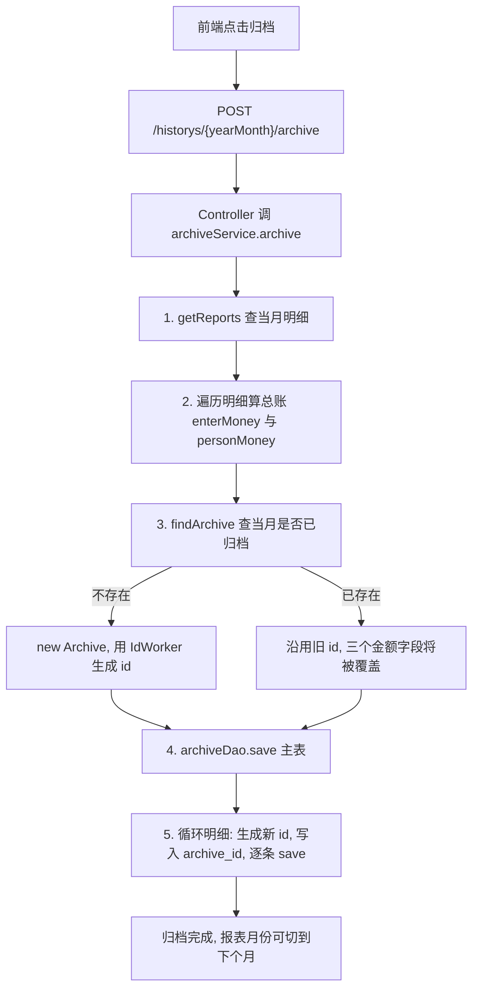

# 社保数据归档：把当月报表搬进两张历史表，覆盖与搬运一次讲清

报表页右上有「归档 7 月份报表」按钮，点击后弹确认框，提示一句话：如果之前归档过 7 月，之前的内容会被全部覆盖。确认后前端发 `POST /historys/201907/archive`，响应里没有任何数据，因为归档是纯粹的数据库搬运：把上一课 `getReports` 现场拼出来的当月明细，写进归档主表与归档明细表，从此这个月的社保数据定格成快照。

## 先给结论

- 归档 = 当月报表固化：`ss_archive` 主表存年月与企业、个人、合计三个总金额，`ss_archive_detail` 明细表存每个员工的完整参保快照，两表一对多。
- 归档方法四步走：查明细、算总账、查是否已归档、保存或覆盖；主表的覆盖语义由 JPA `save` 按主键自然实现。
- 总账计算是四项累加：公积金企业与个人、社保企业与个人，全用 `BigDecimal`，取值前用三元表达式把 null 兜底成 0。
- 明细表每次归档都用新 id 插入，重复归档不会清旧记录，dao 里预留的 `deleteByArchiveId` 就是补这个洞用的。
- 两个参数顺序、一个非空约束、一处累加手误，是这套代码里最容易踩的三个雷。

## 一、归档的两张表：主表管总账，明细管快照

先看表设计。`ss_archive` 只有七列，重点在三个金额字段：

```sql
CREATE TABLE `ss_archive` (
  `id` varchar(40) NOT NULL COMMENT 'id',
  `company_id` varchar(40) NOT NULL COMMENT '企业id',
  `years_month` varchar(255) NOT NULL COMMENT '年月',
  `creation_time` date DEFAULT NULL COMMENT '创建时间',
  `enterprise_payment` decimal(10,2) NOT NULL DEFAULT '0.00' COMMENT '企业缴纳',
  `personal_payment` decimal(10,2) NOT NULL DEFAULT '0.00' COMMENT '个人缴纳',
  `total` decimal(10,2) NOT NULL DEFAULT '0.00' COMMENT '合计',
  PRIMARY KEY (`id`)
) ENGINE=InnoDB DEFAULT CHARSET=utf8 COMMENT='社保-归档表';
```

`ss_archive_detail` 则有六十多列，从用户名、手机号、学历、开户行，到养老、医疗、失业、工伤、生育、大病、公积金的基数与比例，把报表页上的每一格都存成列。主表是给「历史归档列表页」看的总账，明细表是点开某个月后的完整快照，两者靠明细表的 `archive_id` 关联，一对多。整体流程如下：



图里第 3 步是覆盖语义的分叉点：已归档就走更新，未归档才生成新记录。

## 二、Controller 与 Service 的分工

归档动作牵涉主表、明细表两张表与一段金额计算，全部下沉到 Service，Controller 只做转发：

```java
/**
 * 数据归档
 *  /historys/201907/archive
 */
@RequestMapping(value = "/historys/{yearMonth}/archive", method = RequestMethod.POST)
public Result historysDetail(@PathVariable String yearMonth) throws Exception {
    archiveService.archive(yearMonth, companyId);
    return new Result(ResultCode.SUCCESS);
}
```

返回值不带数据，前端拿到成功码后自行刷新页面。请求路径与查询报表的 `/historys/{yearMonth}` 同一前缀，用 POST 与多出的 `archive` 片段区分。

## 三、主表：先算总账，再决定插入还是覆盖

`archive` 方法的前半段是算总账：

```java
public void archive(String yearMonth, String companyId) throws Exception {
    //1.查询当月的明细数据
    List<ArchiveDetail> archiveDetails = getReports(yearMonth, companyId);
    //1.1 计算当月企业与员工支出的所有社保金额
    BigDecimal enterMoney = new BigDecimal(0);
    BigDecimal personMoney = new BigDecimal(0);
    for (ArchiveDetail archiveDetail : archiveDetails) {
        BigDecimal t1 = archiveDetail.getProvidentFundEnterprises() == null
                ? new BigDecimal(0) : archiveDetail.getProvidentFundEnterprises();
        BigDecimal t2 = archiveDetail.getSocialSecurityEnterprise() == null
                ? new BigDecimal(0) : archiveDetail.getSocialSecurityEnterprise();
        BigDecimal t3 = archiveDetail.getProvidentFundIndividual() == null
                ? new BigDecimal(0) : archiveDetail.getProvidentFundIndividual();
        BigDecimal t4 = archiveDetail.getSocialSecurityIndividual() == null
                ? new BigDecimal(0) : archiveDetail.getSocialSecurityIndividual();
        enterMoney = enterMoney.add(t1).add(t2);
        personMoney = personMoney.add(t3).add(t4);
    }
    //2.查询当月是否已经归档
    Archive archive = this.findArchive(companyId, yearMonth);
    //3.不存在已归档的数据, 保存
    if(archive == null) {
        archive = new Archive();
        archive.setCompanyId(companyId);
        archive.setYearsMonth(yearMonth);
        archive.setId(idWorker.nextId() + "");
    }
    //4.已归档则沿用查出的对象, 覆盖三个金额字段
    archive.setEnterprisePayment(enterMoney);
    archive.setPersonalPayment(personMoney);
    archive.setTotal(enterMoney.add(personMoney));
    archiveDao.save(archive);
    //5.明细逐条搬运
    for (ArchiveDetail archiveDetail : archiveDetails) {
        archiveDetail.setId(idWorker.nextId() + "");
        archiveDetail.setArchiveId(archive.getId());
        archiveDetailDao.save(archiveDetail);
    }
}
```

**总账必须先算。** 主表上三个金额字段（企业缴纳、个人缴纳、合计）在重复归档时会随明细变化，所以保存或覆盖之前都要遍历明细重新累加。四个取值各包一层三元表达式，员工可能只缴社保不缴公积金，任何一项都可能为 null，直接 `add` 就是 `NullPointerException`。

**覆盖不等于先删后插。** 弹窗里说的「覆盖」在代码里只是 `save`：已归档时 `archive` 对象是从库里查出来的，主键 `id` 还是旧值，JPA 看到主键存在就发 update；未归档时才 `new Archive()` 并用 `IdWorker` 生成分布式 id 发 insert。一条 `save` 同时覆盖两种场景，与员工社保表用 user_id 做主键的思路一脉相承。

## 四、明细：新 id 插入与旧数据的处理

明细搬运每条都生成新 id，再写上归档主表的 `archive_id`。这里有个隐藏问题：主表覆盖了，明细却是纯插入。第二次归档同一个月时，旧明细还在表里，新明细又插进去，同一个 `archive_id` 之下出现两套快照。dao 里其实预留了清理方法：

```java
public interface ArchiveDetailDao extends JpaRepository<ArchiveDetail, String>,
        JpaSpecificationExecutor<ArchiveDetail> {
    void deleteByArchiveId(String archiveId);
    List<ArchiveDetail> findByArchiveId(String archiveId);
}
```

正确的做法是在重新归档分支里，主表 `save` 之前先执行 `archiveDetailDao.deleteByArchiveId(archive.getId())`，把旧明细清掉再插新明细，保证一个归档 id 对应且只对应一套快照。资料代码里没有调用它，属于实现留白，补上这两行才与弹窗承诺的「全部覆盖」严格一致。

## 五、调试实录里的三个雷

这套代码联调时接连暴露了三个典型问题，每一个都值得单独记一笔。

**第一，`creation_time` 非空约束。** 首次归档报错 create time 不能为 null：归档实体里有 `creationTime` 字段，但 `archive` 方法从未给它赋值，而测试库的表设计把这个列设成了非空。两种修法：在代码里补 `archive.setCreationTime(new Date())`，语义更完整；或者把列改成允许 NULL，课程资料包的 `ihrm.sql` 最终就是可空设计。金额与时间这类「代码没赋值但表要求非空」的错位，是快照类功能的高发区。

**第二，参数顺序传反。** 归档时发现重复归档产生了多条主表记录，排查到 `findArchive` 的两个入参：方法签名是 `(companyId, yearMonth)`，调用处却按 `(yearMonth, companyId)` 传了进去。年月与企业 id 都是字符串，编译器不报错，只是永远查不到已归档记录，覆盖分支形同虚设。两个同类型参数相邻出现时，调用处要对着签名核对顺序。

**第三，累加手误。** 资料的原始代码里，个人总账那一行写成了 `personMoney = enterMoney.add(t3).add(t4)`，把企业金额累加进了个人金额，合计也因此翻倍出错。正确写法必须是累加变量加在自己身上：`personMoney = personMoney.add(t3).add(t4)`。复制上一行改两个词是最容易出这种错的场景，累加语句写完要核对等号左边那个变量是否也出现在右边的第一项。

## 常见误区

- **以为覆盖会自动清明细**：主表 `save` 走 update，明细却是新 id 插入，重复归档会让明细翻倍。重新归档前先 `deleteByArchiveId` 清旧明细。
- **总账累加不判空**：员工只参保不缴公积金时对应字段为 null，直接累加抛空指针。取值处统一三元表达式兜底成 `new BigDecimal(0)`。
- **合计用字段值相加之外的路径算**：`total` 必须等于 `enterprisePayment.add(personPayment)`，单独再写一遍累加逻辑迟早与两个字段对不上，合计永远从两个已定字段推导。
- **归档接口顺手做切换周期**：归档只固化数据，不推进报表月份。把切换逻辑混进归档接口，一次点击会同时改两张表的状态，排查问题时无法区分是哪一步造成的。

## 面试可能被问到的问题

1. 面试官追问：「归档和备份是一回事吗？」
   答：归档是业务层面的快照固化，把当月报表数据连同金额计算结果写进历史表，之后政策或比例再变也不影响这个月；备份是运维层面的数据副本。这里归档的意义在于，未归档报表是实时算出来的「现在」，归档表里存的是「当时」，两者口径必须分离。

2. 面试官追问：「重复归档是怎么实现覆盖的？」
   答：先按企业 id 加年月查归档主表，查到就沿用原对象，主键不变，JPA 的 `save` 判断主键存在自动转 update；查不到才 new 新对象并生成 id 走 insert。覆盖动作没有专门代码，靠主键的双语义完成。

3. 面试官追问：「为什么总账算在 Java 里而不是用 SQL 的 sum？」
   答：明细本身是 Java 拼装出来的，社保金额来自城市比例乘基数的实时计算，公积金金额存在员工表里，来源不一，SQL 里没有一张现成的表能一次 sum 出结果。在遍历明细的同一层用 `BigDecimal` 累加，口径与页面展示完全一致。

4. 面试官追问：「BigDecimal 的 add 会改变原对象吗？」
   答：不会。`BigDecimal` 是不可变对象，`add`、`multiply` 都返回新对象，必须用 `x = x.add(y)` 接住返回值，写成单独一行 `x.add(y)` 等于什么都没做。资料代码里的累加手误正是没接住返回值导致的典型错误。

5. 面试官追问：「明细表为什么每条记录都生成新 id 而不是沿用用户 id？」
   答：明细快照与用户是多对一的历史关系，同一个用户每个月各有一条记录，用户 id 做主键会让上个月的快照被这个月覆盖。用 `IdWorker` 生成的分布式 id 做主键，用 `archive_id` 表达归属，历史才能逐月累积。

## 配套资料

- 归档接口与完整归档逻辑：`materials/code/02/day14 微服务网关与社保模块开发/day14/03-资料/社保模块相关资料/ihrm_social_securitys/src/main/java/com/ihrm/social/controller/SocialSecurityController.java`（`/historys/{yearMonth}/archive`，包名已改为中性命名）
- `archive` 方法与累加逻辑：同目录 `社保资源/基本代码/service/ArchiveService.java`（资料中 `personMoney` 累加行存在手误，正文已修正为 `personMoney.add(...)`）
- 归档实体与明细清理 dao：同目录 `社保资源/基本代码/domain/Archive.java`、`domain/ArchiveDetail.java`、`dao/ArchiveDetailDao.java`
- 归档表建表语句：`materials/code/02/day14 微服务网关与社保模块开发/day14/ihrm.sql`（`ss_archive`、`ss_archive_detail`，含 `archive_id` 关联列与预置历史数据）
- 主键生成工具：同目录 `common模块的工具类/IdWorker.java`
