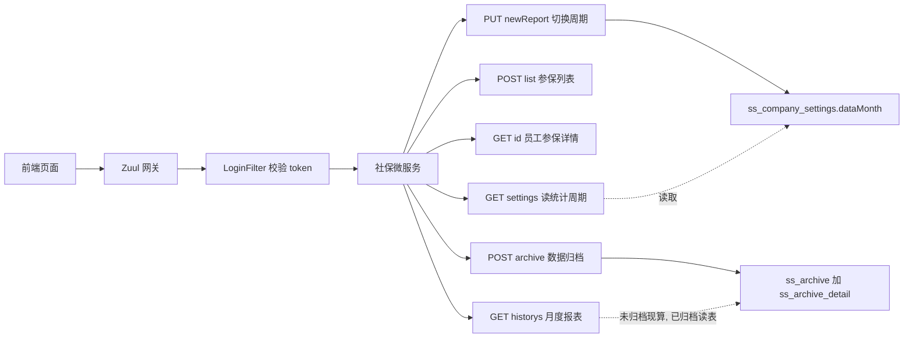

# 一天课收两块：Zuul 网关的统一鉴权与社保模块的全链路复习

这一天的内容横跨两块：前半段是微服务网关，属于基础设施；后半段是社保模块，属于业务开发。两块看似不相干，实际上社保页面的每个请求都要先过网关的过滤器，token 校验通过才有资格进业务，把它们串起来才是一个能跑通的完整系统。复习时最忌把知识点割裂成「过滤器四方法背诵」与「几张表几个接口」，这篇按请求的真实流动顺序把两块收拢成一条线，最后把课内没做完的历史归档界面拆成可下手的练习。

## 先给结论

- 网关做两件事：按路由规则把 `/sys/**`、`/social_securitys/**` 这类前缀分发到对应微服务；在 pre 过滤器里统一校验 token，无 token 返回 401。
- Zuul 过滤器要实现四个方法：`filterType` 定类型、`filterOrder` 定顺序、`shouldFilter` 定开关、`run` 写业务，鉴权写在 pre 类型里。
- 社保模块六个接口连成一条业务线：企业设置、参保列表、员工参保详情、月度报表、数据归档、切换统计周期。
- 数据分三层：员工社保表存现状，归档主表与明细表存历史快照，企业设置表的 `dataMonth` 是统计周期指针。
- 课内留了一个口子：历史归档界面未实现，查主表列表加按归档 id 查明细，用现成的 dao 方法就能补上。

## 一、网关这一块：路由加过滤器

网关在微服务架构里的角色是统一入口：前端只认识网关一个地址，网关按路径前缀把请求转给后面的微服务。路由规则集中在网关的 `application.yml` 里：

```yaml
zuul:
  routes:
    ihrm-system: #系统微服务
      path: /sys/**
      serviceId: ihrm-system
      stripPrefix: false
    ihrm-employee: #员工微服务
      path: /employees/**
      serviceId: ihrm-employee
      stripPrefix: false
    ihrm-social-securitys: #社保微服务
      path: /social_securitys/**
      serviceId: ihrm-social-securitys
      stripPrefix: false
      customSensitiveHeaders: true #放行 cookie 等敏感头
```

`serviceId` 写的是注册中心里的服务名，网关从 Eureka 拉取实例做负载均衡，微服务扩容缩容不用改配置。`stripPrefix: false` 表示转发时保留路径前缀，因为各微服务的 Controller 本身就映射了这些前缀。

路由解决「去哪」，过滤器解决「让不让去」。自定义过滤器继承 `ZuulFilter`，四个方法各司其职：

```java
public class LoginFilter extends ZuulFilter {

    public String filterType() {
        return "pre"; //路由之前执行
    }

    public int filterOrder() {
        return 2; //数字越小优先级越高
    }

    public boolean shouldFilter() {
        return true; //所有请求都过这个过滤器
    }

    public Object run() throws ZuulException {
        //1.从 Zuul 上下文拿请求对象
        RequestContext rc = RequestContext.getCurrentContext();
        HttpServletRequest request = rc.getRequest();
        //2.取 Authorization 头
        String token = request.getHeader("Authorization");
        //3.没有 token 就拦截, 返回 401
        if(token == null || "".equals(token)) {
            rc.setSendZuulResponse(false); //不再路由到微服务
            rc.setResponseStatusCode(HttpStatus.UNAUTHORIZED.value());
        }
        return null;
    }
}
```

`run` 里校验 JWT 时，解析成功把 claims 放进上下文传给下游，解析失败同样 `setSendZuulResponse(false)` 加 401。这套 `LoginFilter` 是 JWT 方案；课内还给了基于 Shiro 的等价方案，差异只在 `run` 方法里用什么组件做校验，过滤器骨架完全不变。请求的完整生命周期是 pre 过滤、routing 转发、post 返回，出错走 error 过滤器，自定义过滤器嵌在 pre 环节。

## 二、社保这一块：六个接口一条业务线

社保模块围绕「当月参保现状」展开，六个接口的调用顺序与业务推进完全同构：

| 接口 | 方法 | 作用 |
|---|---|---|
| `/settings` | GET | 读企业设置，返回统计周期与是否已设置 |
| `/list` | POST | 分页查全企业员工的参保列表 |
| `/{id}` | GET | 详情页数据：Feign 取用户信息加本地社保数据 |
| `/historys/{yearMonth}` | GET | 月度报表，`opType` 区分未归档与已归档 |
| `/historys/{yearMonth}/archive` | POST | 归档，把当月明细搬进两张归档表 |
| `/historys/{yearMonth}/newReport` | PUT | 切换统计周期，更新 `dataMonth` |



图中最容易混淆的一层关系在数据侧：员工社保表永远只有参保「现状」一份，月度报表未归档时按现状实时计算，归档后才在归档表里定格成「历史」，统计周期指针决定当前操作的是哪个月。三个存储各管一段，谁也不重复谁。

## 三、两块怎么咬合：token 从网关走到业务

网关过滤器校验通过后，请求继续转发，社保模块的 Controller 继承 `BaseController`，直接就能拿到解析好的 `companyId`，前面几个接口里反复出现的 `companyId` 变量就是这么来的。也就是说，网关不校验，业务接口就暴露在无 token 的裸奔状态；网关校验后透传身份，业务代码才能专注于参数与逻辑。这种分层让鉴权逻辑只写一次，所有微服务共享同一道闸门，改动 token 规则时只动网关一处。

## 四、课内留的练习：历史归档界面

历史归档列表在课内没有实现，需求本身不复杂：点进「历史归档」先列出企业所有归档月份，点某个月再看该月明细。查询的正是归档主表，主表再关联明细表。按本课写法补全的示例骨架如下：

```java
/**
 * 历史归档列表: 查询企业所有归档主表记录 (示例, 按本课写法补全)
 */
@RequestMapping(value = "/historys/list", method = RequestMethod.GET)
public Result historysList() {
    List<Archive> list = archiveService.findAllByCompany(companyId);
    return new Result(ResultCode.SUCCESS, list);
}
```

service 与 dao 侧用派生查询方法即可：`ArchiveDao` 加一个 `List<Archive> findByCompanyId(String companyId)`，明细复用现成的 `findAllDetailByArchiveId`。前端列表页展示主表的年月与三个金额字段，跳转详情页把归档 id 作为路径参数传给已有的 `opType` 报表接口，`opType` 传非 1 值即可复用整条已归档查询线，不需要任何新逻辑。

## 常见误区

- **把过滤器四方法当成四个可选项**：`filterType` 与 `filterOrder`、`shouldFilter`、`run` 都来自抽象父类与接口，少实现任何一个编译不过。`shouldFilter` 返回 false 时 `run` 不执行，常被误认为过滤器失效了。
- **401 之后就忘了 `setSendZuulResponse(false)`**：只设置状态码不停止路由，请求仍会转发到微服务，客户端拿到的是微服务的响应而不是拦截结果，拦截形同虚设。
- **复习社保模块时只背接口不记数据分层**：现状表、归档表、周期指针三层职责不清，就会写出「归档时顺手切周期」这种把两层混在一起的问题，排查时也无法定位数据是哪个口径的。
- **历史归档界面另起炉灶造接口**：明细查询与 `opType` 分流早已存在，补一个主表列表接口就够了，重复造轮子反而引入两套口径。

## 面试可能被问到的问题

1. 面试官追问：「为什么统一鉴权放在网关层，而不是各微服务自己校验？」
   答：网关是所有请求的必经之路，鉴权写一次就能保护全部后端服务，token 规则变更只改网关；各服务自己校验会把同一套逻辑复制 N 份，漏改一处就出安全洞。业务服务内部仍可做细粒度权限，粗粒度的身份认证收敛在网关。

2. 面试官追问：「Zuul 过滤器的四种类型分别什么时候执行？」
   答：pre 在路由转发前执行，适合鉴权、日志、限流；routing 在路由转发时执行；post 在目标服务返回后执行，适合改响应、加头；error 在执行过程抛异常时执行。自定义过滤器常选 pre，通过 `RequestContext.setSendZuulResponse(false)` 中断转发。

3. 面试官追问：「网关里 JWT 和 Shiro 两种方案怎么选？」
   答：JWT 无状态，签发后校验只靠签名，适合网关这种不落会话的场景，缺点是签发后无法主动作废，需要配合黑名单；Shiro 有会话与权限模型，适合细粒度的角色权限管理。过滤器骨架相同，差异在 run 方法里的校验实现，工程上可以在网关用 JWT 做认证，进入业务层再用权限框架做授权。

4. 面试官追问：「社保模块的报表为什么要有归档表，直接实时算不行吗？」
   答：实时报表按员工社保表的当前值计算，基数与比例随时会调，算出来永远是「现在」的口径。归档表把某个月的企业缴纳、个人缴纳与逐人明细定格成快照，历史月份的审计与对账才有一致依据，这也是切换统计周期之前必须先归档的原因。

5. 面试官追问：「网关转发时敏感头信息怎么处理？」
   答：Zuul 默认会过滤 cookie 等敏感头，导致依赖 cookie 的请求转发后丢信息。路由配置里 `customSensitiveHeaders: true` 加把 `sensitiveHeaders` 置空，可以让指定路由放行这些头；token 走 `Authorization` 头则不受影响。

## 配套资料

- 网关工程与路由配置：`materials/code/02/day14 微服务网关与社保模块开发/day14/03-资料/网关相关资料/ihrm_gate/src/main/resources/application.yml`（zuul 路由规则）与 `src/main/java/com/ihrm/gate/filter/LoginFilter.java`（自定义过滤器，包名已改为中性命名）
- 社保模块全部接口：`materials/code/02/day14 微服务网关与社保模块开发/day14/03-资料/社保模块相关资料/ihrm_social_securitys/src/main/java/com/ihrm/social/controller/SocialSecurityController.java`
- 归档与报表逻辑：同目录 `社保资源/基本代码/service/ArchiveService.java`、`domain/Archive.java`、`domain/ArchiveDetail.java`
- 全部建表语句与预置数据：`materials/code/02/day14 微服务网关与社保模块开发/day14/ihrm.sql`（含 `ss_archive`、`ss_archive_detail`、`ss_company_settings`）
- 历史归档列表接口在资料中未提供实现，正文示例为按本课写法补全，dao 层派生查询与明细接口均来自上述真实文件
