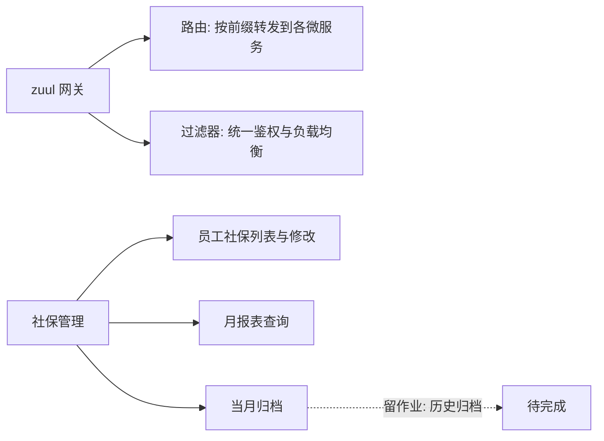
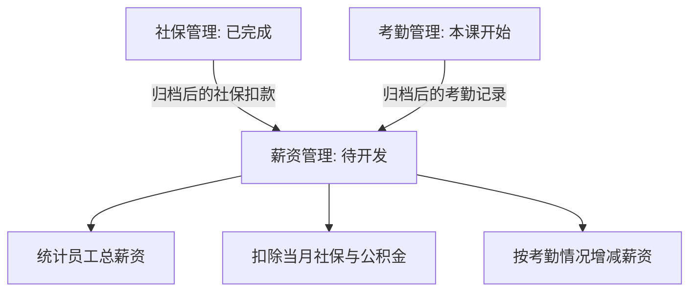

# 从社保收尾到考勤开篇：人力资源系统第 15 天要补的两块拼图

上一课结束时社保模块留了个尾巴：月报表能看、当月能归档，但「历史归档」点进去是空的，历史月份的明细也查不出来。这一课先用三四个接口把这块补齐，让社保模块彻底收口，然后进入人力资源系统的第二个主环节：考勤。补作业只是回锅饭，真正的重头是考勤设置，因为它决定了后面考勤管理和薪资计算的全部口径。

## 先给结论

- 社保模块收尾要做三件事：历史归档列表、归档详情展示、给薪资模块预留的「按员工查归档明细」接口，全是对已有 `ss_archive`、`ss_archive_detail` 两张表的查询，没有新表。
- 人力资源系统的三大主环节是社保、考勤、薪资，社保已完成，考勤从本课开始；社保和考勤的归档数据是薪资计算的全部依据。
- 考勤不是先记打卡，而是先做「考勤设置」：出勤时间、请假类型、扣款规则、加班规则四类配置，因企业、因部门而异。
- 设置好之后才有考勤管理（查指定月份全公司出勤记录、可修正），归档之后记录锁定不可改，与社保归档同一套约束。
- 本课新起一个考勤微服务，表全部以 `atte_` 前缀开头，与社保的 `ss_` 前缀、组织的 `bs_` 前缀划清边界。

## 一、回顾网关与社保：已经拿到了什么

上一课的两块内容可以用一张图概括：



网关部分的代码套路很固定：启动类上开启网关功能，配置文件里写好转发规则，需要鉴权就写一个过滤器继承 `ZuulFilter`。课程里的登录校验过滤器骨架长这样（包名已改为 `com.example`）：

```java
package com.example.gate.filter;

import com.netflix.zuul.ZuulFilter;
import org.springframework.stereotype.Component;

@Component
public class LoginFilter extends ZuulFilter {
    @Override
    public String filterType() {
        return "pre";       // 请求被路由之前执行
    }
    @Override
    public int filterOrder() {
        return 2;           // 多个过滤器时的执行顺序
    }
    @Override
    public boolean shouldFilter() {
        return true;        // 是否启用该过滤器
    }
    @Override
    public Object run() {
        // 校验请求头中的令牌, 失败直接拦截返回
        return null;
    }
}
```

社保部分上一课完成了三件事：员工社保数据列表（`ss_user_social_security` 左连用户表分页查询）、修改员工社保配置、按当前月份出月报表并归档。归档把当月报表固化进 `ss_archive` 与 `ss_archive_detail` 两张历史表，但「历史归档」页面还差查询接口，这正是留给本课的作业。

## 二、为什么考勤必须排在薪资前面

人力资源系统有三个主环节：社保、考勤、薪资。这个顺序不是随便排的，而是数据依赖决定的：



算一个月薪并不只是拿合同工资除以天数。当月社保个人部分扣多少、公积金个人部分扣多少，来自社保模块的归档明细；这个月迟到几次、旷工几天、加班多少小时，来自考勤模块的归档记录。薪资模块自己不生产这些数据，只能按「用户 id 加年月」向两个兄弟模块索取。所以社保和考勤各自归档之后，薪资才有可靠的计算依据，反过来说，没归档的数据是「活」的，还允许修正，不能直接参与算钱。

## 三、考勤模块要做什么：先设置，再管理，最后归档

考勤最容易让人以为就是「记打卡」，实际开发顺序正好相反，第一步是配置。不同企业、不同部门的规则差异很大：研发部可能要求早晨九点打卡、中午十二点休息、下午一点继续、晚上六点下班；有的部门双休，有的岗位轮休；迟到是否扣款、扣多少、多久算旷工，每家公司都有自己的制度。这些约束不先配置好，后面的考勤数据就没有判定标准。

本课的考勤设置拆成四类配置：

**第一类，出勤设置。** 每个部门各自的上午上下班、下午上下班时间，例如研发部「09:00 至 18:00，午休 12:00 至 13:00」。

**第二类，请假设置。** 年假、事假、病假、婚假等假期类型，可以按部门逐个开关。职能部门的假期严格按制度执行，销售一类常年在外跑业务的岗位可能规则更宽松，所以假期可用性要做到部门粒度。

**第三类，扣款设置。** 它是薪资计算的重要参考。可以配置迟到多少分钟开始扣款、迟到多少分钟算旷工、早退一次扣多少、旷工按当月日薪的几倍罚款。人性化的公司允许每月免费迟到两三次，严格的公司五分钟就扣钱，这些差异全部落在配置表里而不是硬编码里。

**第四类，加班设置。** 工作日能否申请加班、休息日能否申请加班、法定节假日加班怎么补偿。这一项还和工作流联动：如果企业设置为不允许加班，员工发起的加班审批流可以直接不通过。

设置就绪后才是考勤管理：查指定月份全公司每个人的出勤记录，张三周一是迟到还是旷工一目了然，发现异常可以人工修正。当月数据确认无误后做考勤归档，归档之后记录锁定不可再改，和社保归档完全同一套约束。社保归档加考勤归档，共同构成薪资计算的数据底盘。

## 四、本课的两条线

一条线是收尾：给社保模块补三个查询接口。历史归档列表按企业 id 加年份模糊查询 `ss_archive` 主表；归档详情沿用上一课的报表查询逻辑，当月实时算、历史月查明细表；再新增一个「按用户 id 和年月查归档明细」的接口，这是专门给薪资模块通过微服务调用准备的，页面上没有对应按钮。

另一条线是开篇：新建考勤微服务，完成考勤设置的第一个功能「出勤设置」的查询与保存。考勤模块的全部实体类和 dao 在课程资料里以工具代码的形式提供，表名统一 `atte_` 前缀，比如出勤设置对应 `atte_attendance_config`，请假配置对应 `atte_leave_config`，扣款字典对应 `atte_deduction_dict`。后面的课程再依次展开考勤管理、数据导入、考勤归档，直到把考勤数据送到薪资模块门口。

## 常见误区

- **以为考勤模块先写打卡记录**：实际顺序是先配置后记录。没有出勤时间、扣款规则这些配置，打卡数据进来也无法判定正常还是迟到。
- **把考勤规则硬编码进业务逻辑**：迟到五分钟扣五十这种数字写死在代码里，换个客户就要改代码发版。规则落库，按企业 id 加部门 id 读取，才是多租户 SaaS 的正确姿势。
- **认为归档只是「复制一份」**：归档的业务含义是锁定，归档后的社保、考勤数据不可修改，薪资模块只认归档数据，这保证月度核算口径稳定。
- **忽略三大环节的数据流向**：薪资模块不是自己算社保和考勤，而是按用户 id 加年月向社保、考勤模块索取已归档数据，接口在设计期就要预留。

## 面试可能被问到的问题

1. 面试官追问：「人力资源系统为什么把社保、考勤、薪资拆成三个微服务？」
   答：三者都是独立限界上下文，数据模型差异大且变更频率不同，社保政策、考勤制度、薪资方案经常单独调整。拆开后各自独立部署，通过接口交换数据，一个模块改动不影响另外两个。

2. 面试官追问：「zuul 网关在一个微服务系统里承担什么职责？」
   答：它是对外的统一入口，核心职责两个：路由，按请求前缀把请求转发到对应微服务；过滤，在路由前后执行过滤器完成统一鉴权、日志、限流。所有外部请求先过网关，微服务本身不必各自实现鉴权。

3. 面试官追问：「为什么社保和考勤都要做归档，直接算当前数据不行吗？」
   答：当前数据是可变的，随时可能被修正，而薪资核算需要确定的口径。归档相当于月度快照，固化了那个月每个员工的缴费和出勤记录，之后即使原始数据被改动也不影响已核算的薪资，出了争议也有据可查。

4. 面试官追问：「考勤设置的规则为什么要做到部门粒度？」
   答：同一企业内不同部门的制度差异很大，研发部九点上班，门店可能七点半就要到岗；销售岗的请假规则也和职能部门不同。配置表里同时存企业 id 和部门 id，查询时两级定位，才能在同一套代码里服务多种制度。

5. 面试官追问：「薪资计算要消费社保和考勤的数据，微服务间怎么拿？」
   答：由社保、考勤模块各暴露一个按用户 id 加年月查询的内部接口，薪资模块通过 Feign 之类的客户端发起服务间调用。这类接口的返回值通常直接是业务对象而不包装统一响应体，因为消费方是程序不是浏览器。

## 配套资料

- 考勤模块实体类（出勤、请假、扣款、加班配置）：`materials/code/02/day15 考勤模块开发/day15/工具代码/实体类/atte/entity/`（含 `AttendanceConfig.java`、`LeaveConfig.java`、`DayOffConfig.java`、`ExtraDutyConfig.java`、`ExtraDutyRule.java`、`DeductionDict.java`，包名已改为 `com.example`）
- 考勤模块 dao 与 service 骨架：`materials/code/02/day15 考勤模块开发/day15/工具代码/工具类/考勤模块/`
- 社保归档两张表对应的实体与 dao：`materials/code/02/day15 考勤模块开发/day15/工具代码/实体类/social_security/Archive.java`、`ArchiveDetail.java`；`materials/code/02/day14 微服务网关与社保模块开发/day14/03-资料/社保模块相关资料/ihrm_social_securitys/src/main/java/com/ihrm/social/dao/ArchiveDao.java`
- 网关过滤器与配置：`materials/code/02/day14 微服务网关与社保模块开发/day14/03-资料/网关相关资料/ihrm_gate/src/main/java/com/ihrm/gate/filter/LoginFilter.java`
- 本课示例代码中的包名均由课程原始包名改为 `com.example` 中性包名
