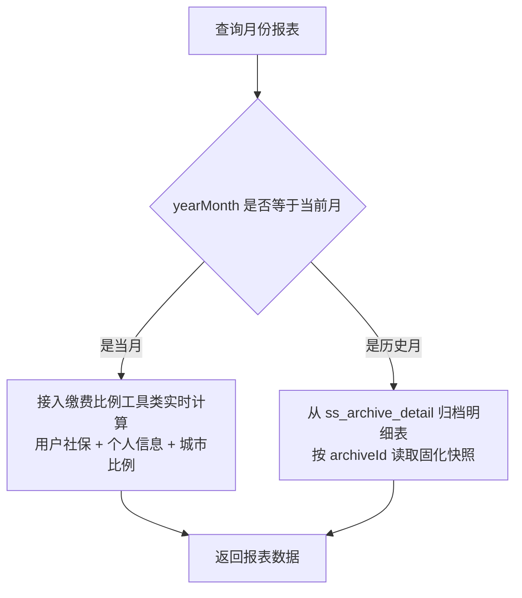
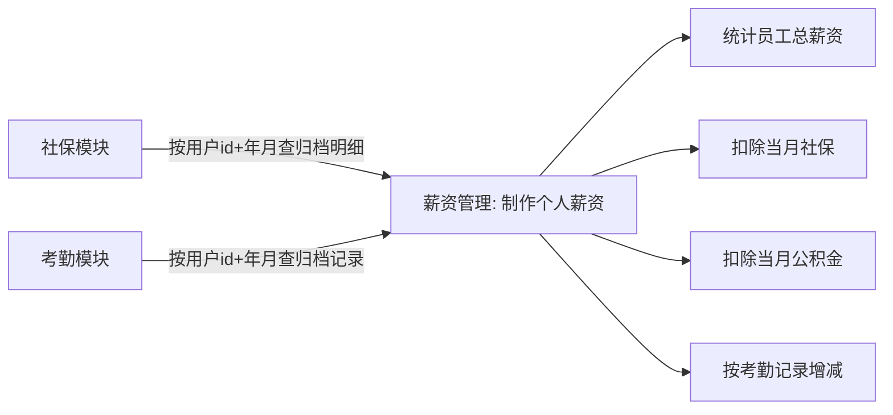

# 社保归档详情与用户缴费历史：给薪资模块留的那个接口

历史归档列表能按年份查出来了，点开某个月还能看到该月的归档明细，页面上能点的地方都有了。但社保模块还欠一个页面上看不见的接口：后面的薪资模块算工资时，需要按员工 id 加年月来查这个人当月的社保扣款。这一课先把「点开月份看明细」的既有逻辑捋清楚，再把这个内部接口补上，并用 Postman 直连微服务验证。

## 先给结论

- 归档详情沿用已有的报表查询逻辑：查当月走实时计算，查历史月直接读 `ss_archive_detail` 明细表，一条分支判断区分两种数据来源。
- 新增接口 `GET /histories/data`，参数是用户 id 与年月，返回该员工当月的归档明细，这是专门给薪资模块消费的内部接口。
- 它的返回值直接是 `ArchiveDetail` 实体，不包统一响应体 `Result`，因为消费方是微服务调用而不是浏览器。
- 查询落在归档明细表上，dao 方法 `findByUserIdAndYearsMonth`，两个条件属性名都必须来自实体类。
- 测试不走网关直连 9004 端口，绕开网关层的鉴权过滤器，用 Postman 模拟未来薪资模块的调用方式。

## 一、归档详情：当月算出来，历史月读出来

点开历史归档列表里的某个月，前端请求归档详情接口。这个功能在上一课写报表查询时已经顺手实现，核心是一个数据来源的分支判断：



这样设计的原因很直接：当月还没有归档，数据是「活」的，员工社保基数随时可能调整，必须按城市缴费比例现场算；历史月已经归档，数据定格成快照，直接查明细表既快又保证口径与归档那一刻完全一致。同一份代码服务两个页面诉求，分界线就是「是否已归档」。

## 二、薪资模块为什么来要数据

薪资计算不是独立算术题，它需要三份输入：



算某个员工某个月的实际薪资，要统计总薪资、当月社保扣款、当月公积金扣款，还要参考当月考勤。社保和考勤的数据薪资模块自己没有，只能按「用户 id 加年月」分别向两个模块查询。还有一个前提：查到的必须是已归档的数据，未归档的数据随时可能被修正，不能作为算钱的依据。所以社保模块要补的，就是一个查归档明细的接口，考勤模块后面会照同样模式补一个。

## 三、新接口的三层实现

Controller 层实现如下，注意返回值类型：

```java
//根据用户id和年月查询用户归档明细(供薪资模块调用)
@RequestMapping(value = "/histories/data", method = RequestMethod.GET)
public ArchiveDetail historysData(String userId, String yearMonth) throws Exception {
    return archiveService.findUserArchiveDetail(userId, yearMonth);
}
```

与页面接口的差别一眼可见：返回值不是 `Result`，而是 `ArchiveDetail` 实体本身。Service 层转发到 dao：

```java
//根据用户ID和年月查询用户归档明细
public ArchiveDetail findUserArchiveDetail(String userId, String yearMonth) {
    return archiveDetailDao.findByUserIdAndYearsMonth(userId, yearMonth);
}
```

DAO 层在归档明细 dao 里追加一个方法声明：

```java
public interface ArchiveDetailDao extends JpaRepository<ArchiveDetail, String>,
        JpaSpecificationExecutor<ArchiveDetail> {
    void deleteByArchiveId(String archiveId);
    List<ArchiveDetail> findByArchiveId(String archiveId);
    List<ArchiveDetail> findByUserIdAndYearsMonth(String userId, String yearMonth);
}
```

派生查询的老规矩，`And` 连接的两个属性名 `userId`、`yearsMonth` 必须与 `ArchiveDetail` 实体里的字段严格一致。归档明细表里本来就有这两个维度：`archive_id` 定位「哪个月的整体归档」，`user_id` 定位「哪个员工」，`years_month` 则冗余存储了年月，让按员工查历史可以绕过主表直接命中。

被查询的实体就是上一课归档时逐条插入的 `ArchiveDetail`，它有六十多个字段，从基本信息到五险一金每个险种的基数、比例、企业缴、个人缴一应俱全：

```java
@Entity
@Table(name = "ss_archive_detail")
@Data
public class ArchiveDetail implements Serializable {

    @Id
    private String id;
    /** 归档id */
    private String archiveId;
    /** 用户id */
    private String userId;
    /** 姓名 */
    private String username;
    /** 社保基数 */
    private BigDecimal socialSecurityBase;
    /** 社保企业 */
    private BigDecimal socialSecurityEnterprise;
    /** 社保个人 */
    private BigDecimal socialSecurityIndividual;
    /** 公积金企业 */
    private BigDecimal providentFundEnterprises;
    /** 公积金个人 */
    private BigDecimal providentFundIndividual;
    /** 年月 */
    private String yearsMonth;
    // 其余字段: 身份证号、学历、开户行、养老/医疗/失业/工伤/生育/大病各险种明细
}
```

薪资模块拿到这个对象，社保个人部分、公积金个人部分直接取字段，无需重复计算，这正是归档时把明细算全、存全的价值。

## 四、返回值为什么不是 Result，以及怎么测

给浏览器消费的接口统一返回 `Result`，成功码加数据包在一起，前端只认一种响应格式。给微服务消费的接口则不同：薪资模块会通过 Feign 这样的客户端发起调用，调用方拿到响应后要按声明的类型反序列化成业务对象。返回 `Result` 的话，调用方还得先解包再转型，多一层无意义的包装；直接返回 `ArchiveDetail`，Feign 声明返回类型就能拿到干净的对象。两类接口并存的原则是：人看的接口求统一，程序调的接口求直白。

测试也体现了这个差别。页面上没有按钮会请求这个接口，只能用 Postman 手工验证；而且不去请求网关，直接打社保微服务自身的 9004 端口，因为网关层配了鉴权过滤器，手工请求没带合法令牌会被拦截。请求方式如下：

```bash
curl "http://127.0.0.1:9004/social_security/histories/data?userId=106370348986940632064&yearMonth=201906"
```

先在数据库的 `ss_archive_detail` 表里确认要查的员工在 201906 这个月份确实有归档记录，再从表里取它的 `user_id` 拼进请求。响应返回一段 JSON，字段与实体一一对应，说明接口贯通。未来薪资模块经 Feign 调用时，走的逻辑与这次手工请求完全一致。

## 常见误区

- **给内部接口也包一层 `Result`**：微服务间调用要的是业务对象，多包一层响应体，每个调用方都要写解包代码，Feign 的返回类型声明也变得别扭。面向人的接口与面向程序的接口，返回值设计应分开对待。
- **方法名属性名跟参数名走**：参数叫 `yearMonth`，dao 方法却写成 `findByUserIdAndYearMonth`，实体属性是 `yearsMonth`，启动即报属性解析失败。属性名永远以实体类字段为准。
- **以为按员工查历史要连主表**：归档时 `years_month` 已冗余进明细表，按员工加年月单表查询即可；绕主表连查反而把简单查询复杂化。冗余字段存在的意义就是支持这类直达查询。
- **测试内部接口走网关**：内部接口的调用方是微服务，鉴权方式与浏览器不同，用 Postman 走网关会被鉴权过滤器拦下，先直连服务端口验证业务逻辑，再单独验证网关链路。

## 面试可能被问到的问题

1. 面试官追问：「面向浏览器的接口和面向微服务的接口，返回值设计有什么区别？」
   答：浏览器接口统一返回响应体对象，用状态码加数据封装，前端按同一格式处理成功与失败；微服务间接口直接返回业务对象，由 HTTP 状态码与 RPC 异常传递失败信息，让调用方反序列化后即拿即用，避免逐层解包。

2. 面试官追问：「为什么薪资模块只读归档明细，不读员工社保配置表？」
   答：社保配置表是当前状态，基数与比例随时可改，用它算历史月份会得到与当月实际不符的结果；归档明细是历史快照，固化了当时的数据。财务口径必须可追溯，读快照而不是读现状。

3. 面试官追问：「`ss_archive_detail` 里同时存 `archive_id` 和 `years_month`，是不是冗余？」
   答：是刻意冗余。`archive_id` 支撑按归档批次查全部员工，`years_month` 支撑按员工查任意月份历史，后者若靠 `archive_id` 中转就得先查主表再查明细。明细表数据只增不改，冗余年月不会产生一致性风险，换来的是单表直达查询。

4. 面试官追问：「Spring Data 派生查询两个字符串条件都用 `And` 连接，如何区分属性名边界？」
   答：框架按实体属性名做贪心匹配，解析时把剩余片段与实体所有属性名比对，能完整覆盖的切分方案才算合法。属性名拼接歧义或对不上时启动即抛异常，这也是实体属性命名要规范、避免前缀互相包含的原因之一。

5. 面试官追问：「为什么这个接口用 GET 而不用 POST？」
   答：它是一个幂等的纯查询，参数只有两个短字符串，完全符合 GET 的语义；GET 还能被中间层缓存与重试，对只读接口是加分项。涉及请求体、大参数或非幂等操作时才用 POST。

## 配套资料

- 归档明细实体 `ArchiveDetail`：`materials/code/02/day15 考勤模块开发/day15/工具代码/实体类/social_security/ArchiveDetail.java`（含 `archiveId`、`userId`、`yearsMonth` 与五险一金全部明细字段，包名已改为 `com.example`）
- 报表查询与归档主流程（当月实时算、历史月查明细的分支所在）：`materials/code/02/day14 微服务网关与社保模块开发/day14/03-资料/社保模块相关资料/ihrm_social_securitys/src/main/java/com/ihrm/social/service/ArchiveService.java`
- 归档明细 dao 基础版：`materials/code/02/day14 微服务网关与社保模块开发/day14/03-资料/社保模块相关资料/ihrm_social_securitys/src/main/java/com/ihrm/social/dao/ArchiveDetailDao.java`（`findByUserIdAndYearsMonth` 为本课新增方法，按本课写法补全）
- 文中包名均已由课程原始包名改为 `com.example` 中性包名
