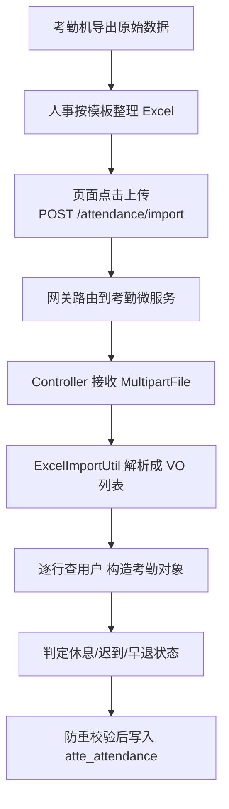

# 考勤数据导入概述：固定格式 Excel 是考勤系统的数据入口

需求分析确定了考勤管理的全貌，落地时它其实拆成四个功能：考勤数据导入、考勤列表展示、修改考勤数据、月报表与数据归档。四块里其他三块都是「对已有数据做加工」，唯独导入负责把数据从系统外搬进来，是整条流水线的源头。这一课先不写代码，把导入的方案选型和数据格式约定讲透，格式定错了，后面解析、判定、统计全部跟着歪。

## 先给结论

- 打卡数据进系统选 Excel 导入方案：直连考勤机数据库门槛高、适配型号有限，Excel 是多数企业采用的折中方案。
- 模板固定五列：员工姓名、手机号、工号、上班时间、下班时间，列顺序就是解析依据，不能随意增删调换。
- 姓名列是给人看的，手机号与工号才是系统定位员工的键；两个时间列是后续判定迟到早退的原料。
- 解析复用之前封装好的 `ExcelImportUtil` 泛型工具类与 `@ExcelAttribute` 注解，上传入口为 `POST /attendance/import`，下一课动手实测。

## 一、为什么还是 Excel

需求分析时对比过两条把打卡数据搬进系统的路。方案一直连考勤机数据库，要求考勤机具备网络支持，而且只能适配特定的一两个型号，每换一家客户就要重做一次适配。方案二让考勤机把数据导出成固定格式的 Excel，再由系统导入解析，中间多了一步人工，换来的是与考勤机型号彻底解耦。

两种方案的差异摆在一张表里看更直观：

| 对比项 | 直连考勤机数据库 | 导出 Excel 再导入 |
|---|---|---|
| 网络要求 | 考勤机必须联网可访问 | 无要求，文件拷贝即可 |
| 适配范围 | 绑定特定品牌型号 | 与型号无关，只认格式 |
| 实施成本 | 每类机型一套对接代码 | 一套解析逻辑通用 |
| 实时性 | 准实时 | 批量，按天或按月 |
| 出错责任 | 系统对接层 | 人事整理模板环节 |

实时性是直连方案唯一的实质优势，但考勤数据本身按天甚至按月处理就够用，报表与归档更是月度动作，批量的延迟完全可以接受。综合下来课程与多数企业一样选方案二，剩下的问题只有一个：格式必须固定，系统才能解析。

## 二、固定格式长什么样

课程资料里备了一份 `demo.xlsx` 作为标准模板，第一行是表头，从第二行起每行一名员工一天的打卡数据：

| 员工姓名 | 手机号 | 工号 | 上班时间 | 下班时间 |
|---|---|---|---|---|
| 张三 | 13800000002 | 123456 | 2019-7-1 8:30 | 2019-7-1 18:30 |
| 李四 | 13900001234 | 123457 | 2019-7-1 9:02 | 2019-7-1 18:31 |

五列各有分工。**员工姓名只承担可读性**，解析与定位都不依赖它，因为重名在一家公司里太常见。**手机号和工号是定位键**：这是一个 SaaS 多租户系统，注册时手机号全局唯一，用它反查用户最稳；工号则是企业内部的唯一编号，两者都在模板里，方便人事按任一键核对。**上下班两个时间列是判定原料**：导入服务会拿它们与部门的出勤配置比对，算出正常、迟到、早退等状态，时间必须带完整日期，否则跨天班次没法归位。

格式固定的含义是列的顺序与含义一一对应：第一列必须是姓名、第二列手机号，以此类推。人事是从考勤机导出数据后按这个模板整理的「生产者」，系统是按列号解析的「消费者」，两端契约就是这张模板。契约一旦被破坏，比如临时插了一列备注，解析出来的字段就会整体错位。

## 三、从文件到考勤记录的完整链路

把链路画出来，后面几课的代码无非是逐段实现这张图：



关键的接缝在 F 这一步：上传进来的只是字节流，必须先变成结构化的 Java 对象才有后续业务可言。这个转换不需要从零写，之前 POI 课程已经沉淀了一个基于注解的通用导入工具。

## 四、解析的注解方案预览

模板五列正好对应一个 VO 类的五个字段，列号与类型的绑定写在注解里：

```java
@Data
@ToString
public class AtteUploadVo {

    // 员工姓名 手机号 工号 上班时间 下班时间
    @ExcelAttribute(sort = 0, format = "String")
    private String username;
    @ExcelAttribute(sort = 1, format = "String")
    private String mobile;
    @ExcelAttribute(sort = 2, format = "String")
    private String workNumber;
    @ExcelAttribute(sort = 3, format = "Date")
    private Date inTime;
    @ExcelAttribute(sort = 4, format = "Date")
    private Date outTime;
}
```

`sort` 声明该字段取模板的第几列，`format` 声明单元格数据要转成什么 Java 类型。注解定义本身很短：

```java
@Retention(RetentionPolicy.RUNTIME)
@Target(ElementType.FIELD)
public @interface ExcelAttribute {
    /** 对应的列名称 */
    String name() default "";
    /** 列序号 */
    int sort();
    /** 字段类型对应的格式 */
    String format() default "";
}
```

工具类在运行时反射读取这些注解，遍历 Excel 的行与列，`sort` 值与列号相等就把单元格值按类型转换后塞进字段。模板将来加列，只需要给 VO 补一个带注解的字段，解析代码一行不动，这正是当初把 POI 样板代码封装成泛型工具类的目的。工具类怎么用、实测时会踩什么坑，留给下一课。

## 常见误区

- **随意调整模板列顺序**：解析按 `@ExcelAttribute` 的 `sort` 列号匹配，把手机号列挪到第三列，所有记录的手机号就会读到工号。加列只能加在末尾并同步补注解。
- **拿姓名当员工唯一键**：重名会让数据挂到错误的用户上。定位用户用手机号或工号，姓名只用于人工核对与展示。
- **时间列写成文本格式还不统一**：单元格是文本时解析端要做字符串转日期，格式五花八门必然出错。模板里时间列保持日期时间单元格格式，让解析端统一从日期型单元格读取。
- **以为 Excel 里带了企业信息**：模板只有员工与打卡数据，没有企业归属。导入时 `companyId` 必须由服务端从登录态解析补上，绝不能出现在模板里由人事填写。

## 面试可能被问到的问题

1. 面试官追问：「批量导入为什么用 Excel 而不用 CSV，主要考虑什么？」
   答：Excel 的单元格自带类型，日期、数值可以按类型直接读取，不容易出现格式歧义；且业务方对 Excel 更熟悉，模板可以带表头样式与数据校验。CSV 是纯文本，日期与编码问题都要自己兜底，两者都可行时看使用方习惯与解析成本。

2. 面试官追问：「导入模板的格式契约应该怎么维护？」
   答：把列号、类型、必填性收敛到注解或配置里，模板文档从代码生成而不是人肉维护；上传时先校验表头与列数，不符合直接拒绝并给出明确提示，避免半解析半入库留下脏数据。

3. 面试官追问：「解析出来的数据怎么定位到系统里的用户？」
   答：选一个跨系统稳定且唯一的键。手机号在 SaaS 系统里全局唯一，工号在企业内唯一，本方案两者都放进模板，解析时优先按手机号查用户，查不到再用工号兜底并记录异常行，姓名绝不作为定位键。

4. 面试官追问：「导入文件里没有企业归属信息，多租户下怎么保证数据写对租户？」
   答：归属字段一律服务端补齐。用户登录态里解析出 `companyId`，导入服务只处理本企业的数据，模板里即使出现企业字段也忽略，防止跨租户写数据。

5. 面试官追问：「上传接口接收文件用什么类型与注解？」
   答：Spring Boot 里用 `MultipartFile` 接收文件对象，参数上标 `@RequestPart("file")` 或 `@RequestParam("file")` 与前端表单的字段名对应，方法内通过 `getInputStream()` 拿到文件流交给解析工具。

## 配套资料

- 导入 VO（五列模板的注解映射）：`materials/code/02/day15 考勤模块开发/day15/工具代码/实体类/atte/vo/AtteUploadVo.java`（包名已改为 `com.example`）
- 通用导入工具类：`materials/code/02/day08 POI高级/POI高级/资源/代码/工具类/ExcelImportUtil.java`（`readExcel`、类型转换与科学计数法处理都在其中）
- 注解定义：`materials/code/02/day08 POI高级/POI高级/资源/代码/工具类/ExcelAttribute.java`
- 模板文件 `demo.xlsx` 未随资料包提供，文中表格示例为按课程视频格式补全；上传接口与解析代码在后续课程实现
