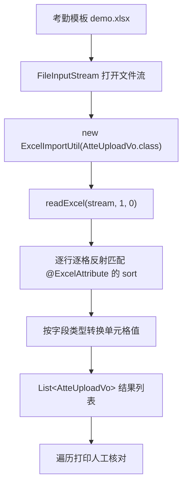

# Excel 导入工具类实测：三步解析考勤模板，先踩一遍 hh 与 HH 的坑

模板格式和注解方案都定了，按惯例别急着写业务代码，先把解析工具整个跑通：拿一份真实的考勤 Excel，用 `ExcelImportUtil` 解析成 `AtteUploadVo` 列表并打印核对。POI 原生 API 操作 Excel 的样板代码量不小，工作簿、工作表、行、单元格四层循环加一堆类型判断，之前 POI 课程已经把这些封装成一个泛型工具类和一个注解，这一课正好用考勤数据把它复习一遍，顺带踩掉一个时间解析的经典坑。

## 先给结论

- 用这套工具固定三步：定义带 `@ExcelAttribute` 的 VO，`new ExcelImportUtil<>(VO.class)` 构造工具，`readExcel(文件流, 起始行, 起始列)` 拿结果列表。
- 起始行传 1 跳过表头，起始列传 0 从第一列读起；参数都是下标，从 0 开始数。
- 工具类里日期格式写的是 `yyyy-MM-dd hh:mm:ss`，小写 `hh` 是 12 小时制，下午 18:30 会被解析成 6:30，必须改成大写 `HH`。
- 数值单元格统一走 `BigDecimal.toPlainString` 输出，手机号这类长数字才不会变成科学计数法。

## 一、三步用法

第一步是定义与模板对应的 VO。五列五个字段，注解里写清每个字段取第几列、转成什么类型：

```java
@Data
@ToString
public class AtteUploadVo {

    // 员工姓名 手机号 工号 上班时间 下班时间
    @ExcelAttribute(sort = 0, format = "String")
    private String username;
    @ExcelAttribute(sort = 1, format = "String")
    private String mobile;
    @ExcelAttribute(sort = 2, format = "String")
    private String workNumber;
    @ExcelAttribute(sort = 3, format = "Date")
    private Date inTime;
    @ExcelAttribute(sort = 4, format = "Date")
    private Date outTime;
}
```

第二步是构造工具类。构造参数只有一个 `Class` 对象，含义是「你要把每行 Excel 生成什么对象」：传 `AtteUploadVo.class`，工具内部就会反射拿它的字段列表，之后每行数据都 `newInstance` 出一个 `AtteUploadVo` 实例回填。

第三步是调用 `readExcel`。它有三个参数：输入流、从第几行开始读、从第几个单元格开始读。表头占了第 0 行，所以起始行传 1；数据从 A 列开始，起始单元格传 0。

整个流程串起来是这样：



## 二、写一个测试类跑一遍

```java
package com.example;

import com.example.common.poi.ExcelImportUtil;
import com.example.domain.atte.vo.AtteUploadVo;
import java.io.File;
import java.io.FileInputStream;
import java.util.List;

public class PoTest {

    public static void main(String[] args) throws Exception {
        // 1.构造工具类, 告诉它每行数据生成什么对象
        ExcelImportUtil<AtteUploadVo> util =
                new ExcelImportUtil<>(AtteUploadVo.class);
        // 2.打开模板文件流
        FileInputStream stream = new FileInputStream(new File("E:\\demo.xlsx"));
        // 3.从第 1 行(跳过表头)第 0 列开始解析
        List<AtteUploadVo> list = util.readExcel(stream, 1, 0);
        for (AtteUploadVo vo : list) {
            System.out.println(vo);
        }
    }
}
```

运行后控制台每行打出一个 `AtteUploadVo` 对象，五列数据各归各位，说明列号映射正确。工具能跑通只是第一步，敢把它接进业务，还得知道它内部替你做了什么。

## 三、工具类内部在做什么

`readExcel` 的核心是三层循环加注解匹配，摘出来看：

```java
public List<T> readExcel(InputStream is, int rowIndex, int cellIndex) {
    List<T> list = new ArrayList<T>();
    try {
        XSSFWorkbook workbook = new XSSFWorkbook(is);
        Sheet sheet = workbook.getSheetAt(0);
        for (int rowNum = rowIndex; rowNum <= sheet.getLastRowNum(); rowNum++) {
            Row row = sheet.getRow(rowNum);
            T entity = (T) clazz.newInstance();          // 每行新建一个对象
            for (int j = cellIndex; j < row.getLastCellNum(); j++) {
                Cell cell = row.getCell(j);
                for (Field field : fields) {             // 与 VO 字段做匹配
                    if (field.isAnnotationPresent(ExcelAttribute.class)) {
                        field.setAccessible(true);
                        ExcelAttribute ea = field.getAnnotation(ExcelAttribute.class);
                        if (j == ea.sort()) {            // 列号与 sort 相等才回填
                            field.set(entity, covertAttrType(field, cell));
                        }
                    }
                }
            }
            list.add(entity);
        }
    } catch (Exception e) {
        e.printStackTrace();
    }
    return list;
}
```

工具对象构造时就用 `clazz.getDeclaredFields()` 把 VO 的字段数组缓存进了成员变量，解析期间不再重复反射拿字段。每个单元格要与所有带注解的字段比对一次 `sort`，相等才调用 `covertAttrType` 按字段类型转换后 `field.set` 回填，这就是注解驱动导入的全部秘密。`covertAttrType` 里 `String` 直接取值，`Date` 按固定模式 `parse`，`Integer`、`Double` 各自 `parse` 数值，不认识的类型返回 null。

单元格取值统一经过 `getValue` 方法，它按单元格类型分派：字符串直接 trim 返回；数值型先 `DateUtil.isCellDateFormatted` 判断是不是日期格式，是就转成日期字符串，否则用 `BigDecimal.toPlainString` 展开成普通数字串并去掉末尾的 `.0`，长数字因此不会退化成科学计数法；布尔型转字符串，其余返回空串。

## 四、实测撞上的坑：18 点变成了 6 点半

第一次运行打印结果时，下班时间显示成了下午 6:30，而模板里写的是 18:30。数据列映射没有错位，错的是时间本身，问题出在工具类的日期模式上：

```java
// 修改前: 小写 hh 是 12 小时制, 下午时间解析后丢失上午下午语义
new SimpleDateFormat("yyyy-MM-dd hh:mm:ss").parse(getValue(cell));

// 修改后: 大写 HH 是 0-23 的 24 小时制
new SimpleDateFormat("yyyy-MM-dd HH:mm:ss").parse(getValue(cell));
```

`covertAttrType` 与 `getValue` 两处都写死了这个模式，要一起改。`hh` 与 `HH` 一字之差，12 小时制下 `6:30` 与 `18:30` 解析出的都是上午语义的小时数，考勤判定里上班打卡八点半、下班打卡十八点半这种数据全会被砍掉下午，迟到早退判定随之全错。这类错误编译期零提示，只能靠拿真实数据打印核对才能暴露，也是这一课非要先测工具再写业务的原因。

## 常见误区

- **日期模式用小写 `hh`**：12 小时制解析不了「下午 6 点半」这种表达，考勤、订单、日志类时间字段一律用 `HH`。修复后拿一条下午的数据专门核对。
- **起始行传 0**：第 0 行是表头，会把「员工姓名」这样的文字解析成一个 VO 对象混进结果列表。数据从下标 1 开始，传参前先数清下标。
- **以为长数字会原样读出**：POI 数值单元格返回 double，直接 `String.valueOf` 得到 `1.38E10` 这样的科学计数法。工具类里 `BigDecimal.toPlainString` 就是为此而写，自己造轮子时别忘了这一步。
- **模板中间留空行**：`readExcel` 循环里 `sheet.getRow(rowNum)` 取到空行会返回 null，紧接着的 `row.getLastCellNum()` 直接空指针。导入前保证数据行连续，或在自己改造工具时补上判空跳过。

## 面试可能被问到的问题

1. 面试官追问：「这个导入工具类为什么能对任意 VO 通用？」
   答：构造时传入目标 `Class`，工具内部用反射拿到全部 `Field` 缓存起来；解析每个单元格时按 `@ExcelAttribute` 的 `sort` 与列号匹配，再用 `newInstance` 创建实例、`field.set` 回填。字段与列的映射全部外置到注解，新增字段或换 VO 都不用改工具代码。

2. 面试官追问：「XSSFWorkbook 读取 Excel 有什么隐患？大文件怎么办？」
   答：XSSFWorkbook 会把整个工作簿加载进内存，几十万行会导致内存溢出。大文件应改用事件模型按流读取，比如 POI 的 SAX 方式或 easyexcel 这类按行读、边读边处理的封装；本课程考勤导入数据量在几千行级别，用 XSSF 足够。

3. 面试官追问：「解析日期单元格要注意哪些问题？」
   答：先用 `DateUtil.isCellDateFormatted` 判断单元格确实是日期格式，再决定按日期读还是按文本解析；文本解析时格式模式必须与数据一致，特别区分 12 小时制的 `hh` 与 24 小时制的 `HH`；解析失败要有明确报错而不是静默塞进 null。

4. 面试官追问：「为什么手机号会被读成科学计数法，怎么避免？」
   答：Excel 数值单元格底层是 double，超过一定位数时 `getNumericCellValue` 拿到的就是浮点近似值，转字符串就成了 `1.38E10`。用 `BigDecimal.valueOf(数值).toPlainString()` 展开成完整数字串即可；更稳妥的做法是导入前把长数字列设为文本格式。

5. 面试官追问：「表头与模板校验应该放在哪一层做？」
   答：放在解析之前、业务处理之前。读取首行与注解约定比对，列数、列名不符直接拒绝整个文件并返回明确的错误信息，避免解析出一批错位数据再逐行清理。

## 配套资料

- 通用导入工具类全文：`materials/code/02/day08 POI高级/POI高级/资源/代码/工具类/ExcelImportUtil.java`（`readExcel`、`covertAttrType`、`getValue` 三个方法，文中代码摘自此处，日期模式仍为待修复的 `hh`）
- 注解定义：`materials/code/02/day08 POI高级/POI高级/资源/代码/工具类/ExcelAttribute.java`
- 考勤导入 VO：`materials/code/02/day15 考勤模块开发/day15/工具代码/实体类/atte/vo/AtteUploadVo.java`（包名已改为 `com.example`）
- 测试类 `PoTest` 与模板 `demo.xlsx` 未随资料包提供，文中按课程视频写法补全，模板示例数据与视频一致
