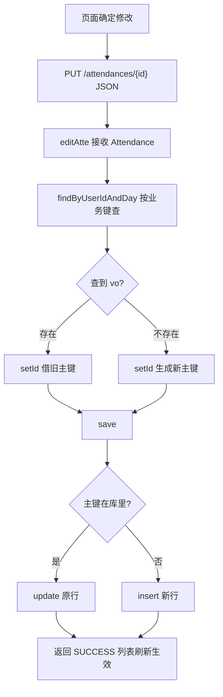

# 修改员工考勤记录：一个 PUT 接口接住新增与更新两种情况

列表能看了，但整屏旷工说明兜底逻辑必然产生误判：考勤月指向 8 月，表里却只有 7 月的导入数据，8 月每一天都被补成了旷工。人事需要一个修改入口，点开一条记录，把状态从旷工改成正常或迟到。这个编辑接口背后的核心问题只有一个：提交的这条记录，数据库里可能存在也可能不存在，一个接口要同时接住两种情况。

## 先给结论

- 编辑接口 `PUT /attendances/{id}`，`@RequestBody Attendance` 接收页面提交的整条考勤对象，含 `userId`、`day`、部门 id、状态值等字段。
- Service 的 `editAtte` 三步：按 `userId + day` 查记录；查到则借用旧主键，查不到则用 `IdWorker` 生成新主键；`save` 落库。
- 同一个 `save` 覆盖新增与更新：主键是库里的旧值就走更新，是新值就走插入。
- 页面上改完状态立即生效，因为列表每次请求都实时查库组装，没有缓存层要同步。

## 一、页面交互与请求长什么样

点击列表某条记录，弹出编辑窗，勾选正确状态（正常、迟到等）后确定。Network 面板里能看到这次提交：PUT 方式，路径 `/attendances/{id}`，请求体是 JSON，字段包括 `userId`、`day`、`deptId`、`attStatus` 等。

用 PUT 而不是 POST，是因为这条请求的语义是「把这条记录更新成我提交的样子」。幂等更新配 PUT 加路径标识，创建资源才交给 POST，语义清晰了，网关与前端代理的转发规则也好维护。

请求体里另一个值得留意的细节是字段完整性：编辑弹窗打开时，页面会先按这条记录回查一遍，把全部字段灌进表单，确定提交时整体回传，后端拿到的对象字段是全的。若前端只提交被修改的状态字段，后端又不做合并，其余字段就会以 null 落库，联调时要用请求体原文逐字段核对一遍再定接口约定。

## 二、Controller：接对象，转交 Service

```java
/**
 * 编辑用户的考勤记录
 * 请求: PUT /attendances/{id}  参数: 考勤对象 JSON
 */
@RequestMapping(value = "/{id}", method = RequestMethod.PUT)
public Result editAtte(@RequestBody Attendance attendance) throws Exception {
    atteService.editAtte(attendance);
    return new Result(ResultCode.SUCCESS);
}
```

`@RequestBody` 把 JSON 反序列化成 `Attendance` 实体，页面提交的字段名与实体属性一一对应。值得注意的是，路径里的 `{id}` 在方法里并没有被直接使用，真正定位记录靠请求体里的 `userId + day` 这对业务键，原因在下一节。

## 三、Service：先查、定主键、再 save

```java
// 编辑考勤: 存在则更新, 不存在则新增
public void editAtte(Attendance attendance) {
    // 1.查询该用户当天的考勤记录是否存在
    Attendance vo = attendanceDao.findByUserIdAndDay(attendance.getUserId(), attendance.getDay());
    if (vo == null) {
        // 2.不存在: 生成新主键, save 走新增
        attendance.setId(idWorker.nextId() + "");
    } else {
        // 存在: 借用旧主键, save 走更新
        attendance.setId(vo.getId());
    }
    // 3.保存
    attendanceDao.save(attendance);
}
```

为什么定位用 `userId + day` 而不是路径里的 id：页面提交的记录可能根本没入库，比如列表里补出来的那条旷工占位记录，它在数据库里不存在，自然没有 id 可言。「某个人某一天」才是考勤记录的业务唯一键，主键 id 只负责定位物理行。整条链路画出来：



## 四、save 为什么一箭双雕

JPA 的 `save` 行为由主键驱动：主键为 null 时按新实体 persist；主键有值时先按主键查询，存在则合并更新，不存在则插入。考勤实体是 `String` 主键，由 `IdWorker`（雪花算法）生成后手动赋值，永远不会是 null，所以「新增还是更新」的分支在进 `save` 之前就由业务查询定好了，`save` 只负责执行结果。

另一个不用操心的点是事务：`SimpleJpaRepository` 的读写方法自带 `@Transactional`，单条 `save` 不需要外层再包事务边界；只有一次编辑牵涉多张表的写入时，才需要显式声明事务。

## 常见误区

- **不查旧记录直接 save**：每次都生成新主键，一次「修改」变成一条新记录，列表越改越多，旧记录还原地躺着。
- **拿路径参数 `{id}` 去查库**：占位的旷工行没有 id，按 id 查永远查不到，更新分支永远走不进。定位必须用 `userId + day`。
- **只回传部分字段就整对象 save**：打卡时间、打卡地点这些字段若没随请求回传，合并后会被 null 覆盖。要么编辑弹窗回传全量字段，要么先查旧对象、只改状态字段再保存。
- **把新增与更新拆成两个接口**：「库里有没有这条记录」本来就是这次提交要回答的问题，前端并不知道答案，拆开只会把复杂度推给调用方。

## 面试可能被问到的问题

1. 面试官追问：「JPA 的 save 到底是新增还是更新？」
   答：由主键判定。主键为 null 按新实体 persist；有值时先按主键查询，存在则合并更新，不存在则插入。主键由应用层生成的场景（如雪花 id），存在性判断要自己做，save 只执行判定后的结果。

2. 面试官追问：「编辑接口为什么按 userId 加 day 查，不直接用路径里的 id？」
   答：业务唯一键是人加日期，页面提交的记录可能尚未入库、没有 id。先按业务键判存在性，再决定借旧主键还是造新主键，一个接口同时覆盖两种情况。

3. 面试官追问：「这个 PUT 真的幂等吗？」
   答：对已存在的记录，重复提交同样数据结果一致，符合 PUT 语义；对不存在的记录，第一次提交会新增一行，行为与后续不同。严格幂等要在 userId 加 day 上建唯一索引兜底，把并发下的重复插入挡在存储层。

4. 面试官追问：「怎么防止 A 企业的人改 B 企业的考勤？」
   答：企业字段不取请求体，一律从登录态取 companyId，更新时再带上它做归属校验；跨企业的 id 提交进来查不到对应行，自然失败。越权防护的要点是服务端不信任前端传来的归属字段。

5. 面试官追问：「修改之后列表为什么立刻生效，不用刷缓存？」
   答：列表接口每次都实时查库组装，没有缓存层，下一次请求自然拿到新值。引入缓存后，编辑接口就要承担失效或更新缓存的责任，这是后续性能优化时必须补上的一环。

## 配套资料

- 考勤 dao（`findByUserIdAndDay` 按视频写法补全）：`materials/code/02/day15 考勤模块开发/day15/工具代码/工具类/考勤模块/dao/AttendanceDao.java`
- 考勤实体（`@Table(name = "atte_attendance")`）：`materials/code/02/day15 考勤模块开发/day15/工具代码/实体类/atte/entity/Attendance.java`
- 考勤服务（资料包内为依赖注入骨架，`editAtte` 按本课视频实现补全）：`materials/code/02/day15 考勤模块开发/day15/工具代码/工具类/考勤模块/service/AtteService.java`
- 主键生成器：`materials/code/02/day15 考勤模块开发/day15/工具代码/工具类/utils/IdWorker.java`
