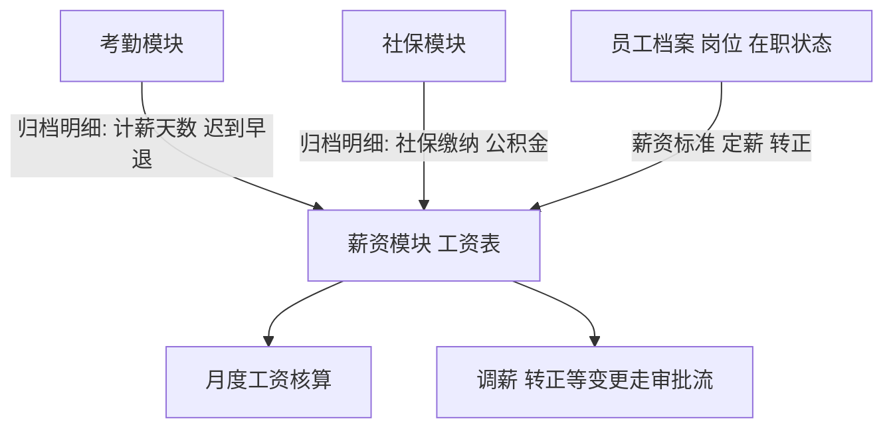

# 考勤收官之后做薪资：工资表从哪来，审批流往哪去

社保模块和考勤模块都已经跑通，人力资源管理系统还差最后一块主业务：薪资。业内常把社保、考勤、薪资称作人力资源系统的三大件，三者缺一不可，而且数据上是层层依赖的，考勤的归档明细和社保的缴纳数据，最终都要汇进工资里。这一课先补上考勤遗留的归档功能，再给薪资模块开个头，同时把后续审批类业务的实现思路（工作流）交代清楚。

看完这一课再动手，最大的收益是搞清楚数据从哪里汇过来：工资表不是一张手工维护的大宽表，它是员工薪资标准、考勤归档、社保缴纳三路数据的聚合结果。方向不明就急着写代码，很容易把薪资做成一座孤岛。

## 先给结论

- 本课四件事：补考勤遗留的报表与归档功能、搭建薪资模块并制作工资表数据、认识工作流、以请假为例制作第一条流程。
- 工资表的数据结构核心是 `UserSalary`：当前基本工资、岗位工资与定薪、转正工资成对出现，区分「现在拿多少」和「将来拿多少」。
- 薪资服务不自己存考勤和社保数据，通过 Feign 分别调用考勤服务的月度统计接口与社保服务的归档明细接口。
- 企业级的报表月份开关在 `CompanySettings` 一行配置里：`isSettings` 标记是否已设置，`dataMonth` 记录当前报表月份。
- 请假、调岗、调薪这类业务不是一个人点完的，要经过各级领导审批，这类多节点流转用工作流引擎承载，从请假流程做起。

## 一、三大件的数据关系：薪资是汇合点

把三个模块之间的依赖摆出来，薪资的位置一目了然：



三路输入各有节奏：员工档案给出「这个人按什么标准拿钱」，考勤归档给出「这个月实际出了多少天勤」，社保归档给出「这个月要扣多少五险一金」。工资表制作就是把三路数据按人拼到一起，所以薪资服务必须能跨服务取数，这决定了它的接口形态。

## 二、薪资模块的数据模型：工资表怎么存

薪资相关的实体先认三个。第一个是员工薪资表 `UserSalary`，对应 `sa_user_salary`，这是工资表的底座：

```java
@Entity
@Table(name = "sa_user_salary")
@Data
public class UserSalary implements Serializable {

    @Id
    private String userId;                      // 用户 id 即主键
    private BigDecimal currentBasicSalary;      // 当前基本工资
    private BigDecimal currentPostWage;         // 当前岗位工资
    private BigDecimal fixedBasicSalary;        // 定薪基本工资
    private BigDecimal fixedPostWage;           // 定薪岗位工资
    private BigDecimal correctionOfBasicWages;  // 转正基本工资
    private BigDecimal turnToPostWages;         // 转正岗位工资
}
```

注意「当前」与「定薪、转正」的成对设计：当前值是此刻生效的数字，定薪值是入职谈定的数字，转正值是转正后要切的数字。调薪和转正本质上是把后者覆盖到前者，历史变更另有 `UserSalaryChange` 记录，工资的来龙去脉才可追溯。

另外两张是企业级配置。`Settings` 对应 `sa_settings`，存津贴方案与计税方式，交通、通讯、午餐、住房四类补贴各有计算类型与金额；`CompanySettings` 对应 `sa_company_settings`，只有三个字段：企业 id 主键、`isSettings` 是否已设置、`dataMonth` 当前报表月份。最后这个字段是后面「制作新报表」功能的开关，本月做哪个月的工资，就由这一行配置决定。

## 三、跨服务取数：薪资服务的两条 Feign 线

薪资服务自己只有薪资标准，考勤和社保数据都要现取。取数的客户端在薪资服务里各声明一条：

```java
// 声明调用的微服务名称(服务名按业务语义重命名)
@FeignClient("social-security-service")
public interface SocialSecurityFeignClient {

    @RequestMapping(value = "/social_securitys/historys/archiveDetail/{userId}/{yearMonth}", method = RequestMethod.GET)
    Result getSocialInfo(@PathVariable("userId") String userId, @PathVariable("yearMonth") String yearMonth);
}
```

```java
@FeignClient("attendance-service")
public interface AttendanceFeignClient {
    // 查询某用户某月的考勤统计
    @RequestMapping(value = "/attendances/archive/{userId}/{yearMonth}", method = RequestMethod.GET)
    Result atteStatisMonthly(@PathVariable("userId") String userId, @PathVariable("yearMonth") String yearMonth);
}
```

两条线的形态完全一致：按用户 id 加年月，拿回该人该月的归档明细。接口设计成「按人按月」而不是「全公司一次打包」，是因为工资核算本来就是逐人逐月进行的，接口粒度与业务粒度对齐，服务端也好按月缓存。这正是前面课程反复强调的微服务边界：数据属于哪个服务，就由哪个服务的接口提供，跨服务只认契约不认表。

## 四、审批流预告：为什么请假需要工作流

系统里还有一类业务，特征完全不同：请假要组长批、经理批，调岗调薪要两级领导甚至人事会签，一个人没法在一次请求里完成整个业务，每个节点只负责自己那一步。把「流程定义、逐级流转、条件分支」这些共性抽出来交给流程引擎，业务代码就只需要关心每个节点做什么，这就是工作流。

本课对工作流只做概念铺垫，并以请假为例制作第一条流程：画出流程图，定义发起、审批、结束的节点与流转线。后面几天的审批类功能都会跑在这套流程之上，先把「流程是一等公民」这个观念立住，后面看代码才不会迷路。

## 常见误区

- **把工资表设计成一张手工维护的大宽表**：把考勤天数、社保扣款、工资标准全部塞进一张表手填，数据来源不可追溯，跨月重复劳动。正确做法是薪资标准落 `sa_user_salary`，考勤与社保按月通过接口现取，核算时聚合。
- **薪资服务直接连考勤、社保的数据库**：跨服务直连表，表结构一变全线崩。数据所有权属于各自服务，取数走 Feign 接口契约。
- **忽略 `dataMonth` 这个企业级开关**：不知道「当前做哪个月报表」由 `sa_company_settings` 一行配置控制，就无法理解新建报表、归档、工资制作之间的先后关系。
- **把工作流理解成前端页面的跳转顺序**：审批流的核心是流程定义与节点流转，前端页面只是每个节点的操作入口；把流转逻辑写死在页面里，加一个审批节点就要全系统改代码。

## 面试可能被问到的问题

1. 面试官追问：「微服务之间取数为什么用 Feign，而不是直接查对方的数据库？」
   答：微服务要求数据自治，每个服务独享存储，只通过接口暴露能力。Feign 把跨服务调用封装成接口方法，调用方只依赖契约；被调方内部表结构、存储引擎随便换，只要契约不变调用方无感。直连库则把两个服务焊死在一起，丧失独立演化和扩缩容的能力。

2. 面试官追问：「薪资模块的数据来自哪些地方，怎么聚合？」
   答：三路输入：员工薪资标准存在本服务 `sa_user_salary` 表；考勤侧按人按月调考勤服务的归档统计接口拿计薪天数与异常记录；社保侧按人按月调社保服务的归档明细接口拿缴纳数据。核算时按用户逐人聚合三路数据算出当月工资。

3. 面试官追问：「`UserSalary` 里为什么要区分当前工资和定薪、转正工资？」
   答：当前工资是此刻生效值，定薪与转正是预设值。调薪、转正的实质是把预设值覆盖到当前值，成对存储让变更有了明确的来源与去向，配合薪资变更记录表，任何一次调薪都可追溯。只用一个字段则变更历史无从还原。

4. 面试官追问：「像 `sa_company_settings` 这种一行配置控制全局的表，设计上要注意什么？」
   答：主键直接用企业 id，天然一行一企业，避免重复配置；读写要考虑并发下的幂等，更新语义是「设置成某值」而不是「叠加修改」；配置项加清晰注释与校验，`dataMonth` 这类月份值要限定格式，否则下游按月统计的 like 匹配会全盘落空。

5. 面试官追问：「什么业务适合上工作流引擎，什么不适合？」
   答：多节点、有审批人、有条件分支、需要留痕的业务适合，如请假、报销、调岗调薪；单次请求即可完成的 CRUD 不适合，硬套流程引擎反而增加部署与调试成本。判断标准是「业务过程是否需要多个人在不同时间点接力完成」。

## 配套资料

- 员工薪资实体 `UserSalary`（表 `sa_user_salary`，含当前与定薪、转正成对字段）：`materials/code/02/day16 薪资管理与工作流概述/day16/03-资料/03薪资代码/实体类domain/salarys/UserSalary.java`
- 企业薪资配置实体（`sa_company_settings` 的 `dataMonth` 即报表月份开关）：`materials/code/02/day16 薪资管理与工作流概述/day16/03-资料/03薪资代码/实体类domain/salarys/CompanySettings.java`
- 津贴与计税配置实体 `Settings`：`materials/code/02/day16 薪资管理与工作流概述/day16/03-资料/03薪资代码/实体类domain/salarys/Settings.java`
- 薪资服务的两条 Feign 客户端（文中服务名按业务语义重命名）：`materials/code/02/day16 薪资管理与工作流概述/day16/03-资料/03薪资代码/基本操作代码/feign/SocialSecurityFeignClient.java`、同目录 `AttendanceFeignClient.java`
- 薪资控制器（定薪、调薪接口真实存在）：`materials/code/02/day16 薪资管理与工作流概述/day16/03-资料/03薪资代码/基本操作代码/controller/SalaryController.java`
