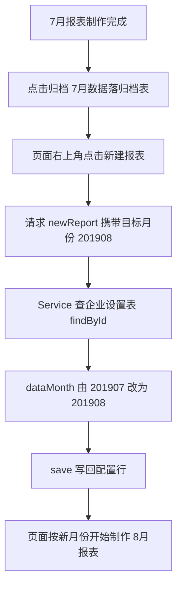

# 新建考勤报表：一张企业设置表管住当前统计月份

7 月考勤归档完成，归档表里已经有了定稿数据，新的问题紧跟着来：页面还停在 7 月报表上，8 月的考勤从哪里开始做？答案藏在页面右上角的「新建报表」按钮里，点一下确定，当前报表月份就从 201907 切到 201908，系统随即开始制作 8 月的报表。这个动作背后没有复制任何数据，只改了数据库里的一行配置。

动手之前先排掉一个挡路的 bug：月报表页查不出数据，员工 A1 明明有整月流水，报表上全是零。问题不在统计逻辑，而在 Controller 接参数的名字上。这也是本课的第一个知识点。

## 先给结论

- 报表无数据先查参数名：Spring MVC 按参数名绑定请求参数，前端传 `atteDate`，Controller 方法形参就必须叫 `atteDate`，名字对不上接收到的就是 `null`。
- 新建报表的本质是改配置不是搬数据：把企业设置表的 `dataMonth` 从 `201907` 改成 `201908`，页面按新月份重新制表。
- 企业设置表主键就是企业 id，`findById` 查出后 `setDataMonth` 再 `save`，JPA 的 `save` 兼具新增与更新。
- 与社保模块的「切换统计周期」完全同构，代码可整套平移。
- 薪资模块的报表切换同一套路，接口是 `PUT /salarys/reports/{yearMonth}/newReport`，工资表制作同样以这份月份配置为起点。

## 一、先修 bug：参数名对不上，报表永远是零

F12 里看页面发出的请求是 `/attendances/reports?atteDate=201907`，回到 Controller 对应的方法却把形参写成了别的名字。Spring MVC 绑定简单类型参数靠的是名字匹配，形参叫 `data`，请求里的 `atteDate` 就没有归宿，方法拿到的是 `null`，拿 `null` 去拼统计条件，结果自然是零。

修复只需让两边名字一致：

```java
/**
 * 获取月度考勤报表
 * 请求: GET /attendances/reports?atteDate=201907
 */
@RequestMapping(value = "/reports", method = RequestMethod.GET)
public Result reports(String atteDate) throws Exception {
    List<ArchiveMonthlyInfo> reports = atteService.getReports(atteDate, companyId);
    return new Result(ResultCode.SUCCESS, reports);
}
```

重启服务再刷新报表，A1 的数据出来了：正常 10 多次、迟到 1 次、早退 1 次。到考勤列表里改一条记录再回报表页看，数字同步变化，说明实时统计链路是通的。这个 bug 的通用教训是：**接口字段名是前后端契约，靠约定不靠编译器**，名字写错编译不报错，只在运行时表现为查无数据，排查时优先 diff 前端请求参数与方法形参。

## 二、归档与新建报表：月份开关的流转

归档封存当月，新建报表开启下月，两者之间的衔接靠一张企业设置表。考勤模块沿用与社保模块同一套结构：主键是企业 id，`dataMonth` 字段记录当前正在制作报表的月份。整条流转如下：



读图的关键在 F 这一步：**切换月份只改一行配置，报表数据本身按月现算**。`dataMonth` 是 `201907` 时，报表页的统计、导入、修改都作用在 7 月数据上；改成 `201908` 后，同样一套代码全部自动指向 8 月。月份是一个全局上下文，配置表是这个上下文的唯一事实来源，各功能都来读它，就不需要每处都传月份。

## 三、代码实现：Controller 与 Service

Controller 侧承接新建报表请求。页面发出的请求带当前月份与目标月份两个参数，服务端真正需要的只有目标月份：

```java
/**
 * 制作新报表: 将当前报表月份切换到指定月份
 * 请求: GET /attendances/archive/item/newReport?yearMonth=201908
 */
@RequestMapping(value = "/archive/item/newReport", method = RequestMethod.GET)
public Result newReport(String yearMonth) throws Exception {
    atteService.newReports(yearMonth, companyId);
    return new Result(ResultCode.SUCCESS);
}
```

Service 侧的实现直白：按企业 id 查出设置行，改月份，存回去。

```java
// 制作新报表: 将企业设置中的报表月份修改为指定值
public void newReports(String yearMonth, String companyId) {
    CompanySettings settings = companySettingsDao.findById(companyId).orElse(null);
    // 首次使用还没有配置行, 补建一条
    if (settings == null) {
        settings = new CompanySettings();
        settings.setCompanyId(companyId);
    }
    settings.setDataMonth(yearMonth);
    companySettingsDao.save(settings);
}
```

主键就是企业 id，`findById` 一次命中；配置行不存在时补建，避免首次使用直接空指针。`save` 的语义由实体是否有 id 决定：带着主键走 `merge` 更新，没有主键走 `persist` 新增，所以「查询后修改再保存」天然覆盖两种情况。切换完成后页面重新加载，报表标题已经变成 201908，8 月的考勤制作从头开始。

## 四、薪资侧的同构实现

社保模块当年做「切换统计周期」就是这套代码，薪资模块把「制作新报表」也做成了同样的接口。薪资服务里真实存在的实现：

```java
// 构造新报表
@RequestMapping(value = "/reports/{yearMonth}/newReport", method = RequestMethod.PUT)
public Result newReport(@PathVariable(value = "yearMonth") String yearMonth) {
    CompanySettings companySettings = new CompanySettings();
    companySettings.setCompanyId(companyId);
    companySettings.setDataMonth(yearMonth);
    companySettingsService.save(companySettings);
    return new Result(ResultCode.SUCCESS);
}
```

三个模块一个模式：**月份切换就是改 `dataMonth`，业务数据全部按月现算**。对薪资来说，这个月份开关的意义更重：新建报表之后，工资表制作以「当前报表月份」为准，去归档表取该月考勤明细、去社保归档取该月缴纳数据，再叠加 `sa_user_salary` 里的薪资标准，工资表的数据结构就这样组装出来。归档先行、报表切换在后、工资制作跟上，三个动作构成一条不可颠倒的流水线。

## 常见误区

- **报表查不出数据去调统计逻辑**：多数时候是参数名与前端请求不一致，先开 F12 对参数，再动代码。Spring MVC 按名字绑定，名字不一致不报错，只给你一个 `null`。
- **`Optional` 直接 `get()`**：`findById` 返回 `Optional`，配置行不存在时裸 `get()` 抛 `NoSuchElementException`。先 `isPresent()` 判断或 `orElse(null)` 兜底，再决定补建还是修改。
- **以为新建报表会复制或生成数据**：它只改一行配置。8 月报表的数据要等 8 月考勤导入后按月统计出来，指望点一下按钮就出现 8 月数据属于理解错位。
- **月份值格式放任自流**：`dataMonth` 必须是 `yyyyMM` 定长格式，下游按它做模糊匹配与切分。格式校验缺失时，`20198` 这种值会让统计条件静默失配。
- **重复点击新建报表到同一个月**：改配置是幂等操作，重复设置同一月份无副作用；真正的风险在于归档后误切回旧月份重新制作，造成口径混乱，切换动作应与归档状态联动校验。

## 面试可能被问到的问题

1. 面试官追问：「Spring MVC 绑定请求参数依据什么？」
   答：简单类型按参数名匹配，请求参数名与方法形参名一致即绑定，不一致得到 `null`，编译期不报错。对象类型按属性名逐级匹配，也可用 `@RequestParam` 显式指定名字。前后端字段名要当成契约维护，联调问题先对名字。

2. 面试官追问：「JPA 的 `save` 怎么区分新增和更新？」
   答：看实体的 id 是否有值。id 为空走 `persist` 新增；id 有值走 `merge`，先按 id 查库再合并属性。所以「查出对象、修改属性、再 save」是标准更新姿势；new 一个对象只填 id 就 save 也能更新，但未赋值字段会被置空，风险要清楚。

3. 面试官追问：「用一行配置表控制当前业务月份，好处和风险各是什么？」
   答：好处是全局上下文只有一份事实来源，各功能读同一配置，切换月份零成本；风险是它是单点，配置错了全企业口径跟着错。所以要配格式校验、变更留痕，并把切换动作与归档状态联动，防止已归档月份被重新制作。

4. 面试官追问：「这个新建报表接口是幂等的吗？」
   答：是。它的语义是「把企业报表月份设置为某值」，重复调用结果不变，天然幂等。真正需要防的是回退操作，比如切回已归档月份，那属于状态机问题，要在业务层校验当前归档进度而不是依赖幂等。

5. 面试官追问：「工资表制作的数据从哪里来？」
   答：三路聚合：以 `dataMonth` 指定的报表月份为准，从考勤服务的归档明细取计薪天数与异常记录，从社保服务的归档明细取五险一金缴纳数据，再加上本服务 `sa_user_salary` 的薪资标准，按人按月组装成工资表结构。任何一路缺失都应显式告警，不能默认为零。

## 配套资料

- 薪资模块的企业设置控制器（`newReport` 接口真实存在）：`materials/code/02/day16 薪资管理与工作流概述/day16/03-资料/03薪资代码/基本操作代码/controller/CompanySettingsController.java`
- 企业薪资配置实体 `CompanySettings`（`isSettings` 与 `dataMonth`）：`materials/code/02/day16 薪资管理与工作流概述/day16/03-资料/03薪资代码/实体类domain/salarys/CompanySettings.java`
- 设置表 service 与 dao（`findById`、`save` 真实存在）：`materials/code/02/day16 薪资管理与工作流概述/day16/03-资料/03薪资代码/基本操作代码/service/CompanySettingsService.java`、同目录 `dao/CompanySettingsDao.java`
- 社保版「切换统计周期」对照实现：`materials/code/02/day14 微服务网关与社保模块开发/day14/03-资料/社保模块相关资料/ihrm_social_securitys/src/main/java/com/ihrm/social/controller/SocialSecurityController.java`
- 考勤侧实体与 dao 结构同社保（`ss_company_settings` 对照）：`materials/code/02/day15 考勤模块开发/day15/工具代码/实体类/social_security/CompanySettings.java`；考勤服务与月报表 Controller 按本课视频实现补全
