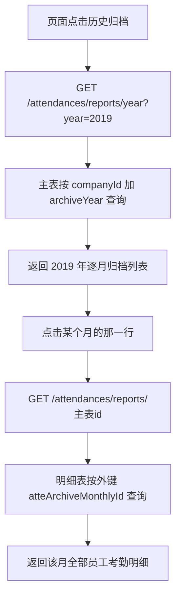

# 考勤归档查询：按年份列归档表，按主表 id 取月度明细

归档动作上一课已经完成：点一下归档按钮，主表一行、明细一人一行，落进 `atte_archive_monthly` 和 `atte_archive_monthly_info` 两张表。数据存进去只是前半件事，查询侧的口子也得到位，否则归档就是一次性写入的死数据。页面左侧的「历史归档」入口就是这个口子：点进去先看到某一年逐月的归档列表，点开某个月，再看这个月每个员工的考勤明细。

接口本身不复杂，两张表各一个查询，但有两个绑定层面的细节容易翻车：派生查询的实参顺序，以及路径参数的注解。课上演示就在第二点上现场卡了一次。

## 先给结论

- 归档列表查主表：`GET /attendances/reports/year?year=2019`，查询条件是「企业 id + 归档年份」，dao 方法 `findByCompanyIdAndArchiveYear` 用派生查询直接声明即可。
- 归档详情查从表：`GET /attendances/reports/{id}`，路径里的 id 是主表 id，从表按外键 `atteArchiveMonthlyId` 检索。
- 主从数据的纽带是归档时回填的外键，这一课的明细查询只是在兑现它。
- 路径参数 `{id}` 必须配 `@PathVariable`，漏掉注解参数绑定不到值，页面表现是「暂无数据」。
- 两个接口的返回都包统一响应体 `Result`，列表接口返回 `List`，详情接口返回 `List` 也成立，因为一次归档包含多名员工。

## 一、页面交互：一年一列表，一月一明细

打开 F12 再操作页面，请求路径一目了然。进入历史归档页面，前端带一个 `year` 参数请求列表；点击列表里的某个月，再用那一行的主表 id 请求明细。两级查询的关系如下：



关键在第二步到第三步的衔接：列表行里能拿到的只有主表 id，明细查询的所有依据都必须从它派生，这正是主从结构查询的标准姿势，从表永远通过主表的主键或从表里冗余的外键进入。

## 二、归档列表：企业 id 加年份查主表

Controller 里补两个方法中的第一个。请求方式 GET，参数只要一个 `year`，企业 id 不由前端传，统一从登录信息里取：

```java
// 查询年度归档列表
@RequestMapping(value = "/reports/year", method = RequestMethod.GET)
public Result findReports(String year) throws Exception {
    // companyId 已在 BaseController 中从登录信息解析
    List<ArchiveMonthly> list = archiveService.findReportsByYear(year, companyId);
    return new Result(ResultCode.SUCCESS, list);
}
```

Service 层是一层透传，真正干活的是 dao 里现成的派生查询：

```java
// 根据年份查询当年的所有考勤历史
public List<ArchiveMonthly> findReportsByYear(String year, String companyId) {
    return atteArchiveMonthlyDao.findByCompanyIdAndArchiveYear(companyId, year);
}
```

```java
public interface ArchiveMonthlyDao extends JpaRepository<ArchiveMonthly, String>,
        JpaSpecificationExecutor<ArchiveMonthly> {

    /**
     * 查询某一年的归档列表
     */
    List<ArchiveMonthly> findByCompanyIdAndArchiveYear(String companyId, String archiveYear);
}
```

派生查询的老规矩：`And` 连接的两段属性名 `companyId`、`archiveYear` 必须与实体字段严格一致，Spring Data JPA 靠解析方法名生成 `where` 条件。还有一个容易忽视的点：**实参顺序必须与方法名里的属性顺序一致。** 方法名先 `companyId` 后 `archiveYear`，调用处就先传企业 id 再传年份，写反了不会报错，但查询条件整体错位，拿年份去匹配企业 id，结果永远是空列表，这类 bug 极难从堆栈里看出来。

## 三、归档详情：主表 id 是从表的查询钥匙

列表有了，点开某个月要看明细。这次传的是主表 id，返回的是从表 `ArchiveMonthlyInfo` 的集合：

```java
// 查询月考勤明细
@RequestMapping(value = "/reports/{id}", method = RequestMethod.GET)
public Result findReportsById(@PathVariable String id) throws Exception {
    List<ArchiveMonthlyInfo> list = archiveService.findMonthlyInfoByAid(id);
    return new Result(ResultCode.SUCCESS, list);
}
```

```java
// 查询归档详情列表
public List<ArchiveMonthlyInfo> findMonthlyInfoByAid(String id) {
    return archiveMonthlyInfoDao.findByAtteArchiveMonthlyId(id);
}
```

```java
public interface ArchiveMonthlyInfoDao extends JpaRepository<ArchiveMonthlyInfo, String>,
        JpaSpecificationExecutor<ArchiveMonthlyInfo> {

    /**
     * 根据归档主表 id 查询月归档明细
     */
    List<ArchiveMonthlyInfo> findByAtteArchiveMonthlyId(String atteArchiveMonthlyId);
}
```

这个查询能成立，靠的是上一课归档时写下的那行 `info.setAtteArchiveMonthlyId(archiveMonthly.getId())`。当时它是落库前必须回填的外键，现在它成了查询条件，主从两表靠这一个字段对上账。归档明细里冗余了姓名、工号、部门、手机号这些员工属性，为的就是明细查询一次出全所有展示字段，不用回头再连员工表。

## 四、现场翻车：路径参数漏了 @PathVariable

课上演示时列表一次就通了，点详情却一直「暂无数据」。回头检查代码，问题出在 `{id}` 上：它是地址里的路径模板变量，不是跟在问号后面的请求参数，取值必须声明 `@PathVariable`。漏掉注解之后，Spring MVC 会退回去按请求参数找 `id`，GET 请求上没有这个参数，方法形参拿到 null，拿 null 去查从表自然什么都查不出来，还不报错。补上注解重启服务，A01 的 11 天正常、一次迟到、一次早退立刻渲染出来。

两类参数的边界值得记牢：`@PathVariable` 绑定路径模板里的占位符，`@RequestParam` 绑定查询串上的键值对。URL 长得像 `/reports/123?year=2019` 时，`123` 走前者，`2019` 走后者，混用注解不会立刻报错，只会让某些参数静默为 null。

## 常见误区

- **派生查询实参顺序写反**：方法名是 `findByCompanyIdAndArchiveYear`，调用时却把 year 放在第一个参数，条件错位后查询恒为空。参数顺序跟属性名顺序走，别按习惯排。
- **`{id}` 忘加 `@PathVariable`**：详情接口不报错但永远查不到数据，页面上只显示「暂无数据」，排查时先看形参有没有绑定注解。
- **明细误按 userId 查**：一个员工十二个月有十二行明细，按用户 id 查会跨月混出全部历史。要按月看就得以主表 id 为条件，从表外键才定位「哪一个月」。
- **列表返回值写成单个实体**：归档列表一个月一行，返回类型必须是 `List<ArchiveMonthly>`，声明成实体类会直接类型不匹配。

## 面试可能被问到的问题

1. 面试官追问：「Spring Data JPA 的派生查询是怎么工作的？」
   答：框架解析方法名，按 `findBy`、`And`、`Or`、`OrderBy` 等关键字切分出属性名与操作符，再结合实体元模型生成 JPQL 与 SQL。属性名必须与实体字段一致，否则启动阶段就抛出 `PropertyReferenceException`，这也是它能在编译期外尽早暴露错误的原因。

2. 面试官追问：「`@PathVariable` 和 `@RequestParam` 有什么区别？」
   答：前者绑定 URL 路径模板中的占位符，如 `/reports/{id}` 里的 id，适合定位资源；后者绑定查询串或表单参数，如 `?year=2019`，适合传筛选条件。注解用错位置时参数会绑定失败并表现为 null，不会直接报错。

3. 面试官追问：「归档明细表为什么冗余员工姓名、部门这些字段？」
   答：归档的本意是定格历史快照，员工后续改名、调部门不应影响已归档的月报口径，所以归档时刻把展示字段一次性抄进明细表。冗余换来了查询不连表和历史口径稳定，代价是更新员工信息时要接受旧归档不变。

4. 面试官追问：「这类归档查询接口为什么要带企业 id 条件？」
   答：SaaS 多租户架构下同一张归档表存着所有企业的数据，查询不带企业 id 就会跨租户泄露数据。企业 id 在后端从登录态解析而不是接收前端传参，防止越权篡改。

## 配套资料

- 归档主表 dao（`findByCompanyIdAndArchiveYear` 真实存在）：`materials/code/02/day15 考勤模块开发/day15/工具代码/工具类/考勤模块/dao/ArchiveMonthlyDao.java`
- 归档明细 dao（`findByAtteArchiveMonthlyId` 真实存在）：`materials/code/02/day15 考勤模块开发/day15/工具代码/工具类/考勤模块/dao/ArchiveMonthlyInfoDao.java`
- 归档主表实体 `ArchiveMonthly`（含 `archiveYear`、`archiveMonth` 字段）：`materials/code/02/day15 考勤模块开发/day15/工具代码/工具类/考勤模块/domain/entity/ArchiveMonthly.java`
- 归档明细实体 `ArchiveMonthlyInfo`（外键字段与冗余员工属性都在此）：`materials/code/02/day15 考勤模块开发/day15/工具代码/工具类/考勤模块/domain/entity/ArchiveMonthlyInfo.java`
- 归档服务骨架（资料包内为依赖注入骨架，查询方法按本课视频实现补全）：`materials/code/02/day15 考勤模块开发/day15/工具代码/工具类/考勤模块/service/ArchiveService.java`
