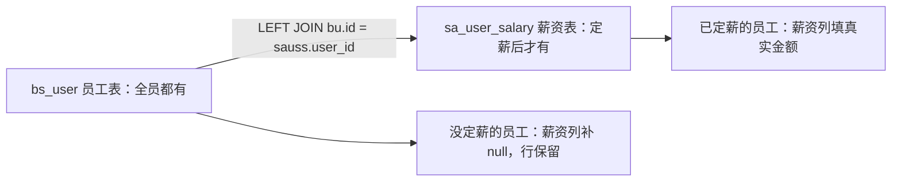
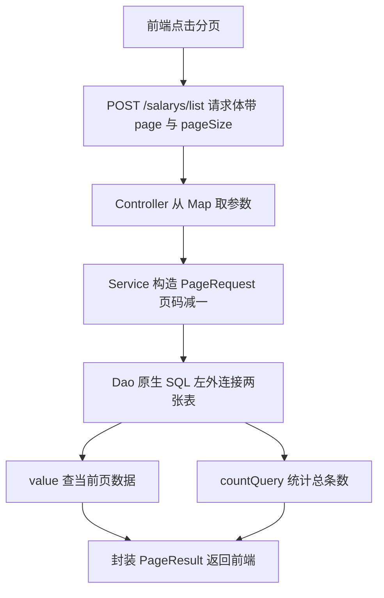

# 薪资分页列表：一条原生 SQL 兜住全员，没定薪的员工也不丢

打开薪资管理页面，列表每一行同时挂了两类信息：左边是员工档案，右边是薪资数字。麻烦的地方在于，刚入职还没定薪的员工在薪资表里根本没有行，查出来要么这人整行消失，要么报空指针。再加上分页，点击第 2 页要准确跳过前一页的十条，总数还得算对，这一整条链路怎么搭，就是这课要拆的内容。

## 先给结论

- 列表接口是 `POST /salarys/list`，参数用 `@RequestBody Map` 接收，从里面取出 `page` 与 `pageSize` 两个分页参数。
- 真正的分页动作发生在 Dao 层一条原生 SQL 上：`@Query(nativeQuery = true)` 提供数据查询，`countQuery` 提供总记录数查询，两者缺一不可。
- 方法形参里的 `PageRequest` 是分页开关，Spring Data JPA 看到它才会对原生 SQL 追加 limit 与 offset。
- 查询用员工表左外连接薪资表，员工必有、薪资未必有，换成内连接会把没定薪的员工整行丢掉。
- 返回值直接用 `Page<Map>`，不新建 VO 实体：一行数据就是一个 Map，key 是 SQL 里的列别名，value 是字段值。

## 一、请求入口：POST 加请求体接分页参数

页面刷新时打开浏览器开发者工具，能看到列表请求的载荷就是 `{page: 1, pageSize: 10}`。因为筛选条件（聘用形式、员工状态、部门）以后会越来越多，参数放在请求体里比拼在 URL 上干净，所以接口用 POST 接收：

```java
//查询列表
@RequestMapping(value = "/list", method = RequestMethod.POST)
public Result list(@RequestBody Map map) {
    //1.获取请求参数,page,size
    Integer page = (Integer) map.get("page");
    Integer pageSize = (Integer) map.get("pageSize");
    //2.调用service查询
    PageResult pr = salaryService.findAll(page, pageSize, companyId);
    return new Result(ResultCode.SUCCESS, pr);
}
```

这里没有为两个参数专门定义实体类，直接用一个 Map 接了。参数少、结构简单时这是可接受的偷懒；`companyId` 不用前端传，它来自父类 `BaseController` 里解析过的企业信息。

## 二、Service：把页码翻译成 PageRequest

Service 层做的事情只有一件，把「第几页、每页几条」翻译成 Spring Data 能认识的分页对象：

```java
//分页查询当月薪资列表
public PageResult findAll(Integer page, Integer pageSize, String companyId) {
    Page page1 = userSalaryDao.findPage(companyId, new PageRequest(page - 1, pageSize));
    return new PageResult(page1.getTotalElements(), page1.getContent());
}
```

`PageRequest` 的页码从 0 开始计数，前端习惯从 1 开始，所以构造时要做 `page - 1`。漏掉这个减法不会报错，但用户点第 1 页看到的其实是第 2 页数据，这种 bug 很隐蔽。返回时从 `Page` 对象里取出总条数和当前页内容，装进统一的 `PageResult` 给前端。

## 三、Dao：原生 SQL 分页的三要素

核心查询落在 `UserSalaryDao` 里，这是整个模块唯一带内容的 Dao 方法：

```java
@Query(nativeQuery = true,
        value = "select bu.id,bu.username,bu.mobile,bu.work_number workNumber," +
                "bu.in_service_status inServiceStatus,bu.department_name departmentName," +
                "bu.department_id departmentId,bu.time_of_entry timeOfEntry ," +
                "bu.form_of_employment formOfEmployment ," +
                "sauss.current_basic_salary currentBasicSalary,sauss.current_post_wage currentPostWage " +
                "from bs_user bu LEFT JOIN sa_user_salary sauss ON bu.id=sauss.user_id " +
                "WHERE bu.company_id = ?1",
        countQuery = "select count(*) from bs_user bu LEFT JOIN sa_user_salary sauss " +
                "ON bu.id=sauss.user_id WHERE bu.company_id = ?1"
)
Page<Map> findPage(String companyId, PageRequest pageRequest);
```

这条语句要凑齐三个要素才能正确分页：

**第一，`nativeQuery = true`。** 它声明 value 里写的是数据库方言的本地 SQL，而不是 JPQL。表名 `bs_user`、`sa_user_salary` 才能直接出现。

**第二，`countQuery`。** `Page` 对象要提供总条数才能算出总页数，框架分两步走：执行 value 拿当前页数据，执行 countQuery 拿总记录数。原生 SQL 带 join 和别名时，框架自动推导 count 语句经常翻车，显式写一份最稳。

**第三，形参里的 `PageRequest`。** Spring Data JPA 靠这个参数识别「这是一次分页查询」，自动把 limit 和 offset 追加到 SQL 尾部。不传它，`@Query` 就只是普通查询，返回值换成 `Page` 也分不了页。

## 四、为什么是左外连接

这条 SQL 查的是员工表和薪资表的联合结果。一个员工入职时一定写在用户表 `bs_user` 里，但薪资表 `sa_user_salary` 里未必有他的行，因为定薪是入职之后的人事动作。两边的关系画出来是这样的：



用左外连接，左表全员保留，右表没匹配上的字段补 null，页面上这行员工的工资列显示为空，正好提示管理员去给他定薪。如果改成内连接，这批人就整行消失，列表看起来像「员工丢了」，而实际上只是没定薪。

顺带一提，SELECT 里每个字段都取了驼峰别名，例如 `work_number workNumber`、`current_basic_salary currentBasicSalary`。这些别名不是美化，它们直接决定下一步 Map 里的 key 叫什么。

## 五、返回 Page<Map>：为什么不建实体类

按常规思路，联合查询的结果应该构造一个新实体类来装。这里刻意没有这么做：JPA 的规矩是一个实体类对应一个 Dao 接口，新造一个「员工薪资列表」实体，就得再写一个配套的 Dao，为一个列表页面引入一套类，成本不划算。直接声明 `Page<Map>`，查询引擎会把每一行数据按「列别名 = 值」装进 Map。也就是说一行数据代表一个 Map 集合，key 是 `userId`、`currentBasicSalary` 这些别名，value 就是对应的金额与档案字段。

这个写法在前一课做社保列表时用过一次，两处逻辑基本一致，属于「跨表列表页」的通用套路。

完整的请求链路串起来是这样：



关键路径在 E 这一步分叉：同一条连接条件跑两遍，一遍取数据、一遍取总数，最后在 `PageResult` 汇合。理解了这一点，分页总数不对之类的排查就有了方向。

## 常见误区

- **漏写 `countQuery`**：主查询能跑，但 `getTotalElements` 抛异常或总数为 0。原生 SQL 带 join 时框架推导 count 语句不可靠，显式补一份 `select count(*)` 加同样连接条件的查询。
- **页码忘减一**：`PageRequest` 页码从 0 开始，直接把前端的 1 传进去，每页都往后错一条数据。
- **把内连接当默认写法**：join 不写 `LEFT` 就是内连接，没定薪的员工会从列表里消失，看起来像数据丢了。
- **按实体属性名取 Map 的值**：Map 的 key 是 SQL 列别名而不是 Java 属性名，别名写成 `workNumber` 就用 `map.get("workNumber")` 取，写成 `work_number` 拿到的是 null。

## 面试可能被问到的问题

1. 面试官追问：「Spring Data JPA 里原生 SQL 怎么实现分页？」
   答：在 Dao 方法上加 `@Query(nativeQuery = true)` 写本地 SQL，方法形参追加一个 `Pageable` 参数（常用实现是 `PageRequest.of`），返回值声明为 `Page`。框架识别到 Pageable 后自动给 SQL 追加 limit 与 offset，并执行 countQuery 汇总总条数。
   
2. 面试官追问：「`countQuery` 不写会怎样？」
   答：简单单表查询框架通常能自动推导 count 语句，但原生 SQL 一旦带 join、别名或复杂子查询，推导经常失败或结果错误，分页总数就拿不到。生产代码建议显式声明 countQuery，与主查询保持相同的连接和过滤条件。
   
3. 面试官追问：「这里为什么返回 `Page<Map>` 而不是自定义 VO？」
   答：联合查询的结构不属于任何现有实体，新建 VO 实体按 JPA 的约定要配套再写一个 Dao 接口，为单个列表页面引入一套类成本过高。Map 方案一行数据就是一个键值对集合，key 取 SQL 别名，牺牲一点类型安全换来零样板代码。
   
4. 面试官追问：「这条 SQL 为什么要用左外连接？」
   答：业务上员工一定存在，薪资不一定已定。左外连接以员工表为基准保留全员，没定薪的员工薪资列为 null；内连接会把这批人过滤掉，页面出现「员工丢失」的假象。
   
5. 面试官追问：「前端传的页码和 PageRequest 的页码有什么区别？」
   答：前端从 1 开始，`PageRequest` 从 0 开始，Service 层构造时要执行 `page - 1`。这个换算漏了不报错，但数据整体错位一页，属于典型的静默 bug。

## 配套资料

- 代码：`materials/code/02/day16 薪资管理与工作流概述/day16/03-资料/03薪资代码/基本操作代码/dao/UserSalaryDao.java`（分页原生 SQL 原件）
- 代码：`materials/code/02/day16 薪资管理与工作流概述/day16/03-资料/03薪资代码/基本操作代码/controller/SalaryController.java` 与 `service/SalaryService.java`
- 代码：`materials/code/02/day16 薪资管理与工作流概述/day16/03-资料/03薪资代码/实体类domain/salarys/UserSalary.java`（薪资表对应实体，文中包名已统一改为 `com.example`）
