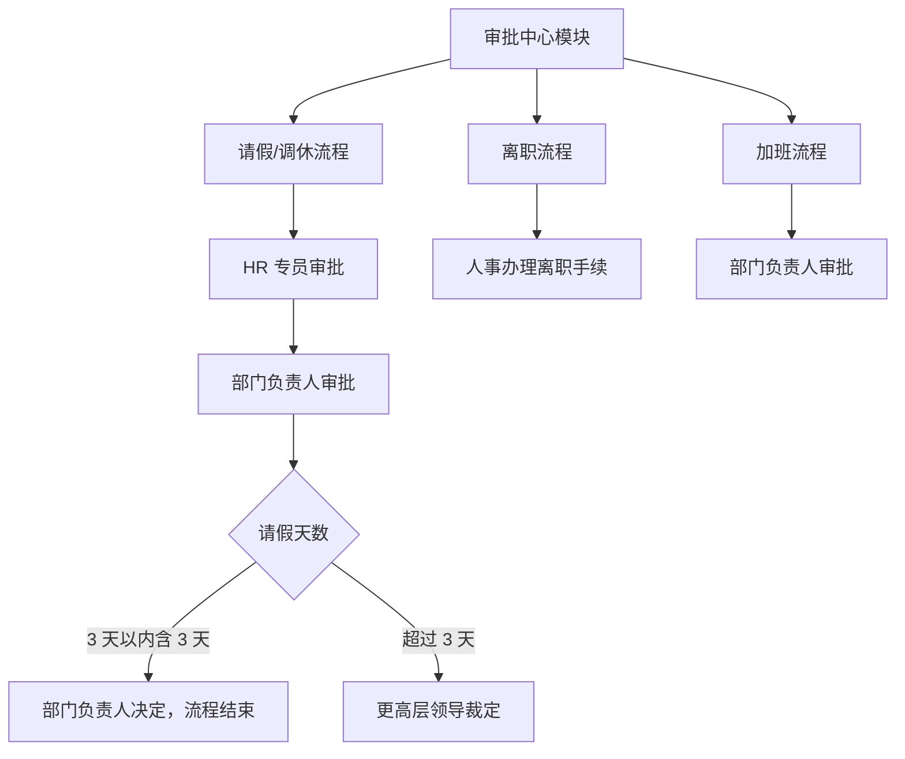

# 审批中心的两块基石：Activiti 引擎与它管的三大审批流程

工作流的概念清楚了，落地前还有两个决定要做：引擎选谁，哪些业务交给它管。这一课给出答案：引擎用 Activiti；系统里独立出一个审批中心模块，请假调休、离职、加班的审批全部走它。同时把请假流程的审批规则先立起来，后面画流程图、写代码都以此为准。

## 先给结论

- Activiti 是开源工作流引擎，实现了 BPMN 2.0 规范，基于 Java，稳定快速、轻量、可嵌入、可扩展。
- 对开发者记两点就够：它是按 BPMN 2.0 规范实现的流程引擎；内部提供大量 API，对象打点调方法就能拿到流程数据。
- 系统中设有独立的审批中心模块，请假/调休、离职、加班等业务流程大量应用工作流完成处理。
- 请假审批规则：先由 HR 专员审批，通过后交部门负责人审批；3 天以内（含 3 天）部门负责人有最终决定权，超过 3 天交更高层领导裁定。
- 工程上审批是独立微服务，引擎自建的表放在独立的 act 库，与业务库通过双数据源分离。

## 一、Activiti：两句话记住它

官方介绍翻译成人话：每一项 BPM 功能的 Activiti 流程引擎，都以服务的形式提供给开发人员；引擎重点关注系统开发的应用性与轻量性。落到开发体验上就是两点：

**第一，它是按 BPMN 2.0 规范实现的流程引擎。** BPMN 2.0 是业务流程建模的标准，流程怎么画、节点是什么含义、图怎么被引擎执行，规范都定义好了。遵守规范意味着模型通用、行为稳定，Activiti 本身就是一个稳定、快速的流程引擎，基于 Java 开发，可以嵌入到现有系统里做可扩展的流程开发。

**第二，它内部提供大量 API 接口。** 想拿工作流相关的数据，不需要去碰引擎的数据库，拿到 Service 对象打点调方法即可：发起流程、查询任务、办理任务都有对应方法，使用成本很低。

## 二、审批中心：一个模块装下所有审批

业务流程或审批是人力资源管理系统、办公系统的重要组成部分。为了把日常业务规范化处理，系统里设了一个独立的审批模块，大量应用工作流完成处理。它覆盖的流程至少有这几类：



图里最值得注意的是请假分支：天数是唯一的分流条件，这个条件之后会被建模成 BPMN 里的排他网关。离职与加班流程这一课只划范围，用到时再展开细节。

## 三、请假流程的审批规则

系统里定义的请假流程分两级加一个分支：

**第一级，HR 专员审批。** 开发部的员工提交请假申请，第一步进入公司的 HR 审批；专员可能不止一位，任一位都可以处理这张单子。

**第二级，部门负责人审批。** HR 审批通过之后，交给请假员工所在部门的负责人。

**分支，天数决定要不要向上走。** 有的公司规定 3 天以内（含 3 天），部门负责人就有权决定批不批，审批结束流程随之结束；超过 3 天，需要更高层的领导裁定能不能批。

这套规则现在还只是文字描述。下一课会把它变成流程图，再变成可部署的 BPMN 模型，规则里的每一个角色、每一个分支都要能对到图上的一个元素。

## 四、工程落地：独立微服务与双数据源

审批中心在工程上是独立的服务。课程资料里审批代码的依赖与配置能看出结构，先看引擎依赖（pom 片段）：

```xml
<dependency>
    <groupId>org.activiti</groupId>
    <artifactId>activiti-spring-boot-starter</artifactId>
    <version>7.0.0.Beta3</version>
</dependency>
```

配置文件里信息量最大的是双数据源与历史配置（服务名与库名已做中性化改写）：

```yaml
spring:
  application:
    name: audit-service
  datasource:
    act:
      jdbc-url: jdbc:mysql://localhost:3306/act?useUnicode=true&characterEncoding=utf8
      username: root
      password: 111111
      driver-class-name: com.mysql.jdbc.Driver
    hrm:
      jdbc-url: jdbc:mysql://localhost:3306/hrm?useUnicode=true&characterEncoding=utf8
      username: root
      password: 111111
      driver-class-name: com.mysql.jdbc.Driver
  activiti:
    history-level: full
    db-history-used: true
```

三个点值得停一下：

**双数据源。** act 库放引擎自建的数据表，部署信息、运行中的任务、历史归档都在里面；hrm 库放业务表，比如请假单的申请数据。引擎的表和业务的表分开管理，互不牵连。

**`history-level: full`。** 历史记录级别取 full，任务级的明细都会归档，后面「已办列表」「历史查询」全靠这批表。

**`db-history-used: true`。** 显式打开历史功能，不开的话历史表基本是空的，审批中心的已办与轨迹页面无从谈起。

## 常见误区

- **把引擎的表和业务表建在同一个库。** 能跑，但两边的清理、升级、备份互相牵连；课程的做法是 act 独立库加独立数据源，业务表不与引擎表混建。
- **不配 history-level 就去做审批中心。** 默认级别下历史明细不全，「已办」列表查不出自己处理过的任务，做到历史查询才发现是配置问题，返工成本高。
- **把 BPMN 2.0 当成 Activiti 私有格式。** 它是公开的建模标准，Activiti 只是实现了这个规范；流程模型文件本身可以被其他支持规范的工具读取。

## 面试可能被问到的问题

1. 面试官追问：「Activiti 是什么，有什么特点？」
   答：开源工作流引擎，实现了 BPMN 2.0 规范，基于 Java。特点是稳定快速、轻量、可嵌入、可扩展，引擎以服务的形式把流程能力提供给开发人员，通过一组 Service 接口就能操作流程数据。

2. 面试官追问：「BPMN 2.0 和 Activiti 是什么关系？」
   答：BPMN 2.0 是业务流程建模与执行的公开标准，定义了流程图的元素与语义；Activiti 是实现了该规范的流程引擎，开发时画出的 BPMN 模型交给它部署和执行，模型不绑定引擎私有格式。

3. 面试官追问：「审批中心为什么设计成独立模块？」
   答：请假、调休、离职、加班都是审批类业务，流程逻辑高度相似，集中在一个模块里统一用工作流引擎处理，避免每个业务各写一套审批代码；独立之后也方便按流程维度扩展新的审批类型。

4. 面试官追问：「引擎的表和业务表分开存储，查询时怎么关联？」
   答：发起流程时把业务主键等字段作为流程变量传入引擎，查出任务后再回业务库取展示数据；两边靠业务标识关联，而不是物理上放在一张表里。

5. 面试官追问：「history-level 配置成 full 有什么影响？」
   答：full 会把任务级的明细完整归档到历史表，已办查询、流程轨迹展示都依赖它；代价是历史表写入量更大、存储占用更高，数据量大时需要定期归档清理。

## 配套资料

- 代码：`materials/code/02/day16 薪资管理与工作流概述/day16/03-资料/04审批代码/application.yml`（双数据源与 Activiti 历史配置原件，文中服务名与库名已中性化）
- 代码：`materials/code/02/day16 薪资管理与工作流概述/day16/03-资料/04审批代码/pom.xml`（activiti-spring-boot-starter 依赖原件）
- 代码：`materials/code/02/Activiti7-day07-审批中心模块开发/Activiti7-day07-审批中心模块开发/代码/activiti07/src/main/java/`（审批中心成例：ActivitiService、ProcessController）
