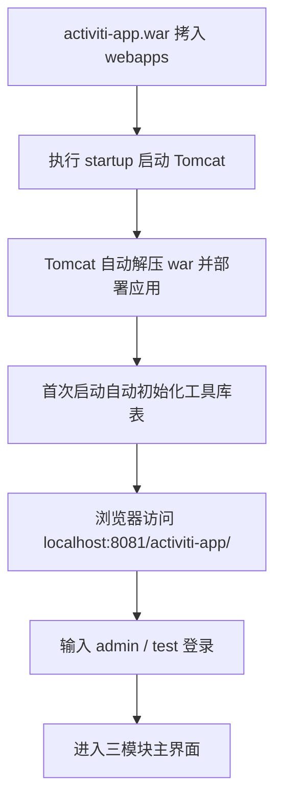

# 不装 IDE 插件也能画流程图：把 activiti-app 部署进 Tomcat 当网页设计器用

要在 Activiti 里跑流程，第一步总得先把流程图画出来。图怎么画？手写 BPMN 的 XML 太硬核，IDE 插件又只有开发人员用得上。Activiti 官方其实还备了一条路：一个叫 activiti-app 的 Web 设计器，本质是一个 war 包，丢进 Tomcat 启动就能在浏览器里拖节点画流程。这一课就是把这套工具装起来、登进去。

## 先给结论

- 流程图最终就是一个 BPMN 2.0 的 XML 文件，谁生成这个文件都行：手写 XML、IDEA 插件、Java 代码生成，或者 Activiti 官方的 Web 工具 activiti-app。
- activiti-app 是个 war 包，拷进任意 Tomcat 的 `webapps` 目录，启动 Tomcat 就完成部署，不需要额外配置。
- 首次启动时它会自动建自己要用的表（日志里能看到 `ACT_F_DATABASECHANGELOG` 这类建表动作），无需手工初始化。
- 访问地址是 `http://localhost:8081/activiti-app/`（端口按 Tomcat 实际配置），默认账号 `admin`，密码 `test`。
- 登录后有三块：Kickstart App（流程制作）、Task App（任务管理与流程测试）、Identity management（用户与用户组），画流程主要用第一块。

## 一、四种流程制作方式，为什么挑 Web 工具

Activiti 官方支持多种流程制作方式，摆在一起对比一下：

| 方式 | 适合谁 | 特点 |
|---|---|---|
| 手写 XML | 熟悉 BPMN 语法的人 | 流程图本质是 XML，懂语法可以徒手写 |
| IDE 的 BPMN 插件 | 开发人员 | 如 IDEA 的 BPMN 插件，专业，其他课程常用 |
| Java 代码生成 XML | 开发人员 | 用代码拼出流程定义，适合批量生成 |
| activiti-app Web 工具 | 所有人 | 浏览器里拖拽画图，非开发角色也能参与 |

前三种都偏专业，面向开发人员。企业里的 Web 项目还有一个现实诉求：流程绘制这件事未必总由程序员做，业务人员或产品也常常要参与调整审批链路。activiti-app 把画图这件事搬进浏览器，谁都能上手，这就是选它当教学工具的原因。画完之后它能导出标准的 BPMN XML，后续部署到引擎用的正是这份文件。

## 二、部署：一个 war 包搞定

安装分下载和部署两步。activiti-app 的安装包可以从 Activiti 官网获取，也可以直接使用课程资料包里已经备好的 war 包，文件名是 `activiti-app.war`。

部署动作非常简单，把 war 拷进 Tomcat 的 `webapps` 目录即可：

```bash
# 把 activiti-app.war 拷进 Tomcat 的 webapps 目录（路径按实际环境调整）
cp activiti-app.war /opt/apache-tomcat-7.0.59/webapps/
# 启动 Tomcat，Windows 环境运行 bin/startup.bat
/opt/apache-tomcat-7.0.59/bin/startup.sh
```

放进 `webapps` 之后不需要改任何配置，Tomcat 启动时会自动把 war 解压部署成一个应用：

```text
apache-tomcat-7.0.59/
└── webapps/
    ├── activiti-app.war      # 设计器安装包
    └── activiti-app/         # Tomcat 自动解压出的应用目录
```

这里有一个小细节：如果之前重复拷贝过 war，`webapps` 下会残留 Tomcat 自动解压出来的同名目录。再次部署前先把旧的解压目录删掉，只留 war 包，避免新旧文件混在一起导致启动异常。

## 三、首次启动时引擎在背后做了什么

启动 Tomcat 后，控制台日志除了常规的部署信息，还能看到 Activiti 在建自己的运行库表，比如 `Creating database history table with name: PUBLIC.ACT_F_DATABASECHANGELOG`、`Table ACT_F_DATABASECHANGELOG created`。这说明 activiti-app 首次运行会自动完成数据库初始化，把工具自身需要的表建好，使用者完全不用碰 SQL。

从拷包到登录的完整链路是这样的：



链路里最关键的一环是自动部署：Tomcat 的 host 配置默认开了自动部署，war 进了 `webapps` 就等于注册了一个应用，应用的访问路径（context path）就是 war 的文件名 `activiti-app`。所以访问地址必须是 `http://localhost:8081/activiti-app/`，少了 `activiti-app` 这一段或者端口不对都会直接 404。

用命令快速确认服务起来了：

```bash
curl -I http://localhost:8081/activiti-app/
# 返回 HTTP/1.1 200 即部署成功
```

## 四、登录与三大模块

浏览器打开 `http://localhost:8081/activiti-app/`，登录页要求输入用户名和密码，使用默认账号：用户名 `admin`，密码 `test`。登录进去之后，主界面有三个入口：

**第一，Kickstart App。** 专门用于流程管理和流程制作，新建模型、拖拽节点、配置属性、导出 BPMN 文件都在这里完成，是三块里用得最多的一个。

**第二，Task App。** 管理整个 Activiti 里涉及的所有任务，也可以做流程测试，比如直接从这里启动一个流程实例。项目集成后可以用它验证流程是否按预期流转。

**第三，Identity management。** 管理当前工程涉及的用户、用户组等身份信息，共三块内容：用户、用户组以及它们之间的关系。

三块的用法在企业集成时能看出价值：如果要把流程能力融进自己的系统，Task App 和 Identity management 的功能可以一并融会进来扩展开发。就当前的学习目标而言，重点只用第一块，下一课就用它把请假流程真正画出来。

## 常见误区

- **端口想当然写成 8080**：Tomcat 的端口由 `conf/server.xml` 里的 Connector 决定，环境改过就是别的值（本课环境是 8081）。访问 404 时先确认端口，再确认 context path。
- **URL 漏掉应用名**：访问 `localhost:8081/` 只会打开 Tomcat 默认页，必须带 `activiti-app` 这一段，它就是 war 包名。
- **重复拷贝 war 前不清理旧解压目录**：Tomcat 可能按旧目录的内容部署，出现类冲突或页面异常。覆盖前先删掉 `webapps` 下的同名解压目录。
- **以为要手工建库建表**：activiti-app 首次启动会自动初始化自己需要的表，日志里能看到建表语句执行记录，不需要手工跑脚本。

## 面试可能被问到的问题

1. 面试官追问：「BPMN 流程文件的本质是什么？」
   答：本质是一个符合 BPMN 2.0 规范的 XML 文件，节点、连线、网关条件、参与人属性都以 XML 元素和属性描述。可视化工具画的图和手写的 XML 是同一份信息的两种视图，引擎最终解析并执行的都是这份 XML。

2. 面试官追问：「Activiti 提供了哪些流程设计方式，各自适用什么场景？」
   答：主要有手写 XML、IDE 的 BPMN 插件、Java 代码生成、官方 Web 工具 activiti-app 四种。前三种面向开发人员，适合精确控制定义细节；Web 工具面向更广的角色，业务人员也能拖拽画图，适合需求频繁调整、需要非技术人员参与的场景。

3. 面试官追问：「war 包放进 webapps，Tomcat 是怎么把它跑起来的？」
   答：Tomcat 的 Host 默认开启自动部署，启动或运行期扫描 `webapps` 目录，发现 war 包就解压成应用目录并按文件名生成 context path，随后完成 Servlet 容器级的初始化。应用路径就是 war 文件名，去掉 `.war` 后缀。

4. 面试官追问：「activiti-app 有哪些模块，各做什么用？」
   答：Kickstart App 负责流程建模，创建和编辑流程模型并导出 BPMN 文件；Task App 管理运行中的任务，可以启动流程做测试；Identity management 管理用户与用户组。企业集成时后两者的能力也可以融合进自己的系统。

5. 面试官追问：「为什么企业里常用候选组而不是写死审批人？」
   答：审批人是会变的，写死在流程定义里每次人事变动都要改模型。用候选组先占位，运行时再按公司、部门等业务维度解析出具体用户组，流程定义可以长期稳定复用，这也是下一课画请假流程时统一用候选组表达参与人的原因。

## 配套资料

- 本课的 war 安装包属二进制文件，不随代码资料分发，文中安装步骤为按本课写法补全的通用指引。
- 用该工具产出的流程成品可对照：`materials/code/02/day16 薪资管理与工作流概述/day16/03-资料/所有的流程bpmn文件/请假.bpmn20.xml`（同目录还有 `加班.bpmn20.xml`、`离职.bpmn20.xml`）。
