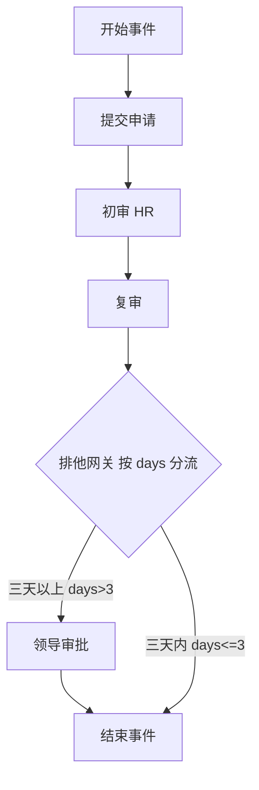

# 在 activiti-app 里把请假审批链画成流程模型：节点、候选组与网关条件

设计器装好了，登录进 Kickstart App，接下来是把口头约定的审批规则落成一张可部署的流程图：提交申请、初审、复审，三天以上加一道领导审批。画图本身只是拖拽，真正的功夫在属性：每个节点叫什么、谁来办理、网关按什么条件分流。画完导出的 BPMN 文件，就是后续部署进引擎的原料。

## 先给结论

- 流程建模在 Kickstart App 里完成，Create Process 填名称「请假」、模型 key 和描述即可新建一个模型。
- 节点属性至少填两样：唯一 ID 和名称；参与人用 Assignment 指定，可选单个用户、候选用户、候选组三种，本课全部用候选组。
- 候选组统一写成 `${PROCESS_LEAVE_APPLY_USERS}` 这类变量形式，四个审批节点分别对应 APPLY、CHU、FU、PI 四个组标识。
- 排他网关按流程变量 `days` 分流：`${days>3}` 走「三天以上」进领导审批，`${days<=3}` 走「三天内」直接结束。
- 保存后可以下载导出 `.bpmn20.xml`，图形和 XML 是同一份流程定义的两种形态。

## 一、新建模型与整体绘制

进入 Kickstart App，点击 Create Process，弹出创建对话框，填模型名称（如「请假」）、模型 key 和描述（如「测试请假流程」），确认后进入画布。

画布左侧是元素面板。开始节点和结束事件直接拖入；用户任务是那个小人图标，每拖一个就多一个审批环节。按请假规则把主干先连出来：



绘制时有个小技巧：先把所有节点和连线摆出来，让整条链路成形，再回头逐个补属性。一边连线一边填属性容易顾此失彼，返工次数明显更多。

## 二、节点属性：ID、名称与候选组

**第一，每个节点都要有 ID 和名称。** 选中节点后在属性面板里填，本课统一用大写 ID：提交申请是 `APPLY`，初审、复审、领导审批分别对应 `CHU`、`FU`、`PI`，开始和结束事件起名「开始」「结束」。名称给图形展示用，ID 才是引擎里的唯一标识，之后写代码要用它找节点。

**第二，参与人在 Assignment 里指定。** 点开任务的分配属性，有三种方式：

| 方式 | 含义 | 适用 |
|---|---|---|
| 单个用户 | 指定唯一办理人 | 责任明确到人的任务 |
| 候选用户 | 一组人里任意一人可认领 | 小范围协作 |
| 候选组 | 按用户组分配，组内都可办理 | 审批类任务，人员可能变动 |

本课四个审批节点全部用候选组，值统一用 `${大写组标识}` 的形式：提交申请填 `${PROCESS_LEAVE_APPLY_USERS}`，初审填 `${PROCESS_LEAVE_CHU_USERS}`，复审填 `${PROCESS_LEAVE_FU_USERS}`，领导审批填 `${PROCESS_LEAVE_PI_USERS}`。组名这样取是为了之后绑定业务数据，运行时按公司维度解析出真正的审批人，这里先立好占位标识。

**第三，图形画完别忘了保存。** 保存对话框里确认 Name、Key、Description 三项，保存后模型列表会出现带版本的记录。要拿去部署，再点下载，起名「请假」导出成 `.bpmn20.xml` 文件落到本地。

## 三、导出的 XML：图形的另一面

导出的文件里，图形变成了流程定义。资料包里的成品 `请假.bpmn20.xml` 与课堂绘制结果一致，核心的 process 段如下（去掉了图形坐标信息）：

```xml
<bpmn2:process id="process_leave" name="请假" isExecutable="true">
  <bpmn2:startEvent id="START" name="开始"></bpmn2:startEvent>
  <!-- 每个审批节点：id 唯一标识，candidateGroups 指定候选组 -->
  <bpmn2:userTask id="APPLY" name="提交申请" activiti:candidateGroups="PROCESS_LEAVE_APPLY_USERS"></bpmn2:userTask>
  <bpmn2:userTask id="CHU" name="初审" activiti:candidateGroups="PROCESS_LEAVE_CHU_USERS"></bpmn2:userTask>
  <bpmn2:userTask id="FU" name="复审" activiti:candidateGroups="PROCESS_LEAVE_FU_USERS"></bpmn2:userTask>
  <bpmn2:userTask id="PI" name="领导审批" activiti:candidateGroups="PROCESS_LEAVE_PI_USERS"></bpmn2:userTask>
  <bpmn2:endEvent id="END" name="结束"></bpmn2:endEvent>
  <!-- 普通连线：sourceRef 指起点，targetRef 指终点，原文为自动生成的长 id，此处缩写 -->
  <bpmn2:sequenceFlow id="flow-1" sourceRef="START" targetRef="APPLY"></bpmn2:sequenceFlow>
  <bpmn2:sequenceFlow id="flow-2" sourceRef="APPLY" targetRef="CHU"></bpmn2:sequenceFlow>
  <bpmn2:sequenceFlow id="flow-3" sourceRef="CHU" targetRef="FU"></bpmn2:sequenceFlow>
  <bpmn2:sequenceFlow id="flow-4" sourceRef="FU" targetRef="GATEWAY"></bpmn2:sequenceFlow>
  <bpmn2:sequenceFlow id="flow-5" sourceRef="PI" targetRef="END"></bpmn2:sequenceFlow>
  <!-- 排他网关：分支名与分流条件 -->
  <bpmn2:exclusiveGateway id="GATEWAY"></bpmn2:exclusiveGateway>
  <bpmn2:sequenceFlow id="flow-6" name="三天内" sourceRef="GATEWAY" targetRef="END">
    <bpmn2:conditionExpression xsi:type="tFormalExpression"><![CDATA[${days<=3}]]></bpmn2:conditionExpression>
  </bpmn2:sequenceFlow>
  <bpmn2:sequenceFlow id="flow-7" name="三天以上" sourceRef="GATEWAY" targetRef="PI">
    <bpmn2:conditionExpression xsi:type="tFormalExpression"><![CDATA[${days>3}]]></bpmn2:conditionExpression>
  </bpmn2:sequenceFlow>
</bpmn2:process>
```

对照属性面板能发现一个对应关系：画布上填的 `${PROCESS_LEAVE_APPLY_USERS}` 落到 XML 里是 `activiti:candidateGroups="PROCESS_LEAVE_APPLY_USERS"`。带 `${}` 的写法是 UEL 表达式，引擎在运行时求值；不带 `${}` 直接写字面量则代表固定的组标识。两种写法引擎都能处理，设计器导出的这份文件用的是字面量组标识，含义不变。原文里连线与网关的 id 是工具自动生成的长串字符，上面代码做了缩写，属性值全部原样保留。

网关条件同理：每条出线一个 `conditionExpression`，变量名 `days` 来自启动流程时传入的流程变量。引擎走到排他网关，会依次求值各条出线的条件，命中哪条走哪条。

## 四、从规则到模型的对应关系

回头看，讲义里那条审批规则已经一字不差地进了模型：HR 专员初审对应 `CHU` 节点，部门负责人复审对应 `FU` 节点，三天以内（含三天）部门负责人有最终决定权对应 `${days<=3}` 直达结束，超过三天交更高层领导对应 `${days>3}` 进 `PI` 节点。候选组占位解决了「专员可能不止一位、任一位可处理」的问题，组内任何人认领都能办理同一张单。

**第一，ID 是贯穿后续开发的锚点。** 发起流程时指定流程定义 key（`process_leave`），传递变量 `days`；查询待办时按候选组过滤；这些操作引用的都是模型里的 ID 和组标识。

**第二，条件变量是业务与流程的接口。** 请假天数由业务表单带来，作为流程变量塞给引擎，网关据此分流。变量名要和条件表达式里写的一字不差，少传或名字对不上，引擎在网关处就断链了。

## 常见误区

- **排他网关只画分支不填条件**：两条出线都没有 `conditionExpression` 时引擎无法决策，运行到网关直接抛异常。每条出线都必须给条件，且所有条件组合要能覆盖实际取值。
- **候选组把具体人名写死**：填了某个员工的账号，人事一变就得改模型重新部署。应该用组标识占位，运行时再按业务规则解析成员。
- **变量名与条件表达式对不上**：表达式写 `${days>3}`，启动时传的变量却叫 `day`，网关求值失败。变量命名要在前后端与流程定义之间约定清楚。
- **改完不保存就关页面**：画布内容只在前端内存里，保存才有模型记录，下载才有文件；部署用的是下载出来的 XML，不是画布截图。

## 面试可能被问到的问题

1. 面试官追问：「assignee 和 candidateGroups 有什么区别？」
   答：assignee 把任务直接指派给某个具体用户，任务列表里只有这个人能看到；candidateGroups 是候选组语义，组内所有用户都能看到该任务并认领，认领后任务归属认领人。审批人可能变动的场景用候选组更稳。

2. 面试官追问：「排他网关的条件表达式是什么语法？」
   答：UEL 表达式，形如 `${days>3}`，大括号里可以对流程变量做比较和逻辑运算。引擎走到网关时逐条出线求值，取第一条命中的分支，所以条件的书写顺序和完备性都要设计。

3. 面试官追问：「流程变量是怎么进到引擎的？」
   答：启动流程实例或办理任务时以 Map 形式传入，引擎把它存进运行时变量表并持久化。网关条件、任务分配表达式都能引用这些变量，它是业务数据影响流程走向的唯一正规通道。

4. 面试官追问：「BPMN 文件里的 userTask 节点，引擎运行时会记录哪些参与人信息？」
   答：任务被创建时会按 assignee 或候选用户、候选组生成身份关联记录，候选语义存的是组或用户标识，用户认领后再落到具体办理人。查询待办就是按这些关联记录过滤。

5. 面试官追问：「为什么导出的 XML 里 candidateGroups 没带 `${}`，页面填的时候却带了？」
   答：两者都是合法写法。带 `${}` 是运行时求值的表达式，不带是字面量组标识。设计器输入框习惯用表达式形式，导出文件视输入内容而定；只要引擎解析后得到的组标识一致，运行行为就一致。

## 配套资料

- 流程成品文件：`materials/code/02/day16 薪资管理与工作流概述/day16/03-资料/所有的流程bpmn文件/请假.bpmn20.xml`（文中 XML 片段节选自该文件，图形坐标已省略，自动生成的连线 id 做了缩写）。
- 同目录 `加班.bpmn20.xml`、`离职.bpmn20.xml` 为另外两条审批链的同源成品，可对照阅读节点与网关写法。
